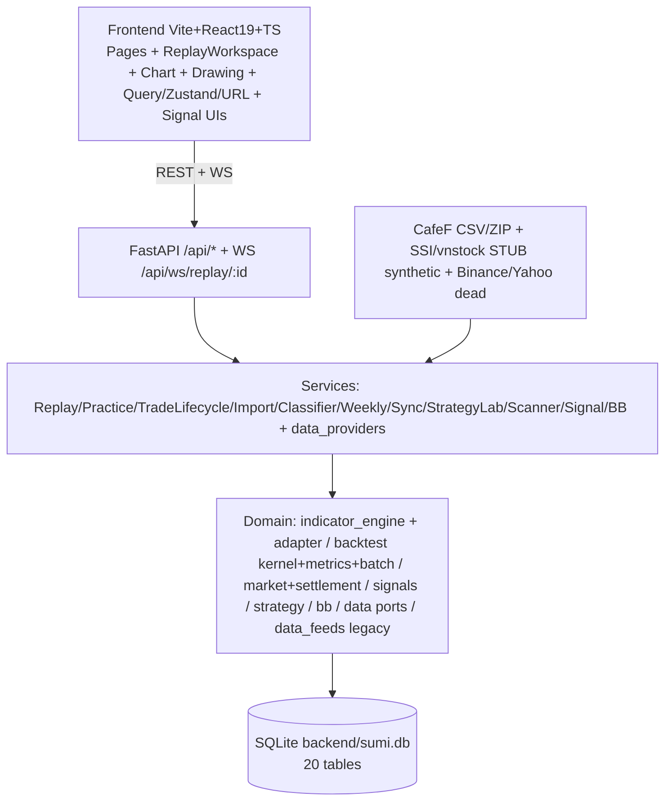
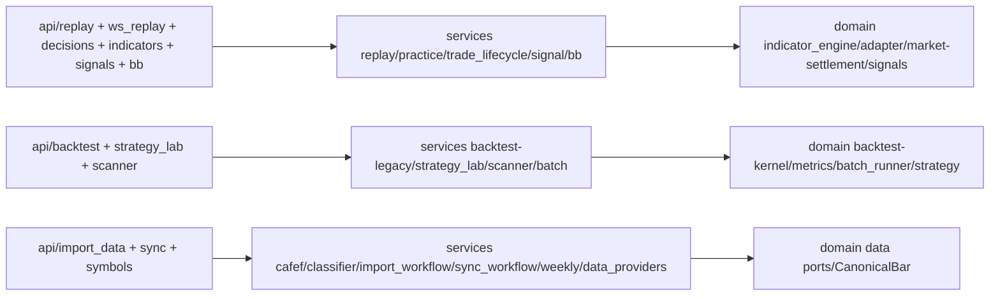
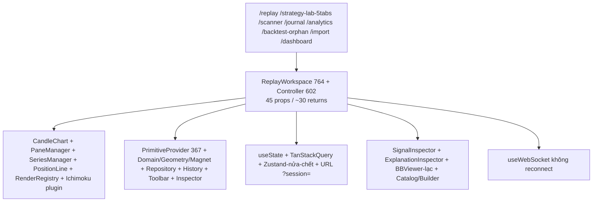
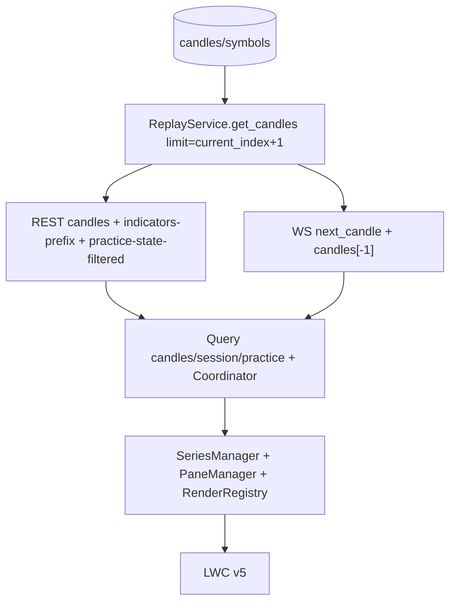
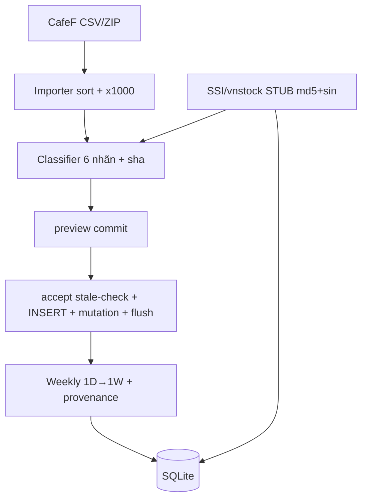
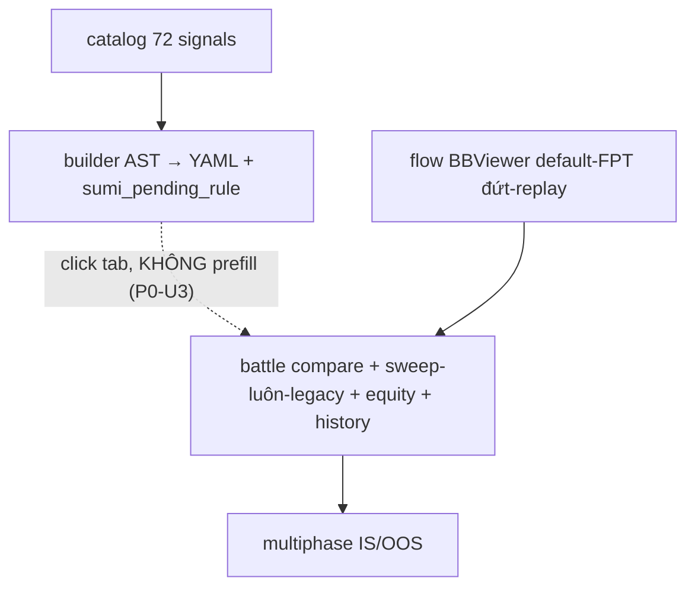
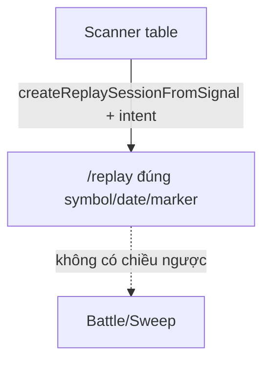

# CURRENT STATE ARCHITECTURE REVIEW — Sumi V3

**Ngày:** 2026-10-09 | **Session:** planning/architecture (model reasoning cao)
**Nguyên tắc:** chỉ đọc + temp DB + static analysis. Không sửa production code, không migration prod, không seed `backend/sumi.db`.
**Đầu vào đã đọc:** `AGENTS.md`, `PLANS.md`, `PRODUCT_ACCEPTANCE_CRITERIA_V3.md`, `ADR-001`, `ADR-002`, `V3_FINAL_HANDOFF_REPORT_2026-09-12.md`, `DEEP_ARCHITECTURAL_AUDIT_REPORT.md` + verify lại 5 trụ cột trên code hiện tại (2026-10-09).
**Kết quả verify tổng:** ~95% findings audit cũ ở trạng thái **CONFIRMED**; 2 partially fixed (guard migration, signalsApi hội tụ); 2 changed giảm nhẹ (journal JSON khớp live, replay gắn `is_projected` nhưng vẫn trả); 0 finding P0 nào đã FIXED. Cộng ~15 NEW findings.

---

## 4.1 Executive summary

### Sumi hiện tại là hệ thống gì?

Local-first manual replay + backtesting cho chứng khoán VN (HOSE/HNX/UPCOM, dữ liệu CafeF EOD), backend FastAPI + SQLAlchemy + SQLite file (`backend/sumi.db`, 20 tables, head `a2d639ecd5d5`, 2366 candles / 1183 symbols / 4 import_runs / 0 sync_runs / 0 replay_sessions live), frontend Vite + React 19 + TS + TanStack Query + Zustand (nửa chết) + Lightweight Charts v5 + custom `ISeriesPrimitive` drawing. Routes thực tế (`App.tsx:54-61`): `/`, `/import`, `/replay`, `/backtest` (orphan), `/strategy-lab` (5 tabs: battle/multiphase/catalog/builder/flow), `/scanner`, `/journal`, `/analytics`.

### Trưởng thành tới đâu?

- **Trưởng thành (giữ):** ingestion preview→accept có checksum + stale-revalidate + mutations + provenance + weekly-derive-locally; replay slice `current_index+1` đúng ở core REST/WS/MTF; `IndicatorEngine` backend-duy-nhất (pandas-ta) + registry 16 fail-closed; Scanner→Replay intent tốt; Sidebar 2 nhóm đúng; Indicator add/edit/validate + drawing Fib/magnet/clear đạt ADR-001 phần lớn.
- **Chưa production-safe:** transaction/rollback + FK + DB path; dual execution timing; raw ledger + projected leak; stub synthetic ghi thật; WS không reconnect + cache sai TF; legacy drawing/feed chết dễ dùng nhầm; contract drift 11+4 mismatches; UX P0 tưởng-bug (T+2, SL/TP, Rule→Battle, Undo, /backtest mồ côi).

### Capability nào ổn / chưa safe?

| Capability | Đánh giá |
|---|---|
| Import CafeF preview/accept/rollback/weekly | Ổn về thiết kế, chưa safe về transaction (P0-D2) + CWD path (P0-D1) |
| Replay cursor core | Ổn ở core, chưa safe ở rìa (raw ledger, projected, forward meta) |
| Indicator backend | Ổn (authoritative), chưa safe ở projected + duplicate route + mapping câm |
| Backtest kernel | Đúng hướng (next-open, calendar, in-memory), chưa safe vì song song legacy + metrics vênh |
| Strategy Lab sweep/batch | Chạy được, chưa safe (sweep luôn legacy → lệch batch) |
| Scanner→Replay | Ổn một chiều, thiếu chiều ngược |
| Sync provider | **Không safe — stub sinh nến giả ghi thật (P0-S1), sync_runs=0 live** |
| WS playback | Chạy demo, chưa safe (không reconnect/heartbeat/validate) |
| Chart/drawing | Vẽ được 7 tools custom, chưa safe (god component, legacy song song, undo tàng hình) |
| Contracts | Chạy demo, chưa safe (11 mismatches + 422 array + BB envelope) |
| UX practice 30-phút | Dễ gặp tưởng-bug P0 |

### 5 rủi ro lớn nhất

1. **Data corruption (P0-D1/D2/D3/S1):** URL tương đối tái sinh file ma + không rollback + FK không enforce + stub nến giả lẫn prod. Một lỗi giữa `flush→commit` để lại transaction mở; một lần chạy alembic từ root tạo DB rỗng; một lần execute sync stub nhiễm toàn bộ weekly.
2. **Financial incorrectness (P0-E2 + P1 metrics):** hai timing (same-close vs next-open vs intraday-same trong kernel) + slippage/T+2/PnL/winner/PF/sample/Sharpe vênh. Sweep vs Batch cùng strategy ra PnL khác nhau mà không có lý do domain.
3. **Lookahead rìa (P0-E1 + projected + forward meta):** raw decisions/orders/trades `.all()` vượt cursor; `union+reindex` trả rows tương lai có gắn flag nhưng FE không filter; `total_bars/earliest_release_date` lộ forward calendar.
4. **Determinism + state divergence (P0-F1/W1/F4):** WS prefix-cache sai TF + index lạc quan + nav không guard + không reconnect + session switch không dọn cache → cursor/UI/REST/practice/candles/signals/indicators có thể lệch nhau, đặc biệt khi step nhanh hoặc backend restart.
5. **Contract drift + UX-blocking (M1..M11 + U1..U5):** 15 mismatches Pydantic↔TS (BANKRUPT, CUSTOM_PRICE, D/split, BB envelope, required/optional đảo, signal max2...) + 422 array thành `[object Object]` + T+2/SL/Rule→Battle/Undo/backtest-orphan khiến user mất dữ liệu hoặc kẹt trade mà tưởng bug.

### Blocker thêm feature mới?

**CÓ — không nên thêm feature mới trước Phase 0–1.** Lý do: bất kỳ feature nào chạm execution, replay, sync, WS, contracts đều có thể khuếch đại 5 rủi ro trên (ví dụ thêm indicator non-causal sẽ nhiễm lookahead qua batch cache; thêm provider mới sẽ đi qua cùng write-path không rollback; thêm tab Lab mới sẽ nhân đôi divergence). Khóa Phase 0 (safety) + Phase 1 (replay integrity) + canonical execution trước, sau đó mới thêm tính năng.

---

## 4.2 Architecture map

### System context

### Backend component map

### Frontend component/state map

### Replay dataflow

### Backtest execution flow (hai path — cần thống nhất, xem §3.3 Target)

```mermaid
flowchart TD
    subgraph LEG["Legacy DB-backed same-close"]
        L1["Signal[T] snapshot i/i-1"] --> L2["Decision MARKET_AT_CLOSE close[T]"] --> L3["Fill cùng bar close[T]"] --> L4["Position/Trade DB"] --> L5["T+2 bar-count"] --> L6["Analytics breakeven=LOSER gate30 PF-None"]
    end
    subgraph KER["Kernel in-memory next-open"]
        K1["Signal[T]"] --> K2["Order QUEUED MARKET_NEXT_OPEN"] --> K3["Fill Open[T+1] trừ SLTP-intraday-cùng-bar"] --> K4["Lots + calendar settlement"] --> K5["Trade net"] --> K6["Metrics breakeven=WINNER PF-inf không-gate không-Sharpe"]
    end
```

### Import/sync flow

### Strategy Lab flow

### Scanner → Replay flow

---

## 4.3 Source of truth matrix

| Concern | Current authority | Duplicate authority | Risk | Target authority |
|---|---|---|---|---|
| Candle | SQLite `candles` + UQ | WS cache `'D'/'split'` bẩn; `data_feeds` DF | Cao — dedupe sai | SQLite là duy nhất; FE cache key đủ TF, validate canonical `1D/1W`, `unadjusted/adjusted` |
| Indicator values | Backend `IndicatorEngine` (pandas-ta duy nhất) | Không (FE chỉ map) — tốt | Thấp ở giá trị, cao ở projected | Backend duy nhất; FE chỉ render `MappingResult`; server drop projected |
| Replay cursor | Backend `replay_sessions.current_index` | FE `current_index+1` lạc quan + WS msg | Cao — divergence | Backend duy nhất; FE mirror từ server, không tự tăng |
| Playback | BE `playback_loop` task | FE `isPlaying` vẫn true khi mất kết nối | Cao — dead playback | BE là máy trạng thái, FE là remote + echo `playback_state`; reconnect khôi phục |
| Trade/Position | DB Decision/Order/Execution/Trade/Position | `practice-state` filtered vs raw `.all()` leak | Cao — lookahead | `practice-state` filtered là read API duy nhất trong replay; raw deprecate/filter |
| Settlement | Hai truth: calendar `settlement.py` vs bar-count ×3 | `BrokerSimulation` thứ ba | Cao — bán sáng T+2 khác nhau | `SettlementEngine` calendar duy nhất; `MarketProfile` một bộ tham số |
| PnL | Ba truth: position gross vs trade net vs kernel net | `accounting.py` đúng nhưng không dùng mọi nơi | Cao — panel vs list lệch bằng phí | Net everywhere (`accounting.calculate_net_pnl`); gross chỉ là dòng phụ thích |
| Backtest execution | Hai engine: legacy same-close vs kernel next-open (+intraday-same nội kernel) | Sweep luôn legacy, batch kernel | Rất cao — cùng strategy khác PnL | Một kernel next-open (quyết định ADR-EXEC-001); legacy xóa sau parity |
| Signal | Backend prefix to cursor + registry | Hai client FE (hard-code 1 vs bundle 4 không version) | Trung bình | Một `signalsClient.calculate` + pin version mọi nơi |
| Drawing | Mới 7-kind primitive + repo | Legacy 4-kind adapter/persistence song song | Cao — mất vẽ nếu dùng nhầm | Mới 7-kind duy nhất; xóa 3 file legacy |
| Session | URL `?session=` thắng + store + validation | Zustand `sessionId` + double-clear | Trung bình — chớp cũ | URL là authority session; xóa Zustand (hoặc thu còn sessionId rồi xóa) |
| Timeframe | `targetTimeframe` local + query key có TF | WS prefix không TF | Cao — trộn D/1W | Timeframe luôn trong query key; WS merge theo key đủ |
| Market assumptions | Sweep footer duy nhất | Battle/Backtest/Trade dialog mỗi nơi một kiểu; `T+2` vs `T+2.5/T+2` wording | Trung bình — so PnL lệch không biết vì sao | Một `MarketProfile` + một dòng assumptions mọi nơi |

---

## 4.4 Architecture scorecard (1–5)

| Area | Score | Evidence |
|---|---|---|
| Data integrity | 2 | Preview/checksum/provenance tốt, nhưng P0-D1/D2/D3/S1 + NEW-DB-02/03: CWD ma, không rollback, FK không enforce, stub ghi thật, preview commit ngay cả khi thiếu confirm |
| Domain consistency | 2 | Kernel/accounting/settlement đúng hướng nhưng 2 timing + 3 slippage + 2 T+2 + gross/net + winner/PF/sample/Sharpe vênh + NEW-EXEC-01/02 |
| Replay integrity | 3 | Core slice đúng REST/WS/MTF + guards tốt, thủng ở raw ledger + projected + forward meta |
| Backtest correctness | 2 | Kernel next-open + cutoff + calendar đúng tài chính hơn, nhưng sweep luôn legacy → parity vỡ; sizing basis mismatch |
| API contracts | 2 | Sync map codes chuẩn + khóa legacy đúng, nhưng 15 mismatches + BB envelope + 422 array + catalog đôi + dead importCafef |
| Frontend state | 2 | Session URL canonicalize + coordinator đúng, nhưng 4 nguồn sự thật + prefix-cache + nav race + switch chớp cũ + QueryClient trần |
| WebSocket reliability | 1 | URL khớp + task riêng + identity-disconnect đúng, nhưng không reconnect/backoff/heartbeat/validate/frame-error; speed restart mất tick; send fire-and-forget |
| Chart architecture | 2 | Stage-commit-rollback + pane materialize + refs đúng, nhưng không facade (2 createChart, calls rải rác) + `any/never` + catch nuốt + snapshot DOM |
| Drawing subsystem | 3 | Custom primitive 100% (không vendor lock) + domain/validate/geometry/magnet/repo/history đúng, nhưng provider 367 dòng gánh tất + project duplicate + legacy song song + undo tàng hình + key sprawl |
| Testability | 3 | Pytest + Vitest + Playwright UAT 31 scenarios + hash invariant theo handoff; thiếu contract snapshot, WS chaos, golden financial, parity sweep-batch, legacy-loss regression |
| Maintainability | 2 | Services/domain tách tốt ở batch path nhưng fat routes (replay/bb) + legacy ôm DB/loop + dead broker/strategy + dead feeds + god 1366 dòng |
| UX consistency | 2 | Sidebar nhóm đúng + Scanner→Replay tốt + Indicator/Drawing đạt phần lớn, nhưng 5 P0-U + 7 P1-U + 3 NEW-UX (T+2, SL/SHORT, Rule→Battle, Undo, orphan, warming, signal dồn, reorder, mobile, assumptions, journal naming, wording) |
| Observability | 2 | Toast đúng string nghiệp vụ + Indicator errorKind tốt, nhưng 422 array `[object Object]`, không toast phân loại/offline, single ErrorBoundary, log prod rời rạc, `detail=str(e)` |
| Deployment safety | 2 | Local-first + temp-DB tests + launchers 1-click theo handoff, nhưng DB path CWD-dependent, seed ghi prod, stub không cờ, migration 1 revision không guard, min-width không enforce |

**Điểm trung bình ~2.1/5 — chưa production-safe cho tuyên bố "professional"; G-04 chưa đạt; cấm "TradingView-like".**
