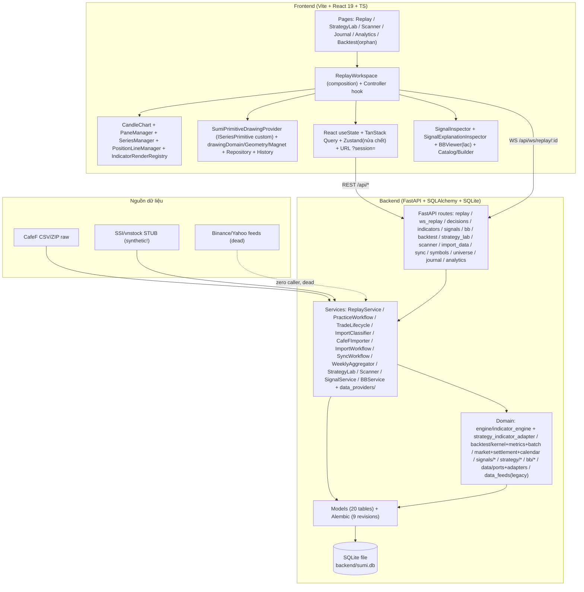
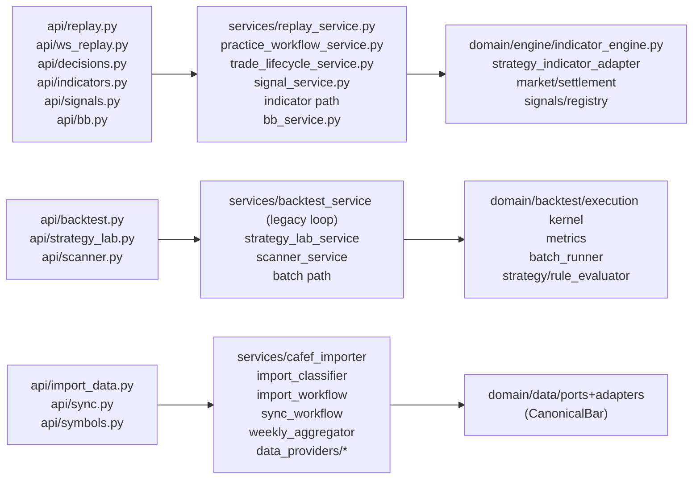
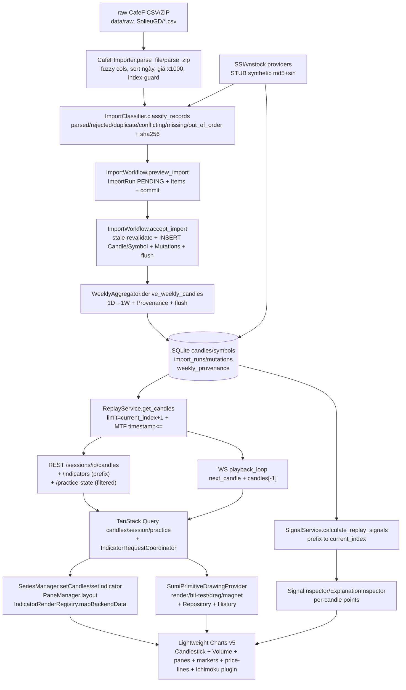

# DEEP ARCHITECTURAL AUDIT REPORT — Dự án Sumi V3

**Ngày lập:** 2026-10-09
**Phạm vi:** Read-only audit, không sửa `backend/` và `frontend/`, không ghi `backend/sumi.db`
**Chuẩn đối chiếu:** `AGENTS.md`, `docs/ARCHITECTURE_DECISION_001_REPLAY_UI_REBUILD.md`, `docs/ARCHITECTURE_DECISION_002_MARKET_DATA_PROVIDER.md`, `docs/PRODUCT_ACCEPTANCE_CRITERIA_V3.md`, `docs/V3_FINAL_HANDOFF_REPORT_2026-09-12.md`
**Output:** `docs/architecture/DEEP_ARCHITECTURAL_AUDIT_REPORT.md` (file này)
**Phương pháp:** 5 agents song song đọc code (models, alembic, services, domain engines, api, schemas, frontend src, hooks, pages), đối chiếu live `sqlite_master` bằng SELECT chỉ-đọc, không migration, không seed.

> Kết luận 1 dòng: Backend domain/ingestion/replay-core thiết kế tốt trên giấy và đúng ở đường chính; rủi ro tập trung ở **transaction/rollback + FK pragma + DB URL tương đối**, **dual execution timing**, **raw ledger leak + projected-indicator leak**, **stub provider ghi nến giả**, **WS không reconnect + cache sai timeframe**, **legacy drawing/legacy feed chết nhưng dễ dùng nhầm**, và **UX P0 khiến user tưởng bug** (T+2, SL/TP, Rule→Battle, Undo, /backtest mồ côi). G-04 chưa đạt nếu tính đủ P0/P1 dưới đây. Cụm "TradingView-like" tiếp tục cấm.

---

## 1. Sơ đồ kiến trúc tổng thể (Mermaid)

### 1.1. Container / phân tầng hệ thống



### 1.2. Component backend (API → Service → Domain)



### 1.3. Dataflow: CafeF CSV → SQLite → Engine → WS/REST → Frontend → Charts



---

## 2. Trụ cột 1: Dữ liệu & Lưu trữ (Data & Persistence)

### 2.1. Inventory tables / FK / indexes (20 tables + alembic_version)

| # | Model | Table | FK | Index / Constraint |
|---|---|---|---|---|
| 1 | `backend/app/models/symbol.py:4-7` | `symbols` | — | `symbol index=True` + live `ix_symbols_symbol` |
| 2 | `backend/app/models/candle.py:4-62` | `candles` | — | `symbol`, `timestamp` index; `UniqueConstraint(symbol,timeframe,timestamp,adjustment_type)` + live `ix_candles_*`, `sqlite_autoindex_candles_1` |
| 3 | `backend/app/models/replay_session.py:5-6` | `replay_sessions` | parent 7 tables | Không index tường minh |
| 4 | `backend/app/models/decision.py:5-9` | `decisions` | `session_id→replay_sessions.id` NOT NULL, **không index/ondelete** | Không |
| 5 | `backend/app/models/order.py:5-10` | `orders` | `session_id`, `decision_id→decisions.id` NOT NULL, không index/ondelete | Không |
| 6 | `backend/app/models/execution.py:5-11` | `executions` | `order_id→orders.id`, `trade_id→trades.id` NULL, `session_id` NOT NULL, không index/ondelete | `execution_candle_index` (từ `a2d639ecd5d5`) không index |
| 7 | `backend/app/models/position.py:4-8` | `positions` | `session_id` NOT NULL, không index | Không |
| 8 | `backend/app/models/trade.py:5-9` | `trades` | `session_id` NOT NULL, không index | Không |
| 9 | `backend/app/models/journal_entry.py:5-11` | `journal_entries` | `session_id` NOT NULL; `decision_id`, `trade_id` NULL; không index | `checklist_snapshot JSON` vs migration `String` (drift, xem P1) |
| 10 | `backend/app/models/event_log.py:5-9` | `event_logs` | `session_id` NULL, không index | Không |
| 11 | `backend/app/models/drawing.py:5-10` | `drawing_states` | `session_id→replay_sessions.id ondelete=CASCADE index=True` — **duy nhất có ondelete** | `session_id`, `symbol`, `id`; live `ix_drawing_states_*` ×3 |
| 12 | `backend/app/models/strategy_lab_run.py:7-8` | `strategy_lab_runs` | — | Không |
| 13 | `backend/app/models/scanner_run.py:7-8` | `scanner_runs` | — | Không |
| 14 | `backend/app/models/import_run.py:6-41` | `import_runs` + `import_run_items` | `ImportRun.id:String(36) UUID` parent; `items.run_id NOT NULL index=True` | `run_id`, `symbol`; **thiếu composite `(symbol,timeframe,timestamp)`** dù preview/accept query theo đó |
| 15 | `backend/app/models/import_run.py:54-58` | `import_run_mutations` | `run_id NOT NULL index=True` | Live `ix_import_run_mutations_run_id`; **thiếu composite** dù rollback query 4 cột (`import_workflow_service.py:437-445`) |
| 16 | `backend/app/models/import_run.py:76-89` | `weekly_candle_provenance` | logic link theo `symbol` | `symbol index=True`; `UniqueConstraint(symbol,adjustment_type,week_start_date)` |
| 17 | `backend/app/models/sync_run.py:6-44` | `sync_runs` + `sync_run_items` | `SyncRun.id UUID`; `items.sync_id NOT NULL index=True` | `ix_sync_runs_symbol`, `ix_sync_run_items_*` |
| 18 | `backend/app/models/sync_run.py:57-61` | `sync_run_mutations` | `sync_id NOT NULL index=True` | Live `ix_sync_run_mutations_sync_id` |

Live DB `backend/sumi.db` (1.499.136 B, `alembic_version=a2d639ecd5d5`, `candles=2366 / symbols=1183 / import_runs=4`): `.tables` = 20 + `alembic_version`, khớp `models/__init__.py:1-39`. DDL live xác nhận FK đúng như models.

Chuỗi migrations tuyến tính 9 revisions, không branch:
`cdf80254e9dc (initial, down=None) → 20260629_0001 (strategy_lab_runs) → 20260629_0002 (replay_session.source) → 20260629_0003 (scanner_runs) → 20260629_0004 (executions.trade_id, guard _has_column) → 20260810_0001 (import_*+provenance, guard _has_table) → 20260816_0001 (planning cols, guard) → 20260816_0002 (sync_*, guard) → a2d639ecd5d5 (execution_candle_index, KHÔNG guard) = HEAD live`.

### 2.2. Câu hỏi database: có bao nhiêu DB? Hiện tượng 2 DB? Đường dẫn inject ở đâu?

**Trả lời ngắn: 1 database logic (SQLite file) + N test DB ephemeral. Không có Postgres/TimescaleDB thật — chỉ còn comment di sản.**

| DB | Path | Trạng thái | Nguồn tạo |
|---|---|---|---|
| Prod/dev duy nhất | `backend/sumi.db` | 1.4 MB, 20 tables, head `a2d639ecd5d5` | `DATABASE_URL=sqlite:///./sumi.db` resolve **tương đối theo CWD**. Chạy từ `backend/` → đúng file này |
| File ma 0-byte | `sumi.db` ở repo root | 0 B (Sep 1) | Cùng URL tương đối nhưng CWD = repo root. Ai chạy `uvicorn/alembic/pytest` từ root sẽ tạo file rỗng này. Đây chính là "hiện tượng 2 DB": **không phải 2 shard, mà là 1 URL tương đối + 2 CWD** |
| Temp test DB | `sqlite:///:memory:` + `StaticPool` | Ephemeral per-test | `backend/app/tests/conftest.py:13-18`, `test_api_integration.py:16-18`, `test_scanner_replay_integrity.py:22-24`, `test_readiness.py:17-19`, `test_indicator_parity_e2e.py`, `test_ichimoku_signals.py:293-295`, `tests/test_t2_settlement.py:37`. Mỗi fixture `drop_all/create_all` |

Wiring:

| Lớp | File:line | Cơ chế |
|---|---|---|
| Khai báo | `backend/app/config.py:10` | `DATABASE_URL="sqlite:///./sumi.db"`, `AUTO_CREATE_TABLES=False`. Không `.env` trong repo; `BaseSettings` cho phép override env nhưng không doc/script nào export |
| Engine/Session | `backend/app/db.py:1-8` | `create_engine(DATABASE_URL)` (không `connect_args/poolclass`), `SessionLocal`, `Base` |
| Request DI | `backend/app/dependencies.py:1-10` | `get_db()` yield + `finally: close` — **không rollback** |
| Startup | `backend/app/main.py:13-14` | `if AUTO_CREATE_TABLES: create_all`. Mặc định False → schema chỉ từ Alembic |
| Alembic | `backend/alembic/env.py:54` + `alembic.ini:701` | Override `sqlalchemy.url=settings.DATABASE_URL`; `.ini` giữ placeholder nhưng bị ghi đè runtime; `pool.NullPool` |
| Tests | `conftest.py:13-51` + các test `:memory:` | Engine riêng + `dependency_overrides[get_db]` — không chạm `sumi.db` |
| Scripts | `backend/seed_cafef.py:3-10`, `scripts/import_batch.py`, `scripts/batch5_recovery_verify.py:13,49-50` | Dùng thẳng `SessionLocal`/prod → **ghi thẳng prod nếu `--confirm`** |

### 2.3. Ingestion pipeline

```
raw CafeF CSV/ZIP → CafeFImporter.parse_file/parse_zip (chuẩn hoá cột, sort ngày, giá×1000, index-guard)
→ ImportClassifier.classify_records (parsed/rejected/duplicate/conflicting/missing/out_of_order + checksum)
→ preview_import (ImportRun PENDING + Items, commit)
→ accept_import (stale-revalidate → INSERT Candle+Symbol+Mutations → WeeklyAggregator → commit)
→ WeeklyAggregator.derive_weekly_candles (1D→1W + Provenance)
→ rollback_import (mutations + guard run-mới-hơn + re-derive 1W)
Luồng song song: SyncWorkflow (SSI/vnstock → cùng Classifier + Weekly + manifest SUMI_SYNC_MANIFEST_V1)
Entry: seed_cafef.py, scripts/import_batch.py, api/import_data.py + sync.py
```

- `backend/app/services/cafef_importer.py`: `PRICE_SCALE_FACTOR=1000.0 (:15)`; `KNOWN_INDEX_SYMBOLS (:17-24)` + `is_index_symbol (:27-33)`; `parse_file (:36-95)`: `pd.read_csv` fallback `on_bad_lines='skip'` (drop lặng lẽ), fuzzy col_map (:42-60), timestamp `%Y%m%d` fallback `to_datetime` (:65-72), sort `(symbol,__sort_dt__)` (:74-80, fix DF-01), giá equity `×1000.round(4)`, index giữ nguyên (:84-93, fix FIN-01); `parse_zip (:98-116)`; `_detect_exchange_from_filename (:119-129)` **dead**; `preview/accept/import_data (:132-233)` fail-closed 2 bước.
- `backend/app/services/import_classifier.py`: allowlist metadata (:64-78); `compute_sha256/semantic_checksum (:81-93)` chống TOCTOU; `classify_records (:96-321)`: thiếu cột → block; symbol format; timestamp multi-format; weekend `weekday>=5 → rejected` nhưng **không block** (:313-318, đúng cho ngày nghỉ); OHLCV bounds `L>H, O/C∉[L,H], ≤0, NaN/Inf`; out_of_order trên thứ tự sau sort; duplicate/conflict bằng tuple float tuyệt đối; missing gaps Mon-Fri; gate `conflicting/out_of_order → block`, còn lại `can_accept` kể cả rejected/missing/duplicate.
- `backend/app/services/import_workflow_service.py`: `preview_import (:24-237)` commit trực tiếp (:53,:101,:214), `ImportRunItem` với naive datetime (:188); `accept_import (:240-387)` idempotent noop, guard can_accept/checksum, noop full-duplicate, **stale-revalidate** (:290-329), upsert Symbol + Mutation INSERT + Candle(source=run_id), `flush → WeeklyAggregator → commit`; `rollback_import (:390-477)` guard symbol-level run-mới-hơn, `INSERT→delete` (nhánh UPDATE chết vì accept chỉ sinh INSERT), re-derive; `get_catalog (:480-546)` GROUP BY + `provenance_state=import_run|local_legacy`.
- `backend/app/services/weekly_aggregator.py:13-183`: `RULE_VERSION=VN_TRADING_WEEK_V1`; load full 1D per (symbol,adj), rỗng → xóa 1W+provenance; group Monday, bỏ weekend; `O=first.open,H=max,L=min,C=last.close,V=sum`; `member_keys + source_runs`; xóa lạc tuần; upsert 1W `source=VN_TRADING_WEEK_V1` + Provenance; chỉ `flush`, caller commit.
- Entry scripts: `seed_cafef.py:8-58` (`create_all` bypass Alembic, hardcode Windows path, nuốt lỗi, close không finally); `scripts/import_batch.py:19-80` (có rollback, tốt hơn); legacy `data_service.py:19-76` (`on_conflict_do_nothing` + 2 commits, **bypass preview/classify/provenance/weekly**).

Đánh giá: chuẩn hoá giá đúng nhưng phát hiện index bằng string-match nên mã lạ/index mới dễ ×1000 sai; đảo ngày đã fix bằng sort; nến dị biệt rejected-không-block là cân bằng hợp lý; idempotency tốt (sha256 + uq_candle + noop + stale-revalidate); provenance tốt (source + mutations + provenance + manifest).

### 2.4. Migration safety / Transaction / Audit trail

Tốt: chuỗi tuyến tính head khớp prod; migration mới có guard; offline+online cùng URL; stale-revalidate + idempotent noop; rollback guard; audit mutations + sha + manifest + provenance.

Yếu (xem P0/P1 §8): `alembic/env.py:31-40` thiếu 8 models → autogenerate mù; 2 migration không guard; `Base.create_all` song song Alembic; `preview/accept/execute/rollback` commit/flush trần không `try/rollback`; `WeeklyAggregator` chỉ flush; `get_db` không rollback-on-error; prod engine không `PRAGMA foreign_keys=ON` (FK vô hiệu runtime); `DataFeedService` 2 commits bypass safety net; trộn naive/aware datetime; float-compare tuyệt đối; `rejected`-không-block + `on_bad_lines='skip'` fail-open lặng lẽ.

---

## 3. Trụ cột 2: Engine nghiệp vụ backend (Core Engines & Invariants)

### 3.1. Replay Engine & Zero-Lookahead: ĐÚNG ở core, leak ở rìa

Đúng:
- `services/replay_service.py:164-177` `get_candles()`: `limit=current_index+1`; MTF branch `timestamp<=current_timestamp (:179-193)`. REST `GET /sessions/{id}/candles (api/replay.py:30-32)` slice đúng. Không leak OHLCV tương lai.
- `services/signal_service.py:70` dùng `get_candles` + `observed_current_index`, enforce monotonic timestamps (:80-95), cache key gồm index (:128).
- `api/replay.py:93-100` session-indicators dùng `get_candles` (visible only), có docstring cảnh báo không dùng `api/indicators.py` cho replay. Đối chứng `api/indicators.py:29-32` WARNING leak future, fetch `limit` không slice cursor — endpoint này chỉ cho full-history view, frontend chuẩn không gọi từ replay (`indicatorsApi.getSessionIndicatorData` → `/replay/sessions/{id}/indicators`).
- WS `api/ws_replay.py:66-108` gọi `next_candle` rồi `get_candles` lấy `candles[-1]`, gửi latest + `source_context`. REST vs WS nhất quán.
- Guards tốt: `assert_writable_tip (practice_workflow_service.py:68-75)` 409 nếu write vượt cursor; snapshot `historical/can_trade/trade_block_reason (:298-319)`; scanner reveal gate `revealed=current_index>=reveal_at_index (replay_service.py:60-72)`.

Khiếm khuyết (P0/P1/P2, chi tiết §8):
- **P1:** `IndicatorEngine._append_indicator_result (:340-349)` `union+reindex` mở rộng index tương lai (Ichimoku Senkou +26, offset>0). `api/replay.py:120-145` gắn `is_projected=True` nhưng **vẫn append vào response**. Frontend grep `is_projected|isProjected` = 0 hit → chart có thể vẽ điểm tương lai. Fix: cắt `<=max_visible_ts` server-side.
- **P0:** Raw ledger `api/decisions.py:40-41,65,69` (`get_decisions/orders/trades`) query full session không filter `candle_index<=current_index`, trong khi `PracticeWorkflowService.get_snapshot (:101-104)` filter đúng. Frontend chuẩn dùng `practice-state` nên chưa nổ, nhưng API vẫn leak. Fix: filter hoặc deprecate raw trong replay mode.
- **P2:** `PracticeWorkflowService.get_snapshot (:34-41,83,304,224-226)` load FULL rồi trả `total_bars` + `earliest_release_date` có thể vượt cursor → lộ forward calendar info. Fix: clamp về cursor.

### 3.2. IndicatorEngine: authoritative về GIÁ TRỊ (1 ngoại lệ nhỏ)

- Backend duy nhất import `pandas_ta`: chỉ `domain/engine/indicator_engine.py`. Frontend `indicatorDomain.ts` chỉ id/pane/style; `IndicatorRepository` chỉ persist JSON; `indicatorsApi` fetch registry + `/replay/sessions/{id}/indicators`. Không công thức RSI/MACD/EMA ở frontend. **Tuân thủ Single Source of Truth** (AGENTS.md).
- Registry 16 ids (`indicator_engine.py:41-229`): sma, ema, macd, rsi, bbands, atr, adx, ichimoku, stoch, volume_sma, psar, supertrend, cci, mfi, kc, relative_strength (+aliases). `compute (:265)` reject unknown, `_normalize_params (:303-308)` reject unknown params, `_coerce_param (:319-337)` check type/min/max. Lỗi → 400 (`api/indicators.py:88-90`, `api/replay.py:133`). `StrategyRuleEvaluator` cũng fail-closed.
- Canonical columns: `SMA_, EMA_, MACD_12_26_9/MACDs_/MACDh_, RSI_14, BBL_/BBM_/BBU_ (std map :290-293), ATRr_/ATR_, ADX_, ITS_/IKS_/ISA_/ISB_/ICS_, STOCHk_/STOCHd_, PSARl_/PSARs_, SUPERT_, CCI_{len}_0.015 (custom :380), MFI_, KCLe/KCM/KCUe, VOLUME_SMA_ (custom :275), RS_{BENCH}_ (custom :396)`. Multi-line mapping tập trung `strategy_indicator_adapter.py:51-108`.
- Nợ P2: `api/replay.py:74-185` duplicate ~60 dòng build-DataFrame/parse-kwargs/benchmark với `api/indicators.py:33-88` thay vì service chung (fat route). `batch_runner.build_symbol_feature_cache` compute-once spanning window rồi slice — hiện an toàn vì mọi indicator causal/rolling, nhưng mong manh nếu thêm indicator non-causal sau này. Nên assert causal hoặc compute per-phase + warmup buffer.

### 3.3. Backtest & Strategy Lab: HAI engine song song — P0

| | Legacy (`services/backtest_service.py:_run_single_symbol_backtest`) | Kernel (`domain/backtest/execution.py` + `batch_runner.py`) |
|---|---|---|
| Timing | Signal Close[T] → fill **cùng bar Close[T]** via `TradeLifecycleService.process_decision (MARKET_AT_CLOSE)` | Signal Close[T] → `MARKET_NEXT_OPEN` fill Open[T+1] (BT-TIME-001/002) |
| Timestamp | decision/execution cùng timestamp, `execution_candle_index=current_index` | `signal/order/fill` tách bạch, `fill_bar_index=i` |
| Cutoff | Không — bar cuối vẫn fill | `UNFILLED_AT_CUTOFF` bar N-1 |
| State | Ghi DB thật (mode=backtest + Decision/Order/Execution/Trade) | Pure in-memory, zero DB (NFR-DET-001) |
| T+2 | Bar-count `i-buy_index<2` (bỏ lễ) | `SettlementEngine` calendar-aware T+1.5 + `min_holding_bars=2` |

`BacktestService.run_backtest`: có `phases` → kernel; single symbol → legacy. `StrategyLabService.run_parameter_sweep (:285-320)` gọi `run_backtest` với symbol/symbols + start/end (không phases) → **luôn legacy**, trong khi tab batch riêng đi kernel. **Cùng strategy có thể ra PnL khác nhau giữa Sweep và Batch.** Phải thống nhất một execution path (khuyến nghị kernel).

Fees đúng VN mọi nơi (`market_rules.py: BUY 0.0015, SELL 0.0015+0.001 tax`; `accounting.py`; kernel default khớp; `broker.py:33-34` khớp). Vênh:
- Slippage P1: `BrokerSimulation pct=0.001` vs kernel `0.0` vs legacy/TradeLifecycle **absent** (0 hit).
- T+2 P1: kernel calendar-aware (`settlement.py`) vs legacy/practice bar-count (`practice_workflow:204,219`, `backtest_service`) vs `TradeLifecycle:263-320` vs `BrokerSimulation:60-67`. Bán sáng T+2 khác nhau theo path.
- Lot 100 nhất quán (`trade_lifecycle:92,134`, kernel `round_board_lot`).
- PnL P1: `practice_workflow.py:191` realized gross (bỏ fee) vs `:261` trade net (gồm fee) vs kernel net đầy đủ → panel vs list lệch đúng bằng phí.
- Winrate P1: `backtest/metrics.py:148` breakeven=WINNER vs `analytics_service.py:195-196` breakeven=LOSER. PF P1: `metrics.py` gross-based inf khi không lỗ vs `analytics` None/N/A. Sample P1: `analytics MIN_SAMPLE=30` insufficient trong khi `metrics` trả ngay 1 trade và sweep chỉ cần ≥5 (`strategy_lab_service:~490`).
- Sharpe chỉ ở analytics (`:158-180`, rf 4.5%, √252); kernel/metrics/batch không có. MaxDD cả hai close-based (understates intraday wick, chấp nhận được).
- Lookahead trong signal: ĐẠT cả 3 path (kernel snapshot (i,i-1) fill T+1; legacy snapshot fill cùng bar nhưng không dùng tương lai; scanner full-df scan ok). Nợ nhỏ: `_calculate_quantity` dùng close signal-bar trong khi kernel fill open-next (sizing≠fill basis).

### 3.4. Layer boundaries

`api/*` 1391 dòng, đa số mỏng. Hai fat route: `api/replay.py:185` (ôm indicator compute + drawings CRUD) và `api/bb.py:200`. Nên rút indicator-block vào `services/indicator_service.py` dùng chung với `api/indicators.py`. Services vs domain tách tốt ở batch path (domain pure); legacy path vi phạm (`backtest_service.py:570` ôm sizing/coverage/manifest/DB/loop; `strategy_lab_service.py:631`; `trade_lifecycle_service.py:522` dù đã dùng `domain/accounting`). Dead P2: `domain/engine/broker.py:BrokerSimulation` + `domain/engine/strategy.py:BaseStrategy` không được production import (chỉ tests) — hai broker = hai truth fee/slippage/T+2. Xóa hoặc deprecated rõ.

---

## 4. Trụ cột 3: Frontend & Chart Adapters

### 4.1. Lightweight Charts v5 — KHÔNG có adapter tập trung

`package.json` chốt `lightweight-charts ^5.2.0`, đã dùng API v5 (`addSeries(CandlestickSeries)`, `addCustomSeries`, `createSeriesMarkers`, `chart.panes()/addPane`, `ISeriesPrimitive`, `fancy-canvas`). Không có `ChartAdapter/ChartFacade`. Mảnh gần-adapter:

| File | Vai trò |
|---|---|
| `components/chart/CandleChart.tsx (147)` | Composition root duy nhất `createChart (:81-92)`; sở hữu chart/panes/series/provider qua ref; expose `ChartWorkspaceRef`; `initialDrawingDocumentRef` chụp 1 lần (:98); alias `CandleChart=ChartWorkspace (:147)` gây nhiễu |
| `components/chart/SeriesManager.ts (246)` | Nến+volume+indicator+markers+position lines; import runtime `Candlestick/Histogram/LineSeries, createSeriesMarkers`; `ManagedSeries ...|any (:18)`; `setIndicator` stage-then-commit + rollback (:149-205); fast-path `update() vs setData() (:100-147)` |
| `components/chart/PaneManager.ts (90)` | Bọc panes, `price=panes()[0]`, `addPane(true)`, stretch price=4 (:76-77), reorder khi đủ set (:81, tốt) |
| `components/chart/PositionLineManager.ts (90)` | 3 price-lines entry/SL/TP, tái dùng handle via `applyOptions` |
| `components/chart/IndicatorRenderRegistry.ts (407)` | Pure mapper backend→series; chỉ `import type Time` (tốt); `mapBackendData`, `mapVolume`, `currentValues`; gate `SUPPORTED_INDICATORS`; all-or-nothing (thiếu 1 cột → `[]` → UI `warming`) |
| `components/chart/plugins/IchimokuCloudPlugin.ts` | Custom Kumo via `fancy-canvas`, `SeriesManager:171` gọi `addCustomSeries` |
| `components/analytics/EquityChart.tsx` | Instance `createChart` thứ hai độc lập — chứng minh không factory chung |

Direct `from 'lightweight-charts'` runtime (đổi lib là vỡ): `CandleChart:2`, `SeriesManager:1-11`, `DrawingToolRegistry:3-8` (legacy), `PositionLineManager:1`, `SumiPrimitiveDrawingProvider:1-4`, `EquityChart:2`, `IchimokuCloudPlugin`. Type-only rủi ro thấp: `PaneManager:1`, `workspaceTypes:1`, `IndicatorRenderRegistry:2`, `ReplayWorkspaceController:4`, các `__tests__`. Không phát hiện `deepentropy` hay `line-tools-core` (grep rỗng) — **custom primitive 100%**, ADR-001 drawing gate chưa ghi verdict provider.

### 4.2. Drawing: custom tốt nhưng HAI hệ song song

Chuỗi chính:
`useDrawingWorkspaceController → CandleChart props {document, tool, selection, provider-event, magnet} → SumiPrimitiveDrawingProvider + SumiDrawingDocumentPrimitive (ISeriesPrimitive) → drawingDomain + drawingGeometry + drawingMagnet + DrawingRepository (localStorage) + replayApi drawings → DrawingToolbar + DrawingInspector`.

- `features/drawings/DrawingProvider.ts (26)`: interface + events (`created/text-placement/selection/change-started/preview/committed/cancelled`) + snapshot.
- `features/drawings/SumiPrimitiveDrawingProvider.ts (367)`: provider duy nhất đang dùng; render `useMediaCoordinateSpace`, pointerdown/move/up/cancel, attach/detach, magnet, extrapolate future time, drag anchor/corner/body, risk-reward 3 anchors. Gánh cả render+hit-test+drag+magnet+extrapolation — cần tách.
- `features/drawings/drawingDomain.ts (183)`: 7 tools `horizontal/trendline/ray/rectangle/fibonacci-retracement/text/risk-reward`; UUID + `order===index` + ray rightward + fib 7 levels + text ≤2000.
- `features/drawings/drawingGeometry.ts (64)`: dùng chung render + hit-test (tốt). `drawingMagnet.ts (16)`: snap OHLC. `useDrawingWorkspaceController.ts (205)`: hàng đợi `runSerialized`, `reconcileWrite`, `generation` guard, history undo/redo, preview lạc quan không ghi backend (đúng). `DrawingRepository.ts (98)`: localStorage + revision conflict + quarantine. `DrawingCommandHistory.ts (17)`.
- Vẽ từng tool (`31-141`): horizontal full-width; trendline/ray segment vs `rayEndpoint`; rectangle fill 0.12; fib levels+label; risk-reward 2 vùng + entry dashed + R:R; text multiline; selected handles+bounds.

Legacy song song (không khởi tạo nhưng vẫn import, dễ mất vẽ):
- `components/chart/SumiDrawingAdapter.ts (43)`: serialize 4 loại (`cursor/trendline/horizontal/fibonacci`); `deserialize` filter lặng lẽ — ray/rectangle/text/risk-reward rơi nếu đi qua đây.
- `components/chart/DrawingToolRegistry.ts (90)`: mỗi drawing 1..8 `LineSeries` (fib 1+7), `render()` clear-all add lại (flicker+leak). Grep không thấy `new DrawingToolRegistry` ngoài định nghĩa.
- `components/chart/WorkspacePersistence.ts (55)`: còn import legacy adapter (`sumi:workspace:{id}`) — schema cũ khác `DrawingRepository` mới.
- `components/chart/workspaceTypes.ts (88)`: `DrawingType` cũ 4 loại vs `DrawingKind` mới 7 loại.

Pane/series management đang chạy tốt nhưng logic rải rác: `CandleChart` tạo 1 lần + dark hard-code + ResizeObserver; `SeriesManager.setCandles` clone + markers; `refreshCandles` re-setData giữ nến dưới; `setVolume/updateCandle` không tạo series mỗi tick; `setIndicator` stage-commit-rollback + debug stage; `PaneManager.layout` materialize panes rỗng trước data (đúng).

### 4.3. State management: 4 nguồn sự thật, 3 race thực tế

| Lớp | Dùng | Nhận xét |
|---|---|---|
| React useState/useMemo/useRef/useEffect | Khắp nơi: `ReplayWorkspace:82-88` (7 modal/panel), `Controller:77-86,110-111`, `useDrawing:22-31`, `SignalInspector:90-95`, `Explanation:28-29`, `BBViewer:33-35,54` | Nguồn chính UI tức thì; không reducer tập trung |
| TanStack Query v5 | `App.tsx:8,46` (`new QueryClient()` không defaults); queries candles/session/practice/journal/registry/explanation/bb; mutations create/next/prev/decision/journal/reset; WS ghi đè cache `setQueriesData/setQueryData` + invalidate | Chuẩn nhưng thiếu retry/stale toàn cục; mỗi màn `staleTime` khác nhau (Infinity/10s/30s/60s) |
| Zustand ^5.0.14 + persist | `store/replayStore.ts (37)`: `{sessionId, candles, currentCandleIndex, positions, trades}`, `partialize` chỉ giữ `sessionId`. Consumer: `useSessionSelection:25-27`, `Sidebar:42`, `ScannerPage:21` | `candles/positions/trades/set*` chết (grep không caller). Hai nguồn session (store+URL) đồng bộ thủ công |
| URL query | `useSessionSelection.ts (140)`: `?session=` thắng, fallback store, validate backend, canonicalize 2 chiều; `StrategyLabPage:84-112 (?tab=)` | Đúng R02-01, có test. Nhưng chỉ session/tab URL-hoá; timeframe/signal/tool không — F5 mất ngữ cảnh |

Race/desync đã xác minh:
1. WS optimistic + prefix cache (`Controller:230-291`): `setQueriesData(['candles',sessionId])` trúng mọi timeframe; append `timeframe: targetTimeframe||'D'`, `id: max+1`; `current_index+1` lạc quan không chờ server. Step nhanh + WS đan xen → lệch.
2. Navigation không guard (`:141-158,294-304`): `Promise.all(4 refetch)` không token/hủy; `handleNext/Prev` không chặn khi pending (`navigationPending` chỉ hiển thị).
3. Indicator storm (`:476-562`): mỗi bước đổi length/index/date → `cancelAll()` rồi request lại toàn bộ visible; coordinator dedupe `workKey=session:timeframe:baseIndex:def:paramsKey (:519)` + abort cũ (đúng nhưng burst khi step nhanh); volume đường riêng.
4. Hai triết lý signal: `SignalInspector` fetch thủ công + generation + `occurrenceToken` (chống late-response tốt) vs `ExplanationInspector` useQuery key chứa object params + bundle 4 signals mỗi index (đúng nhưng tốn, không pin version).
5. Drawing preview mỗi pointermove → `setDocument` → re-render toàn cây → `replaceDocument` + `JSON.stringify` snapshot vào DOM dataset (`SumiPrimitiveDrawingProvider:205`). Đúng dữ liệu, nặng render.
6. Render-time setState (`Controller:110-115`) + `clearSession` double-clear + không dọn candles/practice/journal cũ (`useSessionSelection:65`) → chớp dữ liệu session cũ.

### 4.4. ReplayWorkspace: god component / god hook — CÓ

- `ReplayWorkspace.tsx (764)`: destructure ~45 fields (`:33-80`), 7 useState UI, 3 window listeners, render header + OHLC + IndicatorManager + DrawingToolbar + MultiChartLayout>CandleChart + IndicatorPaneChrome + ChartLegendOverlay + order-controls fixed + ReplayControlDock + 7 `<output hidden>` stringify toàn bộ document/runtime/practice/markers mỗi render (`:578-619`) + PracticeRail 4 tabs + 4 modals. Không memo, không tách Header/ChartPanel/RightPanel.
- `ReplayWorkspaceController.tsx (602)`: return ~30 keys; session CRUD + 4 queries + WS + keyboard + indicator CRUD/fetch + drawing hook (`:223` symbol `—` lúc đầu gây 2 hydrate) + markers + position lines + symbol switch. `PracticeRail key={selectedDrawing?.id}` remount mất tab/cuộn.

### 4.5. Signal Inspector / Explanation

Contract: `api/signalsApi.ts (28)`: `GET /registry` → `{signals}`; `POST /replay/{id}/calculate {signals:[{name,version?,params}]}` → `{session_id, observed_current_index, timeframe, results:[{signal_name,signal_version,params_hash,points}]}` (prefix to current_index nếu backend đúng). Backend `api/signals.py:17-29`, mount `main.py:48`. BB `bb.py`, decisions `decisions.py` mount `/api/replay`, frontend `decisionApi.ts` mirror 1-1.

Ba UI:
- `SignalInspector.tsx (728)`: fetch thủ công `volume.spike@1.0.0` (period 20, mult 2.0), validate period/mult/timestamp, chỉ `1D`, key `session_index_period_mult_timeframe_timestamp`, check envelope, generation chống late-response. **Có per-candle nhưng chỉ 1 signal hard-code.**
- `SignalExplanationInspector.tsx (458)`: useQuery registry + `['signal-explanation',sessionId,currentIndex,signal,params]`; mỗi lần hỏi **4 signals** (selected + health.score + 2 bb); point cuối làm active; badge VALID/INSUFFICIENT/etc; param editor merge defaults. Có per-candle (`ReplayWorkspace:679-686` truyền đúng), nhưng không gửi version.
- `TechnicalFlowBBViewer.tsx (373)`: `symbol` nội bộ default `FPT (:33)`, horizons default, `asOf` rỗng; `getBBHorizons` bỏ kết quả (`:37-40`); **không nhận sessionId/currentIndex/symbolName** → viewer độc lập, không phải inspector. User replay mã khác vẫn thấy FPT (P0). `getHorizonValue/formatSafeNumber` chống crash tốt nhưng là phòng thủ hiển thị.

---

## 5. Trụ cột 4: Hợp đồng giao tiếp & Luồng dữ liệu (API Contracts)

### 5.1. Backend Pydantic vs Frontend TS — mismatches

| ID | Mức | Backend | Frontend | Hậu quả |
|---|---|---|---|---|
| M1 | P0 | `domain/enums.py:10-16` `SessionStatus` 6 gtrị gồm `BANKRUPT` | `types/replay.ts:52` thiếu `'bankrupt'` | Session cháy render sai, switch thiếu nhánh |
| M2 | P1 | `schemas/replay_schema.py:42-47` `CreateSessionMode` chỉ `normal\|random\|blind_symbol\|blind_date` (domain có BACKTEST) | `types/replay.ts:53` cho `'backtest'`, `CreateSessionRequest.mode?` | POST `mode:'backtest'` → **422** |
| M3 | P0 | `domain/enums.py:40-44` `OrderType.CUSTOM_PRICE` hợp lệ nhưng `schemas/decision_schema.py:30-31` chỉ cho 3 loại → từ chối | `types/trade.ts:15` gồm `CUSTOM_PRICE` | Contract 3 đầu vênh; hiện `TradeControls` chỉ offer 2 loại nên chưa nổ |
| M4 | P0 | Canonical `timeframe='1D'`, `adjustment∈{unadjusted,adjusted}` | `ReplayWorkspaceController:257-268` WS append `timeframe:'D'`, `adjustment:'split'`, `source:'websocket'` | Cache nhiễm bẩn, dedupe/filter sai |
| M5 | P0 | `domain/bb/contracts.py:161-183` series trả `{..., points:[{date,horizons,daily_pressure,...}]}`; `format='chart'` qua `BBChartAdapter` trả `{..., data}` không phải `points` | `api/bbApi.ts:49-56` chờ `{symbol,timeframe,methodology,calculation_as_of,points,summary}`; `BBPoint {close?,volume?,value?,lower?,upper?,basis?,bandwidth?,percent_b?,regime?}`; Viewer đọc `.value/.basis/.bandwidth/.percent_b` | Gọi `format='series'` → fallback `-`/null hàng loạt, lỗi câm |
| M6 | P1 | `schemas/analytics_schema.py:55,79` `benchmark_symbol`, `metrics` required | `types/analytics.ts:68,92` optional | Đảo chiều required/optional; ngược lại FE bắt `profit_factor: number\|null` trong khi BE `Optional=None` (BE luôn null nên chạy, nhưng kiểu sai) |
| M7 | P1 | `domain/trade_planning.py:16-26` `TradePlanResult` có 7 field đầu (entry/stop/target/direction/equity/cash/risk%) | `types/decision.ts` mất 7 field, bắt đầu từ `risk_per_share` | UI không kiểm chứng input |
| M8 | P1 | `schemas/journal_schema.py:17` `checklist_snapshot?: dict\|str` | `types/journal.ts` không có field | Checklist journal rơi |
| M9 | P1 | `schemas/signal_schema.py:71-84` `signals: 1..2`, `extra='forbid'`, cấm trùng, params cấm null | `types/signals.ts` không giới hạn, không forbid | FE gửi 3 signals/key lạ → **422** bất ngờ; BE `output_type: str` mở vs FE hẹp `bool\|float\|enum` |
| M10 | P2 | `schemas/candle_schema.py:12` `source?: str=None` | `types/candle.ts:11` `source: string` bắt buộc | `source:null` → FE nhận null vào string |
| M11 | P1 | `api/import_data.py:113` `/api/import/catalog` + `api/symbols.py:17` `/api/data/catalog` cùng gọi `get_catalog` | `api/importApi.ts:134` gọi `/data/catalog` | Route `/api/import/catalog` dead, nguy cơ drift |

### 5.2. Error handling

Backend: không `exception_handler/RequestValidationError` handler (`main.py`, `dependencies.py` grep trắng). Validation trả 422 `{detail:[{loc,msg,type}]}` (array) trong khi nghiệp vụ trả `{detail:"chuỗi VI"}` (string) — FE chỉ parse một hình. Tốt: `sync_workflow` map `Auth→401, RateLimit→429, Network→503, Data→400`, validate start/end/adjustment/checksum/rollback-guard; `import_data.py:119-137` khóa legacy auto-accept bằng 400 + hướng dẫn (đúng ADR) nhưng FE vẫn giữ `importCafefData()` gọi route luôn-400 → dead. `replay.py:92,142`, `bb.py`, `universe.py`, `indicators.py` `HTTPException` rời rạc, có `detail=str(e)` lộ nội bộ (P2).

Frontend: `App.tsx:51` một `ErrorBoundary` cho toàn `<Routes>` (lỗi 1 page sập main; sidebar sống vì ngoài boundary); không boundary theo route, không `resetKeys`. `api/client.ts` chỉ `console.error` khi `!response||>=500` rồi rethrow — không toast, không phân loại 401/404/422/429/503, không offline-detect. `QueryClient` trần (retry 3) → lỗi mạng local retry câm. Mọi nơi đọc lỗi khai `ApiError {detail?: string}` rồi `toast.error(detail||fallback)` → gặp 422 array thì `[object Object]` hoặc fallback, mất `loc/msg`. Tích cực: toast đúng string 400/404; `TradeControls` default `MARKET_NEXT_OPEN` + quantity `'100'` né validator; `IndicatorManager` phân loại `transport|mapping|chart` tốt.

### 5.3. WebSocket playback: handshake/speed/reconnect/heartbeat

- Handshake: FE `hooks/useWebSocket.ts:26-27` `${ws|wss}://host/api/ws/replay/{id}` khớp BE `@router.websocket("/ws/replay/{session_id}")` + prefix `/api`. Không auth/token, không check session lúc `connect()` (`ws_replay.py:19-22` accept ngay); lỗi chỉ lộ khi `start/next`. Test `tests/test_ws_replay.py` chỉ cover `format_candle` + stale-guard.
- Speed sync (bug): FE `Controller:432-435` gửi `start{speed}` mỗi khi đổi tốc độ lúc đang phát; FE default 500ms vs BE default 1000ms (`ws_replay.py:111`). BE `playback_loop(speed_ms)` đóng băng speed lúc tạo task; đổi speed → `stop+create_task` mới (`:112-113`) → **mất ~1 tick** + giật. Không ack/echo, FE không biết BE chạy bao nhiêu. Nên `set_speed` không restart hoặc echo `{type:'playback_state',speed_ms}`.
- Reconnect: **KHÔNG CÓ (P0).** `useWebSocket:21-55` tạo socket khi sessionId đổi; `onclose` chỉ `setIsConnected(false)`; không retry/backoff, không online/offline listener, không onerror riêng. Backend restart → UI kẹt `false` vĩnh viễn; `isPlaying` vẫn true nhưng dừng, không toast. `sendCommand` trả false khi chưa OPEN nhưng cả hai call-site bỏ qua → fire-and-forget câm.
- Heartbeat: **KHÔNG CÓ hai đầu (P1).** Không ping/pong/keepalive/idle-timeout. Idle lâu sau pause có thể bị NAT cắt mà không biết tới lần send tiếp. Nên ping 20-30s + `pong` + đếm miss để reconnect.
- Robustness BE (P0/P1): `ws_replay.py:106-107` `json.loads` không try riêng → rác JSON rơi vào `except→disconnect` câm, FE không frame lỗi. `speed_ms` không validate: âm/chuỗi → `sleep(âm)` thành busy-loop bào DB; `0` tương tự. Cần frame `{"type":"error"}` + clamp `[100,10000]`. `playback_loop` mở `SessionLocal()` riêng là đúng, nhưng `next_candle` raise thì task chết câm (không `{type:'error'/'completed'}`); `COMPLETED` break cũng không frame terminal → FE phải polling mới biết xong. Tốt: `disconnect` so identity socket (fix remount overlap), send-fail → disconnect+cancel, `format_candle` coi naive là UTC.

### 5.4. Provider boundary (ADR-002): khớp ADR nhưng stub ghi nến giả + legacy chết

Khớp: `services/data_providers/base_provider.py:6-94` đúng interface ADR (`ProviderCandleDTO`, `ProviderMetadata`, `MarketDataProviderAdapter`), cộng `ProviderDataError/description/auth_fields` (superset ok). `ssi/vnstock_provider` wrap DTO, chỉ `timeframe='1D'`, passthrough adjustment, phân loại lỗi đúng. `api/sync.py:24-63` mỏng, ủy quyền `SyncWorkflowService`; một chiều `DTO→Classifier→Candle→WeeklyAggregator`, preview→execute có checksum, noop, rollback guard. `import_data.py` khóa legacy, không leak DTO thứ ba trên đường sync/import.

**P0: Hai provider online là stub sinh nến giả nhưng ghi DB thật.** `ssi_provider.py:86-126` + `vnstock_provider.py:83-119` sinh giá `md5+sin`, không HTTP, chỉ sentinel `invalid/error_net/error_rate`. `SyncWorkflowService.execute_sync` insert vào `Candle` với `source=sync:{id}` rồi derive weekly — **dữ liệu giả lẫn prod**, chỉ phân biệt qua prefix. Phải cờ `is_synthetic/stub`, chặn execute khi stub, hoặc cờ `SUMI_ALLOW_SYNTHETIC_PROVIDERS`.

Hai abstraction song song + legacy chết: `domain/data/*` (`CanonicalBar`, `MarketDataPort`, `doraemon/sumi_candle/fixture_adapter`) là abstraction thứ hai, `bb_service.py` dùng đúng (port + `SumiCandleAdapter`), `DoraemonAdapter.parse_row/payload` validate bounds + `ValueSource` (boundary mẫu tốt), `raw_metadata` contained không persist. Cần doc "khi nào dùng ProviderCandleDTO vs CanonicalBar". `domain/data_feeds/*` (`base, binance_feed, yahoo_feed`) + `services/data_service.py:7-13` là legacy thứ ba: trả DataFrame, gọi `requests/yfinance` trực tiếp, hỗ trợ `1m/1H/1W` (vi phạm weekly-derive-locally), timestamp UTC (vi phạm Asia/Ho_Chi_Minh). **Zero caller** ngoài tests — dead mang dependency thứ ba + DTO lạ. Xóa hoặc dời sau `ProviderCandleDTO`.

Secrets: `SyncPreviewRequest.credentials?: Dict` trong POST body (không persist là tốt) nhưng không mask/log-guard; `is_configured` chỉ check SSI env, vnstock luôn true. Thiếu masking `ssi_***` (hiện không echo nên tạm ổn, nhưng log uvicorn có thể ghi body).

---

## 6. Trụ cột 5: UX Cohesion & Usability

### 6.1. Bản đồ 2 phân hệ

Manual (`/replay` → `ReplayWorkspace:35-764`; `/journal` 314 dòng export + link về; `/analytics`; `ReplayControlDock:1-287` Prev/Next/±5/Play/Speed/Progress; `PendingOrders/Position/TradeControls`; rail tabs `trade|journal|decisions|drawing` T-03 đạt; 3 entry signal chồng trong tab Trade) vs Auto Lab (`/strategy-lab` default `tab=battle`, 1722 dòng, 5 tabs battle/multiphase/catalog/builder/flow; catalog 72 signals; builder AST 568 dòng; battle sweep + equity + history; multiphase 739 dòng; flow BB viewer; `/backtest` 317 dòng **ORPHAN không Sidebar**; `/scanner` cầu duy nhất Auto→Manual qua `createReplaySessionFromSignal`). Sidebar (`:65-140`) chia đúng 2 nhóm — điểm sáng cohesion duy nhất.

### 6.2. Đối chiếu ADR-001

- Composition ĐẠT 80%: header + toolbar dọc + MultiChartLayout 1x1 + panes + dock absolute + rail. Controller 602 dòng đã tách khỏi `ReplayPage` (đúng "refactor behind contracts"). 1440×1000: sidebar 240 + toolbar 44 + rail 320 → chart ~836px usable. 1280×800 còn ~676px + header `overflowX:auto` → chật chưa vỡ. `minimumChartHeight=32+60*(4+panes)` + scroll region xử lý phình. T-01 cơ bản đạt. **Nợ:** không min-width enforcement/badge, chỉ warning 1180px — V3 yêu cầu "stated and enforced".
- Indicator Manager I-01→I-08,I-10→I-12 ĐẠT (legend phân biệt, add search+param+validate, remove 1 action, toggle giữ settings, edit từ registry, multi-instance, persist, pane chrome, refs RSI/CCI/MACD). **Nợ P1:** I-09 reorder tàng hình (`opacity:0.15`, không resize, không văn bản fixed-accepted); I-13 `warming` trần trụi (xem §6.4); I-07 không báo restore thành công.
- Drawing D-01→D-11: D-01 ĐẠT+thừa (đủ 7 + thêm risk-reward); D-02 đạt 80% (active rõ, Esc xung đột focus); D-03 đạt (empty-state hướng dẫn tốt); D-04 đạt 70% (edit số ok, kéo-thả thiếu hint); D-05 đạt (Delete + clear 2-step); **D-06 NỢ P0 discoverability** (có history nhưng không ai tìm thấy); D-07 đạt; D-08 đạt về code nhưng user chỉ thấy tooltip mờ; D-09 đạt (direction+reverse); D-10 đạt 70% (toggle + hidden select trùng, chỉ off/ohlc); D-11 đạt về harness.

### 6.3. Đứt gãy Manual ↔ Auto (người dùng lạc)

- **C-1 `/backtest` mồ côi (P0):** `Sidebar` không item, `App:57` vẫn route. `BacktestPage` single vs `StrategyLabPage` battle song song không link, không giải thích khi nào dùng cái nào.
- **C-2 Catalog→Builder→Battle đứt mạch (P0):** `StrategyRuleBuilder:handleExecuteRule/handleSwitchToBattle` ghi `sumi_pending_strategy_rule` + dispatch + click tab battle, nhưng `StrategyLabPage` **không đọc key này ở đâu** → bấm Execute chỉ chuyển tab, rule biến mất (bug UX P0). Không nút "Mở rule với symbol/date hiện tại"; `restoreHistory (:639-655)` bỏ strategy/cash/benchmark.
- **C-3 Lab→Replay một chiều (P1):** Scanner→Replay tốt (intent + marker). Ngược lại không có: Battle/Sweep không "Replay bar này"; Inspector cần sessionId nhưng ở catalog/builder thì rỗng → "Vui lòng bắt đầu phiên Replay". Hai registry (Signal 72 vs Indicator) cùng tên, không glossary bridge.
- **C-4 Journal 3 đầu mối (P1):** Rail (Trade/Journal/Decisions/Drawing) + `/journal` full-page + `/analytics`. Workspace không link `/journal|/analytics`; JournalPage về `/replay` không giữ tab/scroll. 4 tên (`Decisions` vs `DecisionJournal` vs `JournalPage` vs `PracticeJournal`) cho 2 khái niệm.
- **C-5 Signal dồn toa (P1):** `ReplayWorkspace:619-682` xếp dọc ScannerContext + 2 nút + Extended + Inspector luôn hiện + Scoreboard + TradeControls + Orders + Positions → đẩy BUY/SELL xuống fold ở height 1000. Nên tab `Signals` riêng hoặc collapsed mặc định.
- **C-6 Assumptions lệch (P1):** Sweep footer duy nhất ghi `100-share, T+2, 0.15% fee, 0.10% tax (:1573)`; Battle header + Backtest + Trade dialog không ghi (dù `TradeControls:108-118` tính đúng). So PnL tay vs auto lệch không biết vì sao.

### 6.4. Điểm mù khiến user tưởng bug

- Empty states lẫn VI/EN + cộc (`SessionSetup: No replay sessions yet` không CTA; `StrategyLab:1021 No strategies available` khi hiện là lỗi tải; Battle/Sweep chưa chạy không stepper). Mẫu tốt giữ lại: `Chưa có kết quả tại nến này / Vui lòng bắt đầu...`.
- Warmup `warming` trần (`IndicatorPaneChrome:15`, `ChartLegendOverlay:200`): không tooltip, không `cần N bars`, không progress `X/Y`, không badge màu. EMA50 ở bar #10 line cụt → tưởng hỏng. Cần `Warming-up · cần 50, hiện có 10` + dashed gap.
- **T+2 tooltip-only (P0):** `TradeControls:164-166` `availableQty<=0 → sellDisabled`, lý do duy nhất `title="T+2..."`. Không text inline, không đếm T+0/T+1/T+2, Position không `khả dụng/chờ về`. User vừa BUY bấm SELL thấy xám → tưởng freeze. Hiểu-nhầm-bug phổ biến nhất T-02.
- **SL/TP silent (P0):** `practiceDomain:76-81` validate đúng nhưng `TradeControls:sizingCalc` null → panel vụt tắt không chữ. Inputs `#order-sl/#order-tp` number trần không hint/%/preview. Nút preset tốt nhưng tự gõ không bảo vệ. `PositionPanel:57-75` công thức LONG-only → SHORT đảo dấu. `Sync from Drawing` chỉ khi `pendingAction==='BUY'` → SELL/SHORT không sync dù drawing có direction.
- **Undo ≈0 (P0 D-06):** nút 16px xám tương phản thấp, không shortcut trong title, `KeyboardShortcutsModal:13-45` thiếu Ctrl+Z/Y, không toast/count/reset-warning. Trade LIMIT không nút hủy trong `PendingOrdersPanel`.
- Mobile explicit một nửa (P1): Replay có banner ≤1179px + disable trade (tốt, không masquerade) nhưng 3 breakpoint lệch (768/1024/1179); Lab/Scanner/Backtest/Journal không banner (tables `overflowX:auto` thành scroll ngang không lời); không công bố min-width ở Settings/docs.
- Dock/shortcuts (P2): Space 2 nghĩa không điều kiện; step disabled khi playing không tooltip; speed header (1x/2x/5x/10x) vs dock (0.5x..10x) lệch option.

---

## 7. Ma trận ưu / nhược điểm từng module

| Module | Ưu | Nhược / nợ |
|---|---|---|
| Models + Alembic | Đủ 20 tables, UQ candle chống trùng, chuỗi tuyến tính head khớp prod, guard idempotent ở migration mới | FK replay-graph không index/ondelete (trừ drawing); thiếu composite nóng; env thiếu 8 models → autogenerate mù; 2 migration không guard; model JSON vs migration String drift |
| Config/DB/DI | Đơn giản local-first, `AUTO_CREATE_TABLES=False` an toàn, tests `:memory:` không chạm prod | URL tương đối CWD-dependent + file ma 0-byte; không `.env`/doc CWD; engine thiếu pragma/pool; `get_db` không rollback; secrets env rải rác không qua Settings |
| CafeFImporter | ×1000 đúng equity, index-guard, sort fix đảo ngày, fail-closed 2 bước preview→accept | String-match index dễ sai mã lạ; `on_bad_lines='skip'` lặng lẽ; fuzzy cols dễ map nhầm; helper exchange chết; `iterrows/apply` chậm file lớn |
| ImportClassifier | 6 nhãn + gate hợp lý (rejected/missing không block, conflicting/out_of_order block), checksum chống TOCTOU, holiday/weekend xử lý đúng hướng | Float-compare tuyệt đối → conflicting giả; out_of_order trên thứ tự sau sort; missing Mon-Fri cứng không holiday-calendar; rejected lặng lẽ nếu không đọc preview |
| Import/SyncWorkflow | Stale-revalidate, idempotent noop, mutations before/after, manifest bất biến, rollback guard run-mới-hơn (sync chặt hơn import), `get_catalog` provenance | Commit/flush trần không rollback; Weekly chỉ flush; caller commit đơn; INSERT loop N+1 + Symbol lookup per-row; preview persist full items + trả full payload; timestamp naive/aware trộn |
| WeeklyAggregator | Rule version rõ, O/H/L/C/V đúng, xóa lạc tuần + weeks chết, provenance member_keys/source_runs | Load full 1D + full 1W loop O(W²); weekend cứng; naive datetime; không commit (đúng nhưng caller thiếu rollback) |
| ReplayService + PracticeWorkflow | Slice cursor đúng REST/WS/MTF, signal prefix + observed_index, `assert_writable_tip`, snapshot historical/block, reveal gate | Raw decisions/orders/trades bypass filter; `total_bars/earliest_release_date` lộ forward info; T+2 bar-count vs calendar; realized gross vs net |
| IndicatorEngine + Adapter | Single source backend (pandas-ta duy nhất), 16 registry fail-closed, canonical columns, multi-line mapping tập trung, all-or-nothing chống partial | Union-reindex leak projected + API vẫn trả + FE không filter; duplicate 60 dòng build-DF giữa 2 routes; batch compute-once mong manh với non-causal tương lai |
| Backtest Kernel + Batch | Timing next-open đúng tài chính, timestamps tách bạch, cutoff N-1, pure in-memory deterministic, calendar settlement, lot/fees/net PnL chuẩn | Song song legacy same-bar-close → Sweep vs Batch lệch; slippage 3 truth; winner/PF/sample vênh; Sharpe chỉ analytics; MaxDD close-based; sizing basis mismatch |
| Legacy BacktestService + TradeLifecycle + BrokerSimulation | Chạy được single-symbol, dùng `domain/accounting`, fee VN đúng, lot 100 | Ôm DB + loop + sizing + manifest; fill unrealistic; không slippage; T+2 bar-count; dead `broker.py/strategy.py` hai truth |
| Provider boundary (ADR-002) | Interface đúng ADR, DTO→Classifier→Candle→Weekly một chiều, preview/checksum/noop/rollback, khóa legacy auto-accept, Doraemon port mẫu tốt | **Stub SSI/vnstock sinh nến giả ghi DB thật**; hai abstraction (DTO vs CanonicalBar) không doc; legacy `data_feeds` + `data_service` dead vi phạm weekly/UTC/DTO |
| API routes | Đa số mỏng, sync map HTTP codes chuẩn | Hai fat route (replay indicator+drawings, bb); 422 array vs string hai hình; `detail=str(e)` lộ nội bộ; catalog hai route; FE gọi route luôn-400 |
| WS playback | Handshake URL khớp, task + SessionLocal riêng đúng, identity-disconnect fix remount, format naive→UTC đúng | Không reconnect/backoff/heartbeat; speed restart mất tick + không echo; không validate speed/JSON (busy-loop/disconnect câm); không frame error/completed; send fire-and-forget |
| Chart managers | Stage-commit-rollback indicator, fast-path update, volume riêng, pane materialize trước data, refs đúng RSI/CCI/MACD | Không facade/factory (2 createChart, calls rải rác); `any/never` casts; `catch{}` nuốt lỗi; snapshot JSON vào DOM mỗi render |
| Drawing provider | Custom ISeriesPrimitive 100% (không vendor lock), domain 7 tools + validate, geometry dùng chung, magnet, repo + history + preview-lạc-quan đúng | Provider 367 dòng gánh tất cả; project duplicate 2 bản; legacy 4-tool song song + persistence cũ dễ mất vẽ; localStorage key sprawl; undo tàng hình |
| State (FE) | Session URL canonicalize + validate + test, registry `staleTime:Infinity` đúng | 4 nguồn sự thật; Zustand nửa chết + double-clear; WS prefix-cache sai timeframe; nav không guard; indicator storm; timeframe/signal/tool không URL-hoá; QueryClient retry 3 + focus-refetch burst |
| Signal explanation | Prefix authoritative, envelope check, generation chống race, bundle 4 signals + badge, param merge | Một hard-code 1 signal, một không pin version, BB viewer đứt replay (default FPT), không fallback timeframe≠1D |
| ReplayWorkspace composition | Đúng ADR-001 80%, T-01 usable 1440×1000, rail không mất chart, legend/pane chrome đạt I/D phần lớn | God component+hook (764+602, 45 props/30 returns), 7 hidden outputs stringify mỗi render, PracticeRail remount, order-controls fixed khó tab, reorder tàng hình |
| UX Lab/Manual cohesion | Sidebar 2 nhóm đúng, Scanner→Replay intent tốt, add/edit/validate indicator + Fib/magnet/clear đạt | /backtest mồ côi; Rule→Battle mất payload; Lab→Replay một chiều; Journal 4 tên; Signal dồn đẩy trade xuống fold; assumptions chỉ Sweep; T+2/SL/Undo P0; mobile nửa vời |

---

## 8. Danh sách mùi mã nguồn & nợ kỹ thuật (hợp nhất)

### P0 — Phải sửa (mất/sai dữ liệu, leak tương lai, kẹt trade, mất vẽ)

| ID | Vị trí | Mô tả |
|---|---|---|
| P0-D1 | `backend/app/config.py:10` (+ file ma `sumi.db` 0-byte ở root) | DB URL tương đối CWD-dependent. Fix: absolute `Path(__file__).parent.parent/"sumi.db"` + xóa file ma + doc CWD + guard không tạo DB ở root |
| P0-D2 | `services/import_workflow_service.py:53,101,214,280,328,379,405,469`; `services/sync_workflow_service.py:252,321,372,446,476,550`; `dependencies.py:3-10`; `services/weekly_aggregator.py:182` | Không rollback trong mọi write-path. Fix: `try/commit except/rollback` + `get_db` rollback-on-error |
| P0-D3 | `backend/app/db.py:5-7` | SQLite FK không enforce (không `PRAGMA foreign_keys=ON`). Fix: event listener connect → pragma |
| P0-D4 | `backend/seed_cafef.py:9,12,51-54` | Ghi thẳng prod + bypass Alembic + hardcode Windows + nuốt lỗi. Fix: `--db-url` riêng/guard DEBUG + `try/finally` + rollback per-file |
| P0-D5 | `backend/app/services/data_service.py:32,63-73` | `DataFeedService` bypass safety net + comment TimescaleDB sai. Fix: deprecate hoặc route qua `ImportWorkflowService` |
| P0-E1 | `api/decisions.py:40-41,64-65,68-69` | Raw decisions/orders/trades leak future vượt cursor. Fix: filter `candle_index<=current_index` hoặc deprecate trong replay mode, chỉ dùng `practice-state` |
| P0-E2 | `services/backtest_service.py:230-360` vs `domain/backtest/execution.py:121-530` | Dual execution timing (same-bar-close vs next-open) → Sweep vs Batch lệch PnL. Fix: thống nhất kernel, bỏ legacy loop |
| P0-S1 | `services/data_providers/ssi_provider.py:49-126`, `vnstock_provider.py:48-119`, `services/sync_workflow_service.py` execute | Stub sinh nến giả (md5+sin) ghi DB thật. Fix: cờ `is_synthetic`, chặn execute stub hoặc `SUMI_ALLOW_SYNTHETIC_PROVIDERS`, tách quarantine |
| P0-F1 | `components/replay/ReplayWorkspaceController.tsx:253-285` + `hooks/useWebSocket.ts:21-55` | WS prefix-cache đa timeframe (`setQueriesData(['candles',id])` trúng mọi TF; append `'D'/'split'` bẩn; `current_index+1` lạc quan) + nav race (`Promise.all` không token, step không guard). Fix: key đủ TF, index từ server, disable step khi pending + token |
| P0-F2 | `components/chart/TechnicalFlowBBViewer.tsx:33-53` + `api/bbApi.ts:49-56` + `domain/bb/contracts.py:172-183` | BB viewer đứt replay (default FPT, bỏ horizons result, đọc `.value/.basis/.bandwidth` không tồn tại ở `format='series'`). Fix: truyền symbol/date từ workspace hoặc rút khỏi replay; FE map `horizons[H].bb_value + daily_pressure` |
| P0-F3 | `components/chart/SumiDrawingAdapter.ts:3-20`, `workspaceTypes.ts:4`, `WorkspacePersistence.ts:18-28`, `DrawingToolRegistry.ts` | Legacy 4-tool làm rơi ray/rect/fib/text/risk-reward nếu dùng nhầm. Fix: xóa/niêm phong legacy + guard ném lỗi + migrate schema |
| P0-F4 | `hooks/useSessionSelection.ts:60-78`, `Controller:110-115,169-173` | Session switch chớp dữ liệu cũ (không dọn candles/practice/journal, không cancelAll/đóng WS). Fix: removeQueries theo session cũ + cancelAll + đóng WS |
| P0-W1 | `api/ws_replay.py:106-113` + `hooks/useWebSocket.ts` | WS không reconnect/backoff/heartbeat; backend không validate speed/JSON (busy-loop/disconnect câm); send fire-and-forget. Fix: backoff + online/offline + ping/pong + clamp speed + frame error/completed |
| P0-C1 | `domain/enums.py:16,44`, `schemas/decision_schema.py:30-31`, `types/replay.ts:52`, `types/trade.ts:15` | `BANKRUPT` mất ở FE; `CUSTOM_PRICE` vênh enum-validator-FE. Fix: một hướng (bỏ hoặc mở validator + đủ type) |
| P0-U1 | `components/replay/TradeControls.tsx:162-166`, `PositionPanel.tsx:93` | T+2 disabled chỉ tooltip. Fix: dòng inline `T+1 · về sau 1 phiên` + cột Khả dụng/Chờ về |
| P0-U2 | `components/replay/TradeControls.tsx:96-124,215,233`, `practiceDomain.ts:76-81`, `PositionPanel:22-23,57-75` | SL/TP silent (panel vụt tắt), SHORT đảo dấu, SELL không sync drawing. Fix: alert inline + preview % live + công thức SHORT + mở sync mọi direction |
| P0-U3 | `components/strategy/StrategyRuleBuilder.tsx:handleExecuteRule/handleSwitchToBattle` + `pages/StrategyLabPage.tsx` (không consumer `sumi_pending_strategy_rule`) | Rule→Battle mất payload. Fix: consume + prefill Tester hoặc đổi nút thành Copy YAML trung thực |
| P0-U4 | `components/chart/DrawingToolbar.tsx:184-228`, `KeyboardShortcutsModal.tsx:13-45`, `features/drawings/DrawingCommandHistory.ts` | Undo/redo tàng hình + thiếu trong modal + không toast. Fix: hint shortcut + 2 dòng modal + toast/count; thêm hủy LIMIT ở PendingOrders |
| P0-U5 | `App.tsx:57` vs `Sidebar.tsx:65-140` | `/backtest` mồ côi. Fix: thêm vào Lab hoặc redirect/merge + ghi chú khi nào dùng Backtest vs Battle |

### P1 — Nên sửa sớm (drift, sai số, khó bảo trì, lạc UX)

- `alembic/env.py:31-40`: thiếu 8 models → autogenerate mù. Import `app.models` như `main.py:10`.
- FK replay-graph không index (`decision/order/execution/position/trade/journal/event_log`); `items/mutations` thiếu composite `(symbol,timeframe,timestamp)`; candles thiếu composite nóng (giữ UQ). Copy pattern `drawing.py:9`.
- `journal_entry.checklist_snapshot`: model `JSON` vs migration `String` → thống nhất JSON.
- `cafef_importer:38-40` + `classifier:313-318`: `skip` + rejected-không-block fail-open lặng lẽ → surface `skipped_rows` bắt buộc ở UI.
- `classifier:153,259-265` + `cafef_importer:89-92`: float tuyệt đối → conflicting giả → epsilon-compare `isclose`.
- `weekly_aggregator:94,119,182` + `import:188` + `sync:226`: naive/aware trộn → thống nhất aware `Asia/Ho_Chi_Minh` hoặc naive toàn bộ.
- `a2d639ecd5d5` + `cdf80254e9dc`: không guard → copy guard `_has_column/_has_table`.
- `classifier:189-193,281` + `weekly:56`: tuần T2-T6 cứng → holiday-calendar.
- `sync_workflow:47`, `doraemon_adapter:34-35`: credentials `os.getenv` trực tiếp → gom vào `Settings`.
- `indicator_engine:347-349` + `api/replay.py:125-145`: projected rows tương lai → cắt server-side `<=max_visible_ts`.
- Slippage 3 truth (`broker:31` 0.001 vs kernel 0.0 vs trade_lifecycle absent) → một `MarketProfile`/config.
- T+2 2 truth (calendar `settlement.py` vs bar-count) → chuẩn hóa `SettlementEngine`.
- Realized gross vs net (`practice_workflow:191` vs `:261` vs `accounting`) → net mọi nơi.
- Winner/PF/sample (`metrics:148` vs `analytics:195-196,234-247` + MIN 30 vs sweep min-5) → một spec (breakeven? PF-inf vs N/A? gate N?).
- `CreateSessionMode` thiếu `backtest` (`replay_schema:42-47` vs enums vs FE) → mở hoặc guard FE.
- Analytics required↔optional (`analytics_schema:55,79` vs `types/analytics:68,92`); `TradePlanResult` thiếu 7 field; journal `checklist_snapshot` mất ở FE; signal `max2+forbid` không ở FE → đồng bộ types + test contract.
- `detail` 422-array parse như string (`client.ts`, `Controller:36`, `DataSyncPanel`) → normalize join `loc+msg`.
- `data_feeds/binance+yahoo + data_service` dead vi phạm ADR → xóa hoặc dời sau DTO.
- Catalog hai route (`import_data:113` vs `symbols:17`) → giữ một; `importCafefData` FE gọi route luôn-400 → xóa/migrate.
- Không heartbeat/ping-pong, không frame error/completed → thêm.
- Không chart facade (`CandleChart:81`, `EquityChart:26`, calls rải rác) → `ChartKernel` interface + `LwcChartKernel`.
- God component/hook (764+602, 45 props/30 returns, 7 hidden outputs) → tách Header/ChartPanel/RightPanel + `useIndicatorSync/useReplayNavigation/usePracticeSync`, debug sau DEV flag.
- Zustand nửa chết + double-clear → thu còn sessionId hoặc bỏ giữ URL duy nhất.
- `IndicatorRenderRegistry` all-or-nothing + fallback câm → trả `MappingResult {series,missingColumns,normalizedParams}` + surface.
- Hai client signals không share fetcher (hard-code vs bundle 4 không version) → `signalsClient.calculate` chung + pin version.
- `App:8` QueryClient không defaults → `retry:1, refetchOnWindowFocus:false, staleTime:15s`, override registry Infinity.
- Snapshot JSON vào DOM mỗi render (`CandleChart:98,138`, `Provider:205`) → chỉ publish khi listener hoặc rAF/throttle.
- Project duplicate (`Provider:31-50,244-265`) → dùng chung `projectAnchors`.
- `useWebSocket:1-70` không backoff + log prod + state re-render → backoff + ref.
- `/strategy-lab?tab=` mất active nav (`Sidebar:51-63`); `warming` khó hiểu; Signal dồn đẩy trade xuống fold; reorder tàng hình; mobile Lab thiếu banner; assumptions chỉ Sweep; Journal 4 tên → xem P1-U6..U13 ở §6.5 (đánh số U6-U13 tương ứng).

### P2 — Cải tiến nhỏ (hiệu năng, vệ sinh, DX)

- `cafef_importer:86` + `classifier:134` `apply/iterrows` O(n) → vectorize/itertuples.
- `weekly_aggregator:107-119` load full 1W loop O(W²) → query `BETWEEN week_start..end`.
- `import:271-275,333-368` + `sync:313-317,382-407` INSERT loop + Symbol N+1 → `bulk_save_objects`/preload.
- `import:180-212,237-252` preview persist full items + trả full → paginate, chỉ persist parsed/duplicate/conflicting + counters.
- `_detect_exchange_from_filename` chết → nối vào accept hoặc xóa (Symbol.exchange luôn NULL).
- Fuzzy col-map (`'dt'/'vol' in col`) → exact-normalized alias dict.
- `ix_candles_*` 2 single-index → thêm composite `(symbol,timeframe,timestamp)`.
- `timestamp.strftime/str()` rải rác → helper `to_date_str()`.
- Nhận diện file phân tán (`CC_/NN_`, `SolieuGD`) → `CafeFImporter.detect_kind()` duy nhất + test.
- Prod vs test threading (`db.py` vs `conftest`) → thống nhất `connect_args` + doc single-worker.
- `practice_workflow:304,224-226` `total_bars/earliest_release_date` lộ forward → clamp.
- `api/replay:107-185` duplicate `api/indicators:33-115` → service chung.
- Dead `domain/engine/broker.py,strategy.py` (chỉ test) → xóa/đánh dấu.
- Sharpe/MaxDD coverage → bổ sung Sharpe vào metrics/batch nếu so IS/OOS.
- `Candle.source` optional↔required; `nextCandle` build URL tay vs `previousCandle` params; `ProviderRegistry` singleton không thread-safe; `detail=str(e)` lộ nội bộ.
- Alias `CandleChart=ChartWorkspace` + 2 enum drawing; `any/never` casts; `catch{}` nuốt lỗi; order-controls fixed khó tab; 7 hidden outputs trong DOM prod; số format không nhất quán; localStorage key sprawl; legacy drawing test; empty VI/EN + CTA; Space 2 nghĩa; speed 2 nguồn; magnet toggle trùng; persistence tooltip mờ; battle onboarding stepper; version hardcode.

---

## 9. Lộ trình tái cấu trúc khuyến nghị (Refactoring Roadmap)

> Nguyên tắc: một batch = một vertical capability hoàn chỉnh (PLANS.md), một production writer tại một thời điểm, `STATE.json` persist, STOP historical không phải queue, reviewer inspect diff + evidence. Mỗi phase có exit criteria + verification commands. Không đổi contract ngoài scope khi chưa escalate.

### Phase 0 — Safety net (0.5–1 batch, trước mọi thứ)

1. Absolute DB path + CWD guard + xóa file ma root sau backup + doc chạy từ `backend/`; thêm test khởi động assert không tạo DB ở CWD lạ.
2. `get_db` rollback-on-error + `try/commit/rollback` mọi write-path import/sync/weekly/rollback; bật `PRAGMA foreign_keys=ON` (event listener) + test FK cascade/reject.
3. `seed_cafef.py` + `import_batch.py`: `--db-url` riêng, guard prod, `try/finally`, rollback per-file; deprecate `DataFeedService` legacy hoặc route qua workflow.
4. Stub providers: thêm `is_synthetic=True` + chặn `execute_sync` khi stub trừ khi `SUMI_ALLOW_SYNTHETIC_PROVIDERS=1` + quarantine prefix + banner UI "dữ liệu giả". Xóa hoặc cách ly `data_feeds/binance+yahoo`.
- Exit: `.\scripts\verify-v2.ps1` xanh; không file ma mới; test FK/rollback pass; UAT temp-DB không chạm `backend/sumi.db` (hash verified).

### Phase 1 — Replay integrity + Execution unification (1–2 batches)

1. Cắt projected-indicator server-side (`<=max_visible_ts`, drop `is_projected` rows hoặc flag + test FE filter); filter raw decisions/orders/trades theo cursor hoặc deprecate; clamp `total_bars/earliest_release_date` về cursor.
2. Thống nhất execution về kernel (next-open, cutoff, calendar settlement, net PnL, lot/fees): bỏ legacy loop single-symbol, chuyển sweep sang kernel; thống nhất slippage/T+2/winner/PF/sample/Sharpe spec + doc assumptions một chỗ hiển thị ở Battle/Sweep/Backtest/Trade dialog.
3. Rút indicator-block khỏi `api/replay.py` vào `services/indicator_service.py` dùng chung với `api/indicators.py`; assert causal cho batch cache hoặc compute per-phase + warmup.
- Exit: acceptance R-01..R-05 + sweep-vs-batch parity test (cùng strategy cùng PnL) + UAT screenshots 1440×1000 không console error.

### Phase 2 — Frontend decoupling (1–2 batches)

1. `ChartKernel` facade (`LwcChartKernel`): gom `createChart/addSeries/addCustomSeries/markers/priceLines/panes` sau interface; managers chỉ nói interface; xóa direct runtime imports; EquityChart dùng chung factory. Xóa/niêm phong legacy drawing (`SumiDrawingAdapter`, `DrawingToolRegistry`, `WorkspacePersistence` cũ, `DrawingType` cũ) + migrate schema + test không mất ray/rect/fib/text/risk-reward.
2. Tách `SumiPrimitiveDrawingProvider` (render vs interaction vs magnet vs extrapolate) + dùng chung `projectAnchors`; throttle snapshot/DOM publish; gom localStorage keys vào `storageKeys.ts` + version.
3. Tách god component/hook: `ReplayHeader/ChartPanel/RightPanel` + `useIndicatorSync/useReplayNavigation/usePracticeSync`; memo selectors; debug outputs sau DEV flag; Zustand thu còn sessionId hoặc bỏ; QueryClient defaults; WS cache key đủ TF + index từ server + guard nav token + `cancelAll` khi switch session.
- Exit: test race nav/WS/indicator-sync; UAT I-01..I-13 + D-01..D-11 xanh; không chớp session cũ; step nhanh không lệch TF/index.

### Phase 3 — Contract hardening + WS reliability (1 batch)

1. Đồng bộ Pydantic↔TS (BANKRUPT, backtest mode, CUSTOM_PRICE, timeframe/adjustment canonical, BB series/chart, analytics required/optional, TradePlan 7 fields, checklist_snapshot, signal max2/forbid, Candle.source) + test contract tự động (snapshot OpenAPI vs TS types). Chuẩn hóa `detail` (string vs 422 array) + normalize FE + toast phân loại 401/404/422/429/503 + offline-detect. Catalog một route; xóa `importCafefData` dead; `detail=str(e)` → message chuẩn.
2. WS: backoff reconnect + online/offline + ping/pong + `set_speed` không restart (hoặc echo speed) + validate speed/JSON + frame `error/completed` + sendCommand check return + test handshake/speed/reconnect.
3. Secrets vào `Settings` + masking `ssi_***` + log-guard body; doc `ProviderCandleDTO vs CanonicalBar` khi nào dùng cái nào.
- Exit: contract tests pass; WS chaos test (restart backend giữa play tự nối lại); UAT không `[object Object]` toast.

### Phase 4 — UX P0/P1 (1–2 batches, song song sau Phase 1)

1. P0: T+2 inline + Khả dụng/Chờ về; SL/TP alert + preview % + SHORT fix + mở sync mọi direction; Rule→Battle consume/prefill (hoặc Copy YAML); Undo hint + modal + toast + hủy LIMIT; `/backtest` vào Sidebar hoặc merge + ghi chú dùng khi nào.
2. P1: active nav giữ khi `?tab=`; `warming` tooltip + progress + badge; Signal thành tab riêng/collapsed; reorder hiện khi hover + chú fixed-accepted; banner mobile Lab/Scanner/Backtest/Journal + công bố min-width; assumptions mọi nơi; Journal đổi tên + link giữ session; empty VI + CTA + battle stepper.
- Exit: UAT T-01..T-05 + G/R/I/D/T mapping (xem §10) xanh ở 1440×1000 + 1280×800; không hiểu-nhầm-bug trong 30-phút practice session.

### Phase 5 — Perf + vệ sinh (nhỏ, khi chạm file)

Vectorize importer, composite indexes (candles, items/mutations, FK replay-graph), bulk inserts + preload symbols, paginate preview items, query weekly `BETWEEN`, helper date/number/money chung, xóa dead helpers, thống nhất naive/aware + holiday-calendar, version badge từ build meta.

**Rollback/compatibility mỗi phase:** Alembic guard + downgrade đầy đủ; drawing/persist migration layers (không mất sessions/drawings cũ); feature flag cho execution mới (`SUMI_EXECUTION_KERNEL=1` trước khi bỏ legacy); WS tương thích client cũ (echo speed optional); contract thay đổi minor-version + FE fallback. Persistence migration có nguy cơ mất sessions/drawings → **stop + escalate** theo AGENTS.md. Provider fail spike / license đổi / contract ngoài scope → stop về reviewer.

**Verification mỗi batch:** `.\scripts\verify-v2.ps1` (fast gate) + `.\scripts\run-comprehensive-uat.ps1` (E2E 1440×1000, screenshots reviewed, machine-readable results retained) + focused assertions cho behavior mới (không "page is not blank"). Không tuyên bố "TradingView-like"; chỉ dùng "professional manual replay and TA practice product" khi G/R/I/D/T scope phát hành đều pass.

---

## 10. Đối chiếu acceptance V3 (G/R/I/D/T) — trạng thái audit

| Nhóm | Đạt (code) | Nợ P0/P1 chặn G-04 |
|---|---|---|
| G | Local-first + temp-DB tests + UAT harness + hash invariant đúng hướng | G-04 chưa đạt nếu tính P0/P1 §8; min-width "stated and enforced" thiếu; mobile Lab không banner |
| R | Slice cursor core + WS/REST nhất quán + session-indicator prefix + guards tốt | R-01 thủng ở projected-indicator + raw ledger + forward metadata; R-04 race WS/nav/indicator storm; R-05 chớp session cũ |
| I | I-01..I-08,I-10..I-12 đạt render/validate/persist | I-09 reorder tàng hình; I-13 `warming` khó hiểu; I-07 không báo restore |
| D | D-01..D-05,D-07..D-11 đạt provider/code | D-06 undo tàng hình; D-08 status mờ; D-10 chỉ 2 mode; legacy song song nguy cơ mất vẽ |
| T | T-01 usable 1440, T-03 rail không mất chart, fee/lot tính đúng | T-02 T+2/SL/SHORT P0; T-04 markers sync ok nhưng ledger raw leak; T-05 30-phút dễ gặp Rule→Battle mất, /backtest mồ côi, Signal đẩy trade xuống fold |

---

## Phụ lục A — Files đã đọc (chính)

Backend: `app/config.py`, `app/db.py`, `app/dependencies.py`, `app/main.py`, `app/models/*`, `alembic/env.py + versions/*`, `services/cafef_importer.py`, `services/import_classifier.py`, `services/import_workflow_service.py`, `services/sync_workflow_service.py`, `services/weekly_aggregator.py`, `services/replay_service.py`, `services/practice_workflow_service.py`, `services/trade_lifecycle_service.py`, `services/backtest_service.py`, `services/strategy_lab_service.py`, `services/scanner_service.py`, `services/signal_service.py`, `services/bb_service.py`, `services/data_service.py`, `services/data_providers/*`, `domain/engine/indicator_engine.py`, `domain/engine/strategy_indicator_adapter.py`, `domain/engine/broker.py`, `domain/backtest/*`, `domain/market/*`, `domain/signals/*`, `domain/strategy/*`, `domain/bb/*`, `domain/data/*`, `domain/data_feeds/*`, `api/*`, `schemas/*`, `seed_cafef.py`, `scripts/import_batch.py`.
Frontend: `package.json`, `App.tsx`, `api/*`, `types/*`, `hooks/useWebSocket.ts + useSessionSelection.ts`, `store/replayStore.ts`, `components/chart/*`, `components/replay/*`, `components/signals/*`, `components/strategy/*`, `features/drawings/*`, `pages/*`, `components/layout/Sidebar.tsx`.
Docs: `AGENTS.md`, `PRODUCT_ACCEPTANCE_CRITERIA_V3.md`, `ARCHITECTURE_DECISION_001/002`, `V3_FINAL_HANDOFF_REPORT_2026-09-12.md`, `PLANS.md`, `research/DORAEMON_MARKET_DATA_AUDIT.md` (tham chiếu theo workflow khi batch dùng Doraemon — audit này không repeat full audit).

## Phụ lục B — Lệnh verification (không chạy trong audit này)

```powershell
.\scripts\verify-v2.ps1
.\scripts\run-comprehensive-uat.ps1
```

UAT yêu cầu: temp DB (không chạm `backend/sumi.db`), 1440×1000 screenshots reviewed, focused assertions cho behavior mới, machine-readable results retained, 0 console/page errors.

---

*Hết báo cáo. Audit chỉ-đọc — không file nghiệp vụ nào bị sửa, không DB nào bị ghi (chỉ SELECT/sqlite_master + ls/stat). Đề nghị reviewer duyệt roadmap Phase 0→4 và chỉ định batch đầu tiên theo PLANS.md.*
