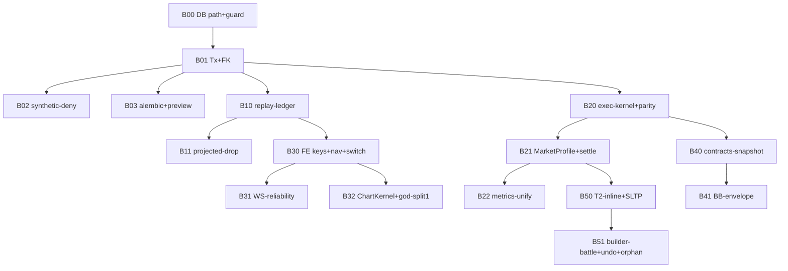

# SUMI V3 MASTER REFACTOR PLAN (2026-10-09)

**Base:** CURRENT_STATE review (~2.1/5), GAP_REGISTER, TARGET_ARCHITECTURE_V3, 8 ADRs. **Rule:** 1 batch = 1 vertical slice, temp-DB only, no `backend/sumi.db` mutation. Cấm feature mới trước Phase 0–1.

## Phase 0 — Safety (data survival)
- **Obj:** Không mất/nhiễm DB. **Scope:** GAP-DB-01/02/03/04/05/10/14 (ADR-TX-001, ADR-PROV-001). **Non-goals:** metrics, UX.
- **Files:** `backend/app/config.py`, `db.py`, `dependencies.py`, `alembic/env.py`, `services/*workflow*.py`, `weekly_aggregator.py`, providers guard. **Deps:** none. **Risks:** path đổi gây tooling cũ sai → startup assert + doc.
- **Migration:** xóa `sumi.db` 0B root sau backup; env import full models. **Tests:** CWD-lạ no-create; inject-fault atomic; FK reject; stub-deny/quarantine. **Exit:** 4 tests xanh + hash prod unchanged. **Rollback:** revert config/db guard (no data migration).

## Phase 1 — Replay integrity (lookahead lockdown)
- **Obj:** Server-authoritative cursor. **Scope:** GAP-REPLAY-01/02, GAP-EXEC-08, GAP-DB-09/11 (ADR: target §3). **Non-goals:** execution parity.
- **Files:** `api/decisions.py`, `api/replay.py`, `domain/engine/indicator_engine.py`, `practice_workflow_service.py`. **Deps:** Phase 0.
- **Tests:** raw-ledger filter N; Ichimoku+26 dropped; total_bars clamp; tz consistent. **Exit:** lookahead regression suite xanh. **Rollback:** feature-flag `REPLAY_STRICT=0` tạm (default 1).

## Phase 2 — One execution (financial truth)
- **Obj:** Một kernel next-open + MarketProfile + net everywhere. **Scope:** GAP-EXEC-01..08, GAP-U-01 (part wording) (ADR-EXEC-001, ADR-SETTLE-001). **Non-goals:** FE tách god.
- **Files:** `domain/backtest/*`, `services/backtest_service.py`, `strategy_lab_service.py`, `trade_lifecycle_service.py`, `practice_workflow*`, `market/*`, `analytics_service.py`. **Deps:** Phase 0–1.
- **Migration:** legacy deprecated banner 1 release → xóa. **Tests:** parity sweep==batch; golden 12 cases; settlement weekend/holiday; PF/winner/gate/Sharpe unify. **Exit:** parity + golden xanh. **Rollback:** `EXECUTION_KERNEL=legacy` flag tạm + banner.

## Phase 3 — FE + WS determinism
- **Obj:** URL authority, merge-key, reconnect. **Scope:** GAP-FE-01/02/03/05/06/09/10, GAP-WS-01 (ADR-FE-001, ADR-CHART-001, ADR-WS-001). **Non-goals:** contracts envelope.
- **Files:** `Controller.tsx`, `ReplayWorkspace.tsx`, `useWebSocket.ts`, `useSessionSelection.ts`, `store/replayStore.ts`, `ChartKernel/*`, QueryClient `App.tsx`. **Deps:** Phase 1 (cursor echo).
- **Tests:** step-x20 race; switch no-flash; WS chaos matrix; facade grep. **Exit:** race + chaos xanh. **Rollback:** revert FE-only (BE echo giữ, backward-compat).

## Phase 4 — Contracts governance
- **Obj:** Một envelope + snapshot. **Scope:** GAP-API-01..11, GAP-FE-07/08 (ADR-API-001). **Deps:** Phase 2 (BB/envelope ổn định sau execution).
- **Files:** `schemas/*`, `api/bb.py`, `domain/bb/*`, `api/import_data.py`, `symbols.py`, FE `types/*`, `api/*Clients`, `client.ts`, `main.py` error envelope. **Tests:** openapi snapshot; BB unify; 422 normalize; dead-route removed. **Exit:** snapshot CI xanh. **Rollback:** dual-read VARCHAR/JSON 1 release.

## Phase 5 — UX-blocking (tưởng-bug)
- **Obj:** 30-phút practice không kẹt. **Scope:** GAP-U-01..05 + P1-U (TARGET §7 structure dùng luôn). **Deps:** Phase 2–4.
- **Files:** `TradeControls`, `PositionPanel`, `PendingOrders`, `StrategyRuleBuilder`+`StrategyLabPage`, `DrawingToolbar`, `KeyboardShortcutsModal`, `Sidebar`, `App` redirect, assumptions components. **Tests:** UAT matrix SL/TP/SHORT/sync, BUILDER→BATTLE, undo/cancel, orphan-nav, T+2 inline. **Exit:** UAT P0-U xanh 1440×1000. **Rollback:** FE-only revert.

## Phase 6 — Cleanup/perf (khi chạm file)
- **Scope:** P2 list (vectorize, BETWEEN, bulk, paginate, helpers, dead feeds/broker/strategy, god tách nốt, mobile banner, journal naming). **Deps:** Phase 0–5. **Exit:** lint/build/test + UAT 31 cũ xanh, không scope-creep.

## Doc update plan (Keep/Update/Replace/Archive)

| Doc | Verdict | Action |
|---|---|---|
| AGENTS.md, ADR-001, ADR-002, PRODUCT_ACCEPTANCE_CRITERIA_V3 | Keep | Không sửa; viện dẫn |
| V3_FINAL_HANDOFF 2026-09-12 | Archive (provenance) | Ghi chú "claims 100% đã bị review 2026-10-09 bác bỏ phần P0"; không xóa |
| DEEP_AUDIT_REPORT | Keep as baseline | new findings đã merge vào GAP_REGISTER |
| CURRENT_STATE_REVIEW, GAP_REGISTER, TARGET, 8 ADRs, MASTER_PLAN, DEV_BATCHES, TEST packs | New canonical | Source of truth cho DEV |
| PLANS.md | Update (append batch template ref) | Không đổi format |

## Batch dependency graph

## Final verdict (A–J) + GO/NO-GO

- **A. Current understood?** YES — review + truth matrix + scorecard.
- **B. Gaps ordered?** YES — GAP_REGISTER P0→P2, data>financial>lookahead>determinism>contract>UX.
- **C. Target coherent?** YES — TARGET + 8 ADRs, evolutionary.
- **D. Batches tiny/self-contained?** YES — DEV_BATCHES B00–B51, 1 capability/batch, STOP gates.
- **E. Test strategy?** YES — MASTER + PAGE + WS matrix + GOLDEN + TRACEABILITY.
- **F. Invariants protected?** YES — §3.1–3.7 mapped per batch.
- **G. No prod edits?** YES — session này chỉ docs; `backend/sumi.db` untouched (ro checks only).
- **H. Temp-DB discipline?** YES — mọi verify yêu cầu temp-DB + hash prod.
- **I. Dependency order safe?** YES — graph trên; cấm skip Phase 0–1.
- **J. Ready?** **GO — READY FOR IMPLEMENTATION**, điều kiện: batch đầu tiên phải là B00; reviewer giữ single-writer; bất kỳ batch nào đỏ → STOP, không workaround.
