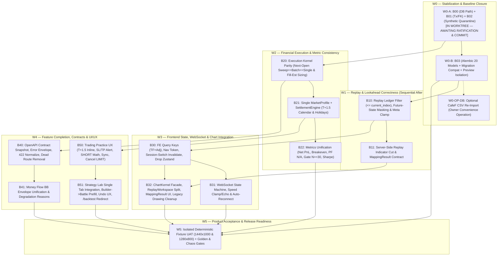

# SUMI V3 — PRODUCT COMPLETION MASTER PLAN (PROPOSED)

- **Document Status:** `PROPOSED — RECONCILED PER EXTERNAL GPT-6 ARCHITECT REVIEW; AWAITING FINAL OWNER & ARCHITECT RATIFICATION`
- **Date:** 2026-10-14
- **Workspace:** `/Users/mizuhara/workspace/sumi`
- **Baseline Git Commit:** `1ff5f04ed7a26969130eaba75da50b20684e763e` (`master`, dirty working tree containing uncommitted `W0-A` stabilization changes across 19 tracked files and 10 untracked test/safeguard files)
- **Author:** Principal Architecture Integration Agent (Antigravity)
- **Companion Deliverables:**
  - [SUMI_V3_BATCH_DEPENDENCY_AND_STATUS_PROPOSED.md](SUMI_V3_BATCH_DEPENDENCY_AND_STATUS_PROPOSED.md)
  - [SUMI_V3_NEXT_WAVE_TEAMWORK_PROMPT_PROPOSED.md](SUMI_V3_NEXT_WAVE_TEAMWORK_PROMPT_PROPOSED.md)

> [!IMPORTANT]
> **Evidence Epistemology Used Throughout This Plan**
> - **`VERIFIED`**: Directly confirmed by inspecting repository source files, git status/diffs, raw log file presence/checksums on disk, or filesystem state during this read-only planning pass.
> - **`REPORTED`**: Test execution outcomes or narrative conclusions stated in prior agent reports and preserved raw logs (`artifacts/local/W0-A/final-remediation/logs/*.log`), where the log files are `VERIFIED` on disk but test commands were not re-executed in this read-only pass.
> - **`ESTIMATED`**: Subjective architectural completion percentages used for high-level orientation (not measured line/branch coverage).
> - **`HISTORICAL`**: Previously valid state or claim superseded by subsequent repository changes or audit findings (e.g., Sept 2026 handoff reports or pre-probe `sumi.db` checksums).
> - **`PROPOSED`**: Planned architectural, roadmap, or governance decisions requiring External Architect (GPT-6) and Product Owner ratification.
> - **`UNKNOWN`**: Insufficient static evidence; requires runtime or browser UAT execution in an authorized implementation wave.

---

## A. Product Vision and Scope

### A.1 Product Mission & Intended Capability
Sumi V3 is a **local-first manual replay, technical-analysis practice, quantitative signal research, and strategy backtesting workstation** engineered specifically for the Vietnamese equity market (`HOSE`/`HSX`, `HNX`, `UPCOM`, and benchmark indices `VNINDEX`, `VN30`, `HNX-INDEX`).

The primary objective of this program is to **complete the software product** so a serious technical trader or quantitative researcher can import local Vietnam market data, conduct zero-lookahead historical bar-by-bar replay and trading practice, inspect causal technical signals, build and compare rule-based strategies, and trust every financial number displayed on screen.

Product Owner priority order (`VERIFIED` per program charter):
1. **Correct financial and trading calculations** (zero lookahead, next-open fills, Vietnam T+1.5 calendar settlement, board-lot sizing, net-of-fee/tax PnL, unified benchmark metrics).
2. **Complete and usable functionality** across all core pages without silent failures or dead ends.
3. **Consistent end-to-end workflows** connecting Data Import, Charting, Replay Practice, Scanner, Strategy Lab, Backtest, Journal, and Analytics.
4. **High-quality charting and UI/UX** on desktop viewports (`1440×1000` primary, `1280×800` compact).
5. **Reliable frontend/backend integration** (deterministic cursor/session state, resilient WebSocket playback, validated API contracts).
6. **Maintainability, regression testing, and release readiness** as supporting engineering foundations.

### A.2 Target Local-First User Experience
- **100% Local-First Privacy (`G-05`, [`AGENTS.md`](../../../AGENTS.md))**: Zero telemetry, zero external tracking, and zero outbound transmission of user replay sessions, trade decisions, journals, drawings, or strategy definitions.
- **Offline Autonomy ([`ADR-002`](../../ARCHITECTURE_DECISION_002_MARKET_DATA_PROVIDER.md))**: Full functionality when completely disconnected from the internet using locally imported CafeF EOD CSV/ZIP archives (`docs/CafeF.SolieuGD.Upto05102026/`).
- **Authoritative Backend Computation ([`AGENTS.md`](../../../AGENTS.md))**: All technical indicators (`IndicatorEngine`), causal signals (`domain/signals/`), settlement schedules (`SettlementEngine`), and backtest simulations (`BacktestExecutionKernel`) execute authoritatively in the Python backend; the browser renders backend truth and never slices future bars client-side.

### A.3 Supported Workflow Boundaries
1. **Market Data & Timeframes**:
   - Canonical Daily (`1D`) OHLCV bars imported from CafeF CSV/ZIP archives or synchronized on demand via `MarketDataProviderAdapter` (`ADR-002`).
   - Canonical Weekly (`1W`) bars derived locally by `WeeklyAggregator` using the `VN_TRADING_WEEK_V1` rule (`Monday–Friday` Vietnam trading calendar).
   - Strict separation between `unadjusted` and `adjusted` price series (`PRO-DATA-06`).
2. **Manual Replay & Paper Trading Practice**:
   - Bar-by-bar historical stepping (`±1`, `±5`, autoplay `1x/2x/5x/10x`, jump-to-date) with strict server-side cursor enforcement (`current_index`).
   - Paper order entry (`BUY`/`SELL`/`SHORT`/`COVER`, Market & Limit orders), Stop-Loss (`SL`) and Take-Profit (`TP`) planning with live Risk:Reward (`R:R`) lines, Vietnam T+1.5 settlement tracking, decision checklists, and session debriefs.
3. **Technical Charting, Indicators & Drawings**:
   - Lightweight Charts v5 multi-pane workspace supporting price overlays (`SMA`, `EMA`, `BBands`, `Ichimoku`, `Supertrend`, `PSAR`) and oscillator sub-panes (`RSI`, `MACD`, `ATR`, `CCI`, `Stochastic`, `MFI`, `ADX`, `Relative Strength`).
   - Versioned, provider-independent 7-tool custom primitive drawing system (`Cursor/Select`, `Horizontal Line`, `Trendline`, `Horizontal Ray`, `Rectangle`, `Fibonacci Retracement`, `Text/Note` + `Risk-Reward` projection).
4. **Signal Discovery, Scanner & Strategy Lab**:
   - 72-signal causal registry across 11 categories (Volume, VSA, Price Patterns, Structure, Regimes, Support/Resistance, Ichimoku, Confirmed Pivot Divergences, Technical Health, Flow Events, Money Flow BB).
   - Multi-symbol EOD Scanner with 1-click handoff into a pre-configured Replay session.
   - Strategy Lab featuring Signal Catalog, AST-sandboxed visual Rule Builder, 1-Click Strategy Battle, Parameter Sweep, Multi-Phase In-Sample/Out-of-Sample (`IS/OOS`) validation, and integrated Single Backtest workspace (`?tab=single`).

### A.4 Existing Capabilities vs. Explicit Non-Goals
- **Existing Foundation (`VERIFIED` in repo, `REPORTED` in historical P-lineage reviews `P1–P10`)**:
   - 16 FastAPI route modules, 20 SQLAlchemy models, 15 signal domain modules, next-event backtest kernel, Vietnam market rules (`HOSE 7%`, `HNX 10%`, `UPCOM 15%`, tiered tick sizes, 100-share lots), trading calendar (`2020–2026` holidays), compute-once batch runner, and React 19 + Lightweight Charts v5 frontend pages.
   - Uncommitted `W0-A` stabilization changes (`B00`, `B01`, `B02` + test safeguards) addressing database path anchoring, transaction rollback/FK enforcement, and synthetic provider quarantine.
- **Explicit Non-Goals**:
   - **No Live Broker DMA Order Execution**: Sumi V3 does not route live orders to brokerage accounts.
   - **No Tick-by-Tick Order Book Matching**: Money Flow Bollinger Bands (`T03..T200`) operate under the documented `OHLCV_PROXY` methodology unless external tick feeds are procured in a future version ([`V3_ACCEPTANCE_MATRIX_AND_LIMITATIONS.md`](../../release/V3_ACCEPTANCE_MATRIX_AND_LIMITATIONS.md) §3.1).
   - **No Fixed 20/30/70/80 BB Production Thresholds**: Remains gated (`NOT_PRODUCTION_SEMANTICS_YET`) per empirical study `P6_MEASURE_01`.
   - **No Full Mobile Trading Layout**: Mobile/narrow viewports (`< 1280px`) are explicitly read-only/limited and must display a clear limitation banner ([`PRODUCT_ACCEPTANCE_CRITERIA_V3.md`](../../PRODUCT_ACCEPTANCE_CRITERIA_V3.md)).
   - **No Unbounded Database-Preservation Sub-Programs**: `backend/sumi.db` holds local development data re-importable from CafeF CSVs (`docs/CafeF.SolieuGD.Upto05102026/`). Test safety is already hardened in [`backend/tests_safety.py`](../../../backend/tests_safety.py); engineering effort must focus on product completion.

### A.5 Definition of a Completed Sumi V3 Product
Sumi V3 is complete when:
1. All P0 and P1 product defects in [`docs/architecture/SUMI_GAP_REGISTER.md`](../../architecture/SUMI_GAP_REGISTER.md) are closed via batches `B00–B51`.
2. All 5 Core End-to-End User Journeys (Section D) execute without runtime, console, or contract errors.
3. All 12 Financial Golden Cases ([`docs/testing/FINANCIAL_GOLDEN_CASES.md`](../../testing/FINANCIAL_GOLDEN_CASES.md) `G-01..G-12`) pass with single-source financial parity across Replay Practice, Single Backtest, Strategy Battle, Parameter Sweep, and Analytics.
4. All release requirements in [`docs/PRODUCT_ACCEPTANCE_CRITERIA_V3.md`](../../PRODUCT_ACCEPTANCE_CRITERIA_V3.md) (`G-01..G-05`, `R-01..R-05`, `I-01..I-13`, `D-01..D-11`, `T-01..T-05`) pass deterministic Playwright browser UAT at `1440×1000` and `1280×800` against an isolated deterministic temporary database fixture.

---

## B. Current Architecture

> [!NOTE]
> Detailed current-state component maps and source-of-truth matrices are maintained in [`CURRENT_STATE_ARCHITECTURE_REVIEW.md`](../../architecture/CURRENT_STATE_ARCHITECTURE_REVIEW.md), [`TARGET_ARCHITECTURE_V3.md`](../../architecture/TARGET_ARCHITECTURE_V3.md), and [`SUMI_CURRENT_ARCHITECTURE_BASELINE.md`](../assessment_2026_10_12/SUMI_CURRENT_ARCHITECTURE_BASELINE.md). This section summarizes the architectural baseline and active structural tensions governing completion work.

```mermaid
graph TB
    subgraph FE["Frontend (Vite + React 19.2.6 + TS + TanStack Query 5.101 + LWC 5.2)"]
        Router["App.tsx Routes: / /import /replay /backtest(orphan) /strategy-lab /scanner /journal /analytics"]
        RW["ReplayWorkspace (764L) + Controller (602L)"]
        Chart["CandleChart + PaneManager + SeriesManager + RenderRegistry + PrimitiveProvider (7 tools)"]
        Lab["StrategyLabPage (5 tabs: Battle, MultiPhase, Catalog, Builder, Flow)"]
        State["State Split: URL ?session= + TanStack Query + Zustand (half-dead) + useState"]
    end

    subgraph API["FastAPI Transport Layer (16 Route Modules)"]
        REST["REST /api/* (replay, decisions, indicators, signals, backtest, strategy_lab, scanner, import_data, sync, bb, journal, analytics, symbols, universe, health)"]
        WS["WS /api/ws/replay/{session_id}"]
    end

    subgraph SVC["Backend Service Layer (backend/app/services/)"]
        Ingest["ImportWorkflowService + SyncWorkflowService + WeeklyAggregator + DataProviders"]
        ReplaySvc["ReplayService + PracticeWorkflowService + TradeLifecycleService"]
        QuantSvc["StrategyLabService + BacktestService (Legacy) + ScannerService + BBService + AnalyticsService"]
    end

    subgraph DOM["Authoritative Domain Layer (backend/app/domain/)"]
        IndEng["engine/IndicatorEngine (pandas-ta, 16 indicators)"]
        SigReg["signals/* (15 modules, 72 causal signals)"]
        BTKernel["backtest/BacktestExecutionKernel + BatchRunner + BenchmarkMetrics"]
        MktRules["market/MarketProfile + MarketRules + SettlementEngine + TradingCalendar"]
        Accounting["accounting.py + trade_planning.py + bb/calculator.py"]
    end

    subgraph DB["Persistence (SQLAlchemy 2.0 + SQLite)"]
        SQLite[("backend/sumi.db (20 tables, canonical vs quarantine:*)")]
    end

    FE -->|REST + WebSocket| API
    API --> SVC
    SVC --> DOM
    SVC --> DB
    DOM --> DB
```



### B.1 Frontend Architecture (`VERIFIED`)
- **Stack**: React `19.2.6`, TypeScript, Vite, TanStack Query `5.101`, Zustand `5.0.14`, Lightweight Charts `5.2`, React Router `7.17` ([`frontend/package.json`](../../../frontend/package.json)).
- **Routing ([`frontend/src/App.tsx`](../../../frontend/src/App.tsx#L53-L62))**: 8 lazy-loaded routes (`/`, `/import`, `/replay`, `/backtest`, `/strategy-lab`, `/scanner`, `/journal`, `/analytics`) wrapped in a single top-level `ErrorBoundary` and `QueryClient` without domain `staleTime`/`retry` defaults (`GAP-FE-09`). `/backtest` is an orphan route not linked in `Sidebar.tsx` (`GAP-U-05`).
- **Charting & Composition**: `ReplayWorkspace.tsx` (`764` lines) and `ReplayWorkspaceController.tsx` (`602` lines) form a `1,366`-line god-component pair (`GAP-FE-05`). Lightweight Charts `createChart` is called directly in `CandleChart.tsx` and `EquityChart.tsx` rather than through a unified `ChartKernel` facade (`GAP-FE-03`, `ADR-CHART-001`).
- **Drawing Stack**: Custom 7-tool `ISeriesPrimitive` implementation (`PrimitiveProvider.ts`, `DrawingDomain`, `Geometry`, `Magnet`, `DrawingRepository`, `DrawingHistory`) coexists with 3 dead legacy files (`SumiDrawingAdapter`, `DrawingToolRegistry`, `WorkspacePersistence`, `GAP-FE-04`).

### B.2 Backend Architecture (`VERIFIED`)
- **Transport (`backend/app/api/`)**: 16 route modules. Most delegate to services, though [`backend/app/api/decisions.py`](../../../backend/app/api/decisions.py#L40-L71) executes raw ORM `.all()` queries and dynamic unrealized PnL math directly inside route handlers (`GAP-REPLAY-01`), and error responses frequently raise `HTTPException(detail=str(e))` without a structured error envelope (`GAP-API-09`, `ADR-API-001`).
- **Services (`backend/app/services/`)**: Orchestrate database persistence, import/sync workflows, replay stepping, practice lifecycle, and strategy/scanner execution.
- **Domain (`backend/app/domain/`)**: Houses pure financial, indicator, signal, and market-rule engines.

### B.3 Market Data Ingestion & Quarantine Boundary (`VERIFIED` in working tree)
- **CafeF Import**: `CafeFImporter` parses CSV/ZIP files, normalizes prices (`×1000` VND scale check) and dates, `ImportClassifier` labels rows (`new`, `duplicate`, `stale`, `conflicting`, `invalid`), `ImportWorkflowService` persists `Candle` + `ImportRun` + `ImportRunMutation`, and `WeeklyAggregator` derives `1W` candles locally under `VN_TRADING_WEEK_V1`.
- **Provider Sync & W0-A Quarantine (`ADR-002`, `ADR-PROV-001`)**: `SSIProviderAdapter` and `VnstockProviderAdapter` are currently offline algorithmic stubs (`md5 + sin`, `is_synthetic=True`). In the uncommitted `W0-A` working tree, `SyncWorkflowService.execute_sync` blocks synthetic providers by default (`HTTP 403` unless `SUMI_ALLOW_SYNTHETIC_PROVIDERS=1`), tags opt-in synthetic rows with `source = f"quarantine:sync:{sync_id}"`, filters `quarantine:%` from canonical ORM reads via `_filter_quarantine_candles` in `backend/app/db.py`, and promotes unambiguous quarantine rows in-place (Option A) when superseded by canonical data while rejecting multi-candidate same-date collisions fail-closed (`HTTP 400`).
- **Remaining Ingestion Gaps**: `preview_import` and `seed_cafef.py` commit preview metadata before explicit user confirmation (`GAP-DB-14`, `B03`), and `WeeklyAggregator`/`ImportClassifier` check `weekday() >= 5` instead of `TradingCalendar.is_trading_day()` (`GAP-DB-11`, `B21`).

### B.4 Replay Data Flow & Cursor Authority (`VERIFIED`)
- **Core Cursor Slicing**: `ReplayService.get_candles` enforces `limit = session.current_index + 1`, and `PracticeWorkflowService.get_snapshot` filters practice state to the active cursor.
- **Confirmed Lookahead Leaks**:
  1. **Raw Ledger Endpoints ([`backend/app/api/decisions.py`](../../../backend/app/api/decisions.py#L40-L71))**: `GET /sessions/{id}/decisions`, `/orders`, and `/trades` execute `.filter(Model.session_id == session_id).all()` with **no `candle_index <= current_index` predicate** and no masking of future order fills or future trade exits (`GAP-REPLAY-01`, `B10`).
  2. **Projected Indicator Rows (`indicator_engine.py:340-349`, `api/replay.py:152-171`)**: `union + reindex` extends indicator timestamps beyond `max_visible_ts` (e.g., Ichimoku Senkou Span A/B `+26` future bars). Although tagged `is_projected`, the backend returns them in replay payloads and the frontend applies zero filtering (`GAP-REPLAY-02`, `B11`).
  3. **Forward Metadata (`practice_workflow_service.py:224-226, 304`)**: Exposes `total_bars` and future `earliest_release_date` beyond cursor (`GAP-EXEC-08`, `B10`).

### B.5 Indicator and Signal Ownership (`VERIFIED`)
- **Indicators**: `IndicatorEngine` (pandas-ta) is the sole calculator for 16 indicators with canonical column naming and fail-closed all-or-nothing multi-series output. Frontend `IndicatorRenderRegistry` currently swallows mapping/warmup failures via ~15 silent `return []` paths instead of returning a typed `MappingResult` (`GAP-FE-07`, `B11`/`B32`).
- **Signals**: `backend/app/domain/signals/` (15 modules, 72 signals) is causal on bar prefixes (`observed_at <= cursor`), with non-backdating pivot confirmation (`causal_delay_bars=3` in `divergence.py`), 4-family Technical Health scoring (`health.py`), and `OHLCV_PROXY` Money Flow BB (`bb/calculator.py`). Frontend signal consumers still exhibit minor schema/version-pin drift (`GAP-API-07`, `GAP-FE-08`, `B40`) and BB envelope mismatch (`GAP-API-02`, `B41`).

### B.6 Strategy & Backtest Execution Divergence (`VERIFIED`)
Sumi V3 currently contains **two incompatible execution engines**:
1. **Authoritative Next-Event Kernel ([`backend/app/domain/backtest/execution.py`](../../../backend/app/domain/backtest/execution.py#L39-L160))**: Pure in-memory engine used by `batch_runner.py` (Multi-Phase / Battle). Evaluates signals on `Close[T]`, queues `MARKET_NEXT_OPEN`, fills on `Open[T+1]`, marks bar $N-1$ signals `UNFILLED_AT_CUTOFF`, enforces `MarketRules` ceiling/floor locks and `SettlementEngine` lot tracking, and computes net PnL. *(Note: lines 319–385 still execute intraday SL/TP on the same bar rather than next-open; see Section E.2.1).*
2. **Legacy DB-Backed Same-Bar Engine (`backtest_service.py:312-346`, `trade_lifecycle_service.py:251-346`, `strategy_lab_service.py:282-291`)**: Used by Strategy Lab Parameter Sweep, legacy Single Backtest, and parts of Practice Lifecycle. Fills orders at `Close[T]` on the same bar as the signal, uses bar-count `T+2` instead of `SettlementEngine`, sizes positions on `Close[T]`, and mixes gross vs. net PnL (`GAP-EXEC-01..07`, `B20–B22`).

### B.7 Persistence, Data Lifecycle & The `backend/sumi.db` Incident (`VERIFIED`)
- **Schema & Models**: [`backend/app/models/__init__.py`](../../../backend/app/models/__init__.py) exports **20 SQLAlchemy ORM models** (`Symbol`, `Candle`, `ReplaySession`, `Decision`, `Order`, `Execution`, `Position`, `Trade`, `JournalEntry`, `EventLog`, `DrawingState`, `StrategyLabRun`, `ScannerRun`, `ImportRun`, `ImportRunItem`, `ImportRunMutation`, `WeeklyCandleProvenance`, `SyncRun`, `SyncRunItem`, `SyncRunMutation`). However, [`backend/alembic/env.py`](../../../backend/alembic/env.py#L14-L23) currently imports only 10 of those 20 models, and revision [`a2d639ecd5d5_add_execution_candle_index.py`](../../../backend/alembic/versions/a2d639ecd5d5_add_execution_candle_index.py) calls `op.add_column('executions', ...)` without the `_has_column` idempotency guard used in [`20260629_0004_execution_trade_id_drift.py`](../../../backend/alembic/versions/20260629_0004_execution_trade_id_drift.py) (`GAP-DB-05`, `GAP-DB-06`, `GAP-DB-10`, `B03`).
- **W0-A Transaction & Path Hardening**: Uncommitted changes in `config.py`, `db.py`, `dependencies.py`, and workflow services anchor `DEFAULT_DATABASE_URL` to `backend/sumi.db` via `Path(__file__)`, enforce `PRAGMA foreign_keys=ON`, and wrap write/rollback paths in `try/commit/except-rollback` blocks (`B00`, `B01`).
- **Forensic Record of the `backend/sumi.db` Incident (`VERIFIED` on disk & in `artifacts/local/W0-A/final-remediation/evidence/database_safety_proof.txt`)**:
  - Prior to 2026-10-13, `backend/sumi.db` held `1,499,136` bytes (`SHA-256: ef5c035c27d49de1de51a59e28e1cac5109d92240bcb600239f2180d49128f3e`, `HISTORICAL`).
  - During `W0-A` C1 closeout adversarial break-it testing on `2026-10-13T17:14:39Z` (`2026-10-14 00:14+07:00`), an unguarded probe calling `Path(PROD_DB_PATH).open('w')` bypassed `builtins.open`, and a subsequent Alembic probe passing `SUMI_DATABASE_URL` instead of `DATABASE_URL` reinitialized `backend/sumi.db` to an empty migrated schema of `188,416` bytes (`SHA-256: 234206fc75259f091337d4feb5f41575d0fe5ac02d6c10ba0de8fad68cbcee86`, `VERIFIED` current disk state).
  - [`backend/tests_safety.py`](../../../backend/tests_safety.py) was immediately hardened with `Path.*`, `io.open`, `_io.open`, `os.open`, and CPython `sys.addaudithook` interceptors, plus dynamic immutable session baseline verification. All 8 subsequent closeout verification suites recorded `0` bytes delta (`VERIFIED` log files in `artifacts/local/W0-A/final-remediation/logs/`, `REPORTED` test runs).
  - **Product Strategy Position**: Because `backend/sumi.db` is local development data and the source CafeF CSV archives (`docs/CafeF.SolieuGD.Upto05102026/CafeF.{HSX,HNX,UPCOM,INDEX}.Upto05.10.2026.csv`) are present in the repository (`VERIFIED`), re-seeding `backend/sumi.db` (`W0-OP-DB`) is an optional Product Owner convenience step after `B03`—not a mandatory release gate or reason for further safeguard engineering.

### B.8 WebSocket & Frontend State Management (`VERIFIED` paths, `REPORTED` behavior)
- **State Fragmentation (`GAP-FE-01`, `GAP-FE-02`, `GAP-FE-06`, `ADR-FE-001`)**: Session and replay state are split across 4 authorities: URL `?session=`, TanStack Query cache (using loose prefix `['candles', id]` without timeframe/adjustment), a half-dead Zustand store (`replayStore.ts`), and local `useState` in `ReplayWorkspaceController.tsx` (which optimistically increments `current_index + 1` before server confirmation).
- **WebSocket Fragility (`GAP-WS-01`, `GAP-FE-10`, `ADR-WS-001`)**: `ws_replay.py` and `useWebSocket.ts` lack JSON schema validation, speed clamping, structured `{type, seq, current_index, payload}` frames, error/completed frames, heartbeat ping/pong, and exponential-backoff auto-reconnect.

### B.9 Canonical Invariants & Ratified ADR Dependencies

| Authority Document | Status | Core Architectural Mandate | Governing Batches |
|---|---|---|---|
| [`AGENTS.md`](../../../AGENTS.md) | **Ratified** | Zero future leak; authoritative backend `IndicatorEngine`; temp-DB verification; local-first privacy; browser UAT at `1440×1000`. | All (`B00–B51`) |
| [`ADR-001`](../../ARCHITECTURE_DECISION_001_REPLAY_UI_REBUILD.md) | **Ratified** | Keep LWC v5 & backend engines; controlled rebuild of Replay UI composition, Indicator Manager, and Drawing adapter boundary. | `B30`, `B32`, `B50`, `B51` |
| [`ADR-002`](../../ARCHITECTURE_DECISION_002_MARKET_DATA_PROVIDER.md) | **Ratified** | `MarketDataProviderAdapter` boundary; CafeF offline anchor; local `1W` derivation via `WeeklyAggregator`; masked credentials. | `B02`, `B03` |
| [`ADR-TX-001`](../../architecture/decisions/ADR-TX-001-transaction-boundary.md) | **Ratified** | Absolute DB path via `Path(__file__)`; `try/commit/except-rollback` on all writes; `get_db` rollback; `PRAGMA foreign_keys=ON`; full models in Alembic `env.py`; preview-confirm split. | `B00`, `B01`, `B03` |
| [`ADR-PROV-001`](../../architecture/decisions/ADR-PROV-001-synthetic-policy.md) | **Ratified** | Synthetic providers default-deny (`403`) unless `SUMI_ALLOW_SYNTHETIC_PROVIDERS=1`; quarantine dataset isolation + UI warning banner. | `B02` |
| [`ADR-PROV-001-ADDENDUM-01`](../../architecture/decisions/ADR-PROV-001-ADDENDUM-01-quarantine-promotion.md) | **PROPOSED** | Option A in-place quarantine-to-canonical promotion (preserving `Candle.id`) and atomic pre-validation rejection (`HTTP 400` + `db.rollback()`) when multiple quarantine candidates share the same calendar date. | `B02` (`W0-A` review) |
| [`ADR-TX-001-ADDENDUM-01`](../../architecture/decisions/ADR-TX-001-ADDENDUM-01-mutation-provenance.md) | **PROPOSED** | `UPDATE:{prior_source}\|{prior_timestamp_iso}` mutation provenance encoding in `action`, right-split parsing (`rsplit("\|", 1)`), fail-closed `HTTP 400` validation on empty/malformed timestamps or missing/ambiguous rollback targets, and full `db.rollback()` atomicity. | `B02` (`W0-A` review) |
| [`ADR-TX-001-ADDENDUM-02`](../../architecture/decisions/ADR-TX-001-ADDENDUM-02-cross-workflow-rollback.md) | **PROPOSED** | Symmetrical cross-workflow rollback conflict resolution: `rollback_import` checks for subsequent accepted `SyncRun`s on affected symbols and aborts (`HTTP 400`); `rollback_sync` checks for subsequent accepted `ImportRun`s on the symbol and aborts (`HTTP 400`). | `B02` (`W0-A` review) |
| [`ADR-EXEC-001`](../../architecture/decisions/ADR-EXEC-001-execution-semantics.md) | **Ratified** | Single canonical `BacktestExecutionKernel` (`Signal[T] → QUEUED → Fill Open[T+1]`, `UNFILLED_AT_CUTOFF` at $N-1$, fill-estimate sizing, sweep==batch parity). | `B20`, `B21`, `B22` |
| [`ADR-SETTLE-001`](../../architecture/decisions/ADR-SETTLE-001-settlement-market-rules.md) | **Ratified** | Single `SettlementEngine` (`T+1.5` Vietnam calendar settlement) and single `MarketProfile` across all engines and UI assumptions. | `B21`, `B50`, `B51` |
| [`ADR-FE-001`](../../architecture/decisions/ADR-FE-001-state-ownership.md) | **Ratified** | URL `?session=` as sole session authority; TanStack Query mirrors server with full `(session, TF, adjustment)` keys; retire Zustand. | `B30` |
| [`ADR-WS-001`](../../architecture/decisions/ADR-WS-001-ws-reliability.md) | **Ratified** | Backend state machine (`validate`, `clamp speed`, `seq`/`current_index` echo, `error`/`completed` frames); frontend remote with backoff reconnect. | `B31` |
| [`ADR-CHART-001`](../../architecture/decisions/ADR-CHART-001-chart-kernel.md) | **Ratified** | Thin `ChartKernel` facade wrapping LWC v5; decompose `ReplayWorkspace` god component; `MappingResult` rendering; delete 3 dead drawing files. | `B32` |
| [`ADR-API-001`](../../architecture/decisions/ADR-API-001-contract-governance.md) | **Ratified** | Domain response envelopes + `response_model` on all GETs; OpenAPI Pydantic↔TS snapshot tests; structured `{code, message, field_errors[]}` error envelope. | `B40`, `B41` |

---

## C. Product Functionality Matrix

> [!NOTE]
> Per Product Owner policy, **CODE IMPLEMENTATION**, **INTEGRATION**, **VERIFICATION**, and **PRODUCT ACCEPTANCE** statuses are tracked separately. Percentage values in the **Code Impl. Status (`ESTIMATED`)** column are subjective architectural completion estimates for planning orientation, not measured code coverage; file existence is `VERIFIED` and prior test results are `REPORTED`.

| # | Functional Area | Intended Product Behavior | Existing Implementation Evidence (`VERIFIED` paths / `REPORTED` tests) | Code Impl. Status (`ESTIMATED`) | Integration Status | Verification Status | Product Acceptance Status | Known Defects (`GAP-*`) & Missing Functionality | Test & UAT Requirements | Priority & Batches |
|---|---|---|---|---|---|---|---|---|---|---|
| **1** | **CafeF CSV Import & Data Management** | Offline CafeF CSV/ZIP upload, 6-label classification (`new`, `duplicate`, `stale`, `conflicting`, `invalid`), preview before commit, atomic accept with mutation provenance, local `1W` derivation (`VN_TRADING_WEEK_V1`), symmetrical rollback, and default-deny/quarantine for synthetic sync providers (`G-02`, `G-05`). | `ImportPage.tsx`, `DataSyncPanel.tsx`, `api/import_data.py`, `api/sync.py`, `api/symbols.py`, `services/cafef/*`, `classifier.py`, `import_workflow_service.py`, `sync_workflow_service.py`, `weekly_aggregator.py`, `data_providers/*` (`VERIFIED`). W0-A path/tx/quarantine rework in working tree (`VERIFIED`). | **~90% Est.** (`ESTIMATED`: Core + W0-A in worktree; preview-confirm & holiday check pending) | **Integrated** (Dual catalog route & dead `importCafefData` cleanup pending) | **REPORTED Green** (`W0-A` 537 BE tests, 75 B02/workflow tests in `artifacts/local/W0-A/` logs; unaccepted) | **PENDING** (Awaiting W0-A ratification + B03 + `IMP-001..003` UAT) | `GAP-DB-01..04` (in W0-A worktree, unaccepted); `GAP-DB-05/06/10/14` (Alembic 10 missing models, composite indexes, `_has_column`, preview commits before confirm); `GAP-DB-08` (float compare); `GAP-DB-11` (hardcoded weekday vs `TradingCalendar`); `GAP-API-08/10` (duplicate `/api/import/catalog`, dead `data_feeds`). | `test_cwd_database_isolation.py`, `test_b01_transaction_fk.py`, `test_b02_*.py`, `IMP-001..003`, `SYNC-001..002`, exact 20-model registry & migration chain tests. | **P0** (`B00`, `B01`, `B02`, `B03`, `B21`, `B40`) |
| **2** | **Charting** | Multi-pane financial chart (`1D`/`1W`, `unadjusted`/`adjusted`) using LWC v5 behind a thin `ChartKernel` facade; responsive pane resizing/reordering; obvious symbol/date/bar/OHLCV header context without crosshair (`R-02`, `T-01`). | `components/chart/CandleChart.tsx`, `PaneManager.ts`, `SeriesManager.ts`, `EquityChart.tsx`, `PositionLineManager.ts`, `ChartLegendOverlay.tsx` (`VERIFIED`). | **~80% Est.** (`ESTIMATED`: LWC v5 multi-pane works; `ChartKernel` facade & god-split pending) | **Partially Integrated** (Direct `createChart` calls; JSON DOM snapshot on render) | **REPORTED Historical** (Sept UAT passed; facade & race tests not yet built) | **PENDING** (`R-02`, `I-08..I-09`, `T-01` browser UAT at `1440×1000` & `1280×800`) | `GAP-FE-03` (no `ChartKernel` facade, 2 `createChart` calls); `GAP-FE-05` (`1,366`-line `ReplayWorkspace` + `Controller` god pair); `GAP-FE-09` (DOM JSON snapshot every render); `GAP-U-09` (pane reorder button `opacity:0.15`, `fontSize:8`, fixed position drift on resize). | `grep createChart` single-facade check; `REPLAY-006`, `REPLAY-008`, `NAV-005` viewport UAT (`1440×1000` + `1280×800`). | **P1** (`B32`, `B51`) |
| **3** | **Indicators** | Authoritative backend calculation (`IndicatorEngine`, 16 indicators); add/search/edit/hide/remove lifecycle; multi-instance support; oscillator reference lines (`RSI 30/50/70`, `CCI -100/0/100`, `MACD` zero line); zero future projection leak in Replay while preserving non-Replay forward projection; explicit warmup/error feedback (`I-01..I-13`). | `domain/engine/indicator_engine.py`, `strategy_indicator_adapter.py`, `api/indicators.py`, `IndicatorManager.tsx`, `IndicatorPaneChrome.tsx`, `IndicatorRenderRegistry.ts`, `IchimokuCloudPlugin.ts` (`VERIFIED`). | **~85% Est.** (`ESTIMATED`: Backend engine & 16 indicators complete; Replay server projection cut & `MappingResult` pending) | **Integrated with Edge Leak** (Future projected rows served in replay; silent `return []` in registry) | **REPORTED Partial** (`test_indicators.py`, `test_indicator_parity_e2e.py` pass; `B11` regression pending) | **PENDING** (`I-01..I-13` + `REPLAY-005/007/008` browser UAT) | `GAP-REPLAY-02` (`union+reindex` serves Ichimoku `+26` projected future rows in replay); `GAP-FE-07` (`IndicatorRenderRegistry` has ~15 silent `return []` instead of `MappingResult`); `GAP-FE-09` (indicator burst storm); `GAP-U-07` (`warming` badge lacks progress `N/X` & tooltip). | `REPLAY-005` (Ichimoku `+26` absent from Replay payload/chart at cursor $N$, preserved in non-Replay full chart), `REPLAY-007`, `REPLAY-008` (`I-01..I-13`). | **P0 Lookahead / P1 UX** (`B11`, `B32`, `B51`) |
| **4** | **Drawing Tools** | 7 interactive tools (`Cursor/Select`, `Horizontal`, `Trendline`, `Ray`, `Rectangle`, `Fibonacci`, `Text/Note` + `R:R`), handles, move/edit/delete, `Undo/Redo` (`Ctrl+Z`/`Y`), magnet toggle, versioned persistence across pan/zoom/step/reload (`D-01..D-11`). | `PrimitiveProvider.ts` (`367` lines), `DrawingDomain`, `Geometry`, `Magnet`, `DrawingRepository`, `DrawingHistory`, `DrawingToolbar.tsx`, `DrawingInspector.tsx`, `models/drawing.py`, `sumi-drawing-document-v1.schema.json` (`VERIFIED`). | **~85% Est.** (`ESTIMATED`: 7-tool custom primitive stack & repo built; 3 dead files & undo UX pending) | **Integrated** (BUY-only R:R sync & low-contrast undo button remain) | **REPORTED Partial** (FE drawing unit tests & historical UAT; `D-06/D-08` reload/undo UAT pending) | **PENDING** (`D-01..D-11`, `REPLAY-009` browser UAT) | `GAP-FE-04` (3 dead legacy drawing files `SumiDrawingAdapter`, `DrawingToolRegistry`, `WorkspacePersistence`); `GAP-U-02` (R:R drawing syncs only for `BUY`, not `SHORT`); `GAP-U-04` (32px low-contrast Undo/Redo, missing `Ctrl+Z/Y` in shortcuts modal, no toast/count); `GAP-U-13` (duplicate magnet toggle). | `REPLAY-009` (all 7 tools + pan/zoom/step/reload persistence + Undo/Redo keyboard/toast), `test_b01_transaction_fk.py` cascade delete. | **P1** (`B32`, `B50`, `B51`) |
| **5** | **Replay** | Bar-by-bar historical replay (`1D`/`1W`) with zero future leak (`R-01`), deterministic stepping (`±1`, `±5`, play/pause, speed `1x–10x`, jump-to-date), resilient WebSocket playback, clean session switching, and full reload/resume (`R-01..R-05`). | `ReplayPage.tsx`, `ReplayWorkspace.tsx`, `ReplayWorkspaceController.tsx`, `ReplayControlDock.tsx`, `SessionSetup.tsx`, `SymbolSwitcherModal.tsx`, `api/replay.py`, `api/ws_replay.py`, `services/replay_service.py` (`VERIFIED`). | **~75% Est.** (`ESTIMATED`: Core slice & UI built; raw ledger filter, WS state machine, & FE key/token fixes pending) | **Fragile on Edges** (Optimistic `index+1`, TF-blind WS cache, no WS reconnect, session-switch flash) | **REPORTED Partial** (`test_replay_no_future_leak.py` core slice passes; chaos & race suites pending) | **PENDING** (`R-01..R-05`, `REPLAY-001..006`, `WS-01..10`) | `GAP-REPLAY-01` (raw `decisions/orders/trades` `.all()` leaks future activity and unmasked fills/exits); `GAP-REPLAY-02` (projected indicators); `GAP-EXEC-08` (`total_bars`/`earliest_release_date` leak); `GAP-FE-01/02/06` (WS prefix cache, optimistic index, nav race, session switch flash, Zustand split); `GAP-WS-01` & `GAP-FE-10` (no WS reconnect/backoff/frames/speed clamp). | `REPLAY-001..006`, step-`×20` stress race test, `WEBSOCKET_TEST_MATRIX.md` (`WS-01..WS-10`), `NAV-003..004` deep-link & reload. | **P0** (`B10`, `B11`, `B30`, `B31`) |
| **6** | **Scanner** | Multi-symbol technical & signal scanner over canonical EOD data with filter/sort and 1-click "Open in Replay" session creation at the scanned signal date (`T-05`). | `ScannerPage.tsx`, `ScannerSourceContext.tsx`, `api/scanner.py`, `services/scanner_service.py` (`VERIFIED`). | **~85% Est.** (`ESTIMATED`: Scanner evaluation & Scanner→Replay intent implemented) | **Integrated (One-Way)** (Scanner→Replay works; Replay→Battle/Scanner reverse link missing) | **REPORTED Green** (`test_scanner.py`, `test_scanner_replay_integrity.py`) | **PENDING** (`SCAN-001`, `SCAN-002` browser UAT) | Missing reverse navigation from Replay back to Scanner/Strategy Lab (`CURRENT_STATE_ARCHITECTURE_REVIEW.md` §4.2); mobile limitation banner missing on `/scanner` (`GAP-U-10`); depends on `B02` quarantine isolation (`VERIFIED` in `test_b02_quarantine_isolation.py`). | `test_scanner_replay_integrity.py`, `SCAN-001` (Scan → Open Replay at exact symbol/date/marker), `SCAN-002`. | **P1** (`B51` nav/banner, `W5` UAT) |
| **7** | **Signals** | 72 causal signals across 11 categories with versioned metadata, parameter schemas, active cursor inspection (`SignalInspector`), structured causal explanations (`SignalExplanationInspector`), and Money Flow BB (`OHLCV_PROXY`). | `domain/signals/*` (15 modules), `domain/bb/*`, `api/signals.py`, `api/bb.py`, `components/signals/*` (`SignalCatalog`, `SignalInspector`, `SignalExplanationInspector`, `TechnicalFlowBBViewer`) (`VERIFIED`). | **~90% Est.** (`ESTIMATED`: All 72 signals, delay-3 divergence, health score, & BB proxy implemented in P1–P9) | **Mostly Integrated** (BB envelope mismatch & FE signal schema validation/version pin pending) | **REPORTED Green** (`P1–P9` signal suites & causal invariance tests passed) | **PENDING** (`REPLAY-014`, `LAB-001`, `LAB-006` browser UAT) | `GAP-API-02` (BB response envelope mismatch between BE `flow_method/horizons` and FE `methodology/value`, missing `response_model` on BB GET); `GAP-API-07` (FE missing `max 2` signal cap, `forbid` extra fields, param validation); `GAP-FE-08` (pin signal version across clients); `GAP-U-08` (signals in trade tab push BUY/SELL below fold). | `test_signals*.py`, `test_market_bb.py`, contract snapshot (`B40`/`B41`), `REPLAY-014`, `LAB-001`, `LAB-006`. | **P1** (`B40`, `B41`, `B51`) |
| **8** | **Strategy Lab** | 5-tab research hub (`Battle`, `MultiPhase`, `Catalog`, `Builder`, `Flow`) + integrated `Single` Backtest tab (`?tab=single`); visual AST Rule Builder with 1-click handoff to Battle/Single Tester; Parameter Sweep; Multi-Strategy SVG Equity Curve & Star Rating (`T-05`). | `StrategyLabPage.tsx`, `StrategyRuleBuilder.tsx`, `MultiPhasePanel.tsx`, `api/strategy_lab.py`, `services/strategy_lab_service.py`, `domain/strategy/*`, `domain/backtest/batch_runner.py` (`VERIFIED`). | **~75% Est.** (`ESTIMATED`: 5 tabs, AST builder, batch runner & cache built; Single tab integration, sweep routing & builder handoff pending) | **Broken Handoff & Dual Engine** (`Builder→Battle` drops rules; Sweep uses legacy engine) | **REPORTED Partial** (`test_strategy_lab.py`, `test_batch_runner.py` pass; sweep==batch parity & handoff fail) | **PENDING** (`LAB-001..007` browser UAT) | `GAP-EXEC-01` (Parameter Sweep routes through legacy same-bar-close engine instead of `BacktestExecutionKernel`); `GAP-U-03` (**Critical**: `StrategyRuleBuilder` writes `sumi_pending_strategy_rule` to `localStorage`, but `StrategyLabPage` never reads it—rule vanishes); `GAP-U-05` (must integrate real `Single` backtest workspace tab before redirecting `/backtest`); `GAP-U-06` (`?tab=multiphase/flow` sidebar active state); `GAP-U-11` (missing assumptions footer on Battle/MultiPhase). | `B20` sweep==batch parity (`G-12`, `LAB-004`), `B51` critical `LAB-002` (`Builder → Battle/Single` prefill), `LAB-003`, `LAB-005..007`. | **P0 Financial & UX** (`B20`, `B51`) |
| **9** | **Backtest** | Deterministic single-symbol & multi-phase backtesting on `BacktestExecutionKernel` (`Open[T+1]` fill, `UNFILLED_AT_CUTOFF`, `MarketProfile` fees/taxes/lots, `SettlementEngine` `T+1.5`), producing identical PnL/metrics whether run in Single, Battle, or Sweep. | `BacktestPage.tsx`, `api/backtest.py`, `services/backtest_service.py`, `domain/backtest/{execution,metrics,batch_runner,models,persistence_adapter}.py` (`VERIFIED`). | **~75% Est.** (`ESTIMATED`: `BacktestExecutionKernel` & `BenchmarkMetrics` exist; legacy `backtest_service` still active) | **Split / Orphaned** (`/backtest` is an orphan route; legacy vs kernel split) | **REPORTED Partial** (`test_backtest_kernel.py` passes; `G-01..G-12` unified golden suite pending) | **PENDING** (`BACK-001`, `BACK-002`, `G-01..G-12`) | `GAP-EXEC-01..07` (legacy same-close vs kernel next-open; intraday SL/TP same-bar in kernel; 3 slippage truths; bar-count vs calendar T+2; gross/net mix; winner/PF/Sharpe drift; close vs fill-estimate sizing); `GAP-U-05` (`/backtest` orphan route not in Sidebar or Strategy Lab; requires real Single Backtest tab in Strategy Lab prior to redirect). | `FINANCIAL_GOLDEN_CASES.md` (`G-01..G-12`), `BACK-001` (Single Backtest tab integrated + `/backtest → /strategy-lab?tab=single`), `BACK-002` determinism. | **P0** (`B20`, `B21`, `B22`, `B51`) |
| **10** | **Trading / Practice Workflows** | Interactive paper trading inside Replay (`BUY`/`SELL`/`SHORT`/`COVER`, `LIMIT` pending orders, `SL`/`TP` inputs + draggable chart lines, live `R:R`, inline `T+1.5` availability, Practice Scoreboard & Session Debrief) (`T-01..T-05`). | `TradeControls.tsx`, `PositionPanel.tsx`, `PendingOrdersPanel.tsx`, `PracticeRail.tsx`, `PracticeScoreboard.tsx`, `SessionDebriefModal.tsx`, `api/decisions.py`, `services/practice_workflow_service.py`, `trade_lifecycle_service.py`, `domain/trade_planning.py` (`VERIFIED`). | **~75% Est.** (`ESTIMATED`: Core lifecycle & UI panels built; SHORT math, SL/TP validation UI, T+2 inline & LIMIT cancel incomplete) | **Integrated with P0 UX Traps** (Silent `sizingCalc=null` disappearance, tooltip-only T+2, no LIMIT cancel button) | **REPORTED Partial** (`test_practice_workflow.py`, `test_trade_lifecycle.py` pass; UX matrix pending) | **PENDING** (`T-01..T-05`, `REPLAY-010..013` browser UAT) | `GAP-U-01` (`SELL`/`CLOSE` disabled during T+2 with reason hidden in hover `title` tooltip; `PositionPanel` ignores `available_quantity`); `GAP-U-02` (invalid SL/TP makes sizing panel vanish silently; SHORT uses LONG formula with inverted sign; R:R drawing syncs BUY only); `GAP-U-04` (`PendingOrdersPanel` lacks cancel button for `LIMIT` orders); `GAP-API-01/05` (`BANKRUPT`/`CUSTOM_PRICE` enum drift, `TradePlanResult` missing 7 fields on FE). | `REPLAY-010` (inline `T+1 · về sau 1 phiên` + Available/Pending columns), `REPLAY-011` (SL/TP/SHORT/sync matrix), `REPLAY-012`, `REPLAY-013` (cancel LIMIT). | **P0 UX & Financial** (`B21`, `B40`, `B50`) |
| **11** | **Journal** | In-workspace Decision Journal & Checklist (`T-03`) plus dedicated `/journal` page preserving trade context, structured checklist snapshots, and post-session reflection notes. | `JournalPage.tsx`, `PracticeJournal.tsx`, `DecisionJournal.tsx`, `api/journal.py`, `models/journal_entry.py`, `models/decision.py` (`VERIFIED`). | **~80% Est.** (`ESTIMATED`: Models, APIs, and UI components exist; schema/type sync & nav links pending) | **Partially Integrated** (Missing direct links from Replay Workspace to `/journal`; 4 overlapping labels) | **UNKNOWN** (Dedicated journal contract & E2E tests not yet verified) | **PENDING** (`T-03`, `JOUR-001`, `JOUR-002` browser UAT) | `GAP-DB-07` (`decisions.checklist` is `VARCHAR` while `journal_entries` uses `JSON`); `GAP-API-06` (`checklist_snapshot` dropped on FE, narrow `string` vs `dict\|str` type); `GAP-U-12` (4 different UI names for 2 journal concepts; no link from Replay Workspace to `/journal` or `/analytics`). | `B40` dual-read `VARCHAR/JSON` & TS type sync, `JOUR-001` (open Journal from Replay without losing chart/replay state), `JOUR-002`. | **P1** (`B40`, `B51`) |
| **12** | **Analytics** | Portfolio & practice performance analytics displaying Net PnL, Win Rate, Profit Factor, Sharpe Ratio, Max Drawdown, equity curve, and explicit `MarketProfile` assumptions (`ANAL-001..002`). | `AnalyticsPage.tsx`, `components/analytics/*`, `api/analytics.py`, `services/analytics_service.py`, `domain/backtest/metrics.py` (`VERIFIED`). | **~80% Est.** (`ESTIMATED`: Analytics service & UI charts exist; metric formula unification pending) | **Integrated with Metric Drift** (Disagrees with `metrics.py` on breakeven, PF, Sharpe, and required/optional fields) | **REPORTED Partial** (`test_analytics*.py` pass against legacy expectations; unified `B22` tests pending) | **PENDING** (`ANAL-001`, `ANAL-002` browser UAT) | `GAP-EXEC-04/05/06` (gross vs net mix; breakeven winner vs loser mismatch; `PF=inf` vs `None` vs `N/A`; $N \ge 30$ sample gate inconsistent; 2 internal Sharpe definitions in `analytics_service.py:158-180` vs `:268-297`); `GAP-API-04` (Pydantic↔TS required/optional field inversions); `GAP-U-11` (missing assumptions footer). | `B22` metric unification (`G-08..G-10`), `B40` contract snapshot (`ANAL-002`), `ANAL-001` browser UAT. | **P0 Financial / P1 Contract** (`B22`, `B40`, `B51`) |
| **13** | **Settings & Operational Tools** | Provider credential management with secret masking (`ADR-002`), synthetic warning badges, keyboard shortcuts modal, health/readiness endpoints, 1-click launchers, temp-DB verification scripts, and viewport/privacy guardrails (`G-01..G-05`). | `components/settings/*`, `KeyboardShortcutsModal.tsx`, `api/health.py`, `scripts/verify-v2.sh`, `scripts/verify-v2.ps1`, `docs/release/*`, `backend/tests_safety.py` (`VERIFIED`). | **~85% Est.** (`ESTIMATED`: Health, launchers, temp-DB gate, & W0-A synthetic settings built; UX polish pending) | **Integrated** (Shortcuts modal & viewport banners incomplete) | **REPORTED Green** (`verify-v2.sh` & `test_database_safeguard.py` 30/30 in W0-A logs) | **PENDING** (`G-01..G-05`, `NAV-001`, `NAV-005`, `REPLAY-015`) | `GAP-DB-12` (remaining scattered `os.getenv` in Doraemon scripts); `GAP-API-09` (HTTP 422 array renders as `[object Object]`, raw `str(e)` details); `GAP-U-04` (`KeyboardShortcutsModal` missing `Ctrl+Z/Y`); `GAP-U-10` (min-width `1280px` not enforced; mobile banner missing outside Replay & off-by-one `1179` vs `1180`); `GAP-U-13` (Spacebar dual binding, hardcoded version string). | `NAV-001`, `NAV-005` (`1440×1000`, `1280×800`, mobile emulation banner), `REPLAY-015` (422 & offline error handling). | **P1 / P2** (`B02`, `B40`, `B51`, `W5`) |

---

## D. Core End-to-End User Journeys

Each core user journey below defines the end-to-end contract that must work seamlessly across frontend and backend before Sumi V3 can be declared complete.

### Journey 1: Import CafeF CSV → Select Symbol → View Chart → Configure Indicators
- **User Flow**:
  1. User opens `/import` (`ImportPage.tsx`), selects a CafeF EOD CSV/ZIP file (e.g., `docs/CafeF.SolieuGD.Upto05102026/CafeF.HSX.Upto05.10.2026.csv`), and chooses `adjustment_type = 'unadjusted'`.
  2. Backend `POST /api/import/preview` classifies rows (`new`, `duplicate`, `stale`, `conflicting`, `invalid`), computes SHA-256 content hashes, and returns a preview summary **without committing canonical candle or symbol mutations across any workflow-affected table** (`B03`).
  3. User clicks **Accept Import**. Backend `POST /api/import/accept` atomically inserts/promotes `1D` candles, records `ImportRunMutation` provenance, and derives `1W` candles via `WeeklyAggregator` (`VN_TRADING_WEEK_V1`) using `TradingCalendar` (`B01`, `B02`, `B21`).
  4. User navigates to `/replay`, selects an imported symbol (e.g., `SSI` or `FPT`) via `SymbolSwitcherModal`, and views the candlestick chart with obvious symbol, date, bar index, and OHLCV header values (`R-02`).
  5. User opens `IndicatorManager`, searches and adds `SMA(20)`, `EMA(50)`, `Ichimoku`, `RSI(14)`, and `MACD(12,26,9)`, edits parameters, toggles visibility, and reloads the page (`I-01..I-13`).
- **Success Criteria**:
  - Preview without confirmation leaves zero committed canonical changes (`IMP-001`).
  - Accepted import populates `1D` and derived `1W` candles with 100% transactional atomicity (`IMP-002`).
  - Active indicator list clearly distinguishes type, parameters, pane, visibility, and color (`I-01`); `RSI` shows `30/50/70` references (`I-11`); `MACD` renders line, signal, histogram, and zero line without overlap (`I-10`); state restores on reload (`I-07`).
- **Required Contracts**:
  - `POST /api/import/preview`, `POST /api/import/accept`, `POST /api/import/rollback`
  - `GET /api/symbols/catalog` (single canonical catalog endpoint after `B40` removes `/api/import/catalog`)
  - `GET /api/indicators/registry`, `POST /api/replay/sessions/{id}/indicators` (returning `MappingResult` states per `B11`/`B32`)
- **Failure & Recovery Behavior**:
  - Corrupted/conflicting CSV rows or mid-derivation exceptions trigger full `db.rollback()` (`B01`) and return structured `{code, message, field_errors[]}` (`B40`) rather than `[object Object]`.
  - Indicator warmup or insufficient bars (`< period`) renders an explicit `warming (N/X bars)` badge in `IndicatorPaneChrome` (`I-13`, `B11`/`B32`/`B51`), never crashing or drawing corrupt segments.
- **Required Evidence**: `IMP-001`, `IMP-002`, `IMP-003`, `REPLAY-007`, `REPLAY-008` Playwright screenshots at `1440×1000` + pytest transaction/quarantine logs.
- **Governing Batches**: `B00`, `B01`, `B02`, `B03`, `B11`, `B32`, `B40`, `B51`.

### Journey 2: Select Symbol/Timeframe → Start Replay → Step/Play → Drawing/Indicators → Change Timeframe → Resume
- **User Flow**:
  1. User creates or opens a Replay session (`/replay?session={id}`) on `1D` timeframe starting at historical index $N$.
  2. User steps forward/backward (`+1`, `-1`, `+5`, `-5`, keyboard arrows) and runs WebSocket autoplay (`1x`, `2x`, `5x`, `10x`) then pauses (`R-03`, `R-04`).
  3. User activates Ichimoku and draws a `Trendline`, `Rectangle`, and `Fibonacci Retracement` on the chart, moves an anchor point, tests `Undo`/`Redo` (`Ctrl+Z`/`Ctrl+Y`), and pans/zooms (`D-01..D-11`).
  4. User switches timeframe from `1D` to `1W` and back to `1D` (`REPLAY-006`).
  5. User reloads the browser (`F5`) or shares the `/replay?session={id}` URL (`R-05`).
- **Success Criteria**:
  - **Zero Lookahead (`R-01`)**: Network payloads for candles, indicators (including Ichimoku Senkou Span A/B `+26`), signals, and raw `decisions/orders/trades` contain zero data beyond `current_index`, with full future-state masking of persisted orders and trades during active Replay (`B10`, `B11`).
  - **Deterministic Navigation (`R-03`, `R-04`)**: Rapidly clicking Step Next 20 times (`WS-06`, `REPLAY-002`) produces no duplicate candles, race conditions, or optimistic cursor drift.
  - **Timeframe & Session Isolation**: Switching `1D ↔ 1W` uses full query keys `(sessionId, timeframe, adjustmentType)` without cross-contaminating series (`B30`). Switching sessions executes the full cleanup checklist without flashing stale data (`B30`).
  - **Drawing & Workspace Persistence (`R-05`, `D-07`, `D-08`)**: Drawings remain anchored across pan, zoom, step, timeframe switch, and browser reload.
- **Required Contracts**:
  - `POST /api/replay/sessions`, `GET /api/replay/sessions/{id}`, `POST /api/replay/sessions/{id}/navigate`
  - `WS /api/ws/replay/{id}` standardized frame `{type, seq, current_index, payload}` (`ADR-WS-001`, `B31`)
  - `GET/PUT /api/replay/sessions/{id}/drawings` adhering to `sumi-drawing-document-v1.schema.json`
- **Failure & Recovery Behavior**:
  - If the backend restarts or network drops mid-autoplay (`WS-01`, `WS-02`), `useWebSocket` displays an offline banner, pauses local playback state, reconnects with exponential backoff, and resumes cleanly from the server's echoed `current_index`.
- **Required Evidence**: `NAV-003`, `NAV-004`, `REPLAY-001..006`, `REPLAY-009`, `WS-01..10` chaos matrix logs + Playwright screenshots.
- **Governing Batches**: `B10`, `B11`, `B30`, `B31`, `B32`, `B51`.

### Journey 3: Build Strategy → Configure Rules → Backtest → Examine Trades & Metrics → Compare Outcomes
- **User Flow**:
  1. User opens `/strategy-lab?tab=builder` (`StrategyRuleBuilder.tsx`), selects entry/exit signals from the 72-signal catalog (e.g., `volume__relative_volume > 1.5 and vsa__strong_demand`), configures `SL/TP` and position sizing, and clicks **"Đưa sang Battle / Thực thi"** (`LAB-002`).
  2. `StrategyLabPage` consumes the pending rule state and prefills the tester (Symbol, Date Range, Initial Cash, Benchmark, Strategy Rule) without data loss (`B51`, closing `GAP-U-03`).
  3. User runs a **Single Backtest** on the integrated Single Backtest workspace tab (`/strategy-lab?tab=single`, integrated prior to redirecting `/backtest` per `B51`), a **1-Click Strategy Battle** comparing 3 strategies (`LAB-003`), a **Parameter Sweep** (`LAB-004`), and a **Multi-Phase IS/OOS** validation (`LAB-005`).
  4. User inspects the trade ledger, multi-strategy SVG equity curve, drawdown, and the 9 Master Benchmark Metrics + Sharpe Ratio + Star Rating, then exports results.
- **Success Criteria**:
  - **Zero Rule Loss (`LAB-002`)**: Transitioning from Rule Builder to Battle/Single Tester preserves 100% of the constructed rule and parameters.
  - **Single Execution Truth (`ADR-EXEC-001`, `G-12`)**: Running the exact same strategy, symbol, and date range through Single Backtest, Battle/Batch Runner, and Parameter Sweep yields **bit-for-bit identical trades, fills, and net PnL** (`B20–B22`).
  - **Transparent Market Assumptions (`LAB-007`)**: Every Strategy Lab tab displays the unified `MarketProfile` assumptions footer (`Fee 0.15% buy/sell, Tax 0.1% sell, Lot 100, Next-Open fill, T+1.5 calendar settlement`).
- **Required Contracts**:
  - `POST /api/strategy-lab/validate-rule`, `POST /api/strategy-lab/battle`, `POST /api/strategy-lab/sweep`, `POST /api/strategy-lab/multiphase`, `POST /api/backtest/run`
  - Unified `BenchmarkMetricRow` + `MarketProfile` metadata schema (`B20–B22`, `B40`)
- **Failure & Recovery Behavior**:
  - AST security sandbox blocks any unsafe expression (`__import__`, `eval`, illegal identifiers) with a clear validation message (`TEST-DSL-001`).
  - Edge cases (`0` trades, `0` losers where `PF = +inf`, sample size $N < 30$) render `N/A (chưa có lệnh thua)` with explanatory tooltips and low-sample warnings (`G-08`, `G-09`, `B22`), never crashing or serializing invalid `Infinity` JSON.
- **Required Evidence**: `LAB-001..007`, `BACK-001..002`, `G-01..G-12` golden test outputs, and `1440×1000` screenshots.
- **Governing Batches**: `B20`, `B21`, `B22`, `B40`, `B41`, `B51`.

### Journey 4: Run Scanner → Inspect Signals → Open Corresponding Chart/Replay
- **User Flow**:
  1. User opens `/scanner` (`ScannerPage.tsx`), selects a universe/filter (e.g., VSA Spring, Volume Spike, or Causal Ichimoku Breakout) and scan date, and runs the scan (`SCAN-001`).
  2. User sorts/filters results (`SCAN-002`), inspects the triggered signal reasons and `OHLCV_PROXY` Money Flow BB context, and clicks **"Mở Replay"** on a matched symbol row.
  3. Application creates/opens a Replay session positioned at the scanned symbol and signal date with `ScannerSourceContext` banner active, allowing the user to inspect `SignalExplanationInspector` at that exact bar (`REPLAY-014`) and step forward to practice trading the setup.
- **Success Criteria**:
  - Scanner evaluates strictly on canonical candles up to the scan date (excluding `quarantine:%` rows per `B02`).
  - Clicking "Mở Replay" lands on `/replay?session={id}` with the exact symbol, date, cursor index, and signal marker synchronized (`SCAN-001`).
  - `SignalExplanationInspector` displays structured causal reasons matching bar $N$ with pinned signal registry version (`B40`).
- **Required Contracts**:
  - `POST /api/scanner/run`, `POST /api/scanner/replay-intent`
  - `POST /api/signals/calculate`, `POST /api/signals/explain`, `GET /api/bb/symbol/{symbol}` (unified BB envelope per `B41`)
- **Failure & Recovery Behavior**:
  - Symbols with insufficient warmup bars or degraded BB coverage (`< 50%` universe breadth) return explicit `UNAVAILABLE_DEGRADED` / `N/A` reason codes (`B41`), never blank panels or silent `[]`.
- **Required Evidence**: `SCAN-001`, `SCAN-002`, `REPLAY-014`, `LAB-006` Playwright screenshots + `test_scanner_replay_integrity.py`.
- **Governing Batches**: `B02`, `B10`, `B11`, `B40`, `B41`, `B51`.

### Journey 5: Perform Research/Trading Practice → Review Journal → Analyze Results
- **User Flow**:
  1. Inside an active Replay session (`/replay?session={id}`), user plans a trade using `TradeControls` (entering `BUY` or `SHORT`, setting `SL` and `TP`, inspecting live `R:R` and lot-100 position sizing on fill-estimate), or places a `LIMIT` order in `PendingOrdersPanel` and cancels it (`REPLAY-010..013`).
  2. Upon `BUY` execution, user steps forward 1 bar ($T+1$): `PositionPanel` displays `Available: 0 / Pending: 100` and `TradeControls` shows inline text `T+1 · về sau 1 phiên` explaining why `SELL`/`CLOSE` is locked under Vietnam `T+1.5` settlement (`GAP-U-01`, `B21`, `B50`).
  3. User steps until `TP`/`SL` triggers auto-resolution or manually closes the position once settled, records pre-trade checklist & post-trade notes in `DecisionJournal` / `PracticeJournal` (`T-03`), and views `PracticeScoreboard` & `SessionDebriefModal` (`REPLAY-012`).
  4. User clicks the direct workspace link to `/journal` (`JOUR-001`) and `/analytics` (`ANAL-001`) to review historical decisions, checklist snapshots, net PnL, Win Rate, Profit Factor, Sharpe Ratio, and Max Drawdown.
- **Success Criteria**:
  - **Transparent T+1.5 Feedback (`T-02`, `REPLAY-010`)**: User sees inline settlement status and Available vs. Pending share counts without hovering over disabled buttons.
  - **Validated SL/TP & Symmetric SHORT (`REPLAY-011`)**: Invalid SL/TP (e.g., `SL >= Entry` on Long) shows an inline alert instead of hiding the sizing panel; `SHORT` sizing/PnL/R:R math and chart `Risk-Reward` drawing sync work in both directions (`B50`).
  - **Lossless Journal & Unified Analytics (`T-03`, `JOUR-001`, `ANAL-001`)**: `checklist_snapshot` persists and renders completely (`B40`); Scoreboard, Debrief, Journal, and Analytics report the exact same net PnL and benchmark metrics (`B22`).
- **Required Contracts**:
  - `GET /api/replay/sessions/{id}/practice-state`, `POST /api/replay/sessions/{id}/plan-sizing`, `POST /api/replay/sessions/{id}/decisions`, `DELETE /api/replay/sessions/{id}/orders/{order_id}`
  - `GET/POST /api/journal`, `GET /api/analytics/summary`
- **Failure & Recovery Behavior**:
  - Attempting to sell unsettled shares or submit an invalid SL/TP fails closed with an inline Vietnamese explanation; unexecuted `LIMIT` orders can be cancelled with 1 click (`REPLAY-013`).
- **Required Evidence**: `REPLAY-010..013`, `JOUR-001..002`, `ANAL-001..002` Playwright screenshots at `1440×1000` and `1280×800`.
- **Governing Batches**: `B20`, `B21`, `B22`, `B40`, `B50`, `B51`.

---

## E. Financial Correctness

Financial correctness is Priority #1. In accordance with instructions, **this plan does not invent new financial formulas**; it enforces ratified rules ([`ADR-EXEC-001`](../../architecture/decisions/ADR-EXEC-001-execution-semantics.md), [`ADR-SETTLE-001`](../../architecture/decisions/ADR-SETTLE-001-settlement-market-rules.md), [`TARGET_ARCHITECTURE_V3.md`](../../architecture/TARGET_ARCHITECTURE_V3.md) §2, [`FINANCIAL_GOLDEN_CASES.md`](../../testing/FINANCIAL_GOLDEN_CASES.md)) and explicitly isolates three areas where existing repository documents/code conflict and require Architect/Product Owner sign-off before coding `B20–B22`.

### E.1 Authoritative Financial Rules & Verification Matrix

| Dimension | Ratified Rule (`ADR-EXEC-001`, `ADR-SETTLE-001`, `TARGET §2`) | Current Code State (`VERIFIED`) | Required Remediation & Batch | Verification Oracle (`FINANCIAL_GOLDEN_CASES.md`) |
|---|---|---|---|---|
| **1. Zero-Lookahead** | All candle, indicator, signal, decision, order, trade, and metadata queries in Replay/Backtest must be strictly bounded by `index <= current_index` (`<= max_visible_ts`). No unrestricted `include_future=true` bypass during active Replay. | `ReplayService.get_candles` slices `current_index + 1`, but `api/decisions.py:42,49,66,70` queries `.all()`, `indicator_engine.py:349` returns projected future rows (`Ichimoku +26`), and `practice_workflow_service.py:224,304` leaks `total_bars`/`earliest_release_date`. | **B10**: Filter raw ledger endpoints by `candle_index <= current_index`, mask future fills/exits on persisted orders/trades at `current_index`, enforce terminal post-session eligibility rules for unmasked audit queries, and clamp forward metadata.<br>**B11**: Drop indicator rows `> max_visible_ts` server-side in Replay while preserving non-Replay chart projection. | `test_replay_no_future_leak.py`, `REPLAY-004`, `REPLAY-005` (`R-01`). |
| **2. Signal Timing** | Signals evaluate strictly on bar close (`Close[T]`) using data prefix `[0..T]`. Swing pivot divergences confirm at $t = p_2 + \text{right\_bars}$ (`delay = 3`) and never backdate to $p_2$. | Uphold in `domain/signals/` and `StrategyRuleEvaluator` (`execution.py:390-395`). | Preserve causal prefix invariance across all `B10–B22` changes. | `TC-SIG-CAUSAL-01`, `TC-DIV-01`, `test_divergence_signals.py`. |
| **3. Order Execution & Fill Timing** | `Signal[T]` queues `Order{status: QUEUED, type: MARKET_NEXT_OPEN}` at bar $T$; fills at `Open[T+1]` on bar $T+1$. If $T = N-1$ (final bar), order is marked `UNFILLED_AT_CUTOFF` with zero fill. Locked ceiling blocks BUY; locked floor blocks SELL (`MarketRules`). | `BacktestExecutionKernel` (`execution.py:127-140, 396-418`) implements `Open[T+1]` and `UNFILLED_AT_CUTOFF`. However, `backtest_service.py:312-331`, `trade_lifecycle_service.py:251,337`, and `strategy_lab_service.py:282-291` (Sweep) still fill at `Close[T]`. Also, `execution.py:319-385` fills intraday SL/TP on the same bar (see **Conflict E.2.1**). | **B20**: Route Sweep and Single Backtest through `BacktestExecutionKernel`; align Practice Lifecycle fill timing; deprecate legacy same-close path behind banner for 1 release. | **G-01** (Long next-open), **G-04** (SL timing), **G-05** (Cutoff $N-1$), **G-12** (Sweep==Batch parity). |
| **4. T+ Settlement** | Vietnam `T+1.5` settlement via `SettlementEngine` + `TradingCalendar` (`VIETNAM_HOLIDAYS_V1`, skipping Sat/Sun and official HOSE/HNX holidays). Shares bought on Day $T$ are unsellable on $T$ and $T+1$, become sellable in afternoon/Close session of trading day $T+2$, and fully sellable at Open of $T+3$. UI displays `T+1 · về sau 1 phiên`. | `SettlementEngine` (`settlement.py`) and `TradingCalendar` (`calendar.py`) exist and are used by `execution.py` when `lots` are present, but `backtest_service.py:346`, `practice_workflow_service.py:201-226`, and `trade_lifecycle_service.py:284-321` use naive bar-count `T+2`. `weekly_aggregator.py` and `classifier.py` ignore `TradingCalendar` holidays. | **B21**: Wire `SettlementEngine` and `TradingCalendar` as the sole settlement and trading-day authority across all services and ingestion classifiers; surface inline `T+1 · về sau 1 phiên` + Available/Pending shares in UI (`B50`). | **G-06** (T+1.5 across weekend), **G-07** (T+1.5 across VN public holiday), `REPLAY-010`. |
| **5. Fees, Taxes & Slippage** | Single `MarketProfile` default: `fee_buy = 0.15%` (`0.0015`), `fee_sell = 0.15%` (`0.0015`), `tax_sell = 0.10%` (`0.001`), `lot_size = 100`, `slippage = 0.0` (unless user overrides). | 3 slippage truths exist: `broker.py:31` (`0.001`), `execution.py:46` (`0.0`), `trade_lifecycle_service.py` (absent) (`GAP-EXEC-02`). | **B21**: Consolidate all fee, tax, lot, and slippage lookups into `MarketProfile`; remove hardcoded rates in `broker.py` and services. | **G-01**, **G-02**, **G-03**; single-source grep check. |
| **6. Position Sizing** | Board lot multiple of `100` shares (`floor(qty / 100) * 100`). Fee-aware cash cap (`qty * price * (1 + fee_buy) <= available_cash`). Sizing basis recorded on order (`sizing_basis = 'fill_estimate'`). | `MarketRules.round_board_lot` rounds down to 100. However, `execution.py:420` computes initial queued `qty` using `close_price` at bar $T$ and clamps to `max_affordable` at `Open[T+1]` (`execution.py:143`), whereas `backtest_service.py:319` sizes on `Close[T]` and `G-11` specifies risk sizing on `fill_estimate` (see **Conflict E.2.2**). | **B20**: Standardize position sizing on `fill_estimate` / requested price and persist `sizing_basis` on orders. | **G-11** (Sizing on fill-estimate, lot 100 rounding). |
| **7. Gross vs. Net PnL** | Realized PnL is **Net PnL everywhere**: $\text{Net PnL} = \text{Gross PnL} - \text{Fee}_{\text{buy}} - \text{Fee}_{\text{sell}} - \text{Tax}_{\text{sell}}$ (`accounting.calculate_net_pnl`). Gross PnL is shown only as a secondary breakdown field. Symmetric LONG and SHORT accounting. | `execution.py:299` and `accounting.py:46` compute net PnL, but `practice_workflow_service.py:191` and `trade_lifecycle_service.py:345-346` report gross PnL in positions/chunks, and `PositionPanel.tsx` / `TradeControls.tsx` invert SHORT signs (`GAP-EXEC-04`, `GAP-U-02`). | **B22** (Backend net PnL unification across practice, lifecycle, analytics, and scoreboard) + **B50** (Frontend SHORT symmetric math). | **G-01** (Long net PnL `90.7225`), **G-02** (Long loss net `-67.87`), **G-03** (Short symmetric net PnL). |
| **8. Win Rate, Breakeven, Profit Factor & Sample Gate** | Per `TARGET_ARCHITECTURE_V3.md` §2 & `FINANCIAL_GOLDEN_CASES.md` `G-02, G-08, G-09`:<br>- Winner: `net_pnl > 0` (breakeven `net_pnl == 0` is **not-winner**).<br>- Profit Factor: $\text{PF} = \sum \text{GP} / |\sum \text{GL}|$; when $\text{GL} = 0$, API/UI surfaces `N/A (chưa có lệnh thua)` with tooltip rather than raw `Infinity` crash.<br>- Sample Gate: Warn when closed trades $N < 30$ (`"mẫu nhỏ (<30), độ tin cậy thấp"`). | Three-way drift (`GAP-EXEC-05`): `metrics.py:168` counts `pnl_percent >= 0.0` as winner and uses `gross_pnl` for PF (`float('inf')` on 0 losers); `analytics_service.py` treats breakeven as loser, returns `None` for 0-loser PF, and gates at $N < 30$ (see **Conflict E.2.3**). | **B22**: Unify winner, Profit Factor, and $N \ge 30$ sample warning across `metrics.py`, `analytics_service.py`, `strategy_lab_service.py`, and `PracticeScoreboard`. | **G-02** (Breakeven rule), **G-08** (`PF` when `GL=0` → `N/A` + tooltip), **G-09** ($N < 30$ sample warning). |
| **9. Sharpe Ratio & Max Drawdown** | Single Sharpe Ratio semantics: annualized daily return Sharpe ($\text{rf} = 0$, $\sqrt{252}$ scaling) shared identically across kernel/batch metrics and `analytics_service.py`. Max Drawdown computed on close-based portfolio equity curve. | `analytics_service.py` has two internal Sharpe formulas (`:158-180` vs `:268-297`), and `metrics.py` (`BenchmarkMetricRow`) omits Sharpe entirely (`GAP-EXEC-06`). | **B22**: Add unified Sharpe calculation to `metrics.py` and `analytics_service.py`. | **G-10** (Sharpe kernel == analytics == hand calculation). |
| **10. Strategy Lab vs. Backtest Consistency** | Single Backtest, Strategy Battle, Multi-Phase Batch, and Parameter Sweep must execute on the same `BacktestExecutionKernel` and `MarketProfile`, producing identical trade counts, fills, and metrics. | Parameter Sweep (`strategy_lab_service.py:282-291`) calls legacy `BacktestService` while Battle/Multi-Phase calls `BatchRunner` (`BacktestExecutionKernel`) (`GAP-EXEC-01`). | **B20**: Route Parameter Sweep and Single Backtest through `BacktestExecutionKernel` + `BatchRunner`. | **G-12** (Sweep == Batch parity test), `LAB-003`, `LAB-004`, `BACK-001`. |

### E.2 Identified Financial Semantics Conflicts Requiring Architect / Owner Decision (Before Coding `B20–B22`)

In accordance with Section 3 ("Do not silently rewrite or reconcile conflicting ADRs") and Section 5.E ("Do not invent or revise formulas. Use ratified financial semantics as authority and identify missing decisions separately"), the following three conflicts between `P-lineage` code/specs (`2026-09`) and `B-lineage` ADRs/golden cases (`2026-10-09`) are flagged for explicit GPT-6 / Product Owner resolution:

1. **Conflict E.2.1 — Intraday SL/TP Fill Timing (`ADR-EXEC-001` & `G-04` vs. `execution.py:319-385`)**:
   - *B-lineage authority (`ADR-EXEC-001`, `TARGET §2`, `FINANCIAL_GOLDEN_CASES.md` `G-04`)*: States that when bar $T+1$ breaches `SL` (`Low[T+1] <= SL`), the stop-loss order fills at **`Open[T+2]` (next-open)** unless an explicit documented flag enables intraday stop fills.
   - *Current P2 Kernel (`backend/app/domain/backtest/execution.py:319-385`)*: Evaluates `low_price <= sl_price` on bar $i$ and fills **same-bar intraday** at `min(open_price, sl_price)` (and `max(open_price, tp_price)` for TP), which existing `test_backtest_kernel.py` tests assert.
   - *Proposed Resolution for Approval (`DEC-03`)*: Default `BacktestExecutionKernel` to next-open SL/TP (`Open[T+2]`) per `ADR-EXEC-001` and `G-04`, or add an explicit `MarketProfile.sl_tp_execution_mode: Literal["next_open", "intraday_touch"] = "next_open"` flag so both `G-04` and any legacy intraday test mode are explicitly parameterized rather than implicit.

2. **Conflict E.2.2 — Causal Position Sizing on `fill_estimate` (`ADR-EXEC-001` & `G-11` vs. `execution.py:420`)**:
   - *B-lineage authority (`TARGET §2`, `G-11`)*: Specifies sizing on `fill_estimate` (e.g., in `G-11`, entry signal at $T=5$ has `Close[5]=10.0` and `Open[6]=10.1`, and `G-11` computes risk sizing using `fill_est = 10.1`).
   - *Causal Constraint*: At bar $T$ close (`Order` creation time), `Open[T+1]` (`10.1`) is in the future and cannot be read at bar $T$ without violating zero-lookahead (`R-01`)! However, at bar $T+1$ open (`Fill` execution time, when `Open[T+1]` is causally known), the broker/kernel can compute the exact lot-100 quantity from `Open[T+1]` (or in interactive Replay Practice, from the user's estimated fill / limit price).
   - *Proposed Resolution for Approval (`DEC-04`)*: At bar $T$ close, record `order.sizing_basis = "fill_estimate"` with a provisional estimate based on `Close[T]` (or user-entered `requested_price` for `LIMIT`), and at bar $T+1$ open (`Open[T+1]` fill time), finalize `fill_qty = round_board_lot(risk_cash / (Open[T+1] - sl_price))` capped by `max_affordable` at `Open[T+1]`. This satisfies `G-11` (`10.1` fill price sizing) with **zero lookahead at bar $T$**.

3. **Conflict E.2.3 — Breakeven Winner Rule & Profit Factor Basis (`TARGET §2` & `G-02`/`G-08` vs. `metrics.py:109,168,185` `TEST-MET-002`)**:
   - *B-lineage authority (`TARGET_ARCHITECTURE_V3.md` §2, `DEV_BATCHES.md` B22, `G-02`, `G-08`)*: Defines winner strictly as `net_pnl > 0` (`breakeven = not-winner`), and displays `PF = N/A (chưa có lệnh thua)` when `GL == 0`.
   - *P4 Code (`backend/app/domain/backtest/metrics.py:109,168,185`)*: Implements Master Spec §22.7 where `pnl_percent >= 0.0` (`breakeven`) counts as a **winner** (`TEST-MET-002`), and computes `profit_factor` using `gross_pnl` instead of `net_pnl`, returning `float("inf")` when `gross_loss == 0`.
   - *Proposed Resolution for Approval (`DEC-05`)*: Supersede P4's `pnl_percent >= 0.0` rule with `ADR-EXEC-001` / `B22`'s `net_pnl > 0` (`breakeven = not-winner`), compute `Profit Factor` on `net_pnl` (`sum(net_pnl > 0) / abs(sum(net_pnl < 0))`), serialize `profit_factor: None` + `profit_factor_display: "N/A"` when `loss == 0` (`G-08`), and update `test_benchmark_metrics.py` (`TEST-MET-002`) accordingly in `B22`.

---

## F. UI/UX Completion

All user-facing workflows must eliminate the "tưởng-bug" (looks-like-a-bug) traps cataloged in [`SUMI_GAP_REGISTER.md`](../../architecture/SUMI_GAP_REGISTER.md) (`GAP-U-01..13`, `GAP-FE-01..10`) and satisfy measurable browser acceptance criteria in [`docs/PRODUCT_ACCEPTANCE_CRITERIA_V3.md`](../../PRODUCT_ACCEPTANCE_CRITERIA_V3.md).

### F.1 Measurable UX Acceptance Criteria by Subsystem

1. **Chart Usability & Indicator Panes (`I-01..I-13`, `GAP-FE-03/07`, `GAP-U-07/09`)**:
   - All Lightweight Charts v5 calls routed through `ChartKernel` (`0` direct `createChart` calls outside `ChartKernel`).
   - `IndicatorRenderRegistry` returns structured `MappingResult` (`ok | warming | mapping-missing | server-error | projected-dropped | transport-error`); `IndicatorPaneChrome` and `ChartLegendOverlay` render `Đang làm ấm (N/X nến)` with progress and tooltip rather than blank space (`GAP-U-07`).
   - Oscillator sub-panes render visible reference lines (`RSI`: `30/50/70`; `CCI`: `-100/0/100`; `MACD`: line, signal, histogram, `0` line, non-overlapping legend values) (`I-10..I-12`).
   - Pane reorder/resize controls are anchored inside `IndicatorPaneChrome` with normal contrast (`opacity >= 0.8`, `fontSize >= 12px`) and never drift on window resize (`GAP-U-09`).
2. **Replay Controls & Context (`R-02..R-05`, `GAP-FE-01`, `GAP-U-13`)**:
   - `ReplayHeader` displays current `Symbol`, `Timeframe`, `Adjustment`, `Candle Date`, `Bar Index (current / visible)`, and `O / H / L / C / V / % Change` at all times without requiring crosshair hover (`R-02`).
   - Step buttons (`±1`, `±5`) disable while a navigation request is in flight (`isNavigating`) and use an abort/request token so rapid `×20` stepping never races or duplicates bars (`GAP-FE-01`, `REPLAY-002`).
   - `Space` keyboard shortcut triggers Play/Pause only when focus is not inside an input/button, preventing double-activation (`GAP-U-13`).
   - Playback speed has a single source of truth echoed from the backend (`1x=1000ms`, `2x=500ms`, `5x=200ms`, `10x=100ms`).
3. **Drawing Tools & Undo Discoverability (`D-01..D-11`, `GAP-FE-04`, `GAP-U-04/13`)**:
   - Toolbar exposes all 7 required tools with Vietnamese/English tooltips and active-mode highlight; `Escape` returns to `Cursor/Select` (`D-01`, `D-02`).
   - `Undo` (`Ctrl+Z` / `Cmd+Z`) and `Redo` (`Ctrl+Y` / `Cmd+Shift+Z`) buttons in `DrawingToolbar` have clear contrast, badge/tooltip showing history availability, entries in `KeyboardShortcutsModal`, and toast feedback on action (`GAP-U-04`, `D-06`).
   - Duplicate magnet toggle removed so a single authoritative magnet control exists (`GAP-U-13`).
4. **Layout, Responsiveness & Viewport Enforcement (`T-01`, `GAP-U-08/10`)**:
   - **Primary Desktop (`1440×1000`) & Compact Laptop (`1280×800`)**: Chart canvas retains primary workspace dominance (`>= 60%` viewport width and usable height even with 2 oscillator panes and the right practice rail open, `T-01`).
   - **Right Panel Fold Protection (`GAP-U-08`)**: Separate `Trade` and `Signals` into distinct tabs inside `RightPanel` (`TARGET_ARCHITECTURE_V3.md` §7) so active signal lists never push `BUY`/`SELL` buttons below the fold at `1280×800` or `1440×1000`.
   - **Minimum Supported Desktop Width (`1280px`) & Mobile Banner (`GAP-U-10`)**: Stated minimum desktop width `1280px` enforced consistently (`< 1280px` triggers the responsive read-only/limited banner across **all** pages—`Replay`, `Strategy Lab`, `Scanner`, `Backtest`, `Journal`, `Analytics`—fixing the `1179` vs `1180` off-by-one bug).
5. **Loading, Empty & Error States (`GAP-API-09`, `GAP-U-13`)**:
   - HTTP `422` validation arrays and API errors are normalized by `frontend/src/api/client.ts` into readable Vietnamese messages; `[object Object]` and raw Python `str(e)` tracebacks never appear in any toast or banner (`REPLAY-015`).
   - Empty states across all pages use consistent Vietnamese copy with an actionable primary CTA (e.g., `"Nhập dữ liệu CafeF"` or `"Tạo phiên Replay mới"`).
6. **Navigation & Information Architecture (`GAP-U-05/06/12`)**:
   - **Real Single Backtest Tab Integration First (`B51`, `GAP-U-05`)**: Integrate a full Single Backtest workspace tab (`?tab=single`) inside `StrategyLabPage.tsx` (exposing single-symbol parameter configuration, equity curve, benchmark metrics, and trade ledger backed by `BacktestExecutionKernel`) **before** redirecting `/backtest` to `/strategy-lab?tab=single`, with an inline callout explaining when to use **Single Backtest** vs. **Strategy Battle** vs. **Parameter Sweep** vs. **Multi-Phase IS/OOS** (`BACK-001`).
   - `Sidebar.tsx` highlights Strategy Lab as active for all query tabs (`?tab=single|battle|multiphase|catalog|builder|flow`, `GAP-U-06`).
   - Replay Workspace includes direct contextual links to `/journal` and `/analytics` without losing session state (`GAP-U-12`, `T-03`).
7. **Trading Practice Controls (`T-02`, `GAP-U-01/02/04`)**:
   - **Inline T+1.5 Feedback (`GAP-U-01`)**: `PositionPanel` displays `Khả dụng (Available)` vs. `Chờ về (Pending)` share counts and settlement date; when `SELL`/`CLOSE` is disabled due to unsettled shares, `TradeControls` shows an inline badge `Đang chờ cổ phiếu về (T+1 · về chiều T+2)` directly below the button without requiring mouse hover (`REPLAY-010`).
   - **SL/TP & SHORT Symmetry (`GAP-U-02`)**: Invalid `SL`/`TP` inputs render an inline red validation alert (`"Giá cắt lỗ phải thấp hơn giá mua cho vị thế Mua (LONG)"`) while keeping the sizing panel visible; `SHORT` positions compute positive profit when price falls and synchronize `Risk-Reward` drawings in both `LONG` and `SHORT` directions (`REPLAY-011`).
   - **Pending Order Cancellation (`GAP-U-04`)**: Every queued `LIMIT` order in `PendingOrdersPanel` has an explicit **Hủy lệnh (Cancel)** button (`REPLAY-013`).
8. **Strategy Builder & Result Presentation (`GAP-U-03/11`)**:
   - Clicking **"Đưa sang Battle"** in `StrategyRuleBuilder` transfers the YAML/AST rule directly into `StrategyLabPage` state (supporting both Battle and Single Backtest tabs) and switches to the execution tab with a confirmation toast (`LAB-002`).
   - Unified `MarketProfile` assumptions bar (`Phí mua 0.15% · Phí bán 0.15% · Thuế bán 0.10% · Lô chẵn 100 CP · Khớp giá Mở cửa phiên kế (Next-Open) · Thanh toán T+1.5 theo lịch giao dịch VN`) displayed consistently across Single Backtest, Battle, Sweep, Multi-Phase, and Trade Controls (`LAB-007`).

---

## G. Product-Driven Roadmap

The development program preserves all existing batch IDs (`B00–B51`) and dependency edges from [`SUMI_V3_MASTER_REFACTOR_PLAN.md`](../SUMI_V3_MASTER_REFACTOR_PLAN.md) and [`DEV_BATCHES.md`](../DEV_BATCHES.md), organized into six product-driven waves (`W0–W5`).



### Wave Breakdown & Sequential / Parallel Execution Rules

| Wave | Batches | Primary Product Outcome | Entry Gate | Exit Gate | Parallel Design / Prep Allowed (Read-Only / Non-Overlapping) |
|---|---|---|---|---|---|
| **W0 — Stabilization & Controlled Baseline Closure** | `B00`, `B01`, `B02` (`W0-A` closure) → `B03` (`W0-B`) | Clean, committed transaction/path/quarantine baseline; verified 20-model Alembic registry; migration-chain compatibility & additive corrective migration; preview read-only isolation across all workflow tables. | GPT-6 & Owner ratification of `W0-A` diff + 3 ADR Addenda; single integrated commit (`Strategy B`). | `B00–B02` committed; `B03` exact 20-table migration & multi-table preview-no-commit tests green. *(Note: `W0-OP-DB` re-seeding of `backend/sumi.db` is an optional Owner convenience operation, not a release or wave gate.)* | Reviewers, spec investigators, and test designers may prepare `B10/B11` test vectors in parallel (read-only) while `B03` implements. |
| **W1 — Replay & Lookahead Correctness** | `B10` → `B11` *(Strict Sequential Order: `B03` first → `B10` second → `B11` third)* | 100% server-authoritative zero-lookahead across raw decisions/orders/trades (with full future-state masking and terminal post-session audit rules), forward metadata, and projected Replay indicators (`Ichimoku +26`), while preserving non-Replay chart projection. | `W0-A` committed and `B03` accepted. | `REPLAY-004` & `REPLAY-005` lookahead regression suites green; `MappingResult` contract verified. | Drafting `B20–B22` golden case fixtures (`G-01..G-12`) and `B30/B32` `ChartKernel` interface specs (read-only). |
| **W2 — Financial Execution & Metric Consistency** | `B20` → `B21` → `B22` | One canonical `BacktestExecutionKernel` (`Open[T+1]`), one `MarketProfile`, one `SettlementEngine` (`T+1.5` calendar + holidays), net PnL everywhere, and unified Win Rate/PF/Sharpe/MaxDD across Lab, Backtest, Practice, and Analytics. | `W0-A` committed + GPT-6/Owner sign-off on financial decisions `DEC-03`, `DEC-04`, `DEC-05`. | `G-01..G-12` golden cases pass; `Sweep == Batch == Single` parity green. | `B30` Frontend state/query-key refactoring can run in parallel once `B10` is merged (strictly disjoint FE files vs. `W2` BE domain files). |
| **W3 — Frontend State, WebSocket & Chart Integration** | `B30` → (`B31` ∥ `B32`) | Deterministic URL/Query state, race-free stepping, resilient WebSocket playback (`WS-01..10`), thin `ChartKernel` facade, decomposed `ReplayWorkspace`, and `MappingResult` UI. | `B10` merged (for `B30`/`B31`); `B11` merged (for `B32` `MappingResult` UI). | Step-`×20` race test green; `WS-01..10` chaos matrix green; `0` `createChart` calls outside `ChartKernel`; drawing persistence UAT green. | `B31` (`ws_replay.py`, `useWebSocket.ts`) and `B32` (`ChartKernel/*`, `CandleChart.tsx`, drawing cleanup) can execute in parallel after `B30` if `ReplayWorkspaceController.tsx` edits are sequenced. |
| **W4 — Feature Completion, Contracts & UI/UX** | (`B40` → `B41`) & (`B50` → `B51`) | OpenAPI Pydantic↔TS snapshot parity, normalized `422`/error envelopes, unified BB envelope, complete 30-minute practice UX (`T+1.5` inline, `SL/TP/SHORT`, cancel `LIMIT`), integrated Single Backtest tab in Strategy Lab prior to `/backtest` redirect, and lossless `Builder → Battle/Single` workflow. | `B20` merged (for `B40/B41`); `B21` merged (for `B50/B51`); `B32` merged before `B51` touches `ReplayWorkspace` layout. | OpenAPI snapshot CI green; `REPLAY-010..015`, `LAB-002..007`, `BACK-001`, `JOUR-001` browser UAT green at `1440×1000` & `1280×800`. | `B40/B41` (API schemas + `bb.py`/`BBViewer.tsx`) and `B50` (`TradeControls.tsx`, `PositionPanel.tsx`, `PendingOrdersPanel.tsx`) touch disjoint files and can run in parallel. |
| **W5 — Product Acceptance & Release Readiness** | Release Gate + Opportunistic P2 Hygiene | Full verification of Journeys 1–5 against **isolated deterministic test fixtures**, all `G/R/I/D/T` acceptance IDs, `1440×1000` & `1280×800` screenshots, and release notes. | All `B00–B51` batches accepted and committed on clean `master`. *(Re-seeding `backend/sumi.db` is NOT a mandatory release gate.)* | `verify-v2.sh`/`.ps1` + full Playwright E2E UAT on isolated deterministic fixtures green with `0` console/page errors and `0` DB delta. | Documentation finalization and release runbook check. |

---

## H. Definition of Done

A batch or feature is **never** marked complete solely because unit tests pass or an API endpoint exists. Every deliverable is evaluated across four mandatory acceptance levels:

### Level 1 — Code Correctness
1. Implementation strictly respects the batch's allowed file scope and architectural boundaries (`AGENTS.md`: no business logic in FastAPI routes, no LWC calls outside `ChartKernel`, no `ReplayPage` god-component accretion).
2. Backend `pytest`, frontend `vitest`, TypeScript `tsc --noEmit`, ESLint (`0` errors, `0` warnings), and `vite build` pass cleanly via `./scripts/verify-v2.sh` (or `.\scripts\verify-v2.ps1`).
3. All tests execute against isolated temporary databases (`tmp_path` or `mktemp`) with `0`-byte delta on `backend/sumi.db` enforced by `backend/tests_safety.py`.

### Level 2 — Integrated Workflow Correctness
1. Frontend components and backend endpoints communicate through validated Pydantic `response_model` schemas and matching TypeScript interfaces (`ADR-API-001`), verified by contract snapshot tests.
2. Error states (`HTTP 400`, `403`, `404`, `422`, `500`, network disconnect) propagate through the structured `{code, message, field_errors[]}` envelope and render human-readable Vietnamese feedback in the UI without console errors or unhandled promise rejections.
3. State transitions (session switch, timeframe toggle `1D ↔ 1W`, reload `F5`, deep-link navigation, WebSocket reconnect) preserve cursor and workspace invariants.

### Level 3 — Financial & Causal Correctness (Where Applicable)
1. **Zero-Lookahead Proof**: Automated regression assertions prove that at replay index $N$, zero candles, indicator points, signal evaluations, decisions, orders, trades (including future fills or future exits of earlier entries), or metadata from index $> N$ are returned or rendered (`R-01`).
2. **Golden Case Parity**: Any change touching execution, sizing, fees, taxes, settlement, or metrics passes the relevant hand-calculated vectors in [`FINANCIAL_GOLDEN_CASES.md`](../../testing/FINANCIAL_GOLDEN_CASES.md) (`G-01..G-12`) within IEEE-754 floating-point epsilon (`1e-6`).
3. **Cross-Surface Agreement**: Single Backtest, Strategy Battle, Parameter Sweep, Practice Scoreboard, Session Debrief, and Analytics produce identical net PnL and metric values for the same trade ledger.

### Level 4 — User-Visible Product Acceptance
1. Automated Playwright E2E scenarios ([`docs/testing/PAGE_TEST_SCENARIOS.md`](../../testing/PAGE_TEST_SCENARIOS.md)) pass in a real headless Chromium browser against isolated deterministic fixture data on a temporary database.
2. Full-page and component screenshots are captured and inspected at **`1440×1000` (primary desktop)** and **`1280×800` (compact laptop)** ([`PRODUCT_ACCEPTANCE_CRITERIA_V3.md`](../../PRODUCT_ACCEPTANCE_CRITERIA_V3.md)).
3. Browser `console.error` and `pageerror` counts are strictly `0`.
4. An independent reviewer (who did not author the implementation diff) has inspected the code diff, ExecPlan decision log, test logs, and UAT screenshots and recorded formal sign-off.

---

## I. Project Governance

Governance for Sumi V3 is designed to be **rigorous on financial truth and scope boundaries, yet lightweight and proportional to a local single-developer/small-team project**.

### I.1 Roles & Decision Boundaries
1. **Product Owner**:
   - Owns product priorities, scope trade-offs, git commits/merges when requested, and any intentional mutation or optional re-seeding of `backend/sumi.db`.
2. **External Technical Architect (GPT-6)**:
   - Ratifies Master Plan, Batch Dependency Board, Next-Wave Prompt, and formal ADR Addenda ([`ADR-PROV-001-ADDENDUM-01`](../../architecture/decisions/ADR-PROV-001-ADDENDUM-01-quarantine-promotion.md), [`ADR-TX-001-ADDENDUM-01`](../../architecture/decisions/ADR-TX-001-ADDENDUM-01-mutation-provenance.md), [`ADR-TX-001-ADDENDUM-02`](../../architecture/decisions/ADR-TX-001-ADDENDUM-02-cross-workflow-rollback.md)).
   - Resolves cross-ADR or financial semantics conflicts (`DEC-03`, `DEC-04`, `DEC-05`).
3. **Antigravity Implementation Team (`teamwork-preview`)**:
   - Executes approved waves inside `/Users/mizuhara/workspace/sumi` using up to 5 focused logical roles:
     - **Orchestrator**: Dispatches batches in dependency order, enforces file-ownership locks, maintains ExecPlans (`docs/exec-plans/`), and consolidates review evidence. Never edits production files concurrently with implementers.
     - **Backend / Domain Implementer**: Single writer for backend routes, services, and domain modules within the active batch's allowed file list.
     - **Quant / Financial Reviewer**: Audits zero-lookahead invariants (`R-01`), execution timing, settlement math, and `G-01..G-12` golden cases.
     - **Frontend / UI Implementer**: Single writer for React components, hooks, `ChartKernel`, and CSS within the active batch's allowed file list.
     - **QA / Integration Reviewer**: Runs `./scripts/verify-v2.sh` and Playwright browser UAT on temporary databases, retains logs/screenshots, and performs independent diff review.
   - **Anti-Bloat Rule**: Do not spawn recursive "victory auditors", redundant explorer swarms, or extra sub-layers. Trivial bug fixes within an approved batch's scope are resolved directly between the Implementer and QA/Quant Reviewer.

### I.2 File Ownership & Git Commit Strategy
- **Single Production Writer per File Slice**: Within Wave `W0-B + W1`, implementation writes and batch acceptance execute sequentially (`B03` first → `B10` second → `B11` third), while reviewers, specification investigators, and test designers may work in parallel without modifying shared application files.
- **One Cohesive Wave/Batch = One Clean Commit**:
  - For the existing `W0-A` working tree (`B00`, `B01`, `B02` + `DB-SAFETY`), execute **Strategy B (Single Integrated Stabilization Commit)** per [`COMMIT_SEPARATION_STRATEGY_EVALUATION.md`](../COMMIT_SEPARATION_STRATEGY_EVALUATION.md) once approved by the Product Owner, avoiding fragile `git add -p` splits across interleaved lines in `config.py`, `db.py`, and workflow services.
  - For all subsequent batches (`B03`–`B51`), each batch starts from a clean `git status`, updates its ExecPlan (`PLANS.md` format), passes verification, and lands as one atomic commit per batch.

### I.3 Evidence & Workspace Hygiene Policy
- **Workspace Containment**: All plans reside in `docs/plans/`; active batch ExecPlans reside in `docs/exec-plans/`; local test logs and UAT screenshots reside in `artifacts/local/<wave-or-batch>/` (already excluded by `.gitignore`).
- **No Root Clutter**: Do not create new `.zip` bundles, temporary markdown files, or log dumps in the repository root, `/tmp` (except self-cleaned ephemeral SQLite files during test runs), or outside `/Users/mizuhara/workspace/sumi`.
- **Escalation Triggers (STOP Gates)**:
  Implementers must immediately STOP and escalate to the Orchestrator / External Architect only when:
  1. A financial formula or execution rule produces an unexplained PnL delta or conflicts with an ADR.
  2. Fixing a batch requires modifying a backend/frontend contract outside the batch's authorized file scope.
  3. A schema migration risks losing persisted user sessions, journals, or drawings.
  4. A new third-party dependency is proposed (requires spike + license review per `AGENTS.md`).

### I.4 W0-A Git Baseline Readiness Assessment (`VERIFIED` Read-Only Inspection)

A complete read-only inspection of `git status --ignored --short --branch`, `git diff`, `HEAD` (`1ff5f04ed7a26969130eaba75da50b20684e763e` on `master`), [`HUNK_TO_DEFECT_MAPPING_W0A.md`](../HUNK_TO_DEFECT_MAPPING_W0A.md), [`COMMIT_SEPARATION_STRATEGY_EVALUATION.md`](../COMMIT_SEPARATION_STRATEGY_EVALUATION.md), `artifacts/local/W0-A/final-remediation/reports/W0A_FINAL_REMEDIATION_REPORT.md`, and the three proposed ADR addenda yields the following baseline classification:

#### A. Files Belonging in the `W0-A` Integrated Stabilization Commit (`38` Files)
1. **19 Modified Tracked Application, Test & Tooling Files (`995 insertions(+), 285 deletions(-)`)**:
   - `.gitignore` (appends `artifacts/local/`)
   - `backend/alembic/env.py` (`B00` `verify_database_path_security`)
   - `backend/app/config.py` (`B00` `DEFAULT_DATABASE_URL`, `verify_database_path_security`, `normalize_database_url`; `B02` `SUMI_ALLOW_SYNTHETIC_PROVIDERS`)
   - `backend/app/db.py` (`B01` `_set_sqlite_pragma`, `atomic()`; `B02` `_filter_quarantine_candles`)
   - `backend/app/dependencies.py` (`B01` `get_db()` rollback on exception)
   - `backend/app/main.py` (`B00` lifespan startup path security guard)
   - `backend/app/schemas/sync_schema.py` (`B02` `is_synthetic` and `warning` DTO fields)
   - `backend/app/services/data_providers/base_provider.py` (`B02` `is_synthetic` metadata field)
   - `backend/app/services/data_providers/provider_registry.py` (`B02/DB-SAFETY` `reset_instance()`)
   - `backend/app/services/data_providers/ssi_provider.py` (`B02` `is_synthetic=True`)
   - `backend/app/services/data_providers/vnstock_provider.py` (`B02` `is_synthetic=True`)
   - `backend/app/services/import_workflow_service.py` (`B01` atomic rollback wrappers; `B02` Option A promotion, multi-candidate pre-validation rejection, `UPDATE:{source}|{ts}` provenance, cross-workflow rollback check)
   - `backend/app/services/sync_workflow_service.py` (`B01` atomic rollback wrappers; `B02` 403 default-deny, Option A promotion, multi-candidate pre-validation rejection, `UPDATE:{source}|{ts}` provenance, cross-workflow rollback check)
   - `backend/app/services/weekly_aggregator.py` (`B01` rollback wrapper; `B02` canonical vs. quarantine daily member partitioning)
   - `backend/app/tests/conftest.py` (`DB-SAFETY` `install_database_safeguard()`)
   - `backend/app/tests/test_sync_workflow.py` (`B02` quarantine & synthetic assertions)
   - `frontend/src/api/syncApi.ts` (`B02` TypeScript `is_synthetic` and `warning` fields)
   - `frontend/src/components/sync/DataSyncPanel.tsx` (`B02` synthetic provider badges & warning banners)
   - `scripts/verify-v2.sh` (`DB-SAFETY` isolated `VERIFY_TMP_DIR` & `DATABASE_URL` export)
2. **10 Untracked `W0-A` Safeguard & Regression Test Files**:
   - `backend/conftest.py`
   - `backend/tests_safety.py`
   - `backend/tests/test_cwd_database_isolation.py`
   - `backend/tests/test_database_safeguard.py`
   - `backend/tests/test_adversarial_challenger.py`
   - `backend/tests/test_w0a_final_adversarial.py`
   - `backend/app/tests/test_b01_transaction_fk.py`
   - `backend/app/tests/test_b02_synthetic_deny.py`
   - `backend/app/tests/test_b02_quarantine_isolation.py`
   - `backend/app/tests/test_b02_quarantine_write_collision.py`
3. **9 Untracked `W0-A` Governance, Retrospective & Proposed ADR Addenda Files**:
   - `docs/architecture/ADR_ADDENDA_W0A_PROPOSALS.md`
   - `docs/architecture/decisions/ADR-PROV-001-ADDENDUM-01-quarantine-promotion.md`
   - `docs/architecture/decisions/ADR-TX-001-ADDENDUM-01-mutation-provenance.md`
   - `docs/architecture/decisions/ADR-TX-001-ADDENDUM-02-cross-workflow-rollback.md`
   - `docs/plans/EXECPLAN_B00_RETROSPECTIVE.md`
   - `docs/plans/EXECPLAN_B01_RETROSPECTIVE.md`
   - `docs/plans/EXECPLAN_B02_RETROSPECTIVE.md`
   - `docs/plans/HUNK_TO_DEFECT_MAPPING_W0A.md`
   - `docs/plans/COMMIT_SEPARATION_STRATEGY_EVALUATION.md`

#### B. Files Belonging to the Product Completion, Architecture Baseline & Test Strategy Documentation Update (`44` Files)
1. **3 Reconciled Product Completion Plan Documents (`docs/plans/product-completion/`)**:
   - `docs/plans/product-completion/SUMI_V3_PRODUCT_COMPLETION_MASTER_PLAN_PROPOSED.md`
   - `docs/plans/product-completion/SUMI_V3_BATCH_DEPENDENCY_AND_STATUS_PROPOSED.md`
   - `docs/plans/product-completion/SUMI_V3_NEXT_WAVE_TEAMWORK_PROMPT_PROPOSED.md`
2. **12 Base Architecture & Canonical ADR Documents (`docs/architecture/`)**:
   - `docs/architecture/CURRENT_STATE_ARCHITECTURE_REVIEW.md`
   - `docs/architecture/DEEP_ARCHITECTURAL_AUDIT_REPORT.md`
   - `docs/architecture/SUMI_GAP_REGISTER.md`
   - `docs/architecture/TARGET_ARCHITECTURE_V3.md`
   - `docs/architecture/decisions/ADR-API-001-contract-governance.md`
   - `docs/architecture/decisions/ADR-CHART-001-chart-kernel.md`
   - `docs/architecture/decisions/ADR-EXEC-001-execution-semantics.md`
   - `docs/architecture/decisions/ADR-FE-001-state-ownership.md`
   - `docs/architecture/decisions/ADR-PROV-001-synthetic-policy.md`
   - `docs/architecture/decisions/ADR-SETTLE-001-settlement-market-rules.md`
   - `docs/architecture/decisions/ADR-TX-001-transaction-boundary.md`
   - `docs/architecture/decisions/ADR-WS-001-ws-reliability.md`
3. **23 Refactor Plan, Batch Prompt & Assessment Baseline Documents (`docs/plans/`)**:
   - `docs/plans/SUMI_V3_MASTER_REFACTOR_PLAN.md`
   - `docs/plans/DEV_BATCHES.md`
   - `docs/plans/prompts/B00_db-path.md`, `B01_transaction.md`, `B02_synthetic.md`, `B10_replay-ledger.md`, `B11_projected.md`, `B20_exec-kernel.md`, `B21_marketprofile.md`, `B22_metrics.md`, `B30_fe-state.md`, `B31_ws.md`, `B32_chart.md`, `B40_contracts.md`, `B41_bb.md`, `B50_trading-ux.md`, `B51_lab-ux.md` (15 files)
   - `docs/plans/assessment_2026_10_12/SUMI_ANTIGRAVITY_TEAMWORK_PLAYBOOK.md`, `SUMI_BATCH_RECONCILIATION.md`, `SUMI_CURRENT_ARCHITECTURE_BASELINE.md`, `SUMI_PRODUCT_COMPLETENESS_MATRIX.md`, `SUMI_PROPOSED_DEVELOPMENT_ROADMAP.md`, `SUMI_RISK_AND_GAP_REGISTER.md` (6 files)
4. **6 Master Test Strategy & Golden Case Documents (`docs/testing/`)**:
   - `docs/testing/ACCEPTANCE_TRACEABILITY_MATRIX.md`
   - `docs/testing/CONTRACT_TEST_STRATEGY.md`
   - `docs/testing/FINANCIAL_GOLDEN_CASES.md`
   - `docs/testing/MASTER_TEST_STRATEGY.md`
   - `docs/testing/PAGE_TEST_SCENARIOS.md`
   - `docs/testing/WEBSOCKET_TEST_MATRIX.md`

#### C. Files, Archives, Caches & Metadata That Must NOT Be Committed
- `artifacts/` and `artifacts/local/` (including `artifacts/local/W0-A/final-remediation/exports/W0A_FINAL_REMEDIATION_REVIEW.zip`, raw logs, and source snapshots — ignored via `.gitignore`).
- OS metadata files: `.DS_Store`, `docs/.DS_Store`, `docs/plans/.DS_Store` (ignored via `.gitignore`, never stage with `-f`).
- Local databases & build/test caches: `backend/sumi.db`, `test.db`, `.pytest_cache/`, `backend/.pytest_cache/`, `__pycache__/`, `.venv/`, `.vite/`, `frontend/dist/`, `frontend/node_modules/`, `test-results/`, `backend/test-results/`, `.agents/`, `research_repos/`, `docs/CafeF.SolieuGD.Upto05102026/`.

#### D. Material Correctness & Migration Readiness Verdict
- **Zero Technical or Migration Blockers (`VERIFIED`)**:
  - Every hunk across the 19 modified tracked files and 10 untracked test/safeguard files belongs strictly to `B00`, `B01`, `B02`, or `DB-SAFETY` (`HUNK_TO_DEFECT_MAPPING_W0A.md` covered the initial 18 tracked + 9 untracked files; the final C1/C2 closeout added `.gitignore` [`artifacts/local/`] and `backend/tests/test_w0a_final_adversarial.py`).
  - Zero Alembic migration revisions were added or altered in `W0-A` (`backend/alembic/versions/` contains the exact 9 baseline files).
  - Preserved raw logs in `artifacts/local/W0-A/final-remediation/logs/` (`VERIFIED` on disk) record `537 passed, 1 skipped` in backend pytest, `239 passed` in frontend Vitest, `0` errors in `npm run build`, and `0` bytes delta on `backend/sumi.db` across all 8 post-hardening verification runs (`REPORTED` test runs).
- **Sole Remaining Gate**: Formal Product Owner & External GPT-6 Architect ratification of `W0-A` and the 3 proposed ADR Addenda (`DEC-01`) to authorize staging and committing.

#### E. Exact Staged-File Proposal (Paths Only — Do Not Stage Until Owner Approval)
- **Commit 1 (`W0-A` Stabilization — 38 paths)**:
  ```text
  .gitignore
  backend/alembic/env.py
  backend/app/config.py
  backend/app/db.py
  backend/app/dependencies.py
  backend/app/main.py
  backend/app/schemas/sync_schema.py
  backend/app/services/data_providers/base_provider.py
  backend/app/services/data_providers/provider_registry.py
  backend/app/services/data_providers/ssi_provider.py
  backend/app/services/data_providers/vnstock_provider.py
  backend/app/services/import_workflow_service.py
  backend/app/services/sync_workflow_service.py
  backend/app/services/weekly_aggregator.py
  backend/app/tests/conftest.py
  backend/app/tests/test_sync_workflow.py
  backend/app/tests/test_b01_transaction_fk.py
  backend/app/tests/test_b02_quarantine_isolation.py
  backend/app/tests/test_b02_quarantine_write_collision.py
  backend/app/tests/test_b02_synthetic_deny.py
  backend/conftest.py
  backend/tests_safety.py
  backend/tests/test_adversarial_challenger.py
  backend/tests/test_cwd_database_isolation.py
  backend/tests/test_database_safeguard.py
  backend/tests/test_w0a_final_adversarial.py
  frontend/src/api/syncApi.ts
  frontend/src/components/sync/DataSyncPanel.tsx
  scripts/verify-v2.sh
  docs/architecture/ADR_ADDENDA_W0A_PROPOSALS.md
  docs/architecture/decisions/ADR-PROV-001-ADDENDUM-01-quarantine-promotion.md
  docs/architecture/decisions/ADR-TX-001-ADDENDUM-01-mutation-provenance.md
  docs/architecture/decisions/ADR-TX-001-ADDENDUM-02-cross-workflow-rollback.md
  docs/plans/EXECPLAN_B00_RETROSPECTIVE.md
  docs/plans/EXECPLAN_B01_RETROSPECTIVE.md
  docs/plans/EXECPLAN_B02_RETROSPECTIVE.md
  docs/plans/HUNK_TO_DEFECT_MAPPING_W0A.md
  docs/plans/COMMIT_SEPARATION_STRATEGY_EVALUATION.md
  ```
- **Commit 2 (Architecture Baseline, Test Strategy & Product Completion Plan — 44 paths, or bundled into Commit 1 at Owner's preference)**:
  ```text
  docs/architecture/CURRENT_STATE_ARCHITECTURE_REVIEW.md
  docs/architecture/DEEP_ARCHITECTURAL_AUDIT_REPORT.md
  docs/architecture/SUMI_GAP_REGISTER.md
  docs/architecture/TARGET_ARCHITECTURE_V3.md
  docs/architecture/decisions/ADR-API-001-contract-governance.md
  docs/architecture/decisions/ADR-CHART-001-chart-kernel.md
  docs/architecture/decisions/ADR-EXEC-001-execution-semantics.md
  docs/architecture/decisions/ADR-FE-001-state-ownership.md
  docs/architecture/decisions/ADR-PROV-001-synthetic-policy.md
  docs/architecture/decisions/ADR-SETTLE-001-settlement-market-rules.md
  docs/architecture/decisions/ADR-TX-001-transaction-boundary.md
  docs/architecture/decisions/ADR-WS-001-ws-reliability.md
  docs/plans/DEV_BATCHES.md
  docs/plans/SUMI_V3_MASTER_REFACTOR_PLAN.md
  docs/plans/prompts/B00_db-path.md
  docs/plans/prompts/B01_transaction.md
  docs/plans/prompts/B02_synthetic.md
  docs/plans/prompts/B10_replay-ledger.md
  docs/plans/prompts/B11_projected.md
  docs/plans/prompts/B20_exec-kernel.md
  docs/plans/prompts/B21_marketprofile.md
  docs/plans/prompts/B22_metrics.md
  docs/plans/prompts/B30_fe-state.md
  docs/plans/prompts/B31_ws.md
  docs/plans/prompts/B32_chart.md
  docs/plans/prompts/B40_contracts.md
  docs/plans/prompts/B41_bb.md
  docs/plans/prompts/B50_trading-ux.md
  docs/plans/prompts/B51_lab-ux.md
  docs/plans/assessment_2026_10_12/SUMI_ANTIGRAVITY_TEAMWORK_PLAYBOOK.md
  docs/plans/assessment_2026_10_12/SUMI_BATCH_RECONCILIATION.md
  docs/plans/assessment_2026_10_12/SUMI_CURRENT_ARCHITECTURE_BASELINE.md
  docs/plans/assessment_2026_10_12/SUMI_PRODUCT_COMPLETENESS_MATRIX.md
  docs/plans/assessment_2026_10_12/SUMI_PROPOSED_DEVELOPMENT_ROADMAP.md
  docs/plans/assessment_2026_10_12/SUMI_RISK_AND_GAP_REGISTER.md
  docs/plans/product-completion/SUMI_V3_PRODUCT_COMPLETION_MASTER_PLAN_PROPOSED.md
  docs/plans/product-completion/SUMI_V3_BATCH_DEPENDENCY_AND_STATUS_PROPOSED.md
  docs/plans/product-completion/SUMI_V3_NEXT_WAVE_TEAMWORK_PROMPT_PROPOSED.md
  docs/testing/ACCEPTANCE_TRACEABILITY_MATRIX.md
  docs/testing/CONTRACT_TEST_STRATEGY.md
  docs/testing/FINANCIAL_GOLDEN_CASES.md
  docs/testing/MASTER_TEST_STRATEGY.md
  docs/testing/PAGE_TEST_SCENARIOS.md
  docs/testing/WEBSOCKET_TEST_MATRIX.md
  ```

#### F. Proposed Commit Messages
- **Proposed Commit 1 Message (`W0-A` Stabilization)**:
  ```text
  chore(stabilization): W0-A integrated stabilization for B00, B01, B02 with fail-closed DB safeguard

  Complete W0-A stabilization across batches B00, B01, and B02:
  1. B00 (GAP-DB-01): Anchor DATABASE_URL to backend/sumi.db via Path(__file__);
     enforce verify_database_path_security() at startup and in Alembic env.py.
  2. B01 (GAP-DB-02, GAP-DB-03): Enforce PRAGMA foreign_keys=ON on all SQLite
     connections; add atomic() helper; wrap get_db() and import/sync/weekly write
     and rollback paths in transactional rollback blocks.
  3. B02 (GAP-DB-04, ADR-PROV-001): Enforce HTTP 403 default-deny on synthetic
     providers; isolate opt-in synthetic rows via _filter_quarantine_candles;
     implement Option A in-place quarantine promotion and fail-closed rejection on
     multi-candidate date collisions (ADR-PROV-001-ADDENDUM-01); preserve mutation
     provenance UPDATE:{source}|{ts} with fail-closed rollback restoration
     (ADR-TX-001-ADDENDUM-01); enforce symmetrical cross-workflow rollback checks
     (ADR-TX-001-ADDENDUM-02); partition WeeklyAggregator daily members.
  4. DB-SAFETY: Install fail-closed test safeguard (backend/tests_safety.py) with
     locked session baseline, io/Path/os.open/audit-hook interception, and
     isolated temporary database verification in scripts/verify-v2.sh.
  ```
- **Proposed Commit 2 Message (Architecture, Test Strategy & Product Completion Plan)**:
  ```text
  docs(plan): add V3 architecture baseline, test strategy, and reconciled product completion plan

  Add canonical V3 architecture review, gap register, ADRs, master test strategy,
  financial golden cases (G-01..G-12), B00-B51 batch prompts, and the reconciled
  Product Completion Master Plan, Batch Dependency Board, and Next-Wave Prompt.
  ```

---

## J. Risks and Open Decisions

### J.1 Confirmed Technical & Process Blockers
1. **Uncommitted `W0-A` Working Tree (`Blocker for B03–B51`)**:
   - *State (`VERIFIED`)*: 19 tracked files are modified and 10 test/safeguard files are untracked in the working tree implementing `B00`, `B01`, `B02`, and `DB-SAFETY`.
   - *Impact*: `B03` and `W1` (`B10–B11`) cannot start coding until `W0-A` and its 3 ADR Addenda are ratified and committed to establish a clean baseline.
2. **Legacy vs. Kernel Execution Split (`GAP-EXEC-01`)**:
   - *State (`VERIFIED`)*: Strategy Lab Parameter Sweep (`strategy_lab_service.py`) and Single Backtest (`backtest_service.py`) execute same-bar-close fills, while Battle/Multi-Phase (`batch_runner.py`) executes `BacktestExecutionKernel` next-open fills.
   - *Impact*: Users receive contradictory PnL and trade counts for the same strategy inside the same application until `B20` is completed.
3. **Rule Builder Handoff Data Loss & Orphan `/backtest` Route (`GAP-U-03`, `GAP-U-05`)**:
   - *State (`VERIFIED`)*: `StrategyRuleBuilder.tsx` writes `sumi_pending_strategy_rule` to `localStorage`, which `StrategyLabPage.tsx` never reads, and `/backtest` is an orphan route separate from Strategy Lab.
   - *Impact*: Core Journey 3 (`Build Strategy → Backtest`) drops user-created rules until `B51` integrates the Single Backtest tab in `StrategyLabPage.tsx`, wires the rule handoff consumer, and redirects `/backtest` to `/strategy-lab?tab=single`.

### J.2 Open Decisions Requiring Product Owner & GPT-6 Architect Sign-Off

| Decision ID | Topic | Options | Recommended Decision (`PROPOSED`) | Gate Impact |
|---|---|---|---|---|
| **DEC-01** | **W0-A & ADR Addenda Ratification + Commit Strategy** | **Option 1**: Ratify `W0-A` (`B00`, `B01`, `B02` + `DB-SAFETY`) and the 3 ADR Addenda ([`ADR-PROV-001-ADDENDUM-01`](../../architecture/decisions/ADR-PROV-001-ADDENDUM-01-quarantine-promotion.md), [`ADR-TX-001-ADDENDUM-01`](../../architecture/decisions/ADR-TX-001-ADDENDUM-01-mutation-provenance.md), [`ADR-TX-001-ADDENDUM-02`](../../architecture/decisions/ADR-TX-001-ADDENDUM-02-cross-workflow-rollback.md)), and commit as a single integrated stabilization commit (**Strategy B**).<br>**Option 2**: Require interactive `git add -p` decomposition into 3 commits (Strategy A). | **Option 1 (Strategy B)** — preserves atomic testability (`537` BE + `239` FE tests reported green in preserved logs) and avoids fragile hunk splitting across `config.py`, `db.py`, and workflow services. | Unlocks **Wave W0-B + W1 (`B03 → B10 → B11`)** immediately. |
| **DEC-02** | **Optional Operational Re-Seed of `backend/sumi.db` (`W0-OP-DB`)** | **Option 1**: Treat re-seeding `backend/sumi.db` from `docs/CafeF.SolieuGD.Upto05102026/*.csv` as an optional Product Owner convenience operation after `B03`, while all automated tests and `W5` UAT run on isolated deterministic temporary database fixtures.<br>**Option 2**: Leave `backend/sumi.db` as-is until manual UI import. | **Option 1** — keeps release/UAT verification 100% deterministic on isolated fixtures while allowing the Product Owner to restore local interactive market data at will. | Optional Owner operation; **not** a release gate. |
| **DEC-03** | **Intraday SL/TP Fill Timing (`Conflict E.2.1`)** | **Option 1**: Enforce strict `Open[T+2]` (next-open) for SL/TP breaches on daily bars per `ADR-EXEC-001` & `G-04`.<br>**Option 2**: Support `sl_tp_execution_mode: "next_open" \| "intraday_touch"` in `MarketProfile` (defaulting to `"next_open"` for `G-04` compliance, while preserving documented `"intraday_touch"` option). | **Option 2 (with `"next_open"` default)** — satisfies `ADR-EXEC-001` and `G-04` strictly by default while explicitly documenting and parameterizing the intraday touch behavior per `ADR-EXEC-001`. | Required before **`B20`** (`Wave W2`). |
| **DEC-04** | **Position Sizing on `fill_estimate` (`Conflict E.2.2`)** | **Option 1**: At bar $T$ close (`Order` queue), record `sizing_basis = "fill_estimate"` with provisional quantity from `Close[T]`; at bar $T+1$ open (`Fill`), compute final lot-100 quantity using `Open[T+1]` (`fill_price`) and `sl_price`.<br>**Option 2**: Size strictly on `Close[T]` and update `G-11`. | **Option 1** — satisfies both `G-11` (`fill_est = 10.1` sizing) and `R-01` (zero lookahead at bar $T$). | Required before **`B20`** (`Wave W2`). |
| **DEC-05** | **Breakeven Winner Rule & Profit Factor Basis (`Conflict E.2.3`)** | **Option 1**: Enforce `ADR-EXEC-001` / `TARGET §2` / `G-02` / `G-08`: Winner is `net_pnl > 0` (`breakeven = not-winner`), PF is computed on `net_pnl` (`GP_net / |GL_net|`), and `GL == 0` renders `N/A (chưa có lệnh thua)` with tooltip (updating P4's `TEST-MET-002`).<br>**Option 2**: Retain P4 Master Spec §22.7 (`pnl_percent >= 0` is winner, gross PF). | **Option 1** — aligns `metrics.py`, `analytics_service.py`, and `PracticeScoreboard` with `ADR-EXEC-001` and `FINANCIAL_GOLDEN_CASES.md` (`G-02`, `G-08`). | Required before **`B22`** (`Wave W2`). |
| **DEC-06** | **Single Backtest Workspace Integration & `/backtest` Consolidation (`B51`)** | **Option 1**: Integrate a full Single Backtest workspace tab (`?tab=single`) into `StrategyLabPage.tsx` first, then redirect `/backtest` to `/strategy-lab?tab=single` with a Single-vs-Battle explanatory banner.<br>**Option 2**: Keep `/backtest` as a separate top-level sidebar route. | **Option 1** — preserves all Single Backtest functionality while unifying strategy creation, single-run testing, battle, and sweep in one cohesive Strategy Lab hub. | Required before **`B51`** (`Wave W4`). |

---

`SUMI V3 PLAN RECONCILED — W0-A BASELINE AWAITING OWNER APPROVAL`
