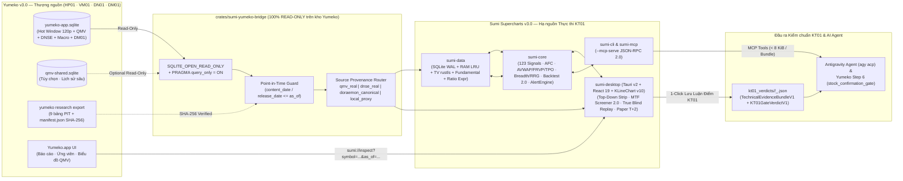
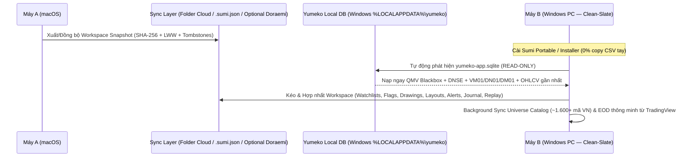

# SUMI SUPERCHARTS `v3.0.0` — KIẾN TRÚC LIÊN HỆ THỐNG `YUMEKO ↔ SUMI` CHUẨN QMV TOP-DOWN, ĐA NỀN TẢNG (`macOS ↔ WINDOWS`) & KẾ HOẠCH THI CÔNG TỔNG THỂ (`MASTER IMPLEMENTATION PLAN`)

- **Phiên bản mục tiêu:** `Sumi Supercharts v2.2.0` → **`v3.0.0`**
- **Ngày lập đặc tả:** `2026-11-27`
- **Phạm vi hệ sinh thái:**
  - **Trạm thực thi kỹ thuật & dòng tiền (`KT01`):** `/Users/mizuhara/workspace/sumi` (Workspace chỉnh sửa chính)
  - **Trạm nghiên cứu thượng nguồn (`HP01 / VM01 / DN01 / DM01`):** `/Users/mizuhara/workspace/yumeko` (**Chế độ Chỉ Đọc mặc định**; chỉ đề xuất mở rộng tối thiểu, không phá vỡ tương thích nếu được duyệt)
  - **Hạ tầng Đồng bộ Đám mây Cá nhân (`Doraemi /sync/v1`):** `/Users/mizuhara/workspace/Doraemi` (**Chỉ Đọc kiểm chứng schema** — phát hiện ràng buộc quan trọng tại `chk_yumeko_sync_entity_kind`)

---

## 0. PHÁT HIỆN THỰC CHỨNG CỐT LÕI TỪ MÃ NGUỒN & CSDL THẬT

Trước khi thiết kế, toàn bộ mã nguồn và CSDL đang chạy thật của cả **Sumi**, **Yumeko** và **Doraemi** đã được kiểm chứng trực tiếp ở chế độ chỉ đọc (`mode=ro` + `PRAGMA query_only = ON`):

1. **Kho dữ liệu thật đang có sẵn trong `~/.local/share/yumeko/yumeko-app.sqlite` (`63,4 MiB`):**
   - `qmv_compact_rows`: **`52.705` dòng** trên `32` schema, bao gồm dữ liệu **QMV Blackbox thật (`qmv_real`)**:
     - `technical_metrics`: `4.200` dòng (`55` mã, `2026-03-17` → `2026-11-25`) — `TMC / TMA20 / TMA50 / DSPI / MPICP / DM / DS / TP1 / TP2 / SL`
     - `active_money`: `4.065` dòng (`56` mã, `2025-12-26` → `2026-11-25`) — Dòng tiền chủ động *Cáo – Sói – Thỏ*
     - `symbol_foreign_flow_current`: `1.242` dòng (`15` mã) & `market_foreign_flow_current`: `150` dòng — Khối ngoại mua/bán ròng thực
     - `bbmarket_v2_horizons_current` (`400` dòng), `market_sentiment_current` (`300` dòng), `division_current` (`2.167` dòng / `1.031` mã), `valuation_report_current` / `valuation_relative_current` / `valuation_top_sectors_current`, `qmv60_membership` (`360`), `trading_ideas` (`597`), `screener` (`54`)
   - `symbol_valuation_snapshots`: **`592` bản ghi** (`540` `CSTC` trên `54` mã + `52` `CTKH`)
   - `dnse_mcp_observations`: **`112` bản ghi** (`price_get_history` trên `22` mã, `doraemi_company_fundamentals`, `doraemi_market_context`, `doraemi_screen_symbols`)
   - `personal_portfolio_snapshots`: `8` bản ghi có kiểm chứng SHA-256 (`F01`), `yr_macro_observations`: `1.708` quan sát vĩ mô PIT (`release_date <= as_of`), `yr_episodic_decisions`: `18` quyết định.
   - Ngoài ra trên máy Mac còn có kho lịch sử tĩnh chỉ đọc `/Users/mizuhara/workspace/yumeko/data/qmv-shared.sqlite` (`3,91 GB`).

2. **Ràng buộc quan trọng phát hiện ở `Doraemi /sync/v1` (ảnh hưởng trực tiếp thiết kế Sync Đa Máy):**
   - Bảng PostgreSQL `doraemon_ai.yumeko_sync_revisions` (migration `0005_cumulative_research_warehouse_and_full_sync.sql`) đặt **`CHECK` constraint cứng (`chk_yumeko_sync_entity_kind`)** chỉ cho phép đúng **18 loại `entity_kind`** của Yumeko (từ `accepted_report` đến `cutover_settings`).
   - Do đó, **Sumi không thể đẩy thẳng `entity_kind = 'sumi_workspace_state'` lên Doraemi hôm nay** nếu chưa deploy migration `0006` trên server Doraemi.
   - **Giải pháp kiến trúc thực dụng 3 tầng:** Thiết kế `SyncTransport` của Sumi chạy **ngay lập tức 100% không phụ thuộc server** qua **Sync Bundle `.sumi.json` + Đồng bộ Thư mục Đám mây hai chiều có Merge LWW & Tombstone (iCloud / OneDrive / Dropbox / Syncthing / Git)**, đồng thời cài đặt sẵn adapter **`DoraemiSyncTransport`** (tái sử dụng OAuth 2.1 + PKCE chuẩn Yumeko) để bật ngay khi người dùng đồng ý mở migration `0006` trên Doraemi.

3. **Ràng buộc Build Độc Lập Đa Máy (`Clean-Slate Windows PC`):**
   - **Tuyệt đối không dùng relative path `path = "../../yumeko/crates/yumeko-sumi-contract"` trong `sumi/Cargo.toml`**, vì trên một máy Windows PC mới chỉ clone repo `sumi` (hoặc build CI độc lập), đường dẫn tương đối ngoài repo sẽ làm vỡ biên dịch ngay lập tức.
   - Thay vào đó, tạo crate **`crates/sumi-yumeko-bridge`** nằm gọn trong workspace `sumi`, định nghĩa các struct **tương thích JSON/Wire 100%** với `SUMI_CONTRACT_VERSION_V1` (`yumeko_sumi_contract_v1`) và kiểm chứng tự động bằng bộ Golden Contract Tests.

4. **Lỗi cấu hình đóng gói hiện hữu trong Sumi `v2.2.0`:**
   - `crates/sumi-desktop/tauri.conf.json:7,9` đang trỏ sai `"npm --prefix ../ui run dev"` / `"npm --prefix ../ui run build"` (thiếu một bậc `../` so với `frontendDist: "../../ui/dist"`).
   - `scripts/package_macos_app.sh` vẫn là script cũ từ bản `v1.1.0` (`sumi-workstation` egui), chưa đóng gói Tauri v2 `sumi-desktop`!
   - `crates/sumi-desktop/src/state.rs:202-256` vẫn ưu tiên tìm `data/cache` theo `workspace_ancestor_dirs()` và tìm `HOME/workspace/sumi` thay vì dùng chuẩn thư mục OS (`~/.local/share/sumi` & `%LOCALAPPDATA%\sumi`).

---

## 1. KIẾN TRÚC TỔNG THỂ LIÊN HỆ THỐNG `YUMEKO ↔ SUMI` (`QMV TOP-DOWN`)

### 1.1. Sơ đồ Luồng Dữ liệu & Ranh giới Tin cậy Hai Chiều



### 1.2. Kỷ luật Ranh giới Bắt buộc (`Hard Guards`)

| # | Quy tắc Bắt buộc (`Hard Guard`) | Cơ chế Thực thi Kỹ thuật trong Code |
|---|---|---|
| **HG-1** | **Chỉ đọc tuyệt đối kho Yumeko** | Mọi kết nối tới `yumeko-app.sqlite` và `qmv-shared.sqlite` dùng `Connection::open_with_flags(path, OpenFlags::SQLITE_OPEN_READ_ONLY | OpenFlags::SQLITE_OPEN_NO_MUTEX)` + `PRAGMA query_only = ON` + `PRAGMA busy_timeout = 3000`. Không bao giờ ghi, tạo bảng hay khóa transaction ghi lên DB Yumeko. |
| **HG-2** | **Minh bạch nguồn dữ liệu (`Source Provenance`)** | Mọi chuỗi chỉ báo & phản hồi API đều mang enum `SourceProvenance::{QmvReal, DnseReal, DoraemonCanonical, TradingView, CafeF, LocalProxy}` và cờ `is_provider_proprietary: bool`. `QMV_FLOW`, `ProxyBB`, `CVD`, `DOM Ladder` luôn gắn `is_provider_proprietary = false` và huy hiệu màu hổ phách **`OHLCV Proxy (Sumi)`** — tuyệt đối không mạo danh Hộp đen QMV thật! |
| **HG-3** | **Chống rò rỉ tương lai (`Point-in-Time Guard`)** | Khi bật mốc `as_of` (hoặc đang trong Bar Replay), mọi truy vấn sang `qmv_compact_rows` (`content_date <= as_of`), `symbol_valuation_snapshots` (`content_date <= as_of`), `yr_macro_observations` (`release_date <= as_of`), `bars` (`timestamp_ms <= as_of_close_utc`) đều bị cắt nghiêm ngặt. Nếu chuỗi DNSE là `Retrospective` (`stored_at > as_of`), bắt buộc đẩy cảnh báo vào `gaps` và hạ trần độ tin cậy (`Confidence::Medium`). |
| **HG-4** | **Tách bạch Danh mục thật (`DM01`) vs Watchlist** | Thẻ ngữ cảnh `DM01` chỉ đọc trạng thái nắm giữ từ `personal_portfolio_snapshots` đã kiểm chứng SHA-256 (`F01`). Watchlist `QMV30 / QMV60 / yr_personal_watchlist ★` được hiển thị tách biệt hoàn toàn, không bao giờ suy diễn vị thế nắm giữ từ Watchlist. |
| **HG-5** | **Kỷ luật Tư vấn (`Advisory Only`)** | Mọi `TechnicalEvidenceBundleV1`, `KT01GateVerdictV1`, `BacktestSummaryV1` và công cụ `sumi-mcp` đều khóa cứng `advisory_only: true`, trình bày cấu trúc vùng giá/điều kiện vô hiệu hóa/R:R/xác suất lịch sử, không phát lệnh đặt mua/bán thực hay tỷ trọng khi thiếu bối cảnh `DM01`. |

### 1.3. Hợp đồng Hai Chiều `Yumeko ↔ Sumi` (`Wire-Compatible V1 + KT01 Verdict`)

1. **Chiều `Yumeko → Sumi`:**
   - **Thứ tự ưu tiên OHLCV:**
     - Chế độ Mặc định (Biểu đồ trực tiếp & 10 năm lịch sử): `sumi_market.db` (`CafeF + TradingView` + bổ sung nến `DNSE/QMV` từ Yumeko khi mã chưa có nến mới nhất hoặc đang offline).
     - Chế độ Nghiên cứu PIT (`as_of` từ Yumeko): ưu tiên chuỗi `dnse_real` / `qmv_real` (có `source_sha256` khớp Yumeko) khi đủ chiều dài, ghép nối minh bạch với lịch sử `sumi_market.db` nếu cần độ sâu 10 năm (cho `AFC` / `MA200` / Backtest), luôn ghi rõ nguồn gốc từng phân đoạn.
   - **Hộp đen QMV thật (`qmv_real`) & Ngữ cảnh Thượng nguồn:**
     - `QmvStockBlackboxSeries`: giải mã `qmv_compact_rows` (`family = 'technical_metrics'`) + `active_money` (*Cáo–Sói–Thỏ*) + `symbol_foreign_flow_current` → vẽ trực tiếp dưới biểu đồ nến Sumi (`QMV_STOCK_BB`, `QMV_ACTIVE_MONEY`, `QMV_FOREIGN_FLOW`).
     - `QmvMarketContextDto`: giải mã `bbmarket_v2_horizons_current`, `market_sentiment_current`, `market_foreign_flow_current`, `valuation_top_sectors_current`, `yr_macro_observations` (`VM01`), `symbol_valuation_snapshots` 8 quý (`DN01`), `personal_portfolio_snapshots` & `yr_personal_watchlist` (`DM01`).
   - **Deep-Link 1-Click (`Yumeko → Sumi`):**
     - URI chuẩn: `sumi://inspect?symbol=HOSE:FPT&as_of=2026-11-25&tf=1D&source=yumeko&run_id=...`
     - **Cơ chế định tuyến 3 lớp (chạy mượt cả macOS `.app` lẫn Windows Portable không cần quyền Admin):**
       1. OS URI Scheme (`CFBundleURLTypes` trong `Info.plist` macOS; tùy chọn `HKCU\Software\Classes\sumi` trên Windows).
       2. Single-Instance CLI args (`sumi-desktop --inspect HOSE:FPT --as-of 2026-11-25 --tf 1D`).
       3. Local Loopback Handoff (`http://127.0.0.1:<ephemeral_port>/ipc/inspect` với per-session Bearer nonce lưu trong `~/.local/share/sumi/runtime.lock` `0600`) — Yumeko hoặc CLI gọi tới để focus đúng cửa sổ Sumi đang mở mà không sinh thêm tiến trình trùng!

2. **Chiều `Sumi → Yumeko & AI Agent (agy acp)`:**
   - **Gói chuẩn `TechnicalEvidenceBundleV1` (`schema_version = "yumeko_sumi_contract_v1"`):** Tương thích nhị phân/JSON 100% với `/Users/mizuhara/workspace/yumeko/crates/yumeko-sumi-contract/src/lib.rs`.
   - **Phần mở rộng tương thích ngược `KT01GateVerdictV1` (`schema_version = "sumi_kt01_verdict_v1"`):**
     ```json
     {
       "schema_version": "sumi_kt01_verdict_v1",
       "verdict_id": "kt01_FPT_2026-11-25_<sha8>",
       "symbol": "HOSE:FPT",
       "as_of": "2026-11-25",
       "advisory_only": true,
       "provenance": { "ohlcv": "tradingview+cafef", "qmv_flow": "qmv_real", "fundamentals": "qmv_real" },
       "mtf_structure": { "w1": "...", "d1": "...", "h1": "..." },
       "active_signals": [ { "id": "...", "category": "...", "is_ohlcv_proxy": false } ],
       "key_levels": { "avwap": [], "frvp_poc": null, "frvp_vah": null, "frvp_val": null, "supports": [], "resistances": [] },
       "afc_projection": { "horizon": 10, "p10": 0.0, "p50": 0.0, "p90": 0.0, "hit_rate_pos": 0.0 },
       "trade_plan": { "entry": 0.0, "stop_loss": 0.0, "target_1": 0.0, "net_r_multiple": 0.0, "warnings": [] },
       "backtest_summary_v1": null,
       "technical_evidence_bundle_v1": { "...": "100% yumeko_sumi_contract_v1" },
       "gaps": [],
       "bundle_sha256": "<64-hex>"
     }
     ```
   - **Vị trí lưu xuất chuẩn:** `~/.local/share/sumi/kt01_verdicts/<as_of>/<SYMBOL>_<sha8>.json` (và `.md` tóm tắt); nếu phát hiện thư mục dữ liệu Yumeko, tùy chọn ghi thêm bản sao đọc-được vào `<YUMEKO_DATA_DIR>/sumi_evidence/` (thư mục tách biệt hoàn toàn, **0 ghi vào `yumeko-app.sqlite`**).
   - **MCP Server (`sumi-cli mcp-serve` & `sumi-desktop --mcp-serve`):** JSON-RPC 2.0 qua stdio với 5 công cụ giới hạn dung lượng (tương tự `--chat-mode` của Yumeko):
     1. `sumi_kt01_analyze_symbol` (`symbol`, `as_of`, `timeframes`, `include_afc`, `include_trade_plan`)
     2. `sumi_mtf_screen` (`basket`, `w1_signals`, `d1_signals`, `h1_signals`, `fundamental_filters`, `limit`)
     3. `sumi_run_backtest` (nhận `BacktestRequestV1` → trả `BacktestSummaryV1` + WFO/MC)
     4. `sumi_market_breadth_rrg` (`as_of`, `basket`)
     5. `sumi_export_kt01_verdict` (xuất và ghim `SHA-256` ra ổ đĩa để Yumeko / `agy acp` trích dẫn ở Bước 6 & Báo cáo 20 phần).

---

## 2. KIẾN TRÚC ĐA THIẾT BỊ & ĐA NỀN TẢNG (`macOS ↔ WINDOWS PC ↔ LINUX`)

### 2.1. Quy ước Thư mục Chuẩn (Đồng nhất 100% với Yumeko — 0% Hardcoded Paths)

| Thành phần | macOS | Windows 10 / 11 (x64) | Linux (XDG) | Biến môi trường ghi đè |
|---|---|---|---|---|
| **Cấu hình & Bí mật** (`sync_config.json`, `alerts_secrets.json`, `tv_auth.json` — `0600` trên Unix) | `~/.config/sumi/` | `%APPDATA%\sumi\` | `$XDG_CONFIG_HOME/sumi/` | `SUMI_CONFIG_DIR` |
| **Kho Dữ liệu Sumi** (`sumi_market.db`, `sumi_workspace.db`, `kt01_verdicts/`, `exports/`, `runtime.lock`) | `~/.local/share/sumi/` | `%LOCALAPPDATA%\sumi\` | `$XDG_DATA_HOME/sumi/` | `SUMI_DATA_DIR` |
| **Tự động phát hiện Kho Yumeko (Read-Only)** | `~/.local/share/yumeko/yumeko-app.sqlite` | `%LOCALAPPDATA%\yumeko\yumeko-app.sqlite` | `$XDG_DATA_HOME/yumeko/yumeko-app.sqlite` | `YUMEKO_DATA_DIR` |
| **Cấu hình Yumeko (Chỉ đọc metadata sync nếu cần)** | `~/.config/yumeko/` | `%APPDATA%\yumeko\` | `$XDG_CONFIG_HOME/yumeko/` | `YUMEKO_CONFIG_DIR` |
| **Ứng dụng Đóng gói** | `~/Applications/Sumi Supercharts.app` | `%LOCALAPPDATA%\Programs\Sumi\sumi-desktop.exe` | `/usr/local/bin/sumi-desktop` | — |

### 2.2. Quy trình Di trú Tự động An toàn từ `v2.2.0` (`Zero Data Loss Migration`)

Trên máy Mac hiện tại đang vận hành `~/Library/Application Support/com.sumi.supercharts/{sumi_market.db, sumi_workspace.db}` (`84,4 MiB` + `76 KiB` WAL):
1. Khi khởi động `v3.0`, nếu `SUMI_DATA_DIR` **chưa có** `sumi_market.db` / `sumi_workspace.db` nhưng phát hiện thư mục cũ `~/Library/Application Support/com.sumi.supercharts/` (hoặc `%APPDATA%\com.sumi.supercharts\` trên Windows cũ):
   - Mở DB nguồn qua `rusqlite::backup::Backup` (đảm bảo hợp nhất sạch toàn bộ trang WAL đang mở, không bao giờ copy file `.db` cụt mất `-wal`!).
   - Ghi vào file tạm `.migrating` → kiểm chứng `PRAGMA integrity_check` + tính `SHA-256` → đổi tên nguyên tử sang `~/.local/share/sumi/{sumi_market.db, sumi_workspace.db}`.
   - Lưu biên lai `~/.local/share/sumi/.migration_v3_receipt.json`. **Tuyệt đối không xóa dữ liệu cũ** trong `Application Support` để người dùng luôn có bản dự phòng quay lui.
2. Ghi chú quan trọng về chế độ Dev: loại bỏ thói quen ngầm tự trỏ vào `<repo>/data/cache/sumi_market.db` gây lệch DB giữa bản dev và bản `.app` đóng gói! Chỉ dùng `<repo>/data/cache` làm **nguồn seed dự phòng** nếu `SUMI_DATA_DIR/sumi_market.db` chưa tồn tại (hoặc khi người dùng đặt rõ `SUMI_DATA_DIR=./data/cache`).

### 2.3. Trải nghiệm Máy Mới `Clean-Slate` & Đồng bộ Đa Máy (`Mac ↔ Windows PC`)



- **Phạm vi đồng bộ Không gian làm việc (`sumi_workspace_bundle_v1` — 11 miền dữ liệu, loại trừ hoàn toàn khóa bí mật Telegram/Webhook):**
  1. `watchlists` & `watchlist_items` (kèm `sort_order` & Section Headers)
  2. `symbol_flags` (Cờ màu)
  3. `saved_screens` (Bộ lọc Screener cá nhân)
  4. `chart_layouts` & `pane_indicators`
  5. `indicator_templates`
  6. `drawings` (kèm thư mục nhóm & AVWAP/FRVP/Callout)
  7. `price_alerts` (kèm cấu hình `AlertEngine`, không kèm token Telegram)
  8. `paper_broker_snapshots` & `journal_annotations` (kèm `SetupTag / MistakeTag / Checklist 6`)
  9. `replay_sessions`
  10. `workspace_settings` (`kv_store` chọn lọc)
  11. `kt01_verdicts` metadata
- **Cơ chế chống mất dữ liệu khi đồng bộ 2 chiều:**
  - Mỗi bản ghi có `updated_at_ms`; mọi thao tác xóa ghi vào bảng `sync_tombstones (entity_kind, entity_key, deleted_at_ms)` để xóa trên Mac sẽ xóa sạch tương ứng trên Windows thay vì bị "hồi sinh".
  - Trước mỗi lần hợp nhất (`merge`), tự động tạo bản chụp phục hồi `sumi_workspace.pre_sync.bak` (giữ xoay vòng 5 bản gần nhất).
  - Kiểm tra `payload_sha256` fail-closed trước khi áp dụng vào SQLite.

### 2.4. Tương thích Build & Đóng gói 100% trên cả macOS và Windows

- **Chuẩn hóa Dependencies Rust (0% OpenSSL hệ thống):**
  - `rusqlite = { version = "0.37", features = ["bundled", "backup"] }`
  - `reqwest = { version = "0.12", default-features = false, features = ["rustls-tls", "json"] }`
  - `tradingview-rs` giữ `default-features = false, features = ["rustls-tls"]`
  - `sha2 = "0.10"`, `hex = "0.4"` (kiểm chứng SHA-256 thống nhất với Yumeko)
  - Windows subprocesses (nếu gọi trình duyệt/CLI phụ): đặt `CREATE_NO_WINDOW` (`0x08000000`) & `#![cfg_attr(not(debug_assertions), windows_subsystem = "windows")]`.
- **Chuẩn hóa UI Đa nền tảng:**
  - Helper `isMacPlatform()` hiển thị nhãn phím tắt **`⌘K / ⌘Z`** trên macOS và **`Ctrl+K / Ctrl+Z`** trên Windows/Linux.
  - Font stack hiển thị chuẩn tiếng Việt có dấu trên cả 2 HĐH: `'Inter', 'Be Vietnam Pro', -apple-system, BlinkMacSystemFont, 'Segoe UI', system-ui, sans-serif` & monospace `'JetBrains Mono', 'SF Mono', 'Cascadia Code', Consolas, monospace`.
- **Bộ Script Đóng gói Chuẩn hóa:**
  - `scripts/build-macos-app.sh` (mô phỏng chuẩn `yumeko/scripts/build-macos-app.sh`): build `ui/dist`, build `sumi-desktop` + `sumi-cli`, tạo `~/Applications/Sumi Supercharts.app` (kèm `CFBundleURLTypes` cho `sumi://`, ad-hoc `codesign`, dọn LaunchServices/Spotlight cache, tùy chọn `--dmg`).
  - `scripts/build-windows-app.ps1` (mô phỏng chuẩn `yumeko/scripts/build-windows-app.ps1`): build `ui/dist`, build `sumi-desktop.exe` + `sumi-cli.exe`, tạo `dist-windows\Sumi\` + `sumi.cmd` + `Sumi-v3.0.0-windows-x64-portable.zip`, hỗ trợ `-InstallToLocalAppData` (`%LOCALAPPDATA%\Programs\Sumi`), `-CreateDesktopShortcut`, `-RegisterUriScheme` (`HKCU\Software\Classes\sumi`), và `-BuildInstaller` (NSIS `.exe` / MSI `.msi`).
  - `.github/workflows/ci-cross-platform.yml`: kiểm thử biên dịch + unit test trên cả `macos-latest` và `windows-latest`.

---

## 3. LỘ TRÌNH THI CÔNG 5 WAVE ĐỘC LẬP & TIÊU CHÍ NGHIỆM THU

Mỗi Wave đều độc lập, có ranh giới module rõ ràng, có unit/integration tests riêng và bắt buộc vượt qua toàn bộ cổng kiểm định (`cargo test --workspace`, `cargo clippy --workspace --all-targets`, `npm --prefix ui run typecheck && test && build`) trước khi chuyển Wave tiếp theo.

---

### WAVE 1 — Nền tảng Đa Nền tảng, Vá 5 Lỗi Kiểm toán, Xóa "Bẫy EOD Cũ", `ADJ` & Workspace Sync v1 (`v2.2.0 → v2.4.0`)

**Hạng mục triển khai cụ thể:**
1. **Hạ tầng Đường dẫn & Di trú Đa Hệ điều hành (`crates/sumi-data/src/paths.rs`, `crates/sumi-desktop/src/state.rs`):**
   - Chuẩn hóa `sumi_config_dir()`, `sumi_data_dir()`, `yumeko_config_dir()`, `yumeko_data_dir()` cho macOS / Windows / Linux + biến môi trường ghi đè.
   - Auto-migration an toàn bằng SQLite Backup API từ `~/Library/Application Support/com.sumi.supercharts/` sang `~/.local/share/sumi/` (không xóa file cũ, có receipt SHA-256).
   - Loại bỏ hoàn toàn đường dẫn hardcode repo và sửa `crates/sumi-desktop/tauri.conf.json` (`../../ui`, version `3.0.0`).
2. **Vá dứt điểm 5 Lỗi Kỹ thuật Kiểm toán:**
   - **(Bug 1)** Dịch ngược `HNX:VN301! → HNX:VN30F1!` & `HNX:VN302! → HNX:VN30F2!` trong `QuoteStreamHandler::handle_quote_data` (`tradingview_feed.rs`); giữ nguyên 5 trường `bid, ask, open, high, low` trong `LiveQuotePayload` (`commands/market.rs`).
   - **(Bug 2)** Mở rộng `crates/sumi-desktop/capabilities/default.json` cho `"windows": ["main", "chart_*"]`; định danh khóa luồng `bar_streams` theo `format!("{window_label}::{slot_id}")` để cửa sổ phụ không bao giờ ngắt luồng cửa sổ chính; đồng bộ cả `barSpace` trên `TimeRangeBus`.
   - **(Bug 3)** Thêm `'30m'` vào `INTRADAY_INTERVALS` và `ICT Session Breaks` (`ui/src/utils/vnMarket.ts`); sửa chế độ múi giờ `Auto` tôn trọng `ResolvedSymbol.timezone` cho cổ phiếu Mỹ/quốc tế.
   - **(Bug 4)** Sửa SQL `ratio-splicing` trong `crates/sumi-data/src/storage.rs` lọc `source IN ('cafef_adjusted', 'cafef_spliced')`, chia `volume / ratio` nhất quán ở cả `migrate_to_v2` lẫn `upsert_bars`, và đồng bộ cột `turnover` để chia tách nhiều lần không tạo vết gãy.
   - **(Bug 5)** Sửa `crates/sumi-core/src/trading/portfolio.rs:1939`: lệnh `OrderKind::Limit` khớp tối đa tại đúng `limit_price` (không bị cộng trượt giá vượt giá đặt; hỗ trợ cấu hình rõ nếu người dùng muốn fill bảo thủ).
3. **Mở rộng Khung giờ, Auto-Rollup Offline, Xóa "Bẫy EOD Cũ" & Nút `ADJ`:**
   - Thêm `M30` và `MN1` vào `sumi_core::Timeframe` + `Interval::to_core_timeframe()`; hỗ trợ tự tổng hợp đa khung (`1W, 1M, 2D, 3D, 2h, 45m`) từ SQLite khi Offline hoặc khi chuỗi chưa tải; bổ sung tùy chọn căn phiên `4h` chuẩn sàn VN (`09:00–11:30` & `13:00–14:45 ICT`).
   - Thay điều kiện `cached_count < 15` trong `commands/scanner.rs` bằng kiểm tra độ tươi theo lịch giao dịch sàn VN (`last_vn_trading_session_date`); thêm lệnh **`sync_vn_universe_catalog`** (`tradingview-rs::list_symbols(Country::VN)` mở rộng lên `~1.600+` mã `HOSE/HNX/UPCOM`) và **`sync_universe_eod`** (đồng bộ bù nến EOD thiếu kèm kênh tiến độ mượt trên UI).
   - Mở khóa nạp `CafeF.SolieuGD.Raw*.csv` (`Adjustment::Unadjusted`) trong `import_cafef_dir` + nút **`ADJ`** ở góc dưới phải biểu đồ + tự động suy xuất và vẽ mốc sự kiện **`D` (Cổ tức) / `S` (Chia tách)** dưới chân nến từ tỷ số `Raw / Adjusted`.
4. **Workspace Sync v1 & Script Đóng gói Đa Nền tảng:**
   - Thêm bảng `sync_tombstones` & module `crates/sumi-desktop/src/sync.rs` (xuất/nhập `.sumi.json` có kiểm chứng SHA-256 + đồng bộ thư mục hai chiều LWW + giao diện Cài đặt Đồng bộ).
   - Tạo `scripts/build-macos-app.sh`, `scripts/build-windows-app.ps1`, `.github/workflows/ci-cross-platform.yml`, và tài liệu `docs/CROSS_PLATFORM_INSTALL_AND_SYNC.md`.

**Tiêu chí Nghiệm thu Wave 1 (`Acceptance Criteria`):**
- [ ] Khởi chạy trên máy Mac tự động di trú mượt `958k+` nến & workspace sang `~/.local/share/sumi/` (kiểm chứng count khớp 100%, giữ nguyên bản cũ không xóa).
- [ ] Unit tests xác nhận cả 5 bug đều đã sửa: `VN30F1!` nhận quote đúng khóa, `chart_*` không đụng stream `main`, `'30m'` giữ hình vẽ & vạch phiên, ratio-splice chạy đúng 2 lần chia tách liên tiếp, lệnh Limit Mua khớp `<= limit_price`.
- [ ] Chuyển Offline và mở khung `1W` / `1M` của mã chưa từng tải online vẫn vẽ đầy đủ nến tổng hợp từ `1D`.
- [ ] Bấm nút `ADJ` chuyển tức thì giữa Giá điều chỉnh (`splits`) và Giá gốc (`unadjusted`) kèm nhãn `D`/`S` tại các ngày chia tách thật của `HOSE:FPT`.
- [ ] Xuất Workspace Bundle từ DB A → nhập/hợp nhất vào DB B trống (mô phỏng Clean-Slate Windows) giữ nguyên 100% watchlists, drawings, layouts, alerts, journal, replay và đúng `SHA-256`.
- [ ] `scripts/build-macos-app.sh` đóng gói chạy được `~/Applications/Sumi Supercharts.app`; `build-windows-app.ps1` vượt qua kiểm tra cú pháp PowerShell & CI Windows workflow.

---

### WAVE 2 — Cầu nối Hai Chiều `Yumeko ↔ Sumi` chuẩn QMV Top-Down, `sumi-cli` & `sumi-mcp` (`v2.4.0 → v2.6.0`)

**Hạng mục triển khai cụ thể:**
1. **Crate mới `crates/sumi-yumeko-bridge`:**
   - Triển khai `YumekoReadOnlyStore`: tự động phát hiện `yumeko-app.sqlite`, tùy chọn `qmv-shared.sqlite`, và thư mục `yumeko research export` (`manifest.json` SHA-256 + 9 bảng PIT). Bắt buộc `SQLITE_OPEN_READ_ONLY` + `PRAGMA query_only = ON`.
   - Triển khai schema wire-identical `yumeko_sumi_contract_v1` (`CandleSeriesV1`, `IndicatorFrameV1`, `BacktestRequestV1`, `BacktestSummaryV1`, `TechnicalEvidenceBundleV1`) + `KT01GateVerdictV1`.
   - Giải mã chuẩn `qmv_compact_rows` (`qmv-compact-domain-v1`): `technical_metrics` (Hộp đen cổ phiếu), `active_money` (*Cáo–Sói–Thỏ*), `bbmarket_v2_horizons_current` (Hộp đen Thị trường), `symbol_foreign_flow_current` & `market_foreign_flow_current` (Khối ngoại thật), `valuation_report_current` / `symbol_valuation_snapshots` (CSTC 8 quý), `qmv60_membership`, `trading_ideas`, `screener`.
   - Trích xuất ngữ cảnh Top-Down `UpstreamContextDto` (`VM01` Macro/Market, `DN01` Valuation 8Q, `DM01` Holdings từ `personal_portfolio_snapshots` xác thực SHA-256 vs Watchlist ★ tách biệt) tuân thủ PIT `<= as_of`.
2. **Giao diện Top-Down & Chỉ báo Hộp đen QMV Thật trên Sumi (`ui/`):**
   - **Thanh ngữ cảnh Top-Down (`TopDownContextStrip` & tab `"Yumeko QMV"` trên RightWidgetBar):** Hiển thị trạng thái kết nối Yumeko (`Read-Only`), bộ chọn ngày chốt `as_of` PIT, chế độ `VM01`, thẻ định giá `DN01` 8 quý, huy hiệu `DM01` (*Đang nắm giữ* vs *Watchlist ★* vs *Ngoài danh mục*).
   - **3 Chỉ báo phụ dữ liệu thật (`qmv_real`):**
     - `QMV_STOCK_BB` (`TMC / TMA20 / TMA50 / DSPI / MPICP` — gắn huy hiệu xanh **`QMV Blackbox (Thật)`**; tự động hạ cấp sang `QMV_FLOW` có huy hiệu hổ phách **`OHLCV Proxy`** khi mã/máy không có dữ liệu `qmv_real`).
     - `QMV_ACTIVE_MONEY` (Cột dòng tiền *Cáo / Sói / Thỏ* + đường lũy kế thật từ Yumeko).
     - `QMV_FOREIGN_FLOW` (Khối ngoại Mua/Bán ròng thật từ Yumeko).
   - **Nút `"Lưu Luận Điểm KT01 (KT01 Verdict)"`:** Tạo gói bằng chứng có ghim `SHA-256`, lưu vào `~/.local/share/sumi/kt01_verdicts/` (+ bản sao tùy chọn vào `<YUMEKO_DATA_DIR>/sumi_evidence/`) kèm nút Copy Markdown dán thẳng vào Yumeko / `agy acp`.
3. **Deep-Link 1-Click (`Yumeko → Sumi`):**
   - Hỗ trợ URI `sumi://inspect?symbol=...&as_of=...&tf=...`, tham số CLI `--inspect --as-of --tf`, và Single-Instance Loopback IPC server (`runtime.lock` có nonce) để Yumeko mở thẳng mã + ngày `as_of` trên cửa sổ Sumi đang chạy.
4. **Crate mới `crates/sumi-cli` & chế độ `sumi-desktop --mcp-serve` (`sumi-mcp`):**
   - Headless CLI (`sumi-cli bridge status | analyze | screen | backtest | export-kt01 | sync | mcp-serve`).
   - Stdio JSON-RPC 2.0 MCP server (`protocolVersion = "2025-03-26"`) cung cấp 5 công cụ chuẩn cho Antigravity Agent (`agy acp`) & Yumeko.

**Tiêu chí Nghiệm thu Wave 2 (`Acceptance Criteria`):**
- [ ] Integration test mở `~/.local/share/yumeko/yumeko-app.sqlite` ở chế độ `READ-ONLY` nạp thành công dữ liệu `qmv_real` cho `FPT` (`TMC/DSPI/MPICP`, *Cáo–Sói–Thỏ*, CSTC 8Q) và chứng minh bằng test rằng `PRAGMA query_only = ON` chặn 100% mọi câu lệnh ghi.
- [ ] Golden contract test xác nhận `TechnicalEvidenceBundleV1` do Sumi xuất ra giải mã (deserialize) khớp 100% schema `yumeko_sumi_contract_v1` và khớp `SHA-256`.
- [ ] Kiểm thử chế độ `Clean-Slate` không có `yumeko-app.sqlite`: Sumi khởi chạy 0 lỗi, tự động chuyển mượt sang `local_proxy` kèm nhãn minh bạch.
- [ ] Kiểm thử Deep-Link CLI (`sumi-desktop --inspect HOSE:VCB --as-of 2026-11-20`) và `sumi-cli mcp-serve` trả lời chuẩn JSON-RPC 2.0 cho cả 5 tools (`initialize`, `tools/list`, `tools/call`).

---

### WAVE 3 — Mở khóa Toàn bộ "Kho Vũ Khí Ngầm" trong `sumi-core` lên Giao diện React (`v2.6.0 → v2.8.0`)

**Hạng mục triển khai cụ thể:**
1. **Cấu trúc Khối lượng, Giá vốn Tổ chức & Chỉ báo Phụ trợ:**
   - Công cụ vẽ 1 điểm neo **`Anchored VWAP (AVWAP ±1σ/2σ)`** nối `sumi_core::indicators::compute_anchored_vwap`.
   - Công cụ vẽ kéo vùng 2 điểm **`Fixed-Range Volume Profile (FRVP)`** nối `sumi_core::indicators::compute_volume_profile` (cột Mua/Bán + `POC`, `VAH`, `VAL 70%`).
   - Chỉ báo **`TPO Market Profile`** nối `sumi_core::indicators::compute_session_market_profiles` (`POC`, `VAH/VAL 70%`, `IB`, `Naked POC`).
   - Nâng cấp **`VRVP`** lên lõi Rust (`VAH/VAL` + tách Vol Mua/Bán + cho phép chỉnh màu) và sửa `IndicatorSettingsModal.tsx` giữ nguyên nét đứt cho `ICHIMOKU` / `VWAP`.
   - Mở lại 6 chỉ báo trong nhóm Phụ trợ (`SuperTrend`, `PSAR`, `Keltner`, `Stochastic`, `MFI`, `CVD [OHLCV Proxy]`) + công tắc đánh dấu **12 mẫu nến Nhật (`patterns.rs`)** trực tiếp trên nến.
2. **Màn hình Độ rộng Thị trường (`Market Breadth`), Biểu đồ Xoay Ngành `RRG` & Bản đồ Nhiệt `QMV Sector Heatmap`:**
   - Tauri command `get_market_breadth_rrg` bọc `sumi_core::scanner::breadth::compute_market_breadth_and_rrg` (tôn trọng mốc `as_of` / Replay cutoff!).
   - Tab Dock / Chế độ xem toàn màn hình **`"Thị trường & RRG"`**: KPI Độ rộng (`% > MA20/MA50/MA200`, Tăng/Giảm/Trần/Sàn), Biểu đồ SVG **4 Góc Phần Tư `RRG`** kèm đuôi quỹ đạo 4 phiên theo 11 ngành QMV & cổ phiếu, và **Treemap `QMV Sector Heatmap`** (chuyển đổi màu theo `% Đổi` chuẩn trần/sàn VN hoặc dòng tiền QMV).
3. **Hệ thống Cảnh báo Chuyên nghiệp (`AlertEngine` + Watchlist Alerts + Native OS & Telegram/Webhook):**
   - Thay thế bộ đánh giá cảnh báo cũ bằng **`sumi_core::alerts::AlertEngine`**: hỗ trợ toàn bộ `123` tín hiệu QMV (`SignalCatalogTrigger`), `ConfluenceThreshold`, chế độ lặp `OncePerBarClose` + `cooldown_bars`, sửa cảnh báo đã tạo, và bảng **`alert_trigger_log`** (tab Lịch sử nổ `Alert Log`).
   - **Watchlist Alerts:** Tác vụ nền canh cả rổ `QMV30 / QMV60 / Watchlist` tùy chọn.
   - **Đẩy thông báo ra ngoài:** Native OS Notification (`tauri-plugin-notification` cho macOS & Windows) + **Telegram Bot & Webhook URL** (lưu bí mật riêng tại `~/.config/sumi/alerts_secrets.json` `0600`, có nút "Gửi tin thử").
4. **Thực thi, Quản trị Vốn, Nhật ký, DOM & Báo cáo Tổ chức:**
   - Thêm loại lệnh **`STOP`** vào `PaperBrokerTab.tsx`.
   - Nối click khung vẽ `longPosition` / `shortPosition` → **Modal/Panel `Trade Planner` (`journal/planner.rs`)** tự tính số cổ phiếu làm tròn lô `100`, bước giá sàn, `Net R:R`, cảnh báo sàn cứng `T+2` & biên độ, và nút 1-click đẩy lệnh sang Paper Broker.
   - Hoàn thiện **Nhật ký Giao dịch (`journal/ledger.rs`)**: chọn `SetupTag` (7), `MistakeTag` (8 — sửa lỗi ghi đè mất `mistake_tag` ở `PaperBrokerTab.tsx:213`), `Checklist 6 điểm`, thống kê **`SQN`**, **`Cost of Mistakes`**, Win Rate / Profit Factor / Expectancy & đường cong vốn SVG trong `PaperBrokerTab`.
   - Bật tùy chọn bảng **`Synthetic DOM Ladder`** (`trading/ladder.rs`, gắn nhãn minh bạch `OHLCV Synthetic`).
   - Nối **`Session Debrief`** (`trading/coaching.rs`) khi kết thúc phiên Bar Replay.
   - Nối nút **Xuất Báo cáo Backtest `HTML / In PDF`** (`backtest/report_html.rs`), **`Parameter Sweep`**, **`All-Presets Battle`**, quạt phân vị **Monte Carlo (`checkpointEnvelopes`)**, và bảng chi tiết từng fold + tùy chỉnh số fold/IS% trên tab `Walk-Forward`.

**Tiêu chí Nghiệm thu Wave 3 (`Acceptance Criteria`):**
- [ ] Vẽ được `AVWAP` (1 click) và `FRVP` (2 click), tải lại ứng dụng hình vẽ vẫn còn và tính đúng `POC / VAH / VAL 70%`; bật `TPO Market Profile`, `SuperTrend`, `PSAR`, `Keltner`, `Stochastic`, `MFI`, `CVD` và 12 mẫu nến Nhật hoạt động mượt.
- [ ] Bảng `Độ rộng & RRG` + `Sector Heatmap` hiển thị đủ 11 ngành QMV, bấm vào 1 ngành lọc/mở nhanh mã đại diện, đồng bộ mốc thời gian khi đang Bar Replay.
- [ ] Tạo được cảnh báo trên tín hiệu QMV (`SIGNAL_CATALOG`), Watchlist Alert, sửa cảnh báo, xem Alert Log, và kiểm chứng gửi Webhook/Telegram mock thành công + bí mật không lọt vào Sync Bundle.
- [ ] Click khung `longPosition` mở `Trade Planner` tính đúng lô `100` & cảnh báo `T+2`; xuất được file báo cáo Backtest `.html` mở trình duyệt/in PDF đầy đủ bảng số liệu & SVG.

---

### WAVE 4 — Vũ khí Thực chiến `KT01`: MTF Screener 2.0, Fundamentals & Biểu đồ Công thức/So sánh (`v2.8.0 → v2.9.0`)

**Hạng mục triển khai cụ thể:**
1. **Metadata Doanh nghiệp & Chuỗi BCTC (`tradingview-rs::fundamental` + Yumeko `fundamentals_pit`):**
   - Giữ đầy đủ các trường `SymbolInfo` (`sector, industry, market_cap_basic, price_earnings_ttm, last_annual_eps, total_shares_outstanding_calculated, total_revenue, earnings_release_date, business_description`) trong `ResolvedSymbol` & `symbols`.
   - Thêm bảng `fundamentals` vào `sumi_market.db`; hợp nhất ưu tiên: **(1) Yumeko `symbol_valuation_snapshots` (PIT xác thực)** → **(2) `tradingview-rs::fundamental` (Guest 100% miễn phí cho cả mã ngoài danh sách Yumeko & cổ phiếu Mỹ)**.
   - Vẽ 4 đường cơ bản dạng step-line dưới biểu đồ `1D/1W`: **`P/E TTM động`**, **`P/B`**, **`ROE (%)`**, **`Tăng trưởng LNST YoY (%)`**, kèm mốc sự kiện **`E` (BCTC)** dưới chân nến (chung hàng với `D` và `S`).
2. **Stock Screener 2.0 Đa Khung Thời Gian (`MTF Two-Stage Funnel: 1W + 1D + 1H`):**
   - **Tầng 1 (`< 150ms` SQLite cục bộ):** Đánh giá đồng thời điều kiện `1W` (tổng hợp nhân quả từ `1D`) `AND` điều kiện `1D` trên toàn bộ `123` tín hiệu (khôi phục đủ tab `'pattern'` và `'structure'`, nối 3 ô lọc `minChangePct`, `macdFilter`, `minHealthScore`) + bộ lọc cơ bản (`P/E`, `P/B`, `ROE`, `LNST YoY`) + bộ lọc Hộp đen QMV thật (khi nối Yumeko).
   - **Tầng 2 (`Smart Intraday Funnel`):** Khi có điều kiện `1H` (hoặc `4H / 15m`), chỉ tải/đánh giá nến intraday cho Top `N` (mặc định `50`) mã đã qua Tầng 1 dưới sự điều tiết của `FeedRateLimiter`.
   - Thêm bảng SQLite `saved_screens` (Lưu/Tải/Xóa nhiều bộ lọc cá nhân, đồng bộ qua Workspace Sync), nút **1-click `"Lưu thành Watchlist"`**, và công tắc `Auto-Refresh` (`1p / 5p`) cho rổ Watchlist/QMV60.
3. **Biểu đồ Công thức & So sánh Liên thị trường (`Compare +` & `Ratio / Spread Charts`):**
   - **Nút `Compare (+)`:** Chồng tối đa 5 mã theo `%` chuẩn hóa từ mép trái khung nhìn (dùng `sumi_core::indicators::compute_rebased_comparison_series`), hỗ trợ bật/tắt/đổi màu nhanh.
   - **Bộ phân tích Biểu thức Mã (`crates/sumi-data/src/expression.rs`):** Gõ trực tiếp vào ô tìm mã:
     - `HOSE:SSI / HOSE:VNINDEX` → trả chuỗi nến OHLC tỷ số (vẽ được nến, kẻ Trendline, bật Ichimoku/MA/AVWAP trực tiếp trên RS!).
     - `HNX:VN30F1! - HOSE:VN30` → vẽ biểu đồ độ lệch `Basis` phái sinh.
     - `(HOSE:HPG + HOSE:HSG + HOSE:NKG) / 3` → rổ ngành tùy biến.
     - Căn chỉnh giao điểm `timestamp` chặt chẽ, chạy 100% Offline và hỗ trợ cả Replay!

**Tiêu chí Nghiệm thu Wave 4 (`Acceptance Criteria`):**
- [ ] Lọc thành công tổ hợp đa khung `1W` + `1D` (`< 200ms`) và phễu `1W + 1D + 1H` (không stall 475 mã); lưu/nạp được Saved Screen và 1-click tạo Watchlist mới từ kết quả lọc.
- [ ] Mở `HOSE:SSI / HOSE:VNINDEX` và `HNX:VN30F1! - HOSE:VN30` vẽ ra nến chính xác (kiểm chứng bằng unit test phép chia/trừ OHLC theo giao điểm timestamp) và vẽ được Trendline + Ichimoku trực tiếp trên biểu đồ tỷ số.
- [ ] Chỉ số `P/E, P/B, ROE, Tăng trưởng LNST` hiển thị đúng trên Thẻ chi tiết mã, Screener và sub-pane dưới biểu đồ (đối chiếu khớp với Yumeko `CSTC` cho `FPT` khi nối bridge).

---

### WAVE 5 — Strategy Tester 2.0 (`Pyramiding / Scale-out / Bar Magnifier`), True Blind Replay Drill & Workspace UX Pro (`v2.9.0 → v3.0.0`)

**Hạng mục triển khai cụ thể:**
1. **Strategy Tester 2.0 chuẩn Đi vốn QMV (`crates/sumi-core/src/backtest/` & `StrategyTesterTab.tsx`):**
   - **Pyramiding / Scale-in nhiều nhịp (`max_pyramiding: 1..5`, phân bổ tỷ trọng ví dụ `30% / 50% / 20%`):** Chuyển `ActivePositionState` sang hàng đợi lô FIFO, mỗi lô giải ngân khóa **`T+2` (hoặc `T+3` lịch sử trước 08/2022) độc lập theo lịch lễ VN**.
   - **Scale-out (Chốt lời từng phần) & Trailing Stop:** Chốt `X%` (ví dụ `50%`) số cổ phiếu đã về tại `TP1`, phần còn lại gồng theo `Trailing MA20` / `Kijun(18)` / `ATR Chandelier`.
   - **`Bar Magnifier`:** Tùy chọn dùng nến khung nhỏ (`15m` / `1h`) khi 1 cây nến `1D` chạm đồng thời cả `SL` lẫn `TP` để xác định thứ tự chạm thực (trả thống kê số nến đã phóng đại vs fallback bảo thủ SL-trước).
   - **Rule Builder 2 tầng `AND / OR` đầy đủ:** Mở khóa toàn bộ năng lực đã có trong `sumi-core` (`4` nhóm × `8` mệnh đề `AND/OR`, `Long` & `Short`, ngưỡng số thực, đủ `123` tín hiệu).
   - **Bảng nhiệt Lợi nhuận `Tháng × Năm` (`Monthly Performance Heatmap`).**
2. **True Blind Replay Drill (`🎲 Luyện Phản Xạ Mù`) & `Jump to Date`:**
   - Thêm bộ chọn ngày **`Jump to Date`** (`<input type="date">`) trên `ReplayControlBar.tsx` gọi `replay_jump`.
   - Chế độ **`Random Blind Drill`:** Bốc ngẫu nhiên mã trong rổ `QMV30 / QMV60 / VN` + ngày lịch sử ngẫu nhiên (`2018–2025`), ẩn hoàn toàn tên mã (`MÃ ẨN #A7`), chuyển trục thời gian sang tương đối (`Phiên #1..#N`), nhân toàn bộ giá với hệ số ẩn chuẩn hóa điểm cắt về `100.0`, khóa mọi gợi ý từ Watchlist/Yumeko, và chỉ **Lật bài kèm `Session Debrief`** khi kết thúc phiên!
3. **Workspace UX Pro:**
   - **`Shift + Click`** đo nhanh biên độ giá / `%` / số nến (ephemeral ruler, không làm mất công cụ vẽ đang chọn).
   - **`Alt + Enter`** (và nút góc ô) phóng to tạm thời 1 ô biểu đồ trong lưới 2–4 ô mà không unmount hay mất trạng thái.
   - **Watchlist Pro:** Cờ màu (`symbol_flags`: Đỏ / Cam / Xanh / Lơ / Tím + lọc theo cờ), Tiêu đề nhóm (`###SECTION:...`), Kéo thả sắp xếp (`sort_order`), Sắp xếp theo cột (`% Đổi / Giá / KL`), nút Đổi tên & Xóa Watchlist.
   - **Công cụ vẽ nâng cao:** Hộp nhập chữ cho `Callout / Text Note`, công cụ `Path`, `Highlighter`, `Pitchfork`, `Fib Time Zones`, click mục trong Cây đối tượng để cuộn tới hình vẽ + Thư mục nhóm hình vẽ, và Undo/Redo cấp `workspaceStore` cho chỉ báo/mẫu chỉ báo.
   - **Nâng cấp `Cmd/Ctrl + K` Command Palette:** Gõ trực tiếp tên mã / biểu thức công thức HOẶC gõ `>` để thực thi lệnh toàn hệ thống (`> ichimoku`, `> avwap`, `> replay`, `> blind`, `> breadth`, `> rrg`, `> sync`, `> kt01`, `> dark/light`).

**Tiêu chí Nghiệm thu Wave 5 (`Acceptance Criteria`):**
- [ ] Unit & integration tests xác minh `Pyramiding` 3 nhịp (`30/50/20`) khóa `T+2` riêng từng lô FIFO, `Scale-out 50%` tại `TP1` + gồng `50%` theo `Trailing MA20/Kijun`, và `Bar Magnifier` phân định đúng thứ tự chạm `SL` vs `TP` trên nến `15m/1h`.
- [ ] Rule Builder 2 tầng chạy được biểu thức `(A AND B) OR (C AND D)` cho cả Long và Short (`VN30F1!`); bảng nhiệt `Tháng × Năm` khớp tổng lợi nhuận năm.
- [ ] Khởi động `Random Blind Drill`: tên mã, ngày thật và thang giá gốc bị ẩn 100% trên mọi thành phần UI; bấm Lật bài hiện đúng mã thật, ngày thật và phiếu chấm điểm `Session Debrief`.
- [ ] Toàn bộ bộ kiểm thử `cargo test --workspace`, `cargo clippy --workspace --all-targets -- -D warnings`, `npm --prefix ui run typecheck && test && build` đạt **100% PASS (0 warnings, 0 errors)** và phát hành gói `Sumi Supercharts v3.0.0` hoàn chỉnh trên macOS + script sẵn sàng cho Windows.

---

## 4. CÁC QUYẾT ĐỊNH THIẾT KẾ CẦN CHỐT TRƯỚC KHI BẮT ĐẦU WAVE 1

Để triển khai chính xác tuyệt đối theo mong muốn vận hành thực tế của anh, xin anh xác nhận ngắn gọn **4 quyết định kiến trúc** sau trước khi bắt đầu viết code Wave 1:

1. **Cơ chế Đồng bộ Không gian Làm việc Đa Máy (`Mac ↔ Windows PC`):**
   - **Đề xuất (Khuyến nghị):** Triển khai ngay **Tầng 1 (Export/Import `.sumi.json` + Đồng bộ Thư mục Đám mây hai chiều có Merge LWW/Tombstone & kiểm chứng SHA-256 — hoạt động ngay không cần sửa server Doraemi)** + chuẩn bị sẵn trait `DoraemiSyncTransport` cho tương lai.
   - *Tùy chọn mở rộng:* Anh có muốn tôi chỉ chuẩn bị trước bản đề xuất SQL migration `0006` cho Doraemi, hay giữ nguyên repo `Doraemi` ở chế độ Read-Only trong đợt này?
2. **Nút Deep-Link 1-Click phía repo `Yumeko` (`/Users/mizuhara/workspace/yumeko`):**
   - **Đề xuất (Khuyến nghị):** Giữ repo `yumeko` **100% Read-Only** xuyên suốt Wave 1–5 (Sumi chủ động lắng nghe `sumi://inspect?...` và cung cấp `sumi-mcp` + xuất `kt01_verdicts/`). Sau khi Wave 2 chạy hoàn chỉnh, nếu anh đồng ý mới thêm đúng 1 nút nhỏ **"Mở trên Sumi (`KT01`)"** trên giao diện `Yumeko.app`.
3. **Thứ tự Ưu tiên Chuỗi OHLCV khi Kết nối Yumeko:**
   - **Đề xuất (Khuyến nghị):**
     - Khi xem biểu đồ bình thường / Backtest 10 năm / `AFC`: dùng `sumi_market.db` (`CafeF + TradingView` 10 năm) và **ghép bổ sung nến gần nhất từ `dnse_real` (Yumeko)** nếu nến DNSE mới hơn hoặc khi Offline.
     - Khi bật chế độ **Nghiên cứu Point-in-Time (`as_of` khóa từ Yumeko)**: ưu tiên chuỗi `dnse_real` / `qmv_real` khớp tuyệt đối `source_sha256` của Yumeko (và gắn nhãn nguồn minh bạch trên góc biểu đồ).
4. **Dữ liệu `git` chưa commit của bản `v2.2.0` hiện tại trong `/Users/mizuhara/workspace/sumi`:**
   - **Đề xuất (Khuyến nghị):** Giữ nguyên toàn bộ thay đổi `v2.2.0` đang có trong working tree làm nền tảng (hoặc anh có thể commit 1 snapshot mốc `v2.2.0` trước khi tôi bắt đầu Wave 1 để dễ đối chiếu `git diff` từng Wave).
