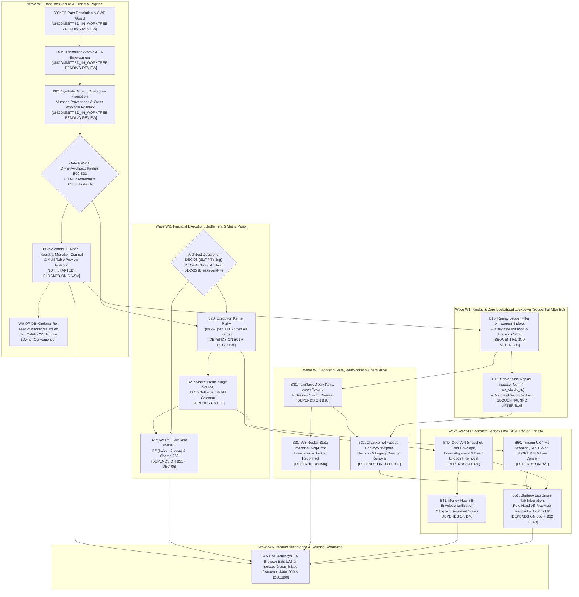

# SUMI V3 — BATCH DEPENDENCY AND STATUS BOARD (PROPOSED)

- **Document ID**: `SUMI-V3-BATCH-BOARD-2026-10-14`
- **Status**: **PROPOSED — RECONCILED PER EXTERNAL GPT-6 ARCHITECT REVIEW; AWAITING FINAL OWNER & ARCHITECT RATIFICATION**
- **Date**: 2026-10-14
- **Repository Root**: `/Users/mizuhara/workspace/sumi`
- **Companion Documents**:
  - [SUMI_V3_PRODUCT_COMPLETION_MASTER_PLAN_PROPOSED.md](SUMI_V3_PRODUCT_COMPLETION_MASTER_PLAN_PROPOSED.md)
  - [SUMI_V3_NEXT_WAVE_TEAMWORK_PROMPT_PROPOSED.md](SUMI_V3_NEXT_WAVE_TEAMWORK_PROMPT_PROPOSED.md)
- **Canonical Baseline References**:
  - [DEV_BATCHES.md](../DEV_BATCHES.md)
  - [SUMI_V3_MASTER_REFACTOR_PLAN.md](../SUMI_V3_MASTER_REFACTOR_PLAN.md)
  - [SUMI_GAP_REGISTER.md](../../architecture/SUMI_GAP_REGISTER.md)
  - [SUMI_BATCH_RECONCILIATION.md](../assessment_2026_10_12/SUMI_BATCH_RECONCILIATION.md)
  - Batch Prompt Specifications: `docs/plans/prompts/B00_db-path.md` through `docs/plans/prompts/B51_lab-ux.md` (with `B03` specified in [`DEV_BATCHES.md`](../DEV_BATCHES.md) and [`SUMI_V3_MASTER_REFACTOR_PLAN.md`](../SUMI_V3_MASTER_REFACTOR_PLAN.md))

---

## 1. Evidence & Status Classification Legend

To prevent status inflation and distinguish between code in the working tree, committed history, preserved test logs, and true product acceptance, every batch is tracked across **five independent status dimensions** and tagged with an **evidence confidence level**:

### 1.1 Evidence Confidence Tags
- **`VERIFIED`**: Directly confirmed by inspecting repository source files, git status/diff, or raw log file presence/checksums on disk during this read-only planning pass.
- **`REPORTED`**: Test execution results or narrative conclusions stated in prior agent reports and preserved raw log files (`artifacts/local/W0-A/final-remediation/logs/*.log`), where the log files are `VERIFIED` on disk but test commands were not re-executed during this read-only planning pass.
- **`HISTORICAL`**: Valid for an earlier commit or program lineage (`P1–P10` or V3 Final Handoff `2026-09-12`) prior to the October 2026 audit and `B00–B51` refactor program.
- **`PROPOSED`**: Recommended plan, dependency rule, complexity estimate, or operational step awaiting GPT-6 / Product Owner ratification.
- **`UNKNOWN`**: Not yet verifiable without running live browser UAT or executing new test suites.

### 1.2 Five Orthogonal Status Dimensions
1. **Implementation Status**: `NOT_STARTED` | `IN_WORKTREE_UNCOMMITTED` | `COMMITTED_HISTORICAL` | `COMPLETE_VERIFIED`
2. **Test Evidence Status**: `NONE` | `UNIT_INTEGRATION_REPORTED` | `UNIT_INTEGRATION_VERIFIED` | `FULL_GATES_AND_UAT_VERIFIED`
3. **Architectural Approval Status**: `NOT_SUBMITTED` | `PENDING_ARCHITECT_REVIEW` | `GATED_ON_ARCHITECT_DECISION` | `APPROVED`
4. **Commit / Merge Status**: `NOT_IN_WORKTREE` | `UNCOMMITTED_IN_WORKTREE` | `COMMITTED_ON_MASTER`
5. **Product Acceptance Status**: `NOT_ACCEPTED` | `HISTORICAL_ACCEPTED_SUPERSEDED` | `ACCEPTED_V3_COMPLETE`

> [!IMPORTANT]
> **Strict Non-Inflation Rule**: No batch in the `B00–B51` program is marked `ACCEPTED_V3_COMPLETE`. Specifically, `B00`, `B01`, and `B02` are `IN_WORKTREE_UNCOMMITTED` (`UNCOMMITTED_IN_WORKTREE`) and `PENDING_ARCHITECT_REVIEW`, and `B03` through `B51` are `NOT_STARTED` (`NOT_IN_WORKTREE`). `B03` remains strictly **BLOCKED** until the `W0-A` gate (`B00–B02` + 3 ADR Addenda ratification and baseline commit) is cleared.

---

## 2. Historical P-Lineage (`P1–P10`) vs. Active B-Lineage (`B00–B51`) Reconciliation

Before examining `B00–B51`, it is critical to distinguish the **completed historical `P1–P10` program** recorded in `docs/dev-program/STATE.json` from the **active `B00–B51` Product Completion Program**:

| Lineage | Batches | Scope | Commit / Tree State | Current Standing |
|---|---|---|---|---|
| **P-Lineage** (`docs/dev-program/STATE.json`) | `P1` through `P10` (`P10` reviewed `2026-09-14`) | Signal Engine Foundation (`P1`), Signal Families & Liquidity (`P2`), Multi-Horizon Outcome Lab (`P3`), Regime Segmentation (`P4`), Parameter Stability (`P5`), Cost/Turnover Realism (`P6`), Portfolio Constraints (`P7`), Walk-Forward Validation (`P8`), Research UI & Presets (`P9`), Final Research Pack (`P10`). | `COMMITTED_ON_MASTER` (`HISTORICAL` / `VERIFIED` in `backend/app/domain/` and `backend/app/services/`) | **`HISTORICAL_ACCEPTED_SUPERSEDED`**: Domain and research modules remain in the repository and provide the foundation for Scanner, Signals, and Strategy Lab, but the broader application requires `B00–B51` to resolve the P0/P1 architectural, financial, contract, and UX gaps documented in [`SUMI_GAP_REGISTER.md`](../../architecture/SUMI_GAP_REGISTER.md). |
| **B-Lineage** ([`DEV_BATCHES.md`](../DEV_BATCHES.md)) | `B00–B03`, `B10–B11`, `B20–B22`, `B30–B32`, `B40–B41`, `B50–B51` + `W5` | 16 product-completion batches closing all P0/P1 gaps across DB safety, Replay zero-lookahead, Financial execution/settlement/metrics parity, Frontend state/WS/ChartKernel, API contracts, and UX completion. | `B00–B02` `UNCOMMITTED_IN_WORKTREE` (`VERIFIED`); `B03–B51` `NOT_IN_WORKTREE` (`VERIFIED`). | **Active Product Completion Program** tracked in Sections 3–6 below. |

---

## 3. Master Dependency Graph & Wave Sequencing

### 3.1 Visual Dependency Graph (`B00–B51`)

### 3.2 Executive Summary Board (All Batches `B00–B51`)

| Batch ID | Wave | Title / Core Capability | Dependencies | Implementation Status | Test Evidence Status | Arch Approval Status | Commit / Merge Status | Product Acceptance Status | Complexity (`PROPOSED`) |
|---|---|---|---|---|---|---|---|---|---|
| **`B00`** | W0-A | DB Path Resolution & CWD Guard | None | `IN_WORKTREE_UNCOMMITTED` (`VERIFIED`) | `UNIT_INTEGRATION_REPORTED` (7 CWD + 30 safeguard tests in `artifacts/local/W0-A/`; `537` BE / `239` FE total) | `PENDING_ARCHITECT_REVIEW` | `UNCOMMITTED_IN_WORKTREE` (`VERIFIED`) | `NOT_ACCEPTED` | `LOW` |
| **`B01`** | W0-A | Transaction `atomic()` & SQLite FK Enforcement | `B00` | `IN_WORKTREE_UNCOMMITTED` (`VERIFIED`) | `UNIT_INTEGRATION_REPORTED` (15 tests in `test_b01_transaction_fk.py`) | `PENDING_ARCHITECT_REVIEW` (`ADR-TX-001`) | `UNCOMMITTED_IN_WORKTREE` (`VERIFIED`) | `NOT_ACCEPTED` | `MEDIUM` |
| **`B02`** | W0-A | Synthetic Provider Deny, Quarantine Promotion, Mutation Provenance & Cross-Workflow Rollback | `B01` | `IN_WORKTREE_UNCOMMITTED` (`VERIFIED`) | `UNIT_INTEGRATION_REPORTED` (`test_b02_*.py`, `test_adversarial_challenger.py`, `test_w0a_final_adversarial.py`) | `PENDING_ARCHITECT_REVIEW` (`ADR-PROV-001-ADDENDUM-01`, `ADR-TX-001-ADDENDUM-01`, `ADR-TX-001-ADDENDUM-02`) | `UNCOMMITTED_IN_WORKTREE` (`VERIFIED`) | `NOT_ACCEPTED` | `HIGH` |
| **`B03`** | W0-B | Alembic 20-Model Registry, Migration-Chain Compatibility & Multi-Table Preview Isolation | `B01` + **Gate `G-W0A`** (`B02` ratification & commit) | `NOT_STARTED` (`VERIFIED` **BLOCKED**) | `NONE` | `NOT_SUBMITTED` (Spec in `DEV_BATCHES.md`) | `NOT_IN_WORKTREE` (`VERIFIED`) | `NOT_ACCEPTED` | `MEDIUM` |
| **`B10`** | W1 | Replay Ledger Filter (`<= current_index`), Future-State Masking & Horizon Clamp | `B03` (Sequential 2nd in Wave `W0-B + W1`) | `NOT_STARTED` (`VERIFIED`) | `NONE` | `NOT_SUBMITTED` (Prompt in `B10_replay-ledger.md`) | `NOT_IN_WORKTREE` (`VERIFIED`) | `NOT_ACCEPTED` | `LOW` |
| **`B11`** | W1 | Server-Side Replay Indicator Cut (`<= max_visible_ts`) & `MappingResult` Contract | `B10` (Sequential 3rd in Wave `W0-B + W1`) | `NOT_STARTED` (`VERIFIED`) | `NONE` | `NOT_SUBMITTED` (Prompt in `B11_projected.md`) | `NOT_IN_WORKTREE` (`VERIFIED`) | `NOT_ACCEPTED` | `MEDIUM` |
| **`B20`** | W2 | Execution Kernel Unification (`Open[T+1]` Across All Paths) | `B01` + `DEC-03`, `DEC-04` | `NOT_STARTED` (`VERIFIED`) | `NONE` | `GATED_ON_ARCHITECT_DECISION` (`DEC-03`, `DEC-04`) | `NOT_IN_WORKTREE` (`VERIFIED`) | `NOT_ACCEPTED` | `HIGH` |
| **`B21`** | W2 | `MarketProfile` Single Source, `T+1.5` Settlement & VN Calendar | `B20` | `NOT_STARTED` (`VERIFIED`) | `NONE` | `NOT_SUBMITTED` (Prompt in `B21_marketprofile.md`) | `NOT_IN_WORKTREE` (`VERIFIED`) | `NOT_ACCEPTED` | `MEDIUM` |
| **`B22`** | W2 | Metrics Unification (Net PnL, Breakeven Rule, PF `N/A`, Sharpe 252) | `B21` + `DEC-05` | `NOT_STARTED` (`VERIFIED`) | `NONE` | `GATED_ON_ARCHITECT_DECISION` (`DEC-05`) | `NOT_IN_WORKTREE` (`VERIFIED`) | `NOT_ACCEPTED` | `MEDIUM` |
| **`B30`** | W3 | Frontend Query Keys, Navigation Token & Session Switch Cleanup | `B10` | `NOT_STARTED` (`VERIFIED`) | `NONE` | `NOT_SUBMITTED` (Prompt in `B30_fe-state.md`) | `NOT_IN_WORKTREE` (`VERIFIED`) | `NOT_ACCEPTED` | `MEDIUM` |
| **`B31`** | W3 | WebSocket Replay State Machine, Sequence Envelope & Auto-Reconnect | `B30` | `NOT_STARTED` (`VERIFIED`) | `NONE` | `NOT_SUBMITTED` (Prompt in `B31_ws.md`) | `NOT_IN_WORKTREE` (`VERIFIED`) | `NOT_ACCEPTED` | `MEDIUM` |
| **`B32`** | W3 | `ChartKernel` Facade, `ReplayWorkspace` Split & Dead Drawing Removal | `B30`, `B11` | `NOT_STARTED` (`VERIFIED`) | `NONE` | `NOT_SUBMITTED` (Prompt in `B32_chart.md`) | `NOT_IN_WORKTREE` (`VERIFIED`) | `NOT_ACCEPTED` | `HIGH` |
| **`B40`** | W4 | OpenAPI Contract Snapshot, Error Envelope & Dead Endpoint Removal | `B20` | `NOT_STARTED` (`VERIFIED`) | `NONE` | `NOT_SUBMITTED` (Prompt in `B40_contracts.md`) | `NOT_IN_WORKTREE` (`VERIFIED`) | `NOT_ACCEPTED` | `MEDIUM` |
| **`B41`** | W4 | Money Flow BB Envelope Unification & Degraded State Display | `B40` | `NOT_STARTED` (`VERIFIED`) | `NONE` | `NOT_SUBMITTED` (Prompt in `B41_bb.md`) | `NOT_IN_WORKTREE` (`VERIFIED`) | `NOT_ACCEPTED` | `LOW` |
| **`B50`** | W4 | Trading Practice UX (`T+1` Wording, SL/TP Alert, SHORT R:R, Limit Cancel) | `B21` | `NOT_STARTED` (`VERIFIED`) | `NONE` | `NOT_SUBMITTED` (Prompt in `B50_trading-ux.md`) | `NOT_IN_WORKTREE` (`VERIFIED`) | `NOT_ACCEPTED` | `MEDIUM` |
| **`B51`** | W4 | Strategy Lab Single Tab Integration, Rule Hand-off, `/backtest` Redirect & 1280px UX | `B50`, `B32`, `B40` | `NOT_STARTED` (`VERIFIED`) | `NONE` | `NOT_SUBMITTED` (Prompt in `B51_lab-ux.md`) | `NOT_IN_WORKTREE` (`VERIFIED`) | `NOT_ACCEPTED` | `MEDIUM` |

---

## 4. Operational Readiness Classification (What Is Where Right Now)

### 4.1 Complete & Committed on `master` (`HISTORICAL` / `VERIFIED`)
- **P-Lineage Research & Domain Foundation (`P1–P10`)**: Signal engine, liquidity filters, multi-horizon outcome lab, regime segmentation, parameter stability, cost/turnover realism, portfolio constraints, walk-forward validation, and research presets (`backend/app/domain/*`, `backend/app/services/*`).

### 4.2 Uncommitted in the Working Tree & Pending Owner/Architect Approval (`W0-A`: `B00`, `B01`, `B02`)
- **19 Modified Tracked Files (`VERIFIED` via `git status`)**:
  - `.gitignore`, `backend/alembic/env.py`, `backend/app/config.py`, `backend/app/db.py`, `backend/app/dependencies.py`, `backend/app/main.py`, `backend/app/schemas/sync_schema.py`, `backend/app/services/data_providers/{base_provider,provider_registry,ssi_provider,vnstock_provider}.py`, `backend/app/services/{import_workflow_service,sync_workflow_service,weekly_aggregator}.py`, `backend/app/tests/conftest.py`, `backend/app/tests/test_sync_workflow.py`, `frontend/src/api/syncApi.ts`, `frontend/src/components/sync/DataSyncPanel.tsx`, `scripts/verify-v2.sh`.
- **10 Untracked Safeguard & Test Files (`VERIFIED`)**:
  - `backend/conftest.py`, `backend/tests_safety.py`, `backend/tests/{test_cwd_database_isolation,test_database_safeguard,test_adversarial_challenger,test_w0a_final_adversarial}.py`, `backend/app/tests/{test_b01_transaction_fk,test_b02_synthetic_deny,test_b02_quarantine_isolation,test_b02_quarantine_write_collision}.py`.
- **3 Proposed ADR Addenda Pending Ratification (`VERIFIED` in `docs/architecture/decisions/`)**:
  - [`ADR-PROV-001-ADDENDUM-01-quarantine-promotion.md`](../../architecture/decisions/ADR-PROV-001-ADDENDUM-01-quarantine-promotion.md): **Option A Quarantine Promotion & Precedence** (In-place promotion of a single unambiguous quarantine candle when canonical data arrives; atomic pre-validation rejection with `HTTP 400` + `db.rollback()` when multiple quarantine candidates share the same calendar date; synthetic sync never overwrites canonical data).
  - [`ADR-TX-001-ADDENDUM-01-mutation-provenance.md`](../../architecture/decisions/ADR-TX-001-ADDENDUM-01-mutation-provenance.md): **Mutation Provenance Encoding & State Reconstruction** (`UPDATE:{prior_source}|{prior_timestamp_iso}` encoding in `ImportRunMutation.action` / `SyncRunMutation.action`, right-split parsing `rsplit("|", 1)`, fail-closed `HTTP 400` validation on empty/malformed ISO timestamps or missing/ambiguous rollback target candles, and transactional `db.rollback()` atomicity).
  - [`ADR-TX-001-ADDENDUM-02-cross-workflow-rollback.md`](../../architecture/decisions/ADR-TX-001-ADDENDUM-02-cross-workflow-rollback.md): **Cross-Workflow Symmetrical Rollback Conflict Resolution** (`ImportWorkflowService.rollback_import` checks for subsequent accepted `SyncRun`s on affected symbols and aborts with `HTTP 400`; `SyncWorkflowService.rollback_sync` checks for subsequent accepted `ImportRun`s on the symbol and aborts with `HTTP 400`; non-accepted runs do not block rollback).
  - Package overview: [`ADR_ADDENDA_W0A_PROPOSALS.md`](../../architecture/ADR_ADDENDA_W0A_PROPOSALS.md).
  - See [SUMI_V3_PRODUCT_COMPLETION_MASTER_PLAN_PROPOSED.md §I.4](SUMI_V3_PRODUCT_COMPLETION_MASTER_PLAN_PROPOSED.md) for the complete `W0-A` Git Baseline Readiness Assessment and exact staged-file proposal.

### 4.3 Blocked (`B03` and Downstream Execution Waves)
- **`B03`** is blocked on **Gate `G-W0A`**: Product Owner & GPT-6 Technical Architect ratification of `W0-A` (`B00`, `B01`, `B02` + 3 ADR Addenda) and committing `W0-A` to Git so `B03` edits (`backend/alembic/env.py`, `backend/app/services/import_workflow_service.py`) start from a clean working tree.
- **`B20` and `B22`** additionally require GPT-6 / Product Owner resolution of **`DEC-03`** (intraday vs next-open SL/TP), **`DEC-04`** (sizing on `Close[T]` vs `Open[T+1]`), and **`DEC-05`** (`net_pnl > 0` breakeven rule and `N/A` Profit Factor display).

### 4.4 What Can Run Next (Immediately After Gate `G-W0A`)
- **Primary Next Execution Wave (`W0-B + W1`: Sequential `B03` → `B10` → `B11`)**:
  - Once `W0-A` is ratified and committed, Wave `W0-B + W1` executes with a **strictly sequential default implementation and batch-acceptance order**:
    1. **`B03` first** (Alembic 20-model registry, migration-chain compatibility assessment & additive corrective migration, multi-table preview read-only isolation).
    2. **`B10` second** (Replay ledger `<= current_index` enforcement without an active-Replay `include_future=true` bypass, full future-state masking of persisted orders/trades, explicit post-session audit eligibility rules, and horizon clamping).
    3. **`B11` third** (Server-side Replay indicator projection clamping `<= max_visible_ts`, preservation of non-Replay forward projection, and typed `MappingResult` warming/error metadata compatibility).
  - See [SUMI_V3_NEXT_WAVE_TEAMWORK_PROMPT_PROPOSED.md](SUMI_V3_NEXT_WAVE_TEAMWORK_PROMPT_PROPOSED.md) for the complete ready-to-launch prompt.

### 4.5 What Can Run in Parallel (Read-Only / Non-Overlapping Roles)
- **Within Wave `W0-B + W1` (`B03 → B10 → B11`)**:
  - Implementation writes and batch acceptance are **strictly sequential** (`B03` → `B10` → `B11`).
  - However, **Reviewers, Specification Investigators, and Test Designers** may work in parallel (e.g., auditing migration chains, designing `B10` future-masking test fixtures, or verifying `B11` Ichimoku `+26` Replay vs. non-Replay vectors) without modifying shared application files.
- **Across Subsequent Waves (`W2` and `W3` After `W1` Completes)**:
  - **Backend Financial Stream (`W2`: `B20 → B21 → B22`)** touches `backend/app/domain/{backtest,market,accounting}*` and `backend/app/services/{backtest,strategy_lab,trade_lifecycle,analytics}_service.py`.
  - **Frontend State & Chart Stream (`W3`: `B30 → B31` and `B32`)** touches `frontend/src/hooks/*`, `frontend/src/components/replay/*`, `frontend/src/chart/*`, and `backend/app/api/ws_replay.py`.
  - Because `W2` and `W3` have disjoint file ownership, `W2` and `W3` can execute in parallel once `B11` is committed and `DEC-03..05` are ratified.

---

## 5. Detailed Batch Specifications (`B00–B51`)

---

### `B00` — Database Path Resolution & CWD Guard
- **Wave**: `W0-A` (Phase 0: Safety & Baseline)
- **Prompt Spec**: [`docs/plans/prompts/B00_db-path.md`](../prompts/B00_db-path.md)
- **Gap IDs Closed**: `GAP-DB-01` ([`ADR-002`](../../ARCHITECTURE_DECISION_002_MARKET_DATA_PROVIDER.md), [`ADR-TX-001`](../../architecture/decisions/ADR-TX-001-transaction-boundary.md))
- **Original Goal**: Anchor default SQLite database URL to `<BACKEND_DIR>/sumi.db` regardless of process current working directory (`CWD`), implement `verify_database_path_security()` and `normalize_database_url`, enforce startup lifespan guard, and align Alembic `env.py`.
- **Product Benefit**: Prevents accidental creation of empty `./sumi.db` ghost files when starting uvicorn, Alembic, or scripts from the repo root instead of `backend/`, ensuring user sessions and imported market data are consistently found.
- **Dependencies**: None.
- **Five-Dimensional Status**:
  - *Implementation Status*: `IN_WORKTREE_UNCOMMITTED` (`VERIFIED` in `backend/app/config.py`, `backend/app/db.py`, `backend/app/main.py`, `backend/alembic/env.py`, `.gitignore`)
  - *Test Evidence Status*: `UNIT_INTEGRATION_REPORTED` (`backend/tests/test_cwd_database_isolation.py` [7 tests], `backend/tests/test_database_safeguard.py` [30 tests]; raw logs `VERIFIED` on disk in `artifacts/local/W0-A/final-remediation/logs/`, test execution `REPORTED`)
  - *Architectural Approval Status*: `PENDING_ARCHITECT_REVIEW` (Retrospective in [`EXECPLAN_B00_RETROSPECTIVE.md`](../EXECPLAN_B00_RETROSPECTIVE.md))
  - *Commit / Merge Status*: `UNCOMMITTED_IN_WORKTREE` (`VERIFIED`)
  - *Product Acceptance Status*: `NOT_ACCEPTED`
- **Entry Criteria**: Repository at baseline commit `1ff5f04`.
- **Expected Deliverables**:
  - `DEFAULT_DATABASE_URL`, `verify_database_path_security()`, and `normalize_database_url` in `backend/app/config.py`.
  - Startup lifespan path security check in `backend/app/main.py`.
  - `backend/alembic/env.py` calling `verify_database_path_security(settings.DATABASE_URL)`.
  - Multi-layer test safeguard in `backend/tests_safety.py` and `backend/conftest.py` protecting `backend/sumi.db`.
- **Tests & Acceptance Criteria**:
  - `test_cwd_database_isolation.py`: resolving DB path from repo root, `backend/`, and `/tmp` yields identical `<BACKEND_DIR>/sumi.db` with zero ghost files created.
  - `test_database_safeguard.py`: attempts to open/mutate `backend/sumi.db` during pytest raise `RuntimeError`.
- **Required Approval**: GPT-6 Technical Architect & Product Owner (`Gate G-W0A`).
- **Likely File Ownership**: `backend/app/config.py`, `backend/app/db.py`, `backend/app/main.py`, `backend/alembic/env.py`, `backend/conftest.py`, `backend/tests_safety.py`, `backend/tests/test_cwd_database_isolation.py`, `backend/tests/test_database_safeguard.py`.
- **Estimated Complexity (`PROPOSED`)**: `LOW`

---

### `B01` — Transaction Context Manager (`atomic()`) & SQLite FK Enforcement
- **Wave**: `W0-A` (Phase 0: Safety & Baseline)
- **Prompt Spec**: [`docs/plans/prompts/B01_transaction.md`](../prompts/B01_transaction.md)
- **Gap IDs Closed**: `GAP-DB-02`, `GAP-DB-03` ([`ADR-TX-001`](../../architecture/decisions/ADR-TX-001-transaction-boundary.md))
- **Original Goal**: Enforce `PRAGMA foreign_keys=ON` on every SQLite connection, add rolling-back `get_db()` dependency and `atomic(target)` context manager/decorator, and wrap write/rollback paths in import, sync, and weekly aggregation services in `try/commit/except-rollback` blocks.
- **Product Benefit**: Prevents half-written candle imports, orphaned child rows, and corrupted session state when a multi-step import or sync fails mid-flight.
- **Dependencies**: `B00`.
- **Five-Dimensional Status**:
  - *Implementation Status*: `IN_WORKTREE_UNCOMMITTED` (`VERIFIED` in `backend/app/db.py`, `backend/app/dependencies.py`, `backend/app/services/{import_workflow_service,sync_workflow_service,weekly_aggregator}.py`)
  - *Test Evidence Status*: `UNIT_INTEGRATION_REPORTED` (`backend/app/tests/test_b01_transaction_fk.py` [15 tests]; raw logs `VERIFIED` on disk in `artifacts/local/W0-A/final-remediation/logs/`, execution `REPORTED`)
  - *Architectural Approval Status*: `PENDING_ARCHITECT_REVIEW` ([`EXECPLAN_B01_RETROSPECTIVE.md`](../EXECPLAN_B01_RETROSPECTIVE.md))
  - *Commit / Merge Status*: `UNCOMMITTED_IN_WORKTREE` (`VERIFIED`)
  - *Product Acceptance Status*: `NOT_ACCEPTED`
- **Entry Criteria**: `B00` in place.
- **Expected Deliverables**:
  - SQLite `connect` event listener `_set_sqlite_pragma` enabling `PRAGMA foreign_keys=ON` in `backend/app/db.py`.
  - `atomic(target)` context manager and decorator in `backend/app/db.py`.
  - Exception rollback in `backend/app/dependencies.py:get_db()`.
  - Transactional rollback wrapping in `import_workflow_service.py`, `sync_workflow_service.py`, and `weekly_aggregator.py`.
- **Tests & Acceptance Criteria**:
  - `test_b01_transaction_fk.py`: confirms `PRAGMA foreign_keys` returns `1`, invalid FK insert raises `IntegrityError`, cascade delete works for drawings, and mid-workflow fault injection rolls back all preceding writes in the unit of work.
- **Required Approval**: GPT-6 Technical Architect & Product Owner (`Gate G-W0A`).
- **Likely File Ownership**: `backend/app/db.py`, `backend/app/dependencies.py`, `backend/app/services/import_workflow_service.py`, `backend/app/services/sync_workflow_service.py`, `backend/app/services/weekly_aggregator.py`, `backend/app/tests/test_b01_transaction_fk.py`.
- **Estimated Complexity (`PROPOSED`)**: `MEDIUM`

---

### `B02` — Synthetic Provider Default-Deny, Quarantine Promotion, Mutation Provenance & Cross-Workflow Rollback
- **Wave**: `W0-A` (Phase 0: Safety & Baseline)
- **Prompt Spec**: [`docs/plans/prompts/B02_synthetic.md`](../prompts/B02_synthetic.md)
- **Gap IDs Closed**: `GAP-DB-04`, `GAP-DB-12` (sync credentials part) ([`ADR-PROV-001`](../../architecture/decisions/ADR-PROV-001-synthetic-policy.md), [`ADR-PROV-001-ADDENDUM-01`](../../architecture/decisions/ADR-PROV-001-ADDENDUM-01-quarantine-promotion.md), [`ADR-TX-001-ADDENDUM-01`](../../architecture/decisions/ADR-TX-001-ADDENDUM-01-mutation-provenance.md), [`ADR-TX-001-ADDENDUM-02`](../../architecture/decisions/ADR-TX-001-ADDENDUM-02-cross-workflow-rollback.md))
- **Original Goal**: Block synthetic (`SSI`, `Vnstock` stub) providers by default (`HTTP 403` unless `SUMI_ALLOW_SYNTHETIC_PROVIDERS=True`), isolate opt-in synthetic rows via `source LIKE 'quarantine:%'` and `_filter_quarantine_candles`, promote unambiguous quarantine rows in-place (Option A) while rejecting multi-candidate same-date collisions fail-closed (`HTTP 400`), preserve `UPDATE:{prior_source}|{prior_timestamp_iso}` mutation provenance for fail-closed rollback restoration, enforce symmetrical cross-workflow rollback conflict checks (`ImportRun` ↔ `SyncRun`), and partition `WeeklyAggregator` daily members.
- **Product Benefit**: Guarantees that Sumi's charts, scanners, and backtests are never silently polluted by fake stub candles, and makes canonical takeover and batch rollback lossless and fail-closed across both CSV imports and provider syncs.
- **Dependencies**: `B01`.
- **Five-Dimensional Status**:
  - *Implementation Status*: `IN_WORKTREE_UNCOMMITTED` (`VERIFIED` in `backend/app/services/data_providers/*`, `backend/app/services/{sync_workflow_service,import_workflow_service,weekly_aggregator}.py`, `backend/app/schemas/sync_schema.py`, `frontend/src/api/syncApi.ts`, `frontend/src/components/sync/DataSyncPanel.tsx`)
  - *Test Evidence Status*: `UNIT_INTEGRATION_REPORTED` (`test_b02_synthetic_deny.py` [13], `test_b02_quarantine_isolation.py` [12], `test_b02_quarantine_write_collision.py` [31], `test_adversarial_challenger.py` [14], `test_w0a_final_adversarial.py` [18]; `537` BE / `239` FE reported passing in `artifacts/local/W0-A/final-remediation/logs/`)
  - *Architectural Approval Status*: `PENDING_ARCHITECT_REVIEW` ([`EXECPLAN_B02_RETROSPECTIVE.md`](../EXECPLAN_B02_RETROSPECTIVE.md) + [`ADR-PROV-001-ADDENDUM-01`](../../architecture/decisions/ADR-PROV-001-ADDENDUM-01-quarantine-promotion.md), [`ADR-TX-001-ADDENDUM-01`](../../architecture/decisions/ADR-TX-001-ADDENDUM-01-mutation-provenance.md), [`ADR-TX-001-ADDENDUM-02`](../../architecture/decisions/ADR-TX-001-ADDENDUM-02-cross-workflow-rollback.md))
  - *Commit / Merge Status*: `UNCOMMITTED_IN_WORKTREE` (`VERIFIED`)
  - *Product Acceptance Status*: `NOT_ACCEPTED`
- **Entry Criteria**: `B01` in place.
- **Expected Deliverables**:
  - `is_synthetic: bool` classification on `ProviderMetadata` and `HTTP 403` default-deny guard in `SyncWorkflowService.execute_sync`.
  - ORM read-isolation filter `_filter_quarantine_candles` in `backend/app/db.py`.
  - Option A in-place quarantine promotion + fail-closed multi-candidate date collision rejection (`HTTP 400`) in `import_workflow_service.py` and `sync_workflow_service.py` (`ADR-PROV-001-ADDENDUM-01`).
  - Structured provenance `UPDATE:{prior_source}|{prior_timestamp_iso}` with right-split parsing (`rsplit("|", 1)`) and fail-closed rollback target/timestamp validation (`ADR-TX-001-ADDENDUM-01`).
  - Symmetrical cross-workflow rollback conflict checks blocking rollback with `HTTP 400` if a subsequent accepted `SyncRun` or `ImportRun` modified overlapping symbols (`ADR-TX-001-ADDENDUM-02`).
  - `WeeklyAggregator` daily member partitioning (`canonical_members` vs. `quarantine_members`) and `DataSyncPanel.tsx` warning banners.
- **Tests & Acceptance Criteria**:
  - `test_b02_synthetic_deny.py`: `ssi` / `vnstock` stubs return `403` when `SUMI_ALLOW_SYNTHETIC_PROVIDERS=False`.
  - `test_b02_quarantine_isolation.py`: Replay, Scanner, Signal, Indicator, Backtest, Practice, and Weekly readers exclude `quarantine:%` bars by default.
  - `test_b02_quarantine_write_collision.py` & `test_w0a_final_adversarial.py`: Unambiguous quarantine rows promote in-place without `UNIQUE constraint failed`, multi-candidate same-date collisions fail closed (`HTTP 400`), rollback restores exact prior quarantine state/source/timestamp, and cross-workflow conflicts block rollback with `HTTP 400`.
- **Required Approval**: GPT-6 Technical Architect & Product Owner (`Gate G-W0A`, including ratification of the 3 ADR Addenda).
- **Likely File Ownership**: `backend/app/services/data_providers/{base_provider,provider_registry,ssi_provider,vnstock_provider}.py`, `backend/app/services/{sync_workflow_service,import_workflow_service,weekly_aggregator}.py`, `backend/app/schemas/sync_schema.py`, `frontend/src/api/syncApi.ts`, `frontend/src/components/sync/DataSyncPanel.tsx`, `backend/app/tests/test_b02_*.py`.
- **Estimated Complexity (`PROPOSED`)**: `HIGH`

---

### `B03` — Alembic 20-Model Registry, Migration-Chain Compatibility & Multi-Table Preview Isolation
- **Wave**: `W0-B` (Phase 0: Safety & Baseline Closure — **Sequential 1st in Next Wave**)
- **Canonical Spec**: [`docs/plans/DEV_BATCHES.md`](../DEV_BATCHES.md) (`## B03`) & [`SUMI_V3_MASTER_REFACTOR_PLAN.md`](../SUMI_V3_MASTER_REFACTOR_PLAN.md)
- **Gap IDs Closed**: `GAP-DB-05`, `GAP-DB-06`, `GAP-DB-10`, `GAP-DB-14` ([`ADR-TX-001`](../../architecture/decisions/ADR-TX-001-transaction-boundary.md))
- **Original Goal**: Register all 20 SQLAlchemy models from `app.models` in `backend/alembic/env.py`; perform a migration-chain compatibility assessment (`cdf80254e9dc` → `a2d639ecd5d5`) and prefer an additive corrective migration where appropriate (without blindly rewriting applied revisions); ensure idempotent column/index guards (`_has_column` / `_has_index`); and ensure CSV preview (`confirm=False` / `dry_run=True` / `preview_import` without confirmation) is read-only across all tables potentially affected by the workflow.
- **Product Benefit**: Guarantees that schema migrations work reliably on both empty and pre-existing databases, and ensures that previewing a CSV file never leaves unintended committed records across any database table.
- **Dependencies**: `B01` and **Gate `G-W0A`** (`B00–B02` ratification and clean git commit).
- **Five-Dimensional Status**:
  - *Implementation Status*: `NOT_STARTED` (`VERIFIED` — **BLOCKED** pending Gate `G-W0A`)
  - *Test Evidence Status*: `NONE`
  - *Architectural Approval Status*: `NOT_SUBMITTED` (Batch scope ratified in `DEV_BATCHES.md` & Task 2 review)
  - *Commit / Merge Status*: `NOT_IN_WORKTREE` (`VERIFIED`)
  - *Product Acceptance Status*: `NOT_ACCEPTED`
- **Entry Criteria**:
  1. `W0-A` (`B00`, `B01`, `B02` + 3 ADR Addenda) ratified by GPT-6 / Product Owner and committed to Git.
  2. Clean `git status` on tracked files before starting `B03`.
- **Expected Deliverables**:
  - `backend/alembic/env.py` importing all 20 ORM models from `app.models` (`Symbol`, `Candle`, `ReplaySession`, `Decision`, `Order`, `Execution`, `Position`, `Trade`, `JournalEntry`, `EventLog`, `DrawingState`, `StrategyLabRun`, `ScannerRun`, `ImportRun`, `ImportRunItem`, `ImportRunMutation`, `WeeklyCandleProvenance`, `SyncRun`, `SyncRunItem`, `SyncRunMutation`).
  - Documented migration-chain compatibility assessment of the 9 existing revisions in `backend/alembic/versions/`; non-destructive `_has_column('executions', 'execution_candle_index')` guard in `a2d639ecd5d5_add_execution_candle_index.py` (only if verified safe for applied revision history) plus a new **additive corrective migration** adding missing composite indexes (`GAP-DB-06`) and any missing table/column definitions with `_has_table` / `_has_column` / `_has_index` guards.
  - Read-only preview isolation in `backend/app/services/import_workflow_service.py` and `backend/app/seed_cafef.py` (`GAP-DB-14`).
- **Tests & Acceptance Criteria**:
  - Verify the exact expected set of 20 model classes and expected table names in `Base.metadata.tables` (not merely `len(Base.metadata.tables) >= 20`).
  - Upgrading an empty temp SQLite DB to `head` and upgrading an already-initialized temp SQLite DB to `head` both succeed cleanly and match ORM metadata.
  - Preview read-only test asserts zero committed row-count or state changes across **all tables potentially affected by the workflow** (`candles`, `symbols`, `import_runs`, `import_run_items`, `import_run_mutations`, `weekly_candle_provenance`, `sync_runs`, `sync_run_items`, `sync_run_mutations`, `event_logs`) when previewing without confirmation or running `seed_cafef(..., dry_run=True)`.
- **Required Approval**: Orchestrator / QA Review (under ratified `ADR-TX-001` & `B03` rules).
- **Likely File Ownership**: `backend/alembic/env.py`, `backend/alembic/versions/a2d639ecd5d5_add_execution_candle_index.py` (if guard needed), `backend/alembic/versions/<new_b03_additive_schema_and_indexes>.py`, `backend/app/services/import_workflow_service.py`, `backend/app/seed_cafef.py`, `backend/app/tests/test_b03_alembic_and_preview_isolation.py`.
- **Estimated Complexity (`PROPOSED`)**: `MEDIUM`

---

### `B10` — Replay Ledger Filter (`<= current_index`), Future-State Masking & Horizon Clamp
- **Wave**: `W1` (Phase 1: Replay & Lookahead Lockdown — **Sequential 2nd After `B03`**)
- **Prompt Spec**: [`docs/plans/prompts/B10_replay-ledger.md`](../prompts/B10_replay-ledger.md)
- **Gap IDs Closed**: `GAP-REPLAY-01`, `GAP-EXEC-08`, `GAP-DB-09` ([`ADR-001`](../../ARCHITECTURE_DECISION_001_REPLAY_UI_REBUILD.md), [`ADR-EXEC-001`](../../architecture/decisions/ADR-EXEC-001-execution-semantics.md))
- **Original Goal**: Enforce `candle_index <= session.current_index` on `/api/decisions/sessions/{id}/decisions`, `/orders`, and `/trades` with **no unrestricted `include_future=true` escape hatch during active Replay**; perform full future-state masking of persisted orders and trades at `current_index`; enforce explicit terminal-state eligibility rules for post-session audit access; clamp `total_bars` and `earliest_release_date` in `practice_workflow_service.py`; and normalize timestamp comparisons.
- **Product Benefit**: Eliminates future trade/order/decision leakage—including future fills of earlier orders or future exits of open trades—when a user steps backward or reviews an active Replay session, and prevents leaking future bar counts or settlement dates.
- **Dependencies**: `B03` (Sequential 2nd in Wave `W0-B + W1` after `B03` acceptance).
- **Five-Dimensional Status**:
  - *Implementation Status*: `NOT_STARTED` (`VERIFIED`)
  - *Test Evidence Status*: `NONE`
  - *Architectural Approval Status*: `NOT_SUBMITTED` (Prompt in `B10_replay-ledger.md` & Task 2 review)
  - *Commit / Merge Status*: `NOT_IN_WORKTREE` (`VERIFIED`)
  - *Product Acceptance Status*: `NOT_ACCEPTED`
- **Entry Criteria**: Gate `G-W0A` cleared and `B03` completed/verified.
- **Expected Deliverables**:
  - Cursor-bounded filtering in [`backend/app/api/decisions.py`](../../../backend/app/api/decisions.py):
    - No unrestricted `include_future=true` parameter during active Replay (`session.status == "ACTIVE"`).
    - Filter `Decision.candle_index <= session.current_index`, `Order.candle_index <= session.current_index`, and `Trade.entry_candle_index <= session.current_index` (using the actual model/execution columns).
    - **Full Future-State Masking**: For any order created at `<= current_index` whose fill/cancellation execution occurred at `execution_candle_index > current_index`, return its state as of `current_index` (`status="PENDING"`, masking future `filled_price` / `filled_at`). For any trade entered at `<= current_index` whose closing execution occurred at `> current_index`, return it as an open position/trade at `current_index` (masking `exit_price`, `exit_time`, `exit_reason`, `realized_pnl`, `pnl_percent`, `is_win`).
    - **Explicit Post-Session Audit Eligibility**: Unmasked full-session audit queries are allowed **only** when the session is in a terminal state (`session.status in ("COMPLETED", "EXPIRED", "BANKRUPT")` or `session.current_index >= total_bars - 1`), rejecting unmasked requests on active mid-stream sessions with `HTTP 403` (or strictly enforcing the cursor mask).
  - Horizon clamp in `backend/app/services/practice_workflow_service.py` so `total_bars` and `earliest_release_date` never leak post-cursor or post-`end_date` information (`GAP-EXEC-08`).
  - Timestamp normalization helper (`GAP-DB-09`).
- **Tests & Acceptance Criteria**:
  - Create an active Replay session with trades entered at bar `15` (closed at bar `30`) and bar `45`; step backward to `current_index = 20`:
    - `/decisions`, `/orders`, `/trades` exclude bar `45` completely.
    - The bar `15` order/trade masks all bar `30` exit fields (`exit_price`, `realized_pnl`, etc. are `None`/open as of bar `20`).
    - Attempting to request unmasked future records while `session.status == "ACTIVE"` at `current_index = 20` is rejected or remains strictly masked; once the session reaches terminal `COMPLETED` status, post-session audit access returns the complete history.
- **Required Approval**: Orchestrator / Quant & Financial Reviewer.
- **Likely File Ownership**: `backend/app/api/decisions.py`, `backend/app/services/practice_workflow_service.py`, `backend/app/tests/test_b10_replay_lookahead_lock.py`.
- **Estimated Complexity (`PROPOSED`)**: `LOW`

---

### `B11` — Server-Side Replay Indicator Projection Cut & `MappingResult` Contract
- **Wave**: `W1` (Phase 1: Replay & Lookahead Lockdown — **Sequential 3rd After `B10`**)
- **Prompt Spec**: [`docs/plans/prompts/B11_projected.md`](../prompts/B11_projected.md)
- **Gap IDs Closed**: `GAP-REPLAY-02` ([`ADR-001`](../../ARCHITECTURE_DECISION_001_REPLAY_UI_REBUILD.md), [`ADR-CHART-001`](../../architecture/decisions/ADR-CHART-001-chart-kernel.md))
- **Original Goal**: Clamp projected indicator points (such as Ichimoku Senkou Span A/B `+26` displacement) to `timestamp <= max_visible_ts` on the server in Replay mode (`indicator_engine.py:340-349` and `api/replay.py:152-171`), **preserve non-Replay chart behavior** where forward projection is intentionally supported, and maintain typed warming/error metadata compatibility (`MappingResult`).
- **Product Benefit**: Guarantees that the backend Replay API never transmits indicator timestamps beyond `candles[current_index].timestamp` (strict zero-lookahead), while preserving standard forward cloud projection on non-Replay charts and giving the frontend typed warming/error states.
- **Dependencies**: `B10` (Sequential 3rd in Wave `W0-B + W1` after `B10` acceptance).
- **Five-Dimensional Status**:
  - *Implementation Status*: `NOT_STARTED` (`VERIFIED`)
  - *Test Evidence Status*: `NONE`
  - *Architectural Approval Status*: `NOT_SUBMITTED` (Prompt in `B11_projected.md` & Task 2 review)
  - *Commit / Merge Status*: `NOT_IN_WORKTREE` (`VERIFIED`)
  - *Product Acceptance Status*: `NOT_ACCEPTED`
- **Entry Criteria**: `B10` completed and verified.
- **Expected Deliverables**:
  - Server-side Replay timestamp clamping in `backend/app/domain/engine/indicator_engine.py` (`L340-349`) and `backend/app/api/replay.py` (`L152-171`) stripping any indicator row with `timestamp > max_visible_ts` (`candles[current_index].timestamp`) during Replay, while preserving intentional forward projection (`is_projected=True`) for non-Replay full-chart endpoints.
  - Typed `MappingResult` / `indicator_meta` contract on backend & frontend (`ok | warming | mapping-missing | server-error | projected-dropped | transport-error`) maintaining backward compatibility with existing frontend chart consumers until `B32` decomposes `ReplayWorkspace`.
- **Tests & Acceptance Criteria**:
  - Replay Lookahead Test (`REPLAY-005`): Request Replay state at `current_index = 60` with `ICHIMOKU(9,26,52)` active; assert `max(point.timestamp) <= candles[60].timestamp` and zero `is_projected` future points are returned.
  - Non-Replay Preservation Test: Request `ICHIMOKU(9,26,52)` via the non-Replay indicator calculation path (`allow_projected=True`); assert the `+26` Senkou Span A/B forward projection points are preserved.
  - Warming Metadata Test: Request `SMA(50)` at `current_index = 10`; assert typed warming metadata (`status="warming"`, `available_bars=11`, `required_bars=50`) is returned cleanly.
- **Required Approval**: Orchestrator / Quant & Financial Reviewer.
- **Likely File Ownership**: `backend/app/domain/engine/indicator_engine.py`, `backend/app/api/replay.py`, `backend/app/schemas/replay_schema.py`, `frontend/src/types/replay.ts` (additive `MappingResult` types), `backend/app/tests/test_b11_indicator_projection_lock.py`.
- **Estimated Complexity (`PROPOSED`)**: `MEDIUM`

---

### `B20` — Execution Kernel Unification (`Open[T+1]` Across All Paths)
- **Wave**: `W2` (Phase 2: Financial Execution, Settlement & Metric Parity)
- **Prompt Spec**: [`docs/plans/prompts/B20_exec-kernel.md`](../prompts/B20_exec-kernel.md)
- **Gap IDs Closed**: `GAP-EXEC-01`, `GAP-EXEC-07` ([`ADR-EXEC-001`](../../architecture/decisions/ADR-EXEC-001-execution-semantics.md))
- **Original Goal**: Route Strategy Lab Sweep (`strategy_lab_service.py`), Single Backtest (`backtest_service.py`), and Legacy Trade Lifecycle (`trade_lifecycle_service.py`) through the canonical `BacktestExecutionKernel` (`Open[T+1]` next-bar open fills, `UNFILLED_AT_CUTOFF` at final bar $N-1$, unified SL/TP and sizing rules).
- **Product Benefit**: Eliminates the critical financial defect where Strategy Lab Sweep fills on same-bar `Close[T]` while Batch/Battle fills on `Open[T+1]`, ensuring that a strategy tested in Strategy Lab produces the exact same trades and PnL when opened in Single Backtest or Sweep.
- **Dependencies**: `B01` + **Architect Decisions `DEC-03` (SL/TP fill timing) and `DEC-04` (Position sizing anchor `Close[T]` vs `Open[T+1]`)**.
- **Five-Dimensional Status**:
  - *Implementation Status*: `NOT_STARTED` (`VERIFIED`)
  - *Test Evidence Status*: `NONE`
  - *Architectural Approval Status*: `GATED_ON_ARCHITECT_DECISION` (`DEC-03` and `DEC-04` must be resolved before coding)
  - *Commit / Merge Status*: `NOT_IN_WORKTREE` (`VERIFIED`)
  - *Product Acceptance Status*: `NOT_ACCEPTED`
- **Entry Criteria**:
  1. Gate `G-W0A` cleared.
  2. GPT-6 Technical Architect & Product Owner ratify `DEC-03` and `DEC-04`.
- **Expected Deliverables**:
  - Refactor `backend/app/services/strategy_lab_service.py` and `backend/app/services/backtest_service.py` to execute via `BacktestExecutionKernel`.
  - Align `backend/app/domain/backtest/execution.py` with ratified `DEC-03` (SL/TP timing) and `DEC-04` (`fill_estimate` sizing anchor).
  - Enforce `UNFILLED_AT_CUTOFF` when a signal occurs on the final bar `N-1`.
  - Deprecate legacy same-close path behind an explicit deprecation banner for 1 release.
- **Tests & Acceptance Criteria**:
  - Golden tests `G-01` (`Open[T+1]` fill parity across Single Backtest, Battle, and Sweep), `G-04` (SL/TP evaluation timing), `G-05` (`UNFILLED_AT_CUTOFF` at bar `N-1`), `G-11` (Position sizing on `fill_estimate` & lot 100 rounding), and `G-12` (`Sweep == Batch` parity).
- **Required Approval**: GPT-6 Technical Architect & Quant/Financial Reviewer.
- **Likely File Ownership**: `backend/app/domain/backtest/execution.py`, `backend/app/services/strategy_lab_service.py`, `backend/app/services/backtest_service.py`, `backend/app/services/trade_lifecycle_service.py`, `backend/app/tests/test_b20_execution_kernel_parity.py`.
- **Estimated Complexity (`PROPOSED`)**: `HIGH`

---

### `B21` — `MarketProfile` Single Source, `T+1.5` Settlement & Vietnam Trading Calendar
- **Wave**: `W2` (Phase 2: Financial Execution, Settlement & Metric Parity)
- **Prompt Spec**: [`docs/plans/prompts/B21_marketprofile.md`](../prompts/B21_marketprofile.md)
- **Gap IDs Closed**: `GAP-EXEC-02`, `GAP-EXEC-03`, `GAP-DB-08`, `GAP-DB-11`, `GAP-U-01` (wording contract) ([`ADR-SETTLE-001`](../../architecture/decisions/ADR-SETTLE-001-settlement-market-rules.md))
- **Original Goal**: Consolidate all fee, tax, price-limit, lot-size, and settlement parameters into `MarketProfile`; wire `TradingCalendar` (`VIETNAM_HOLIDAYS_V1`) and `SettlementEngine` (`T+1.5` calendar settlement) into `settlement.py`, `broker.py`, `practice_workflow_service.py`, `trade_lifecycle_service.py`, `weekly_aggregator.py`, and `classifier.py`; and standardize inline `T+1 · về sau 1 phiên` settlement wording.
- **Product Benefit**: Models real Vietnamese market settlement across weekends and public holidays (`2020–2026`) and ensures every screen and engine uses identical fee (`0.15%`), sell tax (`0.10%`), slippage (`0.0` default), and exchange price-limit (`HOSE ±7%`, `HNX ±10%`, `UPCOM ±15%`) rules.
- **Dependencies**: `B20`.
- **Five-Dimensional Status**:
  - *Implementation Status*: `NOT_STARTED` (`VERIFIED`)
  - *Test Evidence Status*: `NONE`
  - *Architectural Approval Status*: `NOT_SUBMITTED` (Prompt in `B21_marketprofile.md` & `ADR-SETTLE-001` ratified)
  - *Commit / Merge Status*: `NOT_IN_WORKTREE` (`VERIFIED`)
  - *Product Acceptance Status*: `NOT_ACCEPTED`
- **Entry Criteria**: `B20` completed.
- **Expected Deliverables**:
  - Single authoritative `MarketProfile` in `backend/app/domain/market/rules.py` replacing scattered fee/tax/slippage constants in `accounting.py`, `broker.py`, `execution.py`, `strategy_lab_service.py`, and `trade_planning.py`.
  - `SettlementEngine` (`backend/app/domain/market/settlement.py`) and `TradingCalendar` (`backend/app/domain/market/calendar.py`) wired as the sole `T+1.5` settlement and trading-day authority across all backtest, practice, weekly aggregation, and import classification services.
  - Float comparison epsilon (`math.isclose`) in `classifier.py` (`GAP-DB-08`).
- **Tests & Acceptance Criteria**:
  - Golden tests `G-06` (`T+1.5` settlement across weekend) and `G-07` (`T+1.5` settlement across Vietnam public holiday).
  - Single-source grep verification confirming zero hardcoded slippage/fee constants outside `MarketProfile`.
- **Required Approval**: Orchestrator / Quant & Financial Reviewer.
- **Likely File Ownership**: `backend/app/domain/market/{rules,settlement,calendar}.py`, `backend/app/domain/practice/broker.py`, `backend/app/services/{practice_workflow_service,trade_lifecycle_service,weekly_aggregator}.py`, `backend/app/services/cafef/classifier.py`, `backend/app/tests/test_b21_settlement_and_calendar.py`.
- **Estimated Complexity (`PROPOSED`)**: `MEDIUM`

---

### `B22` — Financial Metrics Unification (Net PnL, Win Rate, Profit Factor & Sharpe)
- **Wave**: `W2` (Phase 2: Financial Execution, Settlement & Metric Parity)
- **Prompt Spec**: [`docs/plans/prompts/B22_metrics.md`](../prompts/B22_metrics.md)
- **Gap IDs Closed**: `GAP-EXEC-04`, `GAP-EXEC-05`, `GAP-EXEC-06` ([`ADR-EXEC-001`](../../architecture/decisions/ADR-EXEC-001-execution-semantics.md), [`TARGET_ARCHITECTURE_V3.md`](../../architecture/TARGET_ARCHITECTURE_V3.md) §2)
- **Original Goal**: Unify all PnL, Win Rate, Profit Factor, Expectancy, Sharpe Ratio, and Max Drawdown calculations across `metrics.py`, `analytics_service.py`, `strategy_lab_service.py`, `batch_runner.py`, and `PracticeScoreboard` to use `accounting.calculate_net_pnl` (net of fees, sell tax, and slippage).
- **Product Benefit**: Eliminates contradictory Win Rate, Profit Factor, and Sharpe numbers between Strategy Lab, Single Backtest, Practice Scoreboard, and Analytics Page.
- **Dependencies**: `B21` + **Architect Decision `DEC-05` (Breakeven `net_pnl == 0` winner classification and Net vs Gross Profit Factor with `GL == 0 -> N/A`)**.
- **Five-Dimensional Status**:
  - *Implementation Status*: `NOT_STARTED` (`VERIFIED`)
  - *Test Evidence Status*: `NONE`
  - *Architectural Approval Status*: `GATED_ON_ARCHITECT_DECISION` (`DEC-05` must be resolved before changing `metrics.py` and `TEST-MET-002`)
  - *Commit / Merge Status*: `NOT_IN_WORKTREE` (`VERIFIED`)
  - *Product Acceptance Status*: `NOT_ACCEPTED`
- **Entry Criteria**: `B21` completed and `DEC-05` ratified by GPT-6 / Product Owner.
- **Expected Deliverables**:
  - All metric calculators consume `net_pnl` from `accounting.calculate_net_pnl()`.
  - Winner rule unified per `DEC-05` (`net_pnl > 0` = winner; `net_pnl == 0` = breakeven/not-winner; `net_pnl < 0` = loser).
  - Profit Factor unified on net wins / net losses; when `sum(abs(net_losses)) == 0`, return `profit_factor = None` with display `"N/A (chưa có lệnh thua)"` and tooltip (never `999.0` or raw `Infinity`).
  - Sample-size warning flag `low_sample_warning: bool = (total_closed_trades < 30)` (`G-09`).
  - Single annualized daily-return Sharpe (`rf = 0`, `ddof = 1`, `sqrt(252)`) and close-based peak-to-trough Max Drawdown across `metrics.py`, `batch_runner.py`, and `analytics_service.py` (`G-10`).
- **Tests & Acceptance Criteria**:
  - Golden tests `G-01`, `G-02` (Net PnL & breakeven rule), `G-03` (Short net PnL), `G-08` (Profit Factor `GL=0 -> N/A` + tooltip), `G-09` (`N < 30` sample gate), and `G-10` (Sharpe Ratio `sqrt(252)` parity across kernel, batch, and analytics).
- **Required Approval**: GPT-6 Technical Architect & Quant/Financial Reviewer.
- **Likely File Ownership**: `backend/app/domain/accounting.py`, `backend/app/domain/backtest/{metrics,batch_runner}.py`, `backend/app/services/{analytics_service,strategy_lab_service,backtest_service,practice_workflow_service,trade_lifecycle_service}.py`, `backend/app/tests/test_b22_metrics_unification.py`.
- **Estimated Complexity (`PROPOSED`)**: `MEDIUM`

---

### `B30` — Frontend Query Keys, Navigation Token & Session Switch Cleanup
- **Wave**: `W3` (Phase 3: Frontend State, WebSocket & ChartKernel Integration)
- **Prompt Spec**: [`docs/plans/prompts/B30_fe-state.md`](../prompts/B30_fe-state.md)
- **Gap IDs Closed**: `GAP-FE-01`, `GAP-FE-02`, `GAP-FE-06`, `GAP-FE-09` ([`ADR-FE-001`](../../architecture/decisions/ADR-FE-001-state-ownership.md))
- **Original Goal**: Key all Replay and indicator TanStack Query caches by `(sessionId, symbol, timeframe, adjustmentType, currentIndex)`, guard step/seek/timeframe mutations with a monotonic navigation request token (`AbortController`), execute the 4-step session-switch cleanup checklist (`cancelQueries`, `removeQueries`, `closeWS`, single chart clear), configure `QueryClient` defaults, and retire redundant server-echo state in Zustand `replayStore.ts`.
- **Product Benefit**: Eliminates stale candles/indicators from a previous symbol or timeframe flashing on screen during fast switching or rapid stepping (`Space`/`ArrowRight`).
- **Dependencies**: `B10`.
- **Five-Dimensional Status**:
  - *Implementation Status*: `NOT_STARTED` (`VERIFIED`)
  - *Test Evidence Status*: `NONE`
  - *Architectural Approval Status*: `NOT_SUBMITTED` (Prompt in `B30_fe-state.md` & `ADR-FE-001` ratified)
  - *Commit / Merge Status*: `NOT_IN_WORKTREE` (`VERIFIED`)
  - *Product Acceptance Status*: `NOT_ACCEPTED`
- **Entry Criteria**: `B10` completed.
- **Expected Deliverables**:
  - Canonical query key factory including `(sessionId, timeframe, adjustmentType, currentIndex)` in Replay hooks and `ReplayWorkspaceController.tsx`.
  - Monotonic navigation token + `AbortController` cancelling in-flight requests when a newer step or timeframe switch is triggered, plus pending-mutation guard on step buttons.
  - Session switch cleanup checklist in `useSessionSelection.ts` / `ReplayWorkspaceController.tsx` (`cancelQueries` -> `removeQueries` -> WebSocket close -> single chart clear).
  - Reduction/retirement of `frontend/src/store/replayStore.ts` (`ADR-FE-001`).
- **Tests & Acceptance Criteria**:
  - Step-`×20` rapid navigation race test and session-switch no-flash test pass in Vitest.
- **Required Approval**: Orchestrator / Frontend Reviewer.
- **Likely File Ownership**: `frontend/src/components/replay/ReplayWorkspaceController.tsx`, `frontend/src/hooks/useSessionSelection.ts`, `frontend/src/store/replayStore.ts`, `frontend/src/App.tsx` (`QueryClient` defaults).
- **Estimated Complexity (`PROPOSED`)**: `MEDIUM`

---

### `B31` — WebSocket Replay State Machine, Sequence Envelope & Auto-Reconnect
- **Wave**: `W3` (Phase 3: Frontend State, WebSocket & ChartKernel Integration)
- **Prompt Spec**: [`docs/plans/prompts/B31_ws.md`](../prompts/B31_ws.md)
- **Gap IDs Closed**: `GAP-WS-01`, `GAP-FE-10` ([`ADR-WS-001`](../../architecture/decisions/ADR-WS-001-ws-reliability.md))
- **Original Goal**: Upgrade `/api/ws/replay/{session_id}` (`ws_replay.py`) with a formal playback state machine, JSON schema validation, speed clamping (`0.25x–10x`), monotonic `seq` numbers, `{type, seq, session_id, current_index, playback_state, payload}` envelopes, and explicit `completed` / `error` frames; upgrade `useWebSocket.ts` with exponential backoff auto-reconnect, heartbeat `ping`/`pong`, `send()` boolean return check, and resync from server state.
- **Product Benefit**: Makes continuous Replay playback smooth and resilient—no silent freezes on malformed frames, clean auto-pause when reaching the final bar, and automatic recovery with a clear status banner if the local connection drops.
- **Dependencies**: `B30`.
- **Five-Dimensional Status**:
  - *Implementation Status*: `NOT_STARTED` (`VERIFIED`)
  - *Test Evidence Status*: `NONE`
  - *Architectural Approval Status*: `NOT_SUBMITTED` (Prompt in `B31_ws.md` & `ADR-WS-001` ratified)
  - *Commit / Merge Status*: `NOT_IN_WORKTREE` (`VERIFIED`)
  - *Product Acceptance Status*: `NOT_ACCEPTED`
- **Entry Criteria**: `B30` completed.
- **Expected Deliverables**:
  - Refactored `backend/app/api/ws_replay.py` implementing the `ADR-WS-001` envelope (`state_ack`, `tick`, `completed`, `error`, `pong`) with monotonic `seq` and speed clamp.
  - Refactored `frontend/src/hooks/useWebSocket.ts` with connection status state (`CONNECTING | OPEN | RECONNECTING | DISCONNECTED`), exponential backoff, `send()` return status, and `seq` monotonicity check.
  - Connection status badge / banner in Replay UI when reconnecting or disconnected.
- **Tests & Acceptance Criteria**:
  - All chaos scenarios in [`docs/testing/WEBSOCKET_TEST_MATRIX.md`](../../testing/WEBSOCKET_TEST_MATRIX.md) (`WS-01..WS-10`) pass.
- **Required Approval**: Orchestrator / QA & Integration Reviewer.
- **Likely File Ownership**: `backend/app/api/ws_replay.py`, `frontend/src/hooks/useWebSocket.ts`, `frontend/src/components/replay/ReplayWorkspaceController.tsx`, `backend/app/tests/test_b31_ws_replay.py`.
- **Estimated Complexity (`PROPOSED`)**: `MEDIUM`

---

### `B32` — `ChartKernel` Facade, `ReplayWorkspace` Decomposition & Dead Drawing Removal
- **Wave**: `W3` (Phase 3: Frontend State, WebSocket & ChartKernel Integration)
- **Prompt Spec**: [`docs/plans/prompts/B32_chart.md`](../prompts/B32_chart.md)
- **Gap IDs Closed**: `GAP-FE-03`, `GAP-FE-04`, `GAP-FE-05`, `GAP-FE-07` ([`ADR-001`](../../ARCHITECTURE_DECISION_001_REPLAY_UI_REBUILD.md), [`ADR-CHART-001`](../../architecture/decisions/ADR-CHART-001-chart-kernel.md))
- **Original Goal**: Extract a thin `ChartKernel` TypeScript facade wrapping Lightweight Charts v5 (`createChart`, main candlestick/volume series, auxiliary sub-panes, primitive attachment, and coordinate conversion); split the `ReplayWorkspace.tsx` (`764` LOC) and `ReplayWorkspaceController.tsx` (`602` LOC) god-objects into focused sub-components and hooks; surface `MappingResult` indicator statuses in the UI; and delete the 3 dead legacy drawing files (`SumiDrawingAdapter.ts`, `DrawingToolRegistry.ts`, `WorkspacePersistence.ts`) while preserving `workspaceTypes.ts`.
- **Product Benefit**: Eliminates multi-pane indicator disappearance and chart race conditions during timeframe/session changes, shows clear warming badges (`"Đang làm ấm (N/X nến)"`) when an indicator lacks bars, and makes the Replay workspace maintainable.
- **Dependencies**: `B30` and `B11`.
- **Five-Dimensional Status**:
  - *Implementation Status*: `NOT_STARTED` (`VERIFIED`)
  - *Test Evidence Status*: `NONE`
  - *Architectural Approval Status*: `NOT_SUBMITTED` (Prompt in `B32_chart.md` & `ADR-CHART-001` ratified)
  - *Commit / Merge Status*: `NOT_IN_WORKTREE` (`VERIFIED`)
  - *Product Acceptance Status*: `NOT_ACCEPTED`
- **Entry Criteria**: `B30` and `B11` completed.
- **Expected Deliverables**:
  - `ChartKernel` facade owning LWC v5 lifecycle (`0` direct `createChart` calls outside `ChartKernel`).
  - Decomposition of `ReplayWorkspace.tsx` and `ReplayWorkspaceController.tsx` into `ReplayHeader`, `ChartPanel`, `RightPanel`, `ReplayControlDock`, and focused hooks.
  - UI badges in `IndicatorPaneChrome` / `IndicatorRenderRegistry` surfacing `MappingResult` states (`ok | warming | mapping-missing | server-error | projected-dropped | transport-error`).
  - Removal of `SumiDrawingAdapter.ts`, `DrawingToolRegistry.ts`, and `WorkspacePersistence.ts`.
- **Tests & Acceptance Criteria**:
  - `grep createChart` confirms `ChartKernel` is the sole caller.
  - Component/UAT tests confirm pan, zoom, timeframe toggle (`1D ↔ 1W`), and stepping preserve drawings and indicator sub-panes without console errors.
- **Required Approval**: Orchestrator / Frontend & Architecture Reviewer.
- **Likely File Ownership**: `frontend/src/components/chart/{ChartKernel,CandleChart,PaneManager,SeriesManager,IndicatorRenderRegistry,EquityChart}.*`, `frontend/src/components/replay/{ReplayWorkspace,ReplayWorkspaceController,ReplayHeader,ChartPanel,RightPanel}.tsx`, deletion of 3 dead drawing files.
- **Estimated Complexity (`PROPOSED`)**: `HIGH`

---

### `B40` — OpenAPI Contract Snapshot, Structured Error Envelope & Dead Endpoint Cleanup
- **Wave**: `W4` (Phase 4: Contracts, Money Flow BB & UX Completion)
- **Prompt Spec**: [`docs/plans/prompts/B40_contracts.md`](../prompts/B40_contracts.md)
- **Gap IDs Closed**: `GAP-API-01`, `GAP-API-03`, `GAP-API-04`, `GAP-API-05`, `GAP-API-06`, `GAP-API-07`, `GAP-API-08`, `GAP-API-09`, `GAP-API-10`, `GAP-API-11` (part), `GAP-DB-07`, `GAP-DB-13`, `GAP-FE-08` ([`ADR-API-001`](../../architecture/decisions/ADR-API-001-contract-governance.md))
- **Original Goal**: Introduce a standardized error envelope `{code, message, field_errors[]}`, remove raw `detail=str(e)` exception leaks across FastAPI routers, normalize HTTP 422 array errors in `frontend/src/api/client.ts`, align drifted Pydantic/TypeScript enums and schemas (`BANKRUPT`, `CUSTOM_PRICE`, `CreateSessionMode`, `TradePlanResult` 7 risk fields, Analytics required/optional fields), unify `decisions.checklist` JSON handling (`GAP-DB-07`), pin signal version across clients (`GAP-FE-08`), remove dead `/api/import/catalog`, `importCafefData`, and `data_feeds`, and generate an automated OpenAPI snapshot contract test.
- **Product Benefit**: Eliminates `[object Object]` toast errors on validation failures, restores missing risk-sizing fields in the Trade Plan UI, and prevents silent frontend/backend schema drift.
- **Dependencies**: `B20`.
- **Five-Dimensional Status**:
  - *Implementation Status*: `NOT_STARTED` (`VERIFIED`)
  - *Test Evidence Status*: `NONE`
  - *Architectural Approval Status*: `NOT_SUBMITTED` (Prompt in `B40_contracts.md` & `ADR-API-001` ratified)
  - *Commit / Merge Status*: `NOT_IN_WORKTREE` (`VERIFIED`)
  - *Product Acceptance Status*: `NOT_ACCEPTED`
- **Entry Criteria**: `B20` completed.
- **Expected Deliverables**:
  - Global FastAPI exception handlers in `backend/app/main.py` emitting `{code, message, field_errors[]}` and stripping raw `str(e)` internal stack traces.
  - `frontend/src/api/client.ts` error normalizer converting 422 `detail` arrays and structured envelopes into human-readable Vietnamese messages.
  - Schema alignment across `backend/app/schemas/*` and `frontend/src/types/*` for `BANKRUPT`, `CUSTOM_PRICE`, `CreateSessionMode`, `TradePlanResult` (all 7 sizing fields), `checklist_snapshot`, and `Analytics` DTOs.
  - Removal/deprecation of dead `/api/import/catalog`, `importCafefData`, and `data_feeds`.
  - Contract test suite `backend/app/tests/test_b40_openapi_contract_snapshot.py`.
- **Tests & Acceptance Criteria**:
  - All contract assertions in [`docs/testing/CONTRACT_TEST_STRATEGY.md`](../../testing/CONTRACT_TEST_STRATEGY.md) pass.
  - Triggering a 422 validation error or 400 domain error returns `{code, message, field_errors}` and renders a clean string message in the UI toast (never `[object Object]`).
- **Required Approval**: Orchestrator / QA & Integration Reviewer.
- **Likely File Ownership**: `backend/app/main.py`, `backend/app/api/*.py`, `backend/app/schemas/*.py`, `frontend/src/api/{client,signalsClient,importApi}.ts`, `frontend/src/types/*.ts`, `backend/app/tests/test_b40_openapi_contract_snapshot.py`.
- **Estimated Complexity (`PROPOSED`)**: `MEDIUM`

---

### `B41` — Money Flow BB Envelope Unification & Degraded State Display
- **Wave**: `W4` (Phase 4: Contracts, Money Flow BB & UX Completion)
- **Prompt Spec**: [`docs/plans/prompts/B41_bb.md`](../prompts/B41_bb.md)
- **Gap IDs Closed**: `GAP-API-02`, `GAP-API-11` (BB part) ([`ADR-API-001`](../../architecture/decisions/ADR-API-001-contract-governance.md))
- **Original Goal**: Add explicit Pydantic `response_model` declarations to all `/api/bb/*` endpoints (`api/bb.py`), unify the response envelope across `bb/contracts.py`, `chart_adapter.py`, `bbApi.ts`, and `TechnicalFlowBBViewer.tsx` (`BBViewer`), map `horizons[H].bb_value` consistently, and surface explicit `N/A` / `UNAVAILABLE_DEGRADED` reasons in the UI instead of silent blanks.
- **Product Benefit**: Makes the Money Flow BB panel reliable and transparent when breadth/flow data is available or degraded.
- **Dependencies**: `B40`.
- **Five-Dimensional Status**:
  - *Implementation Status*: `NOT_STARTED` (`VERIFIED`)
  - *Test Evidence Status*: `NONE`
  - *Architectural Approval Status*: `NOT_SUBMITTED` (Prompt in `B41_bb.md`)
  - *Commit / Merge Status*: `NOT_IN_WORKTREE` (`VERIFIED`)
  - *Product Acceptance Status*: `NOT_ACCEPTED`
- **Entry Criteria**: `B40` completed.
- **Expected Deliverables**:
  - `response_model` annotations on all GET endpoints in `backend/app/api/bb.py`.
  - Unified BB response envelope across `backend/app/domain/bb/contracts.py`, `backend/app/domain/bb/chart_adapter.py`, `frontend/src/api/bbApi.ts`, and `frontend/src/components/signals/TechnicalFlowBBViewer.tsx`.
  - Explicit degraded-state banner displaying the server-supplied reason when status is `UNAVAILABLE_DEGRADED` or `N/A`.
- **Tests & Acceptance Criteria**:
  - Contract test verifying `/api/bb/*` OpenAPI schema matches `bbApi.ts` interfaces and `horizons[H].bb_value` renders accurately.
- **Required Approval**: Orchestrator / QA & Integration Reviewer.
- **Likely File Ownership**: `backend/app/api/bb.py`, `backend/app/domain/bb/{contracts,chart_adapter}.py`, `frontend/src/api/bbApi.ts`, `frontend/src/components/signals/TechnicalFlowBBViewer.tsx`, `backend/app/tests/test_b41_bb_contract.py`.
- **Estimated Complexity (`PROPOSED`)**: `LOW`

---

### `B50` — Trading Practice UX (`T+1` Wording, SL/TP Alert, Symmetric SHORT R:R & Limit Cancel)
- **Wave**: `W4` (Phase 4: Contracts, Money Flow BB & UX Completion)
- **Prompt Spec**: [`docs/plans/prompts/B50_trading-ux.md`](../prompts/B50_trading-ux.md)
- **Gap IDs Closed**: `GAP-U-01`, `GAP-U-02`, `GAP-U-04` (part: Cancel Pending Limit Orders) ([`ADR-SETTLE-001`](../../architecture/decisions/ADR-SETTLE-001-settlement-market-rules.md), [`ADR-EXEC-001`](../../architecture/decisions/ADR-EXEC-001-execution-semantics.md))
- **Original Goal**: Display inline `T+1 · về sau 1 phiên` settlement wording and separate `Khả dụng (Available)` vs `Chờ về (Pending)` share columns in `PositionPanel.tsx` and `TradeControls.tsx`; show an inline validation alert on invalid SL/TP geometry (`BUY: SL < Entry < TP`, `SHORT: TP < Entry < SL`) while keeping the sizing preview visible; make `SHORT` PnL and R:R math symmetric; synchronize `Risk-Reward` chart drawings bidirectionally for both `LONG` and `SHORT`; and wire a working Cancel (`Hủy lệnh`) button for pending `LIMIT` orders in `PendingOrdersPanel.tsx`.
- **Product Benefit**: Gives traders clear visibility into which shares are locked in `T+1.5` settlement vs sellable today, prevents accidental inverted SL/TP orders without blanking out the order calculator, and allows cancelling pending limit orders during Replay practice.
- **Dependencies**: `B21`.
- **Five-Dimensional Status**:
  - *Implementation Status*: `NOT_STARTED` (`VERIFIED`)
  - *Test Evidence Status*: `NONE`
  - *Architectural Approval Status*: `NOT_SUBMITTED` (Prompt in `B50_trading-ux.md`)
  - *Commit / Merge Status*: `NOT_IN_WORKTREE` (`VERIFIED`)
  - *Product Acceptance Status*: `NOT_ACCEPTED`
- **Entry Criteria**: `B21` completed.
- **Expected Deliverables**:
  - `PositionPanel.tsx` and `TradeControls.tsx` displaying `Khả dụng` vs `Chờ về (T+1 · về sau 1 phiên)` and showing inline reason below disabled `SELL`/`CLOSE` buttons.
  - Inline SL/TP geometry alert in `TradeControls.tsx` that blocks order submission on invalid SL/TP without hiding the sizing preview card.
  - Symmetric `SHORT` R:R and PnL preview calculation and bidirectional `Risk-Reward` drawing synchronization in both `LONG` and `SHORT` directions.
  - Working Cancel (`Hủy lệnh`) button for pending `LIMIT` orders in `PendingOrdersPanel.tsx`.
- **Tests & Acceptance Criteria**:
  - Component and UAT tests (`REPLAY-010`, `REPLAY-011`, `REPLAY-013`) verifying inline `T+1` feedback, invalid SL/TP inline alert, symmetric `SHORT` math/drawing sync, and `LIMIT` order cancellation.
- **Required Approval**: Orchestrator / Frontend & Financial Reviewer.
- **Likely File Ownership**: `frontend/src/components/replay/{PositionPanel,TradeControls,PendingOrdersPanel}.tsx`, `frontend/src/domain/practiceDomain.ts`.
- **Estimated Complexity (`PROPOSED`)**: `MEDIUM`

---

### `B51` — Strategy Lab Single Tab Integration, Rule Hand-off, `/backtest` Redirect, Shortcuts & 1280px UX
- **Wave**: `W4` (Phase 4: Contracts, Money Flow BB & UX Completion)
- **Prompt Spec**: [`docs/plans/prompts/B51_lab-ux.md`](../prompts/B51_lab-ux.md)
- **Gap IDs Closed**: `GAP-U-03`, `GAP-U-04` (Undo/Redo discoverability), `GAP-U-05`, `GAP-U-06`, `GAP-U-07`, `GAP-U-08`, `GAP-U-09`, `GAP-U-10`, `GAP-U-11`, `GAP-U-12`, `GAP-U-13`
- **Original Goal**:
  1. **Integrate a real Single Backtest workspace/tab (`?tab=single`) into `StrategyLabPage.tsx` first**, providing full single-symbol backtest configuration, execution via `BacktestExecutionKernel`, equity curve, benchmark metrics, and trade ledger **before** redirecting `/backtest` (`BacktestPage.tsx`) to `/strategy-lab?tab=single` with an explanatory Single-vs-Battle note (`GAP-U-05`).
  2. Wire `StrategyLabPage.tsx` to consume `sumi_pending_strategy_rule` written by `StrategyRuleBuilder.tsx` so custom rules prefill Battle and Single Tester without data loss (`GAP-U-03`).
  3. Upgrade Undo/Redo toolbar contrast, add `Ctrl+Z` / `Ctrl+Y` to `KeyboardShortcutsModal.tsx`, and show toast feedback (`GAP-U-04`).
  4. Fix `Sidebar.tsx` active tab states (`GAP-U-06`), add warming `N/X` progress badge (`GAP-U-07`), separate Trade vs. Signals tabs in `RightPanel` (`GAP-U-08`), fix pane reorder button styling (`GAP-U-09`), enforce `1280px` min-width & mobile banners across all pages (`GAP-U-10`), add unified `MarketProfile` assumptions footer across all tabs (`GAP-U-11`), unify journal terminology & Replay↔Journal/Analytics links (`GAP-U-12`), and remove duplicate magnet toggle / Spacebar focus conflict (`GAP-U-13`).
- **Product Benefit**: Completes the end-to-end Strategy Builder → Single/Battle Backtest workflow (Journey 3), consolidates `/backtest` into Strategy Lab without losing single-run backtest capabilities, and polishes the UI for `1440×1000` and `1280×800` viewports.
- **Dependencies**: `B50`, `B32`, and `B40`.
- **Five-Dimensional Status**:
  - *Implementation Status*: `NOT_STARTED` (`VERIFIED`)
  - *Test Evidence Status*: `NONE`
  - *Architectural Approval Status*: `NOT_SUBMITTED` (Prompt in `B51_lab-ux.md` & Task 2 review)
  - *Commit / Merge Status*: `NOT_IN_WORKTREE` (`VERIFIED`)
  - *Product Acceptance Status*: `NOT_ACCEPTED`
- **Entry Criteria**: `B50`, `B32`, and `B40` completed.
- **Expected Deliverables**:
  - Real `Single` Backtest tab (`?tab=single`) integrated inside `StrategyLabPage.tsx`, followed by route redirect in `frontend/src/App.tsx` from `/backtest` to `/strategy-lab?tab=single` with Single-vs-Battle guidance banner.
  - `StrategyLabPage.tsx` reading and clearing `sumi_pending_strategy_rule` from `StrategyRuleBuilder.tsx` to populate Battle/Single Tester.
  - Undo/Redo contrast upgrade, toast notification, and `Ctrl+Z` / `Ctrl+Y` entries in `KeyboardShortcutsModal.tsx`.
  - Shared `<MarketAssumptionsFooter />` rendered across Strategy Lab (`Single`, `Battle`, `Sweep`, `MultiPhase`), Trade Controls, and Analytics.
  - `1280×800` responsive layout polish and `< 1280px` limitation banner across all pages, plus Replay↔Journal/Analytics navigation links.
- **Tests & Acceptance Criteria**:
  - E2E / component tests verifying: (a) `/strategy-lab?tab=single` executes a complete single-symbol backtest; (b) `/backtest` redirects cleanly to `/strategy-lab?tab=single`; (c) clicking `"Đưa sang Battle"` in `StrategyRuleBuilder` prefills the rule in `StrategyLabPage`; (d) `1440×1000` and `1280×800` viewports pass layout and overflow checks across all primary pages.
- **Required Approval**: Orchestrator / Frontend & Product Owner Review.
- **Likely File Ownership**: `frontend/src/App.tsx`, `frontend/src/components/layout/Sidebar.tsx`, `frontend/src/pages/{StrategyLabPage,BacktestPage,JournalPage,AnalyticsPage}.tsx`, `frontend/src/components/strategy/StrategyRuleBuilder.tsx`, `frontend/src/components/replay/{DrawingToolbar,KeyboardShortcutsModal}.tsx`.
- **Estimated Complexity (`PROPOSED`)**: `MEDIUM`

---

## 6. Supporting Operational & Acceptance Milestones (`PROPOSED`)

In addition to the 16 `B00–B51` implementation batches, two explicit operational/verification milestones support the program without introducing new feature batch IDs:

| Milestone ID | Timing | Purpose & Exact Scope | Entry Gate | Deliverable / Evidence |
|---|---|---|---|---|
| **`W0-OP-DB`** (`PROPOSED` Optional Owner Convenience Step) | Optional after `B03` completes (**NOT** a mandatory release or UAT gate) | If desired by the Product Owner for local interactive exploration, re-seed `backend/sumi.db` from the repository's existing CafeF CSV archives (`docs/CafeF.SolieuGD.Upto05102026/CafeF.{HSX,HNX,UPCOM,INDEX}.Upto05.10.2026.csv`) and record the new post-seed SHA-256 baseline hash. All automated test gates and `W5` UAT remain strictly decoupled from `backend/sumi.db` and use isolated deterministic test fixtures. | `B03` verified passing on temp DB + explicit Product Owner authorization (`DEC-02`). | Populated local `backend/sumi.db` for manual use; updated hash record in `artifacts/local/w0b_db_reseed_proof.txt`. |
| **`W5-UAT`** (`PROPOSED` Product Acceptance Wave) | After `B03`, `B22`, `B31`, `B32`, `B41`, and `B51` complete | Execute full technical gate (`./scripts/verify-v2.sh`), Golden Financial Suite (`G-01` through `G-12`), and Playwright Browser E2E UAT across Journeys 1–5 at `1440×1000` and `1280×800` against **isolated deterministic test fixtures** on a temporary SQLite database (with `0` bytes delta on `backend/sumi.db`). | All 16 batches (`B00–B51`) implemented, tested, and committed on `master`. | Screenshot gallery (`1440×1000` & `1280×800`), zero console/page error report, Golden Suite parity report, and updated [`docs/release/V3_ACCEPTANCE_MATRIX_AND_LIMITATIONS.md`](../../release/V3_ACCEPTANCE_MATRIX_AND_LIMITATIONS.md) elevating all 16 batches to `ACCEPTED_V3_COMPLETE`. |

---

`SUMI V3 PLAN RECONCILED — W0-A BASELINE AWAITING OWNER APPROVAL`
