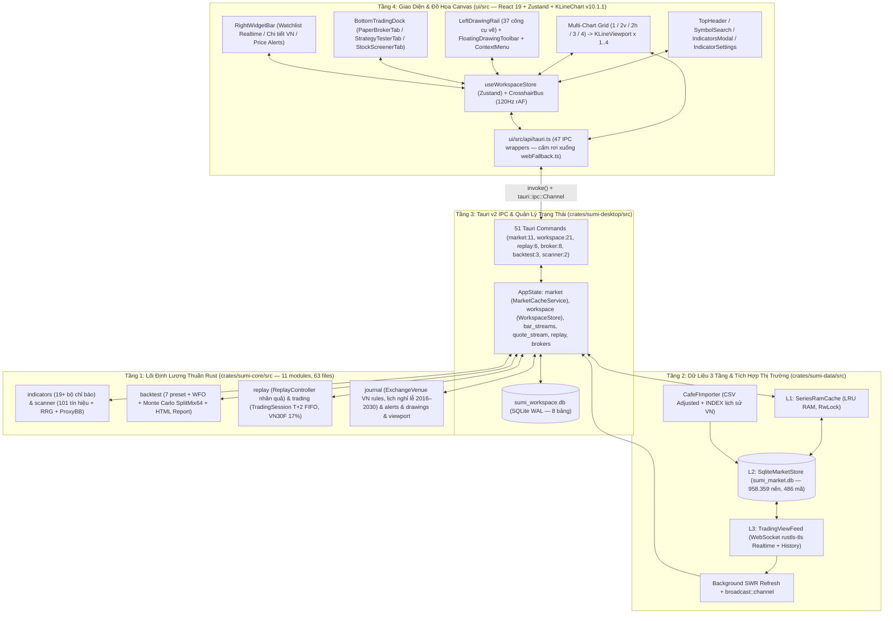

# 01. Phân Tích Toàn Diện Hệ Thống & Bản Đồ Tính Năng — Sumi Supercharts (`v2.1.0`)

> **Phạm vi kiểm định:** Workspace `/Users/mizuhara/workspace/sumi` (`Tauri v2` + Rust `sumi-core` / `sumi-data` / `sumi-desktop` + `React 19` + `klinecharts@10.1.1` + SQLite `sumi_market.db` / `sumi_workspace.db` + `tradingview-rs`).  
> **Vai trò:** Principal QA Architect, Quantitative Trading Systems Auditor & Performance Engineer.  
> **Trạng thái nguồn kiểm kê:** Đọc trực tiếp toàn bộ mã nguồn 4 tầng + kiểm tra CSDL SQLite thực tế trên máy (`sumi_market.db`: **84 MB**, **486 mã**, **492 chuỗi**, **958.359 nến**; `sumi_workspace.db`: **8 bảng**).

---

## 1. Kiến Trúc Tổng Thể & Sơ Đồ Luồng Dữ Liệu

Sumi Supercharts v2.1.0 vận hành theo mô hình **4 tầng tách biệt** nhưng chia sẻ chặt chẽ trạng thái giữa lõi định lượng Rust và tầng đồ họa Canvas HTML5 (`klinecharts@10.1.1`):

### Luồng Dữ Liệu Quan Trọng (Critical Paths)

1. **Stale-While-Revalidate (`get_bars`):**
   - `KLineViewport` gọi `api.getBars(ticker, interval, toTs, limit)` -> `commands::market::get_bars`.
   - `MarketCacheService` tra cứu `L1 (SeriesRamCache)` -> miss thì đọc `L2 (SqliteMarketStore)`.
   - Nếu có dữ liệu L1/L2, trả về **ngay lập tức** (`source: "ram" | "sqlite"`, `stale: true/false`), đồng thời nếu đang Online & dữ liệu cũ quá ngưỡng TTL, kích hoạt tác vụ nền (`tokio::spawn`) kéo nến mới từ `TradingViewFeed (L3)` rồi ghi vào L2/L1 và phát sự kiện qua `broadcast::channel` tới các `subscribe_bars` đang mở.
   - Nếu L1 & L2 đều rỗng và Online: gọi đồng bộ `TradingViewFeed` -> lưu vào SQLite & RAM -> trả về `source: "tradingview"`.
2. **Luồng Bar Replay Nhân Quả + Paper Broker (`replay_*` & `broker_*`):**
   - `replay_start` nạp toàn bộ chuỗi `base_candles` của `(ticker, interval)` vào `AppState.replay`, cắt tại `cutoff_timestamp`, đồng thời **reset & ghi đè** `TradingSession` của `ticker` đó tại vị trí cắt (`replay.rs:115-117`).
   - Mỗi lần `replay_step(+1 / -1)` hoặc `replay_jump`: `ReplayController` cập nhật `base_cursor_index`, `TradingSession::advance_through_bars` hoặc `rewind_to` tái lập lệnh/vị thế/vốn từ command log một cách tất định.
3. **Luồng Phân Giải Đường Dẫn CSDL (`resolve_database_paths` — `state.rs:166-177`):**
   - Hệ thống quét `workspace_ancestor_dirs()` (từ `current_dir()` đi lên) tìm `data/cache/` **TRƯỚC** khi rơi về `app.path().app_data_dir()` (`~/Library/Application Support/com.sumi.supercharts/`).
   - Hệ quả vận hành: Chạy app qua Finder/Applications (`/Applications/Sumi Supercharts.app`) dùng `~/Library/Application Support/com.sumi.supercharts/`, còn chạy binary trực tiếp trong thư mục repo dùng `data/cache/`.

---

## 2. Kiểm Kê Chi Tiết 100% Tính Năng Theo 4 Tầng

### 2.1. Tầng 1 — Backend Định Lượng (`crates/sumi-core/src/` — 11 Modules, 63 Files)

Pure Rust (`f64`/`i64`, chỉ phụ thuộc `log` & `serde`, tương thích `wasm32`, 199 unit tests pass).

| # | Module | Số file | Chức năng & API cốt lõi |
|---|--------|---------|-------------------------|
| 1 | `model` | 1 | `Candle`, `PriceBounds`, `ViewportMapping` (deprecated). Kiểm tra tính hợp lệ OHLCV (`is_valid()`). |
| 2 | `data` | 8 | Loader CSV/JSON RFC-4180/8259 (tối đa 64 MiB, 500k records, 2048 mã), `Timeframe` (`M1/M5/M15/H1/H4/D1/W1`), `aggregate_ohlcv_up_to` nhân quả, lịch UTC Hinnant (`0001..9999`), `audit_ohlcv_series_with_venue` (chuẩn hóa split CafeF), `DataSourcePreset` (7 preset). |
| 3 | `indicators` | 14 | 19+ động cơ chỉ báo thuần Rust: `SMA`, `EMA`, `Bollinger Bands (ddof=0)`, `RSI (Wilder)`, `MACD`, `ATR (Wilder)`, `Ichimoku (O(N) deque)`, `VWAP (Session/Anchored ±1σ/±2σ)`, `CVD (OHLCV_PROXY)`, `Volume Profile (VRVP/FRVP)`, `Market Profile (TPO/IB/Naked POC)`, `12+2 Candlestick Patterns`, `Relative Strength (LOCF <=45d)`, `ProxyBB (T03..T200)`, `ADX/DMI`, `Stochastic`, `SuperTrend`, `Parabolic SAR`, `Keltner`, `CCI`, `MFI`, `Volume SMA`. |
| 4 | `scanner` | 6 | `SIGNAL_CATALOG` **101 tín hiệu** chia **12 nhóm** (`Trend`, `Momentum`, `Volatility`, `Volume`, `PriceAction`, `Divergence`, `Flow`, `Regime`, `Structure`, `Breadth`, `Composite`, `ProxyBB`); `PrecomputedCatalogMatrix`; `CausalConfluenceReport` (`Balanced` 35/25/20/20, `TrendFocused` 50/20/15/15); `MarketBreadthSnapshot` + RRG 4 góc phần tư; `MarketBBAggregator`; `UniverseResolver` (Point-in-Time). |
| 5 | `backtest` | 8 | **6 chiến lược preset + CustomSignalRules (tổng 7 enum)**: `SmaEmaTrendCross`, `RsiMeanReversion`, `MacdMomentum`, `BollingerSqueezeBreakout`, `DonchianAtrBreakout`, `RsiBollingerConfluence`, `CustomSignalRules`. Động cơ khớp mở cửa `t+1` (zero-lookahead), SL-trước-TP bi quan, `run_parameter_sweep` (12 biến thể), `run_walk_forward_validation` (Rolling/Anchored IS/OOS), `run_monte_carlo_bootstrap` (`SplitMix64` tất định, envelope P5/P25/P50/P75/P95, xác suất phá sản), `compute_tearsheet` (CAGR, Sharpe, Sortino, Calmar, PF, Expectancy, SQN, cảnh báo `<30` lệnh), `render_backtest_report_html`. |
| 6 | `replay` | 2 | `ReplayController` (`Inactive`/`Paused`/`Playing`/`Completed`), tốc độ `1x/2x/5x/10x/20x`, `ReplayStepUnit` (`ActiveBar`/`BaseBar`), `materialize_candles` cắt nhân quả `&base_candles[..=base_cursor_index]`, `next_active_bar_cursor` / `prev_active_bar_cursor`. |
| 7 | `trading` | 5 | `TradingSession`: sổ lệnh `Market`/`Limit`/`Stop`, tối đa 64 lệnh chờ, 16.384 recorded commands cho `rewind_to` tất định; khớp lệnh `O -> H/L -> C` với SL/TP bi quan; ký quỹ `required_margin_for`, phí giao dịch + thuế bán `0.10%`, khóa lô `T+2` FIFO; `DOM Ladder` (`ladder.rs`); `Coaching & Debrief` (`coaching.rs`). |
| 8 | `journal` | 4 | `ExchangeVenue` (7 sàn: `HOSE`, `HNX`, `UPCOM`, `Vn30Futures`, `VnIndexBenchmark`, `UsEquities`, `CryptoSpotPerp`), lịch nghỉ lễ TTCK VN chính thức **171 ngày (2016–2030)** (`VIETNAM_HOLIDAYS_V1`), cắt mốc `T+2 13:00 ICT` từ `29/08/2022` (`T+3 09:00` trước đó), `compute_daily_price_band`, `tick_size_at_price`, `compute_trade_plan`, `TradeJournalStore` (tối đa 2.048 mục, Van Tharp SQN, xuất CSV/Markdown chống CSV injection). |
| 9 | `alerts` | 2 | `AlertEngine` (tối đa 128 quy tắc, 256 log kích hoạt): 6 điều kiện (`PriceLevel`, `RsiThreshold`, `MacdHistogramZeroCross`, `DrawingLine`, `SignalCatalogTrigger`, `ConfluenceThreshold`), tần suất `Once`/`OncePerBarClose`, cooldown, đánh giá nhân quả tự động re-arm khi tua lùi Replay. |
| 10 | `drawings` | 4 | `DrawingStore` (lõi Rust — tách biệt với overlay Canvas `klinecharts`), 12 loại công cụ hình học, Liang-Barsky & Sutherland-Hodgman clipping, `HitTest`, `Undo/Redo` 64 bước. *(Lưu ý: Bản Desktop v2.1.0 dùng `klinecharts` overlay ở Frontend + lưu trực tiếp vào bảng `drawings` của `sumi_workspace.db`, không đi qua `sumi_core::drawings`.)* |
| 11 | `viewport` | 9 | `TimeScale`, `PriceScale` (`Normal/Log/Percentage/IndexedTo100`), `KineticAnimation`, `MultiChartSync`, `Hotkeys`, `WorkspaceTemplate`. *(Tương tự `drawings`, phần lớn viewport của Desktop v2.1.0 do `klinecharts@10.1.1` đảm nhận.)* |

---

### 2.2. Tầng 2 — Dữ Liệu 3 Tầng & Thị Trường VN (`crates/sumi-data/src/`)

| Thành phần | Tệp nguồn | Cơ chế & thông số kỹ thuật |
|-----------|-----------|----------------------------|
| **L1 RAM LRU** | `ram_cache.rs` | `SeriesRamCache` bảo vệ bởi `RwLock`, dung lượng mặc định 64 chuỗi gần nhất (LRU), trả về clone `Vec<Bar>` trong `< 1 ms`. |
| **L2 SQLite Market** | `storage.rs` | `SqliteMarketStore` trên `sumi_market.db` (WAL, `synchronous=NORMAL`, `busy_timeout=5000`). Bảng chính: `symbols`, `bars (ticker, interval, adjustment, ts_ms PK)`, `series_meta`. Dữ liệu thực tế trên máy: **486 mã** (`HOSE: 266`, `UPCOM: 117`, `HNX: 92`, `BINANCE: 5`, `NASDAQ: 3`, `AMEX: 1`, `FX_IDC: 1`, `OANDA: 1`), **492 chuỗi**, **958.359 nến** (84 MB). |
| **L3 TradingView WS** | `tradingview_feed.rs` | Sử dụng `tradingview-rs` + `rustls-tls` (không phụ thuộc OpenSSL hệ thống). Hỗ trợ kéo lịch sử đa khung (`1m..1M`), `subscribe_bars`, `subscribe_quotes`, tìm kiếm mã trực tuyến, tự động reconnect & `TokenBucket` rate limit (`rate_limit.rs`). |
| **CafeF Importer** | `cafef_importer.rs` | Quét thư mục chứa CSV CafeF (`CafeF.SolieuGD.Adjusted*.csv`, `CafeF.INDEX.Upto*.csv`), nhân giá `x1000` cho cổ phiếu VN (từ nghìn đồng -> VND) trong khi giữ nguyên điểm số cho chỉ số (`VNINDEX`, `VN30`, `HNXINDEX`), ghi `adjustment = "splits"` vào `sumi_market.db`. |
| **Cache Service & VN Rules** | `cache_service.rs`, `types.rs` | Ánh xạ mã phái sinh `HNX:VN30F1!` <-> `HNX:VN301!` (wire TradingView); phân giải `pricePrecision` (`HOSE/HNX/UPCOM` stock = `0`, `VN30F1!` = `1`, `VNINDEX/BTCUSDT/AAPL` = `2`, `USDVND` = `0..2`); tính dải `Trần/Tham chiếu/Sàn` (`HOSE ±7%`, `HNX ±10%`, `UPCOM ±15%`, `VN30F ±7%`) với làm tròn Trần xuống & Sàn lên theo bước giá biến thiên HOSE (`10 / 50 / 100 VND`). |

---

### 2.3. Tầng 3 — Tauri v2 IPC & `AppState` (`crates/sumi-desktop/src/`)

> **Phát hiện kiểm kê quan trọng:** Tệp `crates/sumi-desktop/src/lib.rs:29-87` đăng ký tổng cộng **51 Tauri commands** (không phải 43 như ước lượng ban đầu). Tệp `ui/src/api/tauri.ts` bọc **47 commands**; 4 command còn lại (`list_layouts`, `list_watchlists`, `list_alerts`, `replay_get_state`) được phục vụ gián tiếp qua `load_workspace_bootstrap` và giá trị trả về của lệnh hành động.

| Nhóm Command | SL | Danh sách chính xác các Tauri Commands |
|--------------|----|----------------------------------------|
| **Market (`commands/market.rs`)** | **11** | `search_symbols`, `resolve_symbol`, `get_bars`, `subscribe_bars`, `unsubscribe_bars`, `subscribe_quotes`, `unsubscribe_quotes`, `get_watchlist_snapshots`, `get_data_status`, `set_offline_mode`, `import_cafef_dir` |
| **Workspace (`commands/workspace.rs`)** | **21** | `load_workspace_bootstrap`, `save_workspace_settings`, `get_drawings`, `upsert_drawing`, `delete_drawing`, `clear_drawings`, `get_pane_indicators`, `save_pane_indicators`, `list_layouts`, `save_layout`, `delete_layout`, `list_watchlists`, `create_watchlist`, `delete_watchlist`, `add_watchlist_symbol`, `remove_watchlist_symbol`, `list_alerts`, `create_alert`, `toggle_alert_status`, `delete_alert`, `check_price_alerts` |
| **Replay (`commands/replay.rs`)** | **6** | `replay_start`, `replay_step`, `replay_jump`, `replay_set_speed`, `replay_stop`, `replay_get_state` |
| **Paper Broker (`commands/broker.rs`)** | **8** | `broker_get_state`, `broker_submit_order`, `broker_cancel_order`, `broker_modify_order`, `broker_update_brackets`, `broker_flatten_position`, `broker_reset_account`, `broker_update_journal_note` |
| **Strategy Tester (`commands/backtest.rs`)** | **3** | `run_strategy_backtest`, `run_strategy_wfo`, `run_strategy_monte_carlo` |
| **Stock Screener (`commands/scanner.rs`)** | **2** | `get_signal_catalog`, `run_stock_screener` |
| **TỔNG CỘNG** | **51** | Đăng ký đầy đủ trong `tauri::generate_handler![]` |

#### Lược đồ `sumi_workspace.db` (8 bảng SQLite WAL — `workspace_db.rs:134-207`)
1. `kv_store (key PK, value_json, updated_at_ms)` — lưu `workspace_settings` và snapshot `paper_broker:{ticker}`.
2. `chart_layouts (id PK, name, layout_json, updated_at_ms)` — lưu cấu hình đa biểu đồ.
3. `drawings ((ticker, id) PK, name, pane_id, group_id, points_json, styles_json, extend_data_json, locked, visible, mode, updated_at_ms)` — hình vẽ theo mã.
4. `pane_indicators (slot_id PK, indicators_json, updated_at_ms)` — danh sách chỉ báo theo từng ô biểu đồ (`pane-0..pane-3`).
5. `watchlists (id PK, name, sort_order)` — tự động seed 4 watchlist mặc định (`VN30 Bluechips`, `Chỉ số & Phái sinh`, `Crypto Realtime`, `Mỹ & Vĩ mô`).
6. `watchlist_items ((watchlist_id, ticker) PK, sort_order)` — `ON DELETE CASCADE`.
7. `price_alerts (id PK, ticker, condition, target_price, message, status, created_at_ms, triggered_at_ms)` — cảnh báo giá.
8. `journal_annotations ((ticker, trade_id) PK, setup_tag, mistake_tag, note, updated_at_ms)` — nhật ký giao dịch gắn theo `trade_id`.

---

### 2.4. Tầng 4 — Giao Diện & Đồ Họa Canvas (`ui/src/` — 32 Files)

| Phân nhóm UI | Tệp nguồn | Năng lực chức năng |
|--------------|-----------|--------------------|
| **State & IPC** | `store/workspaceStore.ts`, `api/tauri.ts`, `types/market.ts` | Zustand quản lý toàn bộ trạng thái 4 pane (`pane-0..3`), lưới `1/2v/2h/3/4`, cờ đồng bộ (`symbol`, `interval`, `crosshair`), Replay, Broker, Backtest, Screener, Watchlists, Alerts, Theme (`dark`/`light`), Timezone (`Asia/Ho_Chi_Minh`/`Etc/UTC`), Toasts. |
| **Canvas Engine** | `chart/KLineViewport.tsx`, `chart/crosshairBus.ts`, `chart/heikinAshi.ts`, `chart/periods.ts`, `chart/themes.ts` | Bọc `klinecharts@10.1.1`; 5 kiểu biểu đồ (`candle_solid`, `candle_stroke`, `heikin_ashi`, `area`, `line`); 3 thang giá (`normal`, `percentage`, `log`); đường `Trần/TC/Sàn` (`vnPriceBandLine`); đánh dấu lệnh backtest (`backtestTradeMarker`) & vị thế broker (`brokerOrderLine`); đồng hồ đếm ngược đóng nến; lazy-load quá khứ; Export PNG; Undo/Redo stack nội bộ; `CrosshairBus` đồng bộ theo `timestamp` với throttle `requestAnimationFrame`. |
| **32 Chỉ báo** | `chart/indicators/{catalog,customIndicators,registerAll}.ts` | **5 chỉ báo Custom Sumi Quant** (`ICHIMOKU`, `SUPERTREND`, `VWAP`, `ATR`, `STOCHRSI`) + **27 chỉ báo Built-in KLineChart v10** (6 main overlay: `MA, EMA, SMA, BOLL, BBI, SAR`; 21 sub-pane: `VOL, MACD, RSI, KDJ, OBV, DMI, CCI, WR, BIAS, BRAR, CR, DMA, EMV, MTM, PSY, ROC, TRIX, VR, AO, PVT, AVP`). |
| **37 Công cụ vẽ** | `chart/overlays/{proOverlays,tradingViewOverlays,utils,registerAll}.ts`, `chart/drawingIcons.tsx` | **8 nhóm trên LeftDrawingRail**: Đường xu hướng & Ngang/Dọc (11), Kênh giá (2), Fibonacci & Gann (7), Sóng Elliott & Harmonic (6), Hình học & Cọ vẽ (5), Ghi chú & Nhãn (2), Dự phóng R:R & Đường lệnh (`longPosition`, `shortPosition`, `brokerOrderLine` — 3), Thước đo Giá & Thời gian (`priceDateRange` — 1) + 2 overlay nội bộ (`vnPriceBandLine`, `backtestTradeMarker`). Hỗ trợ Magnet 3 nấc (`normal`/`weak_magnet`/`strong_magnet`), Lock/Unlock, Hide/Show, Clear, `FloatingDrawingToolbar`, `ChartContextMenu`. |
| **Header & Modals** | `TopHeader.tsx`, `SymbolSearchModal.tsx`, `IndicatorsModal.tsx`, `IndicatorSettingsModal.tsx`, `ReplayControlBar.tsx` | Phím tắt toàn cục (`Cmd/Ctrl+K`, gõ ký tự mở tìm mã, `Alt+T/H/J/V/F`, `Shift+M`, `Space` play/pause Replay, `Alt+R` reset view, `Cmd/Ctrl+Z/Y` undo/redo hình vẽ, `Delete/Backspace` xóa hình đang chọn). |
| **Right Panel & Bottom Dock** | `RightWidgetBar.tsx`, `BottomTradingDock.tsx`, `PaperBrokerTab.tsx`, `StrategyTesterTab.tsx`, `StockScreenerTab.tsx` | Watchlist realtime + flash màu giá + chi tiết biên độ/bước giá VN + quản lý Alert; Paper Trading VN T+2 / VN30F; Strategy Tester (Backtest + WFO + Monte Carlo + vẽ marker lên biểu đồ); Stock Screener 101 tín hiệu (lọc sàn, điểm hợp lưu, xu hướng). |

---

## 3. Các Bất Biến Nghiệp Vụ Bắt Buộc (Business Invariants)

Mọi kiểm thử ở Giai đoạn 3 sẽ xác minh trực tiếp các bất biến sau:

1. **Bất biến Dữ liệu & Tính liên tục (Data Integrity):**
   - Chuỗi nến của mọi `(ticker, interval)` phải đơn điệu tăng theo `timestamp`, không trùng khóa, thỏa `low <= min(open, close) <= max(open, close) <= high`, `volume >= 0`.
   - Cổ phiếu & chỉ số VN (`HOSE`/`HNX`/`UPCOM`) **không bao giờ** được tồn tại nến vào Thứ 7 / Chủ Nhật.
   - Mối nối giữa dữ liệu lịch sử `CafeF` và `TradingView` tại ngày chuyển giao **không được nhảy bước giá giả tạo** vượt biên độ giao dịch hợp lệ.
   - Khi chuyển đổi mã liên tiếp nhanh, kết quả trả về muộn của mã cũ tuyệt đối không được ghi đè lên biểu đồ / dải Trần-Sàn của mã hiện tại.
2. **Bất biến Vi cấu trúc Thị trường Việt Nam (VN Microstructure):**
   - Biên độ ngày: `HOSE ±7%`, `HNX ±10%`, `UPCOM ±15%`, `VN30F ±7%`; làm tròn **Trần xuống** (`floor`) và **Sàn lên** (`ceil`) theo bước giá hợp lệ; mã quốc tế (`BINANCE`, `NASDAQ`, `FX_IDC`) không hiển thị đường Trần/Sàn.
   - Bước giá: `HOSE` (`<10k: 10`, `10k–49.95k: 50`, `>=50k: 100 VND`), `HNX/UPCOM` (`100 VND` cố định), `VN30F` (`0.1 điểm`).
   - Lô giao dịch: `HOSE/HNX/UPCOM` bội số `100 cổ phiếu`, cấm bán khống, áp dụng thuế bán `0.10%`, phí `0.15%`, khóa cổ phiếu `T+2 FIFO` (từ `29/08/2022`).
   - Phái sinh `VN30F1!`: lô `1 HĐ`, hệ số nhân `100.000 VND/điểm`, ký quỹ ban đầu thực tế `17%` (đòn bẩy tối đa tương ứng `~5.88×`, không được chia chồng cho `max_leverage`), cho phép Long/Short `T+0`, thuế bán `0%`.
3. **Bất biến Nhân Quả (DEF-001 Zero-Lookahead):**
   - Trong Bar Replay, tại `base_cursor_index = k`, mọi nến, chỉ báo, kết quả Paper Broker và cảnh báo chỉ được phụ thuộc vào `&base_candles[..=k]`.
   - Trong Backtest, tín hiệu sinh ra tại đóng cửa nến `t` chỉ được khớp từ mở cửa nến `t+1`. Khi một nến chạm đồng thời SL và TP, phải ưu tiên khớp SL (pessimistic).
4. **Bất biến Nhất Quán Toán Học Liên Tầng (Cross-Layer Parity):**
   - Giá trị chỉ báo (`RSI`, `MACD`, `BB`, `Stochastic`, `SuperTrend`, `VWAP`) giữa Biểu đồ (`klinecharts`), Screener (`sumi-core`) và Backtest (`sumi-core`) phải thống nhất công thức và tham số (hoặc ghi rõ sai khác quy ước).
   - Quyền mua, ký quỹ, giá trị danh nghĩa và PnL giữa UI (`PaperBrokerTab`, `KLineViewport`) và động cơ Rust (`TradingSession`) phải khớp 100%.
5. **Bất biến Bền Vững Dữ Liệu (Persistence):**
   - Layout, chỉ báo từng pane, hình vẽ, watchlist, cảnh báo, cài đặt theme/timezone, lệnh/vị thế/ghi chú Paper Broker phải sống sót nguyên vẹn qua chu kỳ đóng hoàn toàn tiến trình và mở lại.

---

## 4. Bản Đồ Điểm Nhạy Cảm Dễ Phát Sinh Bug & Nghẽn Cổ Chai (Audit Hotspots)

Từ phân tích mã nguồn 4 tầng, xác định **16 vùng rủi ro cao** cần kiểm chứng thực nghiệm nghiêm ngặt ở Giai đoạn 3:

| Mức độ dự kiến | Phân hệ | Điểm nhạy cảm (`file:line`) | Cơ chế lỗi / rủi ro nghi ngờ |
|----------------|---------|-----------------------------|-------------------------------|
| **P0 / P1** | Data / CafeF | `sumi_market.db` & `cafef_importer.rs` | Nến cuối tuần bị đảo `DD/MM` trong `CafeF.INDEX.Upto06112026.csv` tạo gai `+19.8% / -16.6%` trên `HNXINDEX`/`VNINDEX`; sai khác hệ số điều chỉnh cổ tức tiền mặt (`CafeF Adjusted`) vs `TradingView Splits` gây nhảy bậc `+4%..+8%` tại điểm nối `HOSE:SSI/VNM/TCB/FPT`. |
| **P1** | Paper Broker (VN30F) | `commands/broker.rs:258-259`, `trading/orders.rs:184`, `PaperBrokerTab.tsx:188,194,498`, `KLineViewport.tsx:890` | Ký quỹ `VN30F1!` bị chia hai lần (`17% / 5.0 = 3.4%` -> đòn bẩy `29.4×`!) trong khi UI tính `17%`; PnL & Notional trên bảng Vị thế và đường vị thế trên biểu đồ thiếu `* 100_000` (sai lệch **100.000 lần**). |
| **P1** | Paper Broker (VN Rules) | `commands/broker.rs:190,325,460-469,510-540`, `workspaceStore.ts:674-678` | Thiếu kiểm tra bước giá (`10/50/100 VND`) khi đặt lệnh; đặt lệnh nhanh từ Context Menu dùng bước giá HOSE & `qty=1000` cho `VN30F1!` & `HNX`; `ATO/ATC` chạy y hệt `MP`; snapshot broker khóa theo `ticker` không phân biệt `interval`; bắt đầu Replay ghi đè/xóa trắng sổ lệnh live. |
| **P1** | Trading Core | `trading/portfolio.rs:1459,1681,1700,1184`, `orders.rs:476` | Gap-open vượt SL xóa mất `stop_loss` của lệnh Limit; Stop vào lệnh trong nến có thể dính TP trước SL; `modify_order_price` bỏ qua `effective_contract_multiplier()` & không tái kiểm ký quỹ. |
| **P1** | Screener vs Chart | `klinecharts` MACD vs `sumi-core` MACD; `commands/scanner.rs:161-172,265,283`; `scanner/catalog.rs` | `klinecharts` tính `MACD Hist = (DIF-DEA)*2` gấp đôi `sumi-core`/TradingView; Screener không lọc được sàn `Crypto` (`BINANCE`), tính trùng chỉ báo 2 lần/mã (`evaluate_symbol_scan` + `PrecomputedCatalogMatrix`), chỉ nạp 220 nến vs 600 nến của chart. |
| **P1 / P2** | Chart / Heikin-Ashi | `KLineViewport.tsx:481-485,547-553`, `heikinAshi.ts` | Cập nhật `lastHaBarRef` ngay trên tick intra-bar khiến `haOpen` bị trôi lệch theo hàm mũ; lazy-load quá khứ ghi đè `lastHaBarRef` bằng đuôi trang cũ. |
| **P2** | Data / Race Condition | `KLineViewport.tsx:456-490`, `cache_service.rs:991-993` | `getBars` không kiểm tra stale ticker sau `await`; fetch lịch sử `HNX:VN30F1!` ghi `HNX:VN301!` vào bảng `symbols` thiếu bí danh. |
| **P2** | Indicators | `customIndicators.ts:275,294`, `IndicatorSettingsModal.tsx:48,222`, `indicators/vwap.rs:303` | 5 chỉ báo custom cứng màu/độ dày nên phớt lờ thay đổi từ `IndicatorSettingsModal`; modal ghép sai số dòng màu với `calcParams.length`; `VWAP` frontend sai reset intraday qua cuối tuần & trừ bình phương bất ổn số; `VWAP` backend nhìn tương lai (`DEF-001`). |
| **P2** | Drawings | `KLineViewport.tsx:290-295,790-806` | Kéo anchor (`onPressedMoveEnd`) không push vào `undoStackRef` -> hỏng chuỗi Undo đa bước; hình vẽ trên cùng một mã không đồng bộ tức thì giữa các ô trong chế độ đa biểu đồ. |
| **P2** | Price Alerts | `commands/workspace.rs:217`, `workspaceStore.ts:796` | ID cảnh báo dùng `alert_{now_ms}` dễ đụng độ; chỉ đánh giá alert trong `applyLiveQuote` của watchlist đang mở -> mã ngoài watchlist hoặc trong Replay không bao giờ nổ cảnh báo. |
| **P2** | Strategy Backtest | `StrategyTesterTab.tsx:126-160`, `backtest/engine.rs`, `walk_forward.rs` | UI ép `lotStep=100`, `taxSell=10bps` ngay cả khi chạy backtest trên `HNX:VN30F1!`; `H1` (1638 bars/yr) vs `H4` (1512 bars/yr) chuẩn hóa năm bất nhất; `StrategyPresetKind` có 7 nhưng mô tả/UI chỉ lộ 6. |
| **P3** | UI / Performance | `RightWidgetBar.tsx:265,393,396`, `KLineViewport.tsx:755` | React `key` của dòng Watchlist chứa `flash?.nonce` -> unmount/remount DOM liên tục khi giá nhảy; nhãn bước giá hiển thị `"0.1 VND"` cho `VN30F1!`; mở 4 sub-pane trong lưới `2×2` làm dẹp biểu đồ nến chính. |
| **P3** | Core Safety | `viewport/kinetic.rs:227`, `drawings/geometry.rs:1440`, `data/audit.rs:728`, `market_rules.rs:769` | Vector panic trên deserialized `duration_ms < 0` hoặc `i64::MIN`; vòng lặp vô hạn nếu gặp timestamp `i64::MAX`. |
