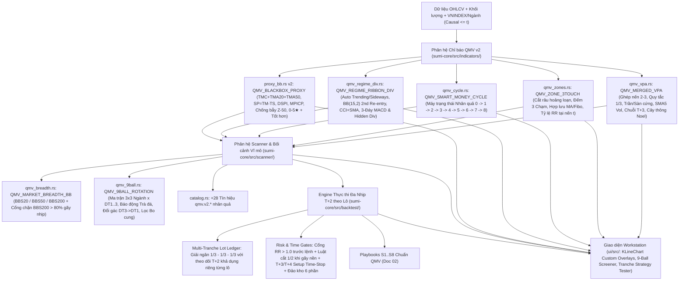

# 04. ĐỐI CHIẾU VỚI SUMI HIỆN TẠI & LỘ TRÌNH NÂNG CẤP INDICATOR / BACKTEST ENGINE

> **Vai trò biên soạn:** Principal Quantitative Researcher, Chief Market Technician & QMV Trading System Architect  
> **Đối tượng kiểm toán (Read-Only):** Mã nguồn Rust (`crates/sumi-core`, `crates/sumi-data`) và TypeScript/React (`ui/src`) của workstation [sumi](file:///Users/mizuhara/workspace/sumi)  
> **Chuẩn đối chiếu gốc:** Toàn bộ bài giảng gốc QMV (`KT01T1..T4`, `HP4 v1..v3`, `HP1`, `HP5`, `DM01`, `VM01`, `DN01`, `Fintech V5/V7 & Audio 2025–2026`, `wa_10_02_2026`, cùng kho `Postmortem T+20` của Yumeko) đã đúc kết tại:
> - [01_QMV_TECHNICAL_ANALYSIS_COMPLETE_DOCTRINE.md](file:///Users/mizuhara/workspace/sumi/docs/qmv_research/01_QMV_TECHNICAL_ANALYSIS_COMPLETE_DOCTRINE.md)
> - [02_QMV_TRADING_STRATEGIES_PLAYBOOK.md](file:///Users/mizuhara/workspace/sumi/docs/qmv_research/02_QMV_TRADING_STRATEGIES_PLAYBOOK.md)
> - [03_QMV_CUSTOM_INDICATORS_SPECIFICATION.md](file:///Users/mizuhara/workspace/sumi/docs/qmv_research/03_QMV_CUSTOM_INDICATORS_SPECIFICATION.md)

---

## MỤC LỤC

1. [Chương 1 — Đánh giá Nền tảng Hiện có của Sumi (`QMV v1 Baseline` — Những gì Sumi đã làm rất đúng)](#chương-1--đánh-giá-nền-tảng-hiện-có-của-sumi-qmv-v1-baseline--những-gì-sumi-đã-làm-rất-đúng)
2. [Chương 2 — Ma trận Đối chiếu Khoảng cách Chi tiết (`Gap Analysis: Sumi v1 vs. Bài giảng gốc QMV`)](#chương-2--ma-trận-đối-chiếu-khoảng-cách-chi-tiết-gap-analysis-sumi-v1-vs-bài-giảng-gốc-qmv)
   - [2.1. Phân hệ A — Đồ thị Nến, Kỹ thuật Ghép Nến & Phân tích Giá–Lượng (`VPA`)](#21-phân-hệ-a--đồ-thị-nến-kỹ-thuật-ghép-nến--phân-tích-giálượng-vpa)
   - [2.2. Phân hệ B — Cấu trúc Vùng 3 Chạm, Chu kỳ `0–8` & Hệ thống Chỉ báo Kỹ thuật](#22-phân-hệ-b--cấu-trúc-vùng-3-chạm-chu-kỳ-08--hệ-thống-chỉ-báo-kỹ-thuật)
   - [2.3. Phân hệ C — Dòng tiền QMV Blackbox Proxy (`ProxyBB` vs `TMC/DSPI/MPICP/SP` & Bẫy `Z-50`)](#23-phân-hệ-c--dòng-tiền-qmv-blackbox-proxy-proxybb-vs-tmcdspimpicpsp--bẫy-z-50)
   - [2.4. Phân hệ D — Screener, Độ rộng `BB` Đa khung & Ma trận 9 Quả Bóng (`9-Ball Matrix`)](#24-phân-hệ-d--screener-độ-rộng-bb-đa-khung--ma-trận-9-quả-bóng-9-ball-matrix)
   - [2.5. Phân hệ E — Chiến lược `S1..S6` & Engine Thực thi Danh mục (`Backtest & Portfolio Execution`)](#25-phân-hệ-e--chiến-lược-s1s6--engine-thực-thi-danh-mục-backtest--portfolio-execution)
3. [Chương 3 — Thiết kế Nâng cấp Kiến trúc Đích cho Sumi (`Target Architecture: sumi-core & ui`)](#chương-3--thiết-kế-nâng-cấp-kiến-trúc-đích-cho-sumi-target-architecture-sumi-core--ui)
   - [3.1. Kiến trúc Module Chỉ báo Mới trong `crates/sumi-core/src/indicators/`](#31-kiến-trúc-module-chỉ-báo-mới-trong-cratessumi-coresrcindicators)
   - [3.2. Kiến trúc Scanner, Độ rộng & Ma trận 9 Quả Bóng trong `crates/sumi-core/src/scanner/`](#32-kiến-trúc-scanner-độ-rộng--ma-trận-9-quả-bóng-trong-cratessumi-coresrcscanner)
   - [3.3. Nâng cấp Engine Backtest Đa Nhịp `1/3–1/3–1/3` Khớp Từng Lô `T+2` (`crates/sumi-core/src/backtest/`)](#33-nâng-cấp-engine-backtest-đa-nhịp-131313-khớp-từng-lô-t2-cratessumi-coresrcbacktest)
   - [3.4. Thiết kế Tích hợp Giao diện `KLineChart`, `StockScreenerTab` & `StrategyTesterTab` (`ui/src/`)](#34-thiết-kế-tích-hợp-giao-diện-klinechart-stockscreenertab--strategytestertab-uisrc)
4. [Chương 4 — Lộ trình Triển khai Ưu tiên (`P0 → P1 → P2 → P3`) & Bộ Kiểm thử Bất biến](#chương-4--lộ-trình-triển-khai-ưu-tiên-p0--p1--p2--p3--bộ-kiểm-thử-bất-biến)

---

## CHƯƠNG 1 — ĐÁNH GIÁ NỀN TẢNG HIỆN CÓ CỦA SUMI (`QMV v1 BASELINE` — NHỮNG GÌ SUMI ĐÃ LÀM RẤT ĐÚNG)

Qua kiểm toán toàn diện mã nguồn Rust và TypeScript, cần khẳng định rõ: **Sumi hiện đang sở hữu một nền tảng kỹ thuật định lượng cực kỳ vững chắc, sạch sẽ, không phụ thuộc ngoại lai (`wasm32-unknown-unknown`-clean, thuần `f64`/`i64`) và tuân thủ tính nhân quả nghiêm ngặt hiếm thấy ở các nền tảng PTKT nội địa.** Khi nâng cấp lên **QMV v2 (Chuẩn bài giảng âm thanh gốc 100%)**, tuyệt đối **kế thừa và giữ nguyên** 6 trụ cột kiến trúc xuất sắc sau đây:

| STT | Trụ cột Kiến trúc đã chuẩn | Vị trí mã nguồn hiện tại trong Sumi | Giá trị kế thừa trực tiếp cho QMV v2 |
| :--- | :--- | :--- | :--- |
| **1** | **Tính Nhân quả Tuyệt đối (`DEF-001` & `TEST-CAUSAL-003`)** | [engine.rs](file:///Users/mizuhara/workspace/sumi/crates/sumi-core/src/backtest/engine.rs#L3256-L3424), [breadth.rs](file:///Users/mizuhara/workspace/sumi/crates/sumi-core/src/scanner/breadth.rs#L169-L209), [ichimoku.rs](file:///Users/mizuhara/workspace/sumi/crates/sumi-core/src/indicators/ichimoku.rs#L222-L231) | Cắt lát chuỗi thời gian đóng nến nhân quả theo từng sàn (`HOSE/HNX/UPCOM`), dùng `compute_prior_window_max/min` $O(N)$ loại trừ nến `i`, lấy `prev_atr` tại `fill_bar - 1` khi mở lệnh ở `Open[fill_bar]`, và cắt cụt `Chikou Span` ở `N - D` để chống rò rỉ tương lai khi chạy Bar Replay. |
| **2** | **Vi cấu trúc TTCK Việt Nam Chính xác theo Lịch sử** | [engine.rs](file:///Users/mizuhara/workspace/sumi/crates/sumi-core/src/backtest/engine.rs#L1649-L1697), [engine.rs](file:///Users/mizuhara/workspace/sumi/crates/sumi-core/src/backtest/engine.rs#L2119-L2245) | Đã mô phỏng đúng biên độ `HOSE ±7% / HNX ±10% / UPCOM ±15%`, bước giá `10/50/100đ`, chặn khớp mua khi `trắng bên bán` (`is_session_locked_ceiling_no_ask`), treo lệnh bán sang phiên kế tiếp khi `trắng bên mua` (`is_session_locked_floor_no_bid`), mốc chuyển đổi lịch sử VSD `2022-08-29` giữa `T+3` và `T+2`, lô chẵn `100`, phí `0.15%`, thuế bán `0.10%` và bảo vệ âm vốn (`[CRITICAL-03]`). |
| **3** | **Ichimoku QMV V7 `(6, 18, 36, 18)` & Biến thể Ngắn `(3, 6, 18, 18)` kèm `Future Kumo` 18 phiên** | [ichimoku.rs](file:///Users/mizuhara/workspace/sumi/crates/sumi-core/src/indicators/ichimoku.rs#L48-L72), [customIndicators.ts](file:///Users/mizuhara/workspace/sumi/ui/src/chart/indicators/customIndicators.ts#L482-L575) | Thuật toán dual monotonic deque $O(N)$ kết hợp cơ chế `extendData` vẽ đám mây tương lai 18 phiên ở khoảng trắng bên phải biểu đồ đã khớp chuẩn công thức Ichimoku độc quyền của QMV V7. |
| **4** | **Quản trị Dòng tiền Toàn thị trường (`AT05/AT09/AT10/AT11/AT17`)** | [scanner/proxy_bb.rs](file:///Users/mizuhara/workspace/sumi/crates/sumi-core/src/scanner/proxy_bb.rs#L140-L555), [breadth.rs](file:///Users/mizuhara/workspace/sumi/crates/sumi-core/src/scanner/breadth.rs#L271-L389) | Thực thi đúng nguyên tắc *Aggregate-Before-Ratio* (cộng tổng giá trị mua/bán chủ động toàn rổ trước khi chia tỷ lệ, không lấy trung bình cộng đơn giản điểm các mã) và kiểm soát thiên kiến sống sót (`PointInTime` vs `RetrospectiveFixed`). |
| **5** | **Phân loại Vũ trụ Cổ phiếu QMV & Nút *"Gỡ bộ lọc mặc định"*** | [qmv_universe.rs](file:///Users/mizuhara/workspace/sumi/crates/sumi-core/src/scanner/qmv_universe.rs#L1-L250), [StockScreenerTab.tsx](file:///Users/mizuhara/workspace/sumi/ui/src/components/dock/StockScreenerTab.tsx#L1-L450) | Đã định danh `QMV30`, `QMV60`, `3 Sector Groups × 11 Sectors`, phân tầng tĩnh `DT1 / DT2 / DT3`, và có sẵn cơ chế gỡ rào cản thanh khoản mặc định để quét cổ phiếu nhỏ chuyển mình từ `0 -> 1`. |
| **6** | **Khung Kiểm định Walk-Forward 5-Fold, Monte Carlo & Danh mục `1/σ`** | [qmv_backtest_matrix.rs](file:///Users/mizuhara/workspace/sumi/crates/sumi-data/examples/qmv_backtest_matrix.rs#L1-L220), [strategy.rs](file:///Users/mizuhara/workspace/sumi/crates/sumi-core/src/backtest/strategy.rs#L1-L420) | Có sẵn `PortfolioWeightingMode::InverseVolatility` (khớp tư duy chia tỷ trọng nghịch đảo biến động `1/σ` trong `DM01T2/T4`), kiểm định chống học vẹt `WFO` và mô phỏng rủi ro đuôi `Monte Carlo`. |

---

## CHƯƠNG 2 — MA TRẬN ĐỐI CHIẾU KHOẢNG CÁCH CHI TIẾT (`GAP ANALYSIS: SUMI v1 vs. BÀI GIẢNG GỐC QMV`)

Mặc dù hạ tầng định lượng của Sumi rất mạnh, phiên bản `QMV v1` hiện tại mới được xây dựng chủ yếu từ tài liệu tóm tắt hệ thống (`V5/V7 Wiki`), nên **còn thiếu nhiều cơ chế thực chiến sắc bén nhất chỉ xuất hiện trong bài giảng âm thanh gốc (`KT01`, `HP4 v1..v3`, `DM01`, `Fintech Audio`, `wa_10_02_2026`) và thậm chí có một số giả định sách vở đại trà đi ngược lời dạy trực tiếp của giảng viên QMV**.

Dưới đây là đối chiếu chi tiết từng tệp mã nguồn và từng công thức trên 5 phân hệ.

---

### 2.1. Phân hệ A — Đồ thị Nến, Kỹ thuật Ghép Nến & Phân tích Giá–Lượng (`VPA`)

| Mã Gap | Hiện trạng trong Sumi (`File & Dòng`) | Chuẩn Gốc Hệ thống QMV (`Nguồn bài giảng`) | Hệ quả Thực chiến / Sai lệch Định lượng | Ưu tiên |
| :--- | :--- | :--- | :--- | :--- |
| **GAP-A1** | **Phân loại sai Nến Trần Cứng / Sàn Cứng (`O == H == L == C`) thành Trung tính (`0.0`)**: Trong [patterns.rs](file:///Users/mizuhara/workspace/sumi/crates/sumi-core/src/indicators/patterns.rs#L108-L119), khi `is_flat_range` (`range <= 1e-12`), hàm trả về `structure_score = Some(0.0)` và tắt toàn bộ mẫu nến. | Tại TTCK Việt Nam, phiên khóa trần trắng bên bán (`Close > PrevClose`, `O=H=L=C`) hoặc khóa sàn trắng bên mua (`Close < PrevClose`, `O=H=L=C`) là **Nến Đặc Cực Đại (`Marubozu ±100`)**, tuyệt đối không phải Doji lưỡng lự (`HP4 v2_2_1`, `HP4 v3_2_bg`). | Bỏ lỡ xung lực bứt phá mạnh nhất ở chân sóng (`Node 1`) hoặc đánh giá nhầm phiên sàn cứng hoảng loạn là "cân bằng cung cầu". | **P0** |
| **GAP-A2** | **Ngưỡng thân nến nhỏ dùng chuẩn sách vở `<= 0.50` & phân biệt màu sai quy tắc `1/3`**: Trong [patterns.rs](file:///Users/mizuhara/workspace/sumi/crates/sumi-core/src/indicators/patterns.rs#L406-L428), `Hammer`/`ShootingStar` dùng `body_ratio <= 0.50`. | QMV chia nến theo **Quy tắc Bất biến `1/3`**: Thân đặc mạnh `>= 2/3` (`0.667`); Thân nhỏ rút chân `<= 1/3` (`0.333`); vùng giữa `(1/3, 2/3)` là **nến bình thường không mang tín hiệu đảo chiều**. Đặc biệt: nến **`1/3 Top` (rút chân dưới dài `>= 2/3` biên độ) là Nến Tăng bất kể thân xanh hay đỏ**, và **`1/3 Bottom` là Nến Giảm bất kể xanh hay đỏ** (`HP4 v2_2_1`, `KT01T2`). | Nhận diện quá nhiều nến nhiễu ở vùng thân `0.34..0.50`, đồng thời bỏ sót các nến `1/3 Top` thân đỏ rút chân cực đẹp tại hỗ trợ. | **P0** |
| **GAP-A3** | **Thiếu hoàn toàn Kỹ thuật Ghép Nến Động 2–3 Phiên & Bối cảnh Vùng Đặc Biệt**: [patterns.rs](file:///Users/mizuhara/workspace/sumi/crates/sumi-core/src/indicators/patterns.rs#L400-L535) quét mẫu nến cố định trên mọi nến đơn lẻ và cặp 2–3 nến sách vở. | QMV dạy: *(1)* **"Nến đặc biệt chỉ có giá trị tại Vùng đặc biệt"** (Hỗ trợ/Kháng cự/Fibo/MA/Trendline); ở lưng chừng hộp phải lờ đi. *(2)* Mọi cụm 2–3–5 nến (`Morning Star`, `Dark Cloud Cover`, `Three Inside Up`, cụm rũ bỏ) phải được **ghép đại số (`O_1, C_K, max H, min L`)** về 1 nến `1/3 Top` hoặc `1/3 Bottom` để xác thực (`HP4 v2_2_2_kythuatghepnen`, `HP4 v3_2_bg`). | Bắn tín hiệu nến đảo chiều tràn lan giữa vùng đi ngang và không giải mã được các tổ hợp rũ bỏ 2–3 phiên bị lái chia nhỏ để giấu dấu chân. | **P0** |
| **GAP-A4** | **Thiếu lọc nhiễu vẽ nến ATO 100 cổ phiếu, mẫu `"Kill Nến Đỏ / Kill Nến Xanh"` và Luật Phủ định Upthrust 3 phiên**: Không có trong [patterns.rs](file:///Users/mizuhara/workspace/sumi/crates/sumi-core/src/indicators/patterns.rs). | - **Lọc ATO:** Ở mã thanh khoản vừa/thấp, lệnh `100 cp` giá trần/sàn phiên ATO bóp méo `Open` tạo nến đỏ giả hoặc Shooting Star giả (`HP4 v3_2_hd`).<br>- **Kill Nến Đỏ:** Nến xanh đóng cửa nuốt trọn `High` của nến đỏ dẫn đường liền trước kèm `Vol` vượt trội = tín hiệu bóp cò bắt đáy an toàn (`wa_10_02_2026`).<br>- **Phủ định Upthrust (`Case TNH`):** Sau nến Upthrust tại đỉnh, nếu trong `<= 3` phiên giá đóng cửa vượt lên trên `High` của chính nến Upthrust đó thì tín hiệu bán bị vô hiệu hóa (`KT01T3`). | Dễ bị rung rụng hàng bởi nến ATO giả hoặc Upthrust rũ hàng giả trước khi chạy nước rút. | **P1** |
| **GAP-A5** | **Đường cơ sở Khối lượng dùng `SMA(Vol, 20)` thay vì `SMA(Vol, 5)` & Đọc nến rời rạc thay vì chuỗi `T+3`**: [indicators/mod.rs](file:///Users/mizuhara/workspace/sumi/crates/sumi-core/src/indicators/mod.rs#L301), [catalog.ts](file:///Users/mizuhara/workspace/sumi/ui/src/chart/indicators/catalog.ts#L71), [engine.rs](file:///Users/mizuhara/workspace/sumi/crates/sumi-core/src/backtest/engine.rs#L3229) (`causal_rvol_20_at`) và [StockScreenerTab.tsx](file:///Users/mizuhara/workspace/sumi/ui/src/components/dock/StockScreenerTab.tsx#L40) đều neo vào `MA20`. | Giảng viên QMV quy định đường cơ sở VPA thực chiến là **`SMA(Volume, 5)` (trung bình 1 tuần giao dịch = 5 phiên)** để bắt ngay sự thay đổi cung–cầu ngắn hạn, và **bắt buộc đọc VPA theo chuỗi tối thiểu `>= 3` phiên (`T+3` hàng về)**, tuyệt đối không phán xét 1 phiên đơn lẻ (`KT01T1`, `KT01T3`, `HP4 v3_1_bg`). | `SMA20` bị trễ nặng sau một nhịp nổ Vol lớn (làm các phiên sau trông như "Vol thấp giả tạo"), hoặc phản ứng quá chậm ở chân sóng mới. | **P0** |
| **GAP-A6** | **Thiếu Cảnh báo Phân phối Xác suất ~100% (`Tiết cung -> Nổ Vol = Cây thông Noel`) & `"Đạp ga mà xe không chạy"`**: [catalog.rs](file:///Users/mizuhara/workspace/sumi/crates/sumi-core/src/scanner/catalog.rs#L5477-L5553) mới có `vsa_withholding_supply` (mua tiết cung) và `vsa_support_dry_up`. | Trong `KT01T1`, `KT01T3` và `HP4 v3_1`, tín hiệu đảo chiều giảm nguy hiểm nhất hệ thống QMV là: *(1)* **Chuỗi Tiết cung kéo giá (`Giá↑ + Vol↓` suốt `>= 3` phiên) bỗng xuất hiện phiên Nổ Vol đột biến (`RVOL5 >= 2.2`)** = Tổ chức xả úp bô tạo đỉnh "Cây thông Noel" (xác suất giảm ~100%). *(2)* **4–6 nến đi ngang sát kháng cự với `Vol > SMA5` nhưng giá không nhích nổi** (*"Đạp ga mà xe không chạy"*). *(3)* Phân biệt `Nổ Vol sau khi mới tăng 5–10% từ nền` (**Rũ bỏ Pha D — giữ/mua lại**) với `Nổ Vol sau khi đã tăng >= 40%` (**Phân phối Pha C — bán dứt khoát**). | Thiếu lá chắn bảo vệ lợi nhuận quan trọng nhất trên các cổ phiếu đầu cơ/tăng nóng và dễ bán nhầm nhịp rũ bỏ đầu chân sóng `5–10%`. | **P0** |

---

### 2.2. Phân hệ B — Cấu trúc Vùng 3 Chạm, Chu kỳ `0–8` & Hệ thống Chỉ báo Kỹ thuật

| Mã Gap | Hiện trạng trong Sumi (`File & Dòng`) | Chuẩn Gốc Hệ thống QMV (`Nguồn bài giảng`) | Hệ quả Thực chiến / Sai lệch Định lượng | Ưu tiên |
| :--- | :--- | :--- | :--- | :--- |
| **GAP-B1** | **Hỗ trợ/Kháng cự lấy cực trị thô, thiếu Cắt Râu Hoảng Loạn (`Panic-Wick Clipping`) & Bộ đếm Quy tắc 3 Chạm**: [engine.rs](file:///Users/mizuhara/workspace/sumi/crates/sumi-core/src/backtest/engine.rs#L3289-L3316) (`prior_support_low`) và `sr.*` trong [catalog.rs](file:///Users/mizuhara/workspace/sumi/crates/sumi-core/src/scanner/catalog.rs) dùng trực tiếp `High/Low` thô và không đếm số lần chạm. | - **Vùng chứ không phải Đường:** Khi vẽ S/R, Trendline và Fibonacci, QMV bắt buộc **gọt bỏ các râu nến hoảng loạn/hưng phấn dị biệt (1–2 phiên bán giải chấp hoặc tin sốc)** để neo vào vùng tập trung thân nến (`KT01T1`, `HP4 v3_1_hd`).<br>- **Định luật 3 Chạm (`3-Touch Rule`):** Sau nhịp rơi mạnh, **Chạm #1 xác suất xuyên thủng rất cao (Cấm bắt dao rơi!)**; phải đợi nhịp nảy lên rồi quay lại **Chạm #2 Test cung cạn Vol** hoặc **Chạm #3 xác nhận kênh xu hướng** mới giải ngân chủ lực (`KT01T1`, `KT01T2`). | Dính bẫy bắt sớm ở Chạm #1 khi áp lực bán chưa cạn, và đặt vùng S/R/Fibo lệch xa thực tế do bị 1 râu nến sàn giải chấp kéo giãn. | **P1** |
| **GAP-B2** | **Thiếu hoàn toàn Bộ Định Vị Chu Kỳ Dòng Tiền Thông Minh `0–8` & 3 Pha Tăng Giá**: Chưa tồn tại trong `sumi-core` maupun `ui`. | Xương sống đọc vị Cáo/Tạo lập của QMV là sơ đồ 9 nút **`0 (Tích lũy) -> 1 (Breakout khởi phát) -> 2 (Tái tích lũy/Rũ 5–10%) -> 3 (Tăng tốc Đồng thuận) -> 4 (Quá mua/Hưng phấn) -> 5 (Phân phối) -> 6 (Break-down gãy nền) -> 7 (Tái phân phối/Bull-trap) -> 8 (Đè giá/Giải chấp) -> 0`** (`KT01T1`, `HP4 v3_4`, `HP4 v3_6`). | Trader và Strategy Engine không phân biệt được đang mua ở `Nút 2` (tái tích lũy an toàn) hay mua nhầm ở `Nút 7` (tái phân phối hình thức y hệt đi ngang nhưng sau `Nút 6` gãy nền!). | **P1** |
| **GAP-B3** | **Bollinger Bands đóng cứng `(20, 2)`, thiếu `BB(15, 2)` & Tín hiệu Tụt vào dải lần 2 (`2nd Re-entry`)**: [indicators/mod.rs](file:///Users/mizuhara/workspace/sumi/crates/sumi-core/src/indicators/mod.rs#L269), [catalog.ts](file:///Users/mizuhara/workspace/sumi/ui/src/chart/indicators/catalog.ts#L46). | Thầy Hào tinh chỉnh Bollinger Bands cho nhịp `T+2.5` Việt Nam về **`BB(15, 2)`** (bám sát 3 tuần giao dịch), kèm quy tắc: Nến vọt ra ngoài Upper Band là **quá khỏe (cấm bán ngay!)**; đợi tụt vào lần 1 -> kéo rướn test đỉnh -> **tụt vào trong Upper Band lần thứ 2 (`2nd Band Re-entry`)** mới là điểm bán đỉnh chuẩn xác (`KT01T3`, `HP4 v3_3_bg`). | Bán mất hàng ngay đầu sóng bứt phá bám biên trên (`Walking the Bands`), hoặc chốt lời chậm 3–4 phiên so với `BB(15, 2)` khi cổ phiếu tạo đỉnh nhọn chữ V. | **P1** |
| **GAP-B4** | **Chỉ báo `CCI` thiếu đường tín hiệu `SMA(CCI)` & Thiếu Kẻ Trendline trên `RSI/CCI`**: [customIndicators.ts](file:///Users/mizuhara/workspace/sumi/ui/src/chart/indicators/customIndicators.ts#L705-L755) chỉ vẽ 1 đường `CCI` đơn độc. | Trên hệ thống QMV, `CCI` luôn đi kèm **đường trung bình làm mượt `SMA(CCI)`** (giao cắt `CCI` và `SMA(CCI)` tại vùng cực trị `±100`), đồng thời dùng **phá vỡ đường xu hướng nối các đỉnh/đáy của chính `RSI` hoặc `CCI`** làm tín hiệu dẫn đường sớm trước khi giá gãy nền (`KT01T3`, `HP4 v3_3`). | Mất công cụ kích hoạt sớm (`Early Trigger`) khi chốt lời chủ động và bắt nhịp đảo chiều. | **P1** |
| **GAP-B5** | **Thiếu Bộ Chuyển Mạch Tự Động `Trending vs Sideways` (Cấm dùng nhầm nhóm chỉ báo)**: Các chỉ báo và chiến lược hiện chạy độc lập, thậm chí `QmvSafeBottomDiv` ([engine.rs](file:///Users/mizuhara/workspace/sumi/crates/sumi-core/src/backtest/engine.rs#L2980-L2988)) tự động thoát toàn bộ lệnh mua ngay khi `rsi >= 70.0`! | Kỷ luật thép của `HP4 v3_3` & `KT01T1`:<br>- Khi **Có xu hướng (`Trending`)**: Chỉ dùng nhóm Xu hướng (`MA10/20/50/200`, `Ichimoku`, `Trendline`); **khóa cứng cảnh báo bán Quá mua (`RSI > 70`, `CCI > 100`)** vì cổ phiếu mạnh nhất chính là lúc neo quá mua liên tục (chỉ bán khi xuất hiện Phân kỳ âm 2–3 đỉnh).<br>- Khi **Đi ngang (`Sideways`)**: **Tắt toàn bộ tín hiệu giao cắt `MA`** (vì MA xoắn thừng cắt giả liên tục gây lỗ kép), chuyển 100% sang đánh biên `Hỗ trợ–Kháng cự + RSI/CCI/BB(15,2)`. | Lỗi kinh điển nhất: ăn non 5–7% rồi văng khỏi siêu cổ phiếu tăng 50–100% vì `RSI >= 70`, và bị bào mòn tài khoản bởi giao cắt MA giả trong giai đoạn tích lũy đi ngang. | **P0** |
| **GAP-B6** | **Ichimoku mới khai thác chiều Thuận trên mây, thiếu Setup Thực chiến Bear-Trap Dưới Mây Dày Đi Lên Eo Mây Mỏng & Hút Kijun**: [engine.rs](file:///Users/mizuhara/workspace/sumi/crates/sumi-core/src/backtest/engine.rs#L2991-L3048) yêu cầu cứng `close > m50 && close > top`. | Trong `HP4 v3_3_bg` & `KT01T2`, setup lợi nhuận cao nhất với `Ichimoku (6,18,36,18)` là: Giá giật gãy hỗ trợ tạo **Bear-Trap dưới đám mây dày phẳng** (nơi nó không thể đục xuyên mây dày ngay), nhưng nhìn sang phải 10–18 phiên thấy **Eo mây mỏng / Xoắn mây (`Kumo Twist`)** -> tạo lập gom hàng đánh vòng lên xuyên qua đúng khe mây mỏng đó! Ngoài ra, khi `Close` vọt quá xa `Kijun(18)` đang đi ngang phẳng, xác suất cao giá bị hút giật ngược về `Kijun`. | Bỏ lỡ toàn bộ điểm mua chân sóng vòng cung hướng về Eo mây mỏng và không cảnh báo rủi ro hút giá về `Kijun` phẳng khi hưng phấn. | **P2** |

---

### 2.3. Phân hệ C — Dòng tiền QMV Blackbox Proxy (`ProxyBB` vs `TMC/DSPI/MPICP/SP` & Bẫy `Z-50`)

| Mã Gap | Hiện trạng trong Sumi (`File & Dòng`) | Chuẩn Gốc Hệ thống QMV (`Nguồn bài giảng`) | Hệ quả Thực chiến / Sai lệch Định lượng | Ưu tiên |
| :--- | :--- | :--- | :--- | :--- |
| **GAP-C1** | **Bẫy Chuẩn hóa 50 Phiên (`Z-50 Normalization Trap`) chưa được chặn**: Trong [indicators/proxy_bb.rs](file:///Users/mizuhara/workspace/sumi/crates/sumi-core/src/indicators/proxy_bb.rs#L543-L575), hàm `compute_z50_horizon` kéo giãn tuyến tính `100 * (v - lo) / (hi - lo)` trên cửa sổ 50 phiên chỉ cần `span > 1e-9`! | Trong `fintech_buoi_1_21052026` và `Fintech_buổi_2_25062026`, giảng viên QMV cảnh báo đích danh **2 Cái Bẫy Chết Người của Chuẩn hóa 50 Phiên**:<br>1. **Bẫy Biên độ Chết (`Dead-Amplitude Trap`):** Cổ phiếu tắt thanh khoản đi ngang sát đáy (`raw` nhích từ `0.01` lên `0.03`), phép chia `min-max 50 phiên` kéo vọt đường chuẩn hóa lên `90–100%` -> **Báo mua giả trên xác chết thanh khoản!**<br>2. **Bẫy Neo Cao (`High-Anchor Trap`):** Cổ phiếu giữ dòng tiền cao suốt 40 phiên rồi chững nhẹ -> đường chuẩn hóa rơi thẳng về `0–10%` dù dòng tiền thực vẫn dương mạnh! | Các tín hiệu `qmv.flow_turn_up_*` ([catalog.rs](file:///Users/mizuhara/workspace/sumi/crates/sumi-core/src/scanner/catalog.rs#L5575-L5662)) và `QmvDualCycleFlow` ([engine.rs](file:///Users/mizuhara/workspace/sumi/crates/sumi-core/src/backtest/engine.rs#L3050-L3088)) đang dùng trực tiếp `z50_at(...)`, nên dễ bị nhiễu nặng khi cổ phiếu đi vào vùng biên độ hẹp 50 phiên. | **P0** |
| **GAP-C2** | **Chưa tách Tiền (`DM/TM`) và Cổ (`DS/TS`) bất đối xứng để tính Tốc độ Dòng tiền `SP = TM - TS`**: [indicators/proxy_bb.rs](file:///Users/mizuhara/workspace/sumi/crates/sumi-core/src/indicators/proxy_bb.rs#L239-L300) chỉ tính đối xứng trên 1 đại lượng `trading_value`. | Kiến trúc lõi QMV (`QMV_SYSTEM_GUIDE_V5`, `V7`, `Fintech B1–B2`) tách biệt **Dòng tiền `TM` (tính theo Giá trị giao dịch, có trọng số ưu tiên Cầu để phản ánh bất đối xứng T+ & không bán khống)** và **Dòng cổ phiếu `TS` (tính theo Khối lượng)**, từ đó suy ra **Gia tốc/Tốc độ `SP = TM_Chuẩn - TS_Chuẩn`**: `SP > 0` chứng tỏ tiền chấp nhận quét giá cao nhanh hơn lượng cổ sang tay (gom chủ động); `SP < 0` tại vùng đỉnh chứng tỏ đẩy khối lượng thoát hàng giá thấp. | Không phát hiện được phân kỳ tinh vi giữa Giá trị tiền vào và Khối lượng cổ phiếu sang tay khi tổ chức kéo xả trong phiên. | **P1** |
| **GAP-C3** | **Thiếu Bộ La bàn Trung hạn `TMC + TMA20 + TMA50`, `DSPI [-1, +1]` và `MPICP [0, 100]`**: Chưa có trong `proxy_bb.rs` và `QMV_FLOW` ([customIndicators.ts](file:///Users/mizuhara/workspace/sumi/ui/src/chart/indicators/customIndicators.ts#L407-L478)). | Trong `Chọn_cổ_phiếu_Fintech_QMV_17072025` & `Fintech B2`, đường sinh tử quyết định giữ hay buông cổ phiếu là **`TMC` (Dòng tiền tích lũy trung hạn) cắt và nằm trên `TMA20 > TMA50`**, phân định 4 pha `BB Status` (*Duy trì -> Khỏe -> Bão hòa -> Yếu*), kết hợp **`DSPI`** (nhịp dao động 20 phiên quanh trục `TMC` để lướt gia tăng/hạ tỷ trọng) và **`MPICP`** (tỷ trọng dòng tiền nhỏ lẻ so với tổ chức). | Hiện `QMV_FLOW` mới hiển thị các đường dao động ngắn/trung hạn phẳng `[0, 100]`, thiếu đường tích lũy xu hướng gốc `TMC/TMA20/TMA50` để giữ chặt sóng lớn 3–6 tháng. | **P1** |
| **GAP-C4** | **Thiếu Thang Điểm `0–5★` kèm Nhãn Đạo hàm Bậc 1 (`Tốt hơn / Ổn định / Kém hơn`)**: Screener hiện chỉ chấm `health.score` tĩnh `[-100, +100]`. | Quy tắc chọn cổ phiếu trên Webapp QMV V7: **Hướng biến thiên quan trọng hơn điểm tĩnh** — cổ phiếu **`2★ Tốt hơn` hoặc `3★ Tốt hơn` (đang cải thiện từ đáy đi lên) có kỳ vọng sinh lời cao hơn hẳn cổ phiếu `4★ Kém hơn` hoặc `5★ Kém hơn` (đã đạt cực đại và bắt đầu suy yếu)** (`V7`, `Fintech B1`, `Chọn CP 17/07/2025`). | Nhà đầu tư dễ đua mua vào các mã điểm kỹ thuật cao chót vót (`5★`) đúng lúc xung lực đang suy yếu (`Kém hơn`). | **P1** |

---

### 2.4. Phân hệ D — Screener, Độ rộng `BB` Đa khung & Ma trận 9 Quả Bóng (`9-Ball Matrix`)

| Mã Gap | Hiện trạng trong Sumi (`File & Dòng`) | Chuẩn Gốc Hệ thống QMV (`Nguồn bài giảng`) | Hệ quả Thực chiến / Sai lệch Định lượng | Ưu tiên |
| :--- | :--- | :--- | :--- | :--- |
| **GAP-D1** | **Độ rộng thị trường chưa có cặp đối xứng `BBS20 / BBS50 / BBS200` & Quy tắc Hậu kiểm `BBS200 > 80%`**: [breadth.rs](file:///Users/mizuhara/workspace/sumi/crates/sumi-core/src/scanner/breadth.rs#L115-L133) mới tính snapshot 1 phiên (`pct_above_sma20`, `pct_above_ema50`, `money_flow_buy_pct`). | QMV điều tiết tỷ trọng tiền–cổ toàn danh mục theo chuỗi thời gian Độ rộng `BB`:<br>- `BBS20 <= 10–15%`: Cực đại bi quan -> Mở khóa giải ngân bắt đáy an toàn.<br>- `BBS20 >= 80–85%`: Cực đại hưng phấn -> Cấm mua đuổi Breakout, chuyển sang canh tỉa lời.<br>- **Luật Xương Máu từ Yumeko Postmortem (`T+20`):** Khi độ rộng dài hạn **`BBS200 > 80%`** (thị trường đã tăng diện rộng quá lâu) mà **`BBS20` gãy gập phân kỳ âm**, đó là bẫy phân phối vĩ mô chứ không phải nhịp chỉnh mua thêm! | Cổng `qmv_vnindex_gate_ok` hiện tại ([engine.rs](file:///Users/mizuhara/workspace/sumi/crates/sumi-core/src/backtest/engine.rs#L3248-L3254)) chỉ kiểm tra `VNINDEX != Downtrend`, nên vẫn cho phép mua full tỷ trọng ngay trên đỉnh bão hòa `BBS20 >= 85%` hoặc `BBS200 > 80%` trước cú sập. | **P1** |
| **GAP-D2** | **Chưa có Ma trận Động 9 Quả Bóng (`3 Nhóm Ngành × 3 Tầng Dòng Tiền`), Cảnh báo Đỉnh `Trà đá` & Tín hiệu `"Đổi gác" DT3 -> DT1`**: [qmv_universe.rs](file:///Users/mizuhara/workspace/sumi/crates/sumi-core/src/scanner/qmv_universe.rs#L1-L120) mới dừng ở metadata phân loại tĩnh. | Mọi sóng lớn TTCK Việt Nam đều vận hành theo chu trình luân chuyển **`DT1 (Trụ mồi sóng) -> DT2 (Midcap dẫn sóng sinh lời cao nhất) -> DT3 (Đầu cơ/Penny cuối sóng)`** trên 3 trụ ngành (*Tài chính – BĐS/Xây dựng – Sản xuất/Xuất khẩu*). Đặc biệt:<br>- **Báo động Đỉnh #1:** Khi nhóm `DT3` / cổ phiếu "trà đá" đồng loạt tăng trần diện rộng trong khi `DT1/DT2` đứng im xả ngầm.<br>- **Báo động Đỏ #2 (`"Đổi gác"`):** Khi tiền rút khỏi `DT3` quay ngược về kéo trụ `DT1` giữ chỉ số xanh vỏ đỏ lòng -> **Hạ danh mục về 100% Tiền mặt ngay lập tức!** (`HP5 v3_3`, `DM01T2`, `KT01T1`). | Bỏ lỡ công cụ định thời điểm chu kỳ dòng tiền liên ngành độc đáo bậc nhất của hệ thống QMV. | **P2** |
| **GAP-D3** | **Thiếu Cổng Lọc Cổ Phiếu Bo Cung / Quay Tay Làm Giá (`Trà Đá Gate`)**: Hiện chỉ lọc `min_entry_avg_vol_20` ([engine.rs](file:///Users/mizuhara/workspace/sumi/crates/sumi-core/src/backtest/engine.rs#L2248-L2274)). | Các cổ phiếu "bo cung / quay tay" có thanh khoản rất cao và đều chằn chặn mỗi ngày (`CV(Volume) cực thấp` + râu nến trên dưới đối xứng nhân tạo), dễ vượt qua bộ lọc thanh khoản thường nhưng **mọi mẫu hình PTKT và VPA trên đó đều là giả tạo do 1 tay lái vẽ** (`DN01`, `tradaviahe_mscore_audio`, `HP1`). | Backtest và Screener dễ chọn nhầm các mã bo cung làm giá rồi chịu sập sàn chuỗi nhiều phiên không thanh khoản (`trắng bên mua`). | **P1** |

---

### 2.5. Phân hệ E — Chiến lược `S1..S6` & Engine Thực thi Danh mục (`Backtest & Portfolio Execution`)

Đây là nơi chứa khoảng cách lớn nhất giữa một engine backtest kỹ thuật cổ điển (vào 1 cục – ra 1 cục) và **Nghệ thuật Thực thi Danh mục Thực chiến của QMV (`KT01T2..T4`, `DM01T4`)**:

| Mã Gap | Hiện trạng trong Sumi (`File & Dòng`) | Chuẩn Gốc Hệ thống QMV (`Nguồn bài giảng`) | Hệ quả Thực chiến / Sai lệch Định lượng | Ưu tiên |
| :--- | :--- | :--- | :--- | :--- |
| **GAP-E1** | **Engine chỉ hỗ trợ Vị thế Nguyên khối (`All-in 1 lệnh / All-out 1 lệnh`, mặc định `95%` vốn)**: [engine.rs](file:///Users/mizuhara/workspace/sumi/crates/sumi-core/src/backtest/engine.rs#L1624-L1796), [engine.rs](file:///Users/mizuhara/workspace/sumi/crates/sumi-core/src/backtest/engine.rs#L2399-L2480) và [StrategyTesterTab.tsx](file:///Users/mizuhara/workspace/sumi/ui/src/components/dock/StrategyTesterTab.tsx#L281). | QMV **cấm tuyệt đối mua 100% vị thế trong 1 lần**! Mọi chiến lược đều giải ngân theo **3 Nhịp `1/3 – 1/3 – 1/3`** (*Thăm dò lấy vị thế T+ -> Gia tăng khi Test cung thành công -> Đánh bồi khi xác nhận Breakout/Retest*), và chốt lời từng phần (`1/3` hoặc `1/2` tại kháng cự, giữ phần còn lại gồng theo Trend/MA/2/3 sóng). | Không mô phỏng được lợi thế cốt tử của QMV tại TTCK `T+2`: luôn có sẵn `1/3` hoặc `2/3` hàng đã về tài khoản để chủ động xử lý biến cố ngay trong phiên! | **P0** |
| **GAP-E2** | **Thiếu Quy tắc Cứu Tài Khoản Sinh Tử: `"Cầm 2/3 hàng mà gãy hỗ trợ -> Cắt ngay 1/2 lượng hàng đang có"`**: Chưa có lệnh `PartialExit` trong `PendingStrategyOrder` ([engine.rs](file:///Users/mizuhara/workspace/sumi/crates/sumi-core/src/backtest/engine.rs#L1642-L1795)). | Trong `KT01T2`, `KT01T3` và `DM01T4`, khi nhà đầu tư đã giải ngân `2/3` vị thế tại hỗ trợ mà giá bất ngờ xuyên thủng hỗ trợ: nhờ lô `1/3` đầu tiên đã về tài khoản (`T+2` khả dụng!), **bắt buộc bán ngay `1/2` tổng lượng cổ phiếu đang nắm giữ (= bán đúng lô `1/3` đã về!)** để lập tức đảo ngược tỷ trọng về thế phòng thủ an toàn **`2/3 Tiền mặt : 1/3 Cổ phiếu`**; nếu hồi lại hỗ trợ thì cover lại, nếu gãy xác nhận khi lô 2 về thì thoát nốt `1/3` cuối. | Thiếu cơ chế giảm chấn rủi ro thông minh nhất giúp học viên QMV không bị đóng băng tâm lý hay cháy tài khoản trong các cú rũ gãy nền tại Việt Nam. | **P0** |
| **GAP-E3** | **Thiếu Kỹ thuật Đảo Hàng 6 Phần trên Kho Có Sẵn (`Inventory T+0/T+2 Rebalancing`)**: Chưa hỗ trợ trong `sumi-core::backtest`. | Với cổ phiếu chiến lược trung hạn (`DT1/DT2`), QMV chia danh mục thành **6 phần** (`4–5 phần lõi + 1–2 phần sức mua dự phòng`): Bán `1/3–1/2` hàng có sẵn tại kháng cự; nếu giá chỉnh về hỗ trợ thì mua trả lại kho (hạ giá vốn); **nếu giá vượt thẳng kháng cự và retest thành công thì BẮT BUỘC mua cover trả lại đủ số lượng cổ phiếu ban đầu** để không bị "mất hàng ở chân sóng thần" (`KT01T4`, `DM01T4`). | Backtest hiện chỉ biết bán đứt đoạn rồi đứng ngoài nhìn cổ phiếu chạy tiếp hoặc mua lại toàn bộ với rủi ro `T+2` từ đầu. | **P2** |
| **GAP-E4** | **Thiếu Cổng Lọc Trước Lệnh `Reward/Risk > 1.0` & Cắt Lỗ Thời Gian `Setup Expiry / T+3 Time-Stop`**: [engine.rs](file:///Users/mizuhara/workspace/sumi/crates/sumi-core/src/backtest/engine.rs#L2335-L2460) vào lệnh ngay khi có tín hiệu mà không đo khoảng cách tới cản trên, và chỉ có `max_holding_bars` tĩnh. | - **Cổng `RR > 1.0` (`KT01T2`, `HP4 v3_6`):** Trước mọi lệnh mua, đo `(Nearest_Resistance - Entry) / (Entry - Stop_Zone)`. Nếu `< 1.0` (mua sát dưới kháng cự dày) -> **Hủy lệnh tuyệt đối!**<br>- **`T+3 / T+4 Time-Stop` (`KT01T2`, `KT01T3`, `Yumeko Postmortem`):** Mua vì lý do gì thì bán vì lý do đó hết hạn! Nếu mua Breakout hoặc Phân kỳ mà sau `3–4` phiên hàng về (`T+3`) giá ì ạch không chạy (`Close < Entry + 0.3*ATR`) dù chưa chạm giá cắt lỗ -> **Thoát cơ cấu ngay (`Bearish Signal 4` — bán vì hết xung lực/sai nhịp thời gian)!** | Giảm mạnh Win-rate và hiệu suất quay vòng vốn do kẹt vốn nhiều tuần trong các lệnh Breakout xịt hoặc mua ngay sát dưới trần kháng cự. | **P0** |
| **GAP-E5** | **Chi tiết sai lệch trong 6 Preset `QmvSupportVpa..QmvMultiGateConfluence` hiện tại ([engine.rs](file:///Users/mizuhara/workspace/sumi/crates/sumi-core/src/backtest/engine.rs#L2906-L3197))**:<br>1. `QmvSupportVpa`: Chưa cấm bắt Chạm #1 và chưa cấm nến bán hoảng loạn (`NoPanicAtSupport`).<br>2. `QmvSafeBottomDiv`: Thiếu bệ đỡ `Weekly EMA(200)`, thiếu phân kỳ 3 đáy `MACD`, thiếu `Kill Nến Đỏ`, và thoát non ở `RSI >= 70`.<br>3. `QmvCongestionBreakout`: Chỉ kiểm tra `close > box_hi && close_location >= 0.65`, thiếu luật **`>= 2/3` Thân nến thực nằm hẳn trên trần hộp**.<br>4. Thiếu các chiến lược gốc QMV: **Phân kỳ kín tiếp diễn + Hộp `<= 1/3` (`S5`)**, **Đánh biên `T+03` Sideway (`S6`)**, **Quét ngược Penny `0->1` & 9-Ball (`S7`)**, **Chốt lời Phân phối Chủ động (`S8`)**. | Đã đặc tả đầy đủ 8 Chiến lược chuẩn gốc (`S1..S8`) kèm toán học nhân quả 100% trong [02_QMV_TRADING_STRATEGIES_PLAYBOOK.md](file:///Users/mizuhara/workspace/sumi/docs/qmv_research/02_QMV_TRADING_STRATEGIES_PLAYBOOK.md). | Cần nâng cấp bộ `StrategyPresetKind` từ 6 bản nháp `QMV v1` lên trọn bộ **8 Chiến lược QMV v2 Chuẩn Bài Giảng Gốc**. | **P1** |

---

## CHƯƠNG 3 — THIẾT KẾ NÂNG CẤP KIẾN TRÚC ĐÍCH CHO SUMI (`TARGET ARCHITECTURE: SUMI-CORE & UI`)

Toàn bộ thiết kế nâng cấp dưới đây tuân thủ nghiêm ngặt các ràng buộc kỹ thuật của Sumi:
- **100% Pure Rust (`f64` / `i64`), tương thích `wasm32-unknown-unknown`** (không `std::time::Instant`, không I/O, không phụ thuộc thư viện ngoài nặng nề).
- **Độ phức tạp tính toán $O(N)$ tuyến tính theo số nến** (sử dụng cửa sổ trượt `VecDeque` và bộ tích lũy cuốn chiếu), đảm bảo chạy Screener 470+ mã dưới `15 ms` và ma trận WFO toàn thị trường trong vài giây.
- **100% Backward-Compatible**: Không phá vỡ bất kỳ test hiện hữu nào của `sumi-core`.



---

### 3.1. Kiến trúc Module Chỉ báo Mới trong `crates/sumi-core/src/indicators/`

Ánh xạ trực tiếp **07 Chỉ báo Độc quyền QMV** từ [03_QMV_CUSTOM_INDICATORS_SPECIFICATION.md](file:///Users/mizuhara/workspace/sumi/docs/qmv_research/03_QMV_CUSTOM_INDICATORS_SPECIFICATION.md) vào `sumi-core`:

1. **Sửa lỗi nền trong [patterns.rs](file:///Users/mizuhara/workspace/sumi/crates/sumi-core/src/indicators/patterns.rs) & Tạo mới `indicators/qmv_vpa.rs` (`QMV_MERGED_VPA`)**:
   - Bổ sung tham số `prev_close: Option<f64>` và `venue_band: Option<DailyPriceBand>` vào bộ phân loại hình học nến QMV:
     - Nếu `is_locked_ceiling`: gán `QmvCandleClass::SolidBullCeiling` (`score = +100.0`).
     - Nếu `is_locked_floor`: gán `QmvCandleClass::SolidBearFloor` (`score = -100.0`).
     - Áp dụng đúng ngưỡng `1/3` (`0.3333`) và `2/3` (`0.6667`), phân loại `OneThirdTopBull` / `OneThirdBottomBear` độc lập với màu nến.
     - Bộ lọc nhiễu `ATO`: Khi `|Open - PrevClose| >= 0.04 * PrevClose` nhưng `Volume < 0.35 * SMA(Vol, 5)` và giá đóng cửa quay về vùng thân hôm trước, tính thêm `effective_open = PrevClose` để tránh báo Shooting Star/Marubozu đỏ giả.
   - Cài đặt `compute_qmv_merged_vpa(candles, zones, config) -> QmvMergedVpaOutput` với:
     - Ghép nến thích ứng `k in {2, 3}` (`MergedGhostCandle { start_idx, end_idx, open, high, low, close, class }`) chỉ kích hoạt tại vùng đặc biệt.
     - Đường cơ sở `vol_sma5`, chuỗi VPA `T+3` (`TietCungBull`, `CanCungTestSupply`, `DapGaKhongChay`, `ChristmasTreeClimax`, `ShakeoutEarly5_10Pct`, `KillRedCandle`, `KillGreenCandle`, `UpthrustNegated3Bar`).

2. **Tạo mới `indicators/qmv_zones.rs` (`QMV_ZONE_3TOUCH`)**:
   - Hàm `compute_qmv_zones(candles, config) -> QmvZoneSeriesOutput`:
     - Cắt râu hoảng loạn (`effective_high = max(O, C) + min(upper_wick, 1.2 * ATR14)`, tương tự cho `effective_low` khi nến đơn lẻ có biên độ `> 2.2 * ATR14` và rút chân/trả điểm ngay phiên kế tiếp).
     - Duy trì danh sách vùng Hỗ trợ/Kháng cự hoạt động cùng bộ đếm chạm nhân quả `touch_count: u8` (phân tách hai lần chạm cách nhau tối thiểu `min_touch_separation_bars = 4` nến).
     - Xuất trực tiếp tại mỗi nến `t`: `nearest_support_zone`, `nearest_resistance_zone`, `support_touch_count`, `confluence_score` (`MA50`, `EMA200`, `Fibo 0.382/0.5/0.618`, `Box`), và **`causal_rr_ratio[t]`** để cả Screener lẫn Backtest Engine tra cứu trong $O(1)$.

3. **Tạo mới `indicators/qmv_cycle.rs` (`QMV_SMART_MONEY_CYCLE`)**:
   - Máy trạng thái hữu hạn nhân quả `QmvCycleNode` (`Node0Accumulation` .. `Node8MarkdownPanic`) kết hợp `QmvTrendPhase` (`Phase1Doubt`, `Phase2Consensus`, `Phase3Euphoria`), chuyển trạng thái thuần túy dựa trên dữ liệu `<= t` (độ rộng hộp nền, `Breakout >= 2/3` thân nến, biên độ tăng từ nền `5–10%` vs `>= 40%`, gãy nền `Node 6` chuyển mọi hộp đi ngang phía sau thành `Node 7 Re-distribution` cho tới khi thỏa điều kiện tạo đáy mới).

4. **Tạo mới `indicators/qmv_regime_div.rs` (`QMV_REGIME_RIBBON_DIV`)**:
   - Tính đồng thời:
     - Chế độ thị trường tự động `QmvIndicatorRegime::{TrendingUp, TrendingDown, SidewaysBox}` để bật/tắt nhóm chỉ báo đúng luật `HP4 v3_3`.
     - Dải `SMA(10), SMA(20), SMA(50), EMA(200)` + `Weekly EMA(200)` (quy đổi nhân quả trên `D1` hoặc tổng hợp từ `W1` đã đóng).
     - `BB(15, 2.0)` kèm máy trạng thái phát hiện **`bb15_second_upper_reentry[t]`** và **`bb15_second_lower_reentry[t]`**.
     - `CCI(14)` + `SMA(CCI, 9)` + phá vỡ đường xu hướng nối 2 đỉnh/đáy gần nhất của `RSI(14)` và `CCI(14)`.
     - Bộ dò **Phân kỳ Thường 2 Đáy vs 3 Đáy trên `MACD(12,26,9)`** và **Phân kỳ Kín Tiếp diễn (`Hidden Bullish/Bearish Divergence`)**.

5. **Nâng cấp [indicators/proxy_bb.rs](file:///Users/mizuhara/workspace/sumi/crates/sumi-core/src/indicators/proxy_bb.rs) lên v2 (`QMV_BLACKBOX_PROXY`)**:
   - Giữ nguyên các trường cũ của `ProxyBBBarPoint` để tương thích ngược, đồng thời bổ sung:
     - Tách luồng `tm_raw` (Giá trị tiền với hệ số ưu tiên Cầu bất đối xứng) và `ts_raw` (Khối lượng cổ phiếu) -> xuất **`sp_speed[t] = tm_norm - ts_norm`**.
     - Chuỗi tích lũy trung hạn **`tmc[t]`**, **`tma20[t]`**, **`tma50[t]`** và 4 trạng thái chuẩn **`QmvBbStatus::{DuyTri, Khoe, BaoHoa, Yeu}`**.
     - Chuỗi dao động chu kỳ **`dspi[t] in [-1.0, +1.0]`** và chỉ số cấu trúc lệnh **`mpicp[t] in [0.0, 100.0]`**.
     - **Sửa triệt để Bẫy Chuẩn hóa 50 Phiên (`compute_damped_z50_horizon`):**
       $$\text{damp\_factor}_t = \min\left(1.0,\; \frac{\max_{k \in [t-49, t]} |x_k| - \min_{k \in [t-49, t]} |x_k|}{\theta_{\text{dead\_span}}}\right)$$
       $$\text{Z50\_Safe}_t = 50.0 + \text{damp\_factor}_t \times (\text{Z50\_Raw}_t - 50.0)$$
       Khi biên độ dòng tiền thực suốt 50 phiên lịm chết (`span < theta_dead_span`), `Z50_Safe` bị ép phẳng về quanh vùng trung tính/duy trì thấp thay vì vọt giả lên `100%`!
     - Thang điểm **`star_rating: u8` (`0..=5`)** và **`star_momentum: StarMomentum::{TotHon, OnDinh, KemHon}`** dựa trên đạo hàm bậc 1 mượt 3 phiên của điểm hợp lưu dòng tiền – xu hướng.

---

### 3.2. Kiến trúc Scanner, Độ rộng & Ma trận 9 Quả Bóng trong `crates/sumi-core/src/scanner/`

1. **`scanner/qmv_breadth.rs` (`QMV_MARKET_BREADTH_BB`)**:
   - Mở rộng [scanner/proxy_bb.rs](file:///Users/mizuhara/workspace/sumi/crates/sumi-core/src/scanner/proxy_bb.rs) và [scanner/breadth.rs](file:///Users/mizuhara/workspace/sumi/crates/sumi-core/src/scanner/breadth.rs) để xuất chuỗi lịch sử theo phiên `SessionDate`:
     - `bbs_20`, `bbs_50`, `bbs_200` (% số mã trong vũ trụ `PIT` có dòng tiền và xu hướng dương trên khung 20, 50, 200 phiên).
     - `MarketExposureCeiling`: tự động trả về trần tỷ trọng cổ phiếu tối đa cho Portfolio/Backtest (`100%`, `70%`, `30%`, hoặc `0%` khi kích hoạt bẫy hậu kiểm **`bbs_200 > 80%` đồng thời `bbs_20` gãy thủng đỉnh phân kỳ âm**).

2. **`scanner/qmv_9ball.rs` (`QMV_9BALL_ROTATION` & `TraDaBoCungGate`)**:
   - Kết hợp phân loại `3 Sector Groups × 3 Money Tiers (DT1/DT2/DT3)` từ [qmv_universe.rs](file:///Users/mizuhara/workspace/sumi/crates/sumi-core/src/scanner/qmv_universe.rs) với dòng tiền thực tế theo phiên để tạo bảng `NineBallSnapshot`:
     - Điểm sức mạnh dòng tiền, gia tốc `Δ5d`, và thứ hạng dẫn dắt của từng quả bóng trong 9 quả bóng (`Finance_DT1 .. Export_DT3`).
     - Cờ cảnh báo hệ thống:
       - `is_dt3_euphoria_warning`: Nhóm `DT3`/Penny chiếm áp đảo số mã kịch trần trong khi `DT1/DT2` phân kỳ âm dòng tiền (**Cảnh báo Đỉnh #1**).
       - `is_guard_change_dt3_to_dt1_alert`: `DT3` gãy dòng tiền đồng loạt trong khi tiền nảy vọt bất thường về `DT1` kéo chỉ số (**Cảnh báo Đỏ #2 — Hạ về 100% Tiền mặt**).
   - Hàm `detect_bo_cung_manipulation(candles, t) -> bool`: Phát hiện cổ phiếu quay tay/bo cung khi hệ số biến thiên khối lượng 30 phiên `CV_30(Volume) = std_30(V) / mean_30(V) < 0.18` đi kèm tỷ lệ nến rút râu hai đầu nhân tạo bất thường -> loại khỏi rổ tín hiệu PTKT chuẩn.

3. **Bổ sung nhóm tín hiệu `qmv.v2.*` vào [scanner/catalog.rs](file:///Users/mizuhara/workspace/sumi/crates/sumi-core/src/scanner/catalog.rs)**:
   - Thêm các entry nhân quả phục vụ trực tiếp Custom Rules và Screener: `qmv.v2.touch2_test_cung`, `qmv.v2.kill_red_candle`, `qmv.v2.breakout_body_2_3`, `qmv.v2.hidden_bull_div_box_1_3`, `qmv.v2.christmas_tree_climax`, `qmv.v2.dap_ga_khong_chay`, `qmv.v2.bb15_2nd_reentry_sell`, `qmv.v2.ichi_thin_cloud_reversal`, `qmv.v2.tmc_above_tma20_50`, `qmv.v2.star_2_3_tot_hon`, `qmv.v2.penny_node_0_to_1`, `qmv.v2.bo_cung_warning`.

---

### 3.3. Nâng cấp Engine Backtest Đa Nhịp `1/3–1/3–1/3` Khớp Từng Lô `T+2` (`crates/sumi-core/src/backtest/`)

Để mô phỏng trung thực 100% phương pháp đi vốn và xử lý rủi ro của QMV tại thị trường Việt Nam mà không làm hỏng cấu trúc hiện tại của [engine.rs](file:///Users/mizuhara/workspace/sumi/crates/sumi-core/src/backtest/engine.rs), ta nâng cấp mô hình vị thế theo kiến trúc **Sổ cái Đa Lô Khả Dụng `T+2` (`Per-Tranche T+2 Lot Ledger`)**:

#### 1. Cấu trúc dữ liệu `TrancheLot` (Giải bài toán `T+2` cho quy tắc `"Cắt 1/2"` của QMV)
```rust
#[derive(Debug, Clone, PartialEq, Serialize, Deserialize)]
pub struct TrancheLot {
    pub tranche_index: u8,          // 1 (Thăm dò 1/3), 2 (Gia tăng 1/3), 3 (Xác nhận 1/3)
    pub quantity: f64,              // Làm tròn lô 100 cổ phiếu
    pub entry_bar_abs: usize,
    pub entry_timestamp: i64,
    pub unlock_bar_abs: usize,      // entry_bar_abs + pit_settlement_bars (3 trước 29/08/2022, 2 từ 29/08/2022)
    pub entry_price: f64,
    pub entry_fee: f64,
}
```
> **Điểm sáng kiến trúc sống còn:** Trong thực tế TTCK Việt Nam, khi học viên QMV mua **Lô 1 (`1/3`)** ở phiên `t` và mua bồi **Lô 2 (`1/3`)** ở phiên `t + 2`: ngay tại phiên `t + 3`, dù Lô 2 chưa về tài khoản (`unlock_bar_abs = t + 4`), **Lô 1 ĐÃ VỀ TÀI KHOẢN (`unlock_bar_abs = t + 2 <= t + 3`)**! Nhờ tách `Vec<TrancheLot>` thay vì gộp chung một `entry_bar_abs` duy nhất như `ActivePositionState` hiện tại, engine tính chính xác `sellable_quantity(bar_i) = sum(lot.quantity for lot in lots if bar_i >= lot.unlock_bar_abs)` và thực thi mượt mà quy tắc **"Gãy hỗ trợ khi đang cầm `2/3` -> Bán ngay Lô `1/3` đã khả dụng (= cắt đúng `1/2` lượng hàng đang có) để lùi về `2/3` Tiền mặt"**!

#### 2. Mở rộng `PendingStrategyOrder` & `StopTakeConfig`
- Bổ sung vào `PendingStrategyOrder`:
  - `ScaleIn { target_tranche: u8, fraction_of_planned_budget: f64, signal_bar: usize }`
  - `PartialExit { sell_fraction_of_holdings: f64, only_settled_lots: bool, reason: BacktestExitReason, signal_bar: usize }`
  - `InventoryCover { target_restore_qty: f64, signal_bar: usize }` (cho chiến lược Đảo kho 6 phần `S8`).
- Bổ sung vào `StopTakeConfig`:
  - `min_pre_trade_rr: Option<f64>`: Mặc định `Some(1.05)` cho các Playbook QMV — nếu `causal_rr_ratio[signal_bar] < min_pre_trade_rr`, ghi nhận `UnfilledReason::InsufficientRewardRisk` và hủy lệnh mua trước khi đặt!
  - `setup_time_stop_bars: Option<usize>` + `setup_min_mfe_atr: f64`: Cắt lỗ thời gian `T+3 / T+4` (`BacktestExitReason::SetupExpiredTimeStop`) nếu sau `3–4` phiên kể từ nến Breakout/Phân kỳ mà vị thế không tạo được biên lợi nhuận tối thiểu `0.5 * ATR` (mô phỏng chính xác **Tín hiệu Bearish 4 — Bán vì hết xung lực / mất đồng thuận**).
  - `cut_half_on_support_break: bool`: Kích hoạt quy tắc cứu tài khoản khi vị thế đang ở mức `2/3`.

#### 3. Chuẩn hóa Trọn bộ 8 Playbook Chiến lược `QmvPlaybookV2` (`S1..S8`)
Ánh xạ 1–1 với [02_QMV_TRADING_STRATEGIES_PLAYBOOK.md](file:///Users/mizuhara/workspace/sumi/docs/qmv_research/02_QMV_TRADING_STRATEGIES_PLAYBOOK.md):
- `QmvS1SupportTestCung`: Vùng hỗ trợ `Chạm #2+` + `NoPanicAtSupport` + Cạn cung `SMA(Vol,5)` chuỗi `T+3` + Nến ghép `1/3 Top` + Đi vốn `1/3 – 1/3 – 1/3` + `Cut 1/2` cứu hộ.
- `QmvS2SafeBottomFishing`: Cổng `Weekly EMA(200)` + Phân kỳ 3 đáy `MACD` / 2 đáy `RSI` + Nến kích hoạt `Kill Nến Đỏ` + Không bán non ở `RSI 70` khi chuyển pha Uptrend.
- `QmvS3IchimokuTrendAndTwist`: Cả 2 nhánh: Thuận xu hướng trên mây `(6,18,36,18)` + Nhánh Bear-Trap dưới mây dày vòng lên Eo mây mỏng + Cảnh báo xa `Kijun(18)` phẳng.
- `QmvS4ValidatedBreakout`: Nền siết chặt `>= 6–8` phiên (`RVOL5 < 0.85`) + Thân nến thực vượt trần hộp **`>= 2/3`** + `RVOL5 >= 1.5` + `T+3 Time-Stop` chống Bull-Trap + Mua bồi Retest không thủng `1/2` thân nến Breakout.
- `QmvS5HiddenDivContinuation`: Uptrend (`MA20 > MA50 > EMA200`) + Hộp chỉnh hẹp `<= 1/3` sóng tăng trước + Phân kỳ kín `RSI/MACD` (`HL` giá + `LL` dao động).
- `QmvS6SidewayTPlus3Box`: Chế độ `Sideways` tự động + Mua đáy hộp kèm `T+03` dòng tiền nảy từ `< 25%` + Bán đỉnh hộp `BB(15,2)` / `T+03 > 75%` + Kỷ luật cắt ngay khi thủng hộp.
- `QmvS7NineBallAndPennyZeroToOne`: Bộ định tuyến dòng tiền `DT1 -> DT2` kết hợp bộ quét ngược Penny từ `Node 0 -> Node 1` (gỡ lọc mặc định, loại mã Bo cung/Trà đá bẩn, khóa quy mô vốn tối đa `10–15%` NAV).
- `QmvS8ActiveDistributionAndRebalance`: Hệ thống bán chủ động trên đường lên (`Tiết cung -> Nổ Vol`, `BB(15,2) 2nd Re-entry`, `2/3 Wave Profit Lock`, `Bearish Signal 4`) & Đảo hàng 6 phần bắt buộc cover khi retest.

---

### 3.4. Thiết kế Tích hợp Giao diện `KLineChart`, `StockScreenerTab` & `StrategyTesterTab` (`ui/src/`)

1. **Biểu đồ Kỹ thuật ([catalog.ts](file:///Users/mizuhara/workspace/sumi/ui/src/chart/indicators/catalog.ts) & [customIndicators.ts](file:///Users/mizuhara/workspace/sumi/ui/src/chart/indicators/customIndicators.ts))**:
   - Đăng ký 07 Custom Indicators mới trong nhóm `"QMV Native Doctrine"`:
     - Overlay trên Price Pane: `QMV_MERGED_VPA` (vẽ bóng mờ `Ghost Candle` cho cụm nến ghép 2–3 phiên + nhãn `Kill Đỏ`, `Tiết cung`, `Cây thông Noel`), `QMV_ZONE_3TOUCH` (hộp vùng S/R đã gọt râu hoảng loạn kèm huy hiệu `Touch #1 / #2 / #3` và `RR`), `QMV_SMART_MONEY_CYCLE` (huy hiệu nút `0..8` tại các điểm chuyển pha).
     - Sub-panes chuyên biệt: `QMV_REGIME_RIBBON_DIV` (dải chế độ nền xanh/xám `Trending vs Sideways`, `BB(15,2)` 2nd re-entry, `CCI + SMA(CCI)`), `QMV_BLACKBOX_PROXY` (`TMC + TMA20 + TMA50` kèm nút chuyển đổi nhanh `Raw Flow` vs `Damped Z-50`, `DSPI`, `SP` histogram, huy hiệu `0–5★ Tốt hơn/Kém hơn`), `QMV_MARKET_BREADTH_BB` (`BBS20 / BBS50 / BBS200`).

2. **Bộ lọc Cổ phiếu & Bảng điều khiển Dòng tiền ([StockScreenerTab.tsx](file:///Users/mizuhara/workspace/sumi/ui/src/components/dock/StockScreenerTab.tsx))**:
   - Thêm Widget **Ma trận 9 Quả Bóng (`3 Ngành × DT1/DT2/DT3`)** ngay đầu tab Screener hiển thị trạng thái dòng tiền thời gian thực/Bar Replay cùng đèn cảnh báo `Bão hòa BBS20`, `Bẫy BBS200 > 80%`, `Đỉnh Trà đá`, `Đổi gác DT3 -> DT1`.
   - Thêm cột **`QMV Star & Momentum`** (`★★★☆☆ Tốt hơn ↑` màu xanh ngọc vs `★★★★★ Kém hơn ↓` màu cam cảnh báo) và công tắc **`Ẩn cổ phiếu Bo cung / Quay tay`**.

3. **Kiểm thử Chiến lược ([StrategyTesterTab.tsx](file:///Users/mizuhara/workspace/sumi/ui/src/components/dock/StrategyTesterTab.tsx))**:
   - Đổi mặc định `positionSizePct` của nhóm Playbook QMV sang chế độ **`QMV 3-Tranche (1/3 – 1/3 – 1/3)`** thay vì `All-in 95%`.
   - Hiển thị chi tiết từng lô giải ngân/hạ tỷ trọng (`Tranche 1/3 Entry`, `Tranche 2/3 Add`, `Cut 1/2 Rescue`, `Partial TP 1/3`, `T+3 Time-Stop`) trong bảng Nhật ký Giao dịch (`Trade List`) và thống kê số lệnh bị chặn bởi cổng `RR < 1.0`.

---

## CHƯƠNG 4 — LỘ TRÌNH TRIỂN KHAI ƯU TIÊN (`P0 → P1 → P2 → P3`) & BỘ KIỂM THỬ BẤT BIẾN

### 4.1. Lộ trình 4 Giai đoạn Triển khai Kế tiếp trên Sumi

| Giai đoạn | Hạng mục Triển khai Cụ thể | Tệp Mã nguồn Tác động Dự kiến | Tiêu chí Hoàn thành (`Definition of Done`) |
| :--- | :--- | :--- | :--- |
| **Phase P0**<br>*(Sửa lỗi Gốc & Lõi Quản trị Vốn QMV)* | 1. Sửa phân loại `Trần cứng / Sàn cứng` (`±100`), ngưỡng `1/3` thân nến, `SMA(Vol, 5)` và thuật toán Ghép nến `QMV_MERGED_VPA` + cảnh báo `Tiết cung -> Nổ Vol`.<br>2. Bổ sung `Dead-Amplitude Dampener` chặn bẫy chuẩn hóa `Z-50` trong `proxy_bb.rs`.<br>3. Bổ sung Bộ chuyển mạch tự động `Trending vs Sideways` (bỏ lỗi thoát non `RSI >= 70` trong Uptrend).<br>4. Nâng cấp `sumi-core::backtest` hỗ trợ **`Per-Tranche T+2 Lot Ledger` (`1/3–1/3–1/3`)**, **Luật cứu hộ `"Cắt 1/2"`**, **Cổng `RR > 1.0`** và **`T+3 Time-Stop`**. | `indicators/patterns.rs`<br>`indicators/qmv_vpa.rs`<br>`indicators/proxy_bb.rs`<br>`backtest/strategy.rs`<br>`backtest/engine.rs` | Toàn bộ test cũ + bộ test bất biến `P0` xanh 100%; so sánh trực tiếp A/B trên `sumi_market.db` chứng minh giảm Max Drawdown và loại bỏ các lệnh mua sát cản `RR < 1`. |
| **Phase P1**<br>*(Bộ Chỉ báo Độc quyền & Playbooks `S1..S6`)* | 1. Triển khai `qmv_zones.rs` (`3-Touch` + Cắt râu hoảng loạn), `qmv_cycle.rs` (`Chu kỳ 0–8`), `qmv_regime_div.rs` (`BB(15,2)` 2nd re-entry, `CCI+SMA`, 3-đáy `MACD` & `Hidden Div`).<br>2. Hoàn thiện `TMC + TMA20 + TMA50`, `SP = TM - TS`, `DSPI`, `MPICP`, và `0–5★ + Tốt hơn` trong `proxy_bb.rs` v2.<br>3. Nâng cấp và bổ sung các chiến lược chuẩn `S1..S6` + Bộ lọc cổ phiếu Bo cung/Trà đá. | `indicators/qmv_zones.rs`<br>`indicators/qmv_cycle.rs`<br>`indicators/qmv_regime_div.rs`<br>`scanner/catalog.rs`<br>`backtest/engine.rs` | `wasm32-unknown-unknown` build sạch không cảnh báo; 05 chỉ báo cấp cổ phiếu hiển thị mượt trên `KLineChart` và khớp 100% Bar Replay. |
| **Phase P2**<br>*(Vĩ mô Dòng tiền 9-Ball, Độ rộng `BB` & `S7–S8`)* | 1. Triển khai `qmv_breadth.rs` (`BBS20/50/200` + Cổng hậu kiểm `BBS200 > 80%`) và `qmv_9ball.rs` (Ma trận `3×3`, cảnh báo Đỉnh `Trà đá` & `Đổi gác DT3 -> DT1`).<br>2. Triển khai `S7` (Luân chuyển 9-Ball & Penny `0->1`) và `S8` (Bán phân phối chủ động & Đảo kho 6 phần bắt buộc cover). | `scanner/qmv_breadth.rs`<br>`scanner/qmv_9ball.rs`<br>`backtest/engine.rs`<br>`ui/src/components/dock/*` | Ma trận 9 Quả Bóng vận hành dưới `15 ms` cho toàn sàn `HOSE/HNX/UPCOM`; hoàn tất UI Screener & Strategy Tester v2. |
| **Phase P3**<br>*(Kiểm định Thực nghiệm 10 Năm `WFO + Monte Carlo`)* | Chạy lại toàn bộ `qmv_backtest_matrix` trên lịch sử 10 năm (`2016–2026`, bao gồm sập `2018`, COVID `2020`, sập giải chấp `2022`, sideway `2023–2024`, sóng nâng hạng `2025–2026`) để đối chiếu định lượng `QMV v1` vs `QMV v2` trên từng nhóm `DT1 / DT2 / DT3` và từng chế độ `VNINDEX`. | `crates/sumi-data/examples/qmv_backtest_matrix.rs` | Xuất báo cáo kiểm định thực nghiệm `WFO 5-Fold` (`WFE >= 50%`), `Monte Carlo Ruin < 1%`, xác nhận cải thiện rõ rệt `Calmar Ratio` và `Profit Factor`. |

---

### 4.2. Bộ Kiểm thử Bất biến Bắt buộc (`Mandatory Verification & Regression Invariants`)

Khi bắt tay vào viết code ở phiên triển khai tiếp theo, mọi PR/commit phải vượt qua 06 bài kiểm thử định lượng bất biến sau:

1. **`TEST-QMV-CAUSAL-PREFIX` (Chống nhìn trước tương lai 100%):** Với mọi chỉ báo trong 07 chỉ báo QMV (`QMV_MERGED_VPA` .. `QMV_9BALL_ROTATION`), kết quả tính trên chuỗi cắt ngắn `candles[..=t]` phải **trùng khớp từng bit (`bit-exact`)** với phần tử thứ `t` khi tính trên toàn chuỗi `candles[..N]` với mọi $t < N$ (kể cả trạng thái nút `0..8`, số lần chạm vùng `TouchCount`, và `Z50_Safe`).
2. **`TEST-QMV-VN-LIMIT-CANDLE` (Nến Trần/Sàn Cứng Việt Nam):** Phiên tăng kịch trần trắng bên bán (`O = H = L = C = Ceiling`) bắt buộc nhận điểm cấu trúc `+100.0` (`SolidBullCeiling`), và phiên giảm kịch sàn trắng bên mua (`O = H = L = C = Floor`) nhận `-100.0` (`SolidBearFloor`), không bao giờ rơi vào nhánh `0.0` trung tính.
3. **`TEST-QMV-Z50-DEAD-SPAN` (Chống Bẫy Chuẩn hóa 50 Phiên):** Chuỗi 60 phiên đi ngang với giá trị dòng tiền nhích nhẹ trong dải nhiễu vi mô `[0.001, 0.003]` không được phép tạo tín hiệu `Z50_Safe >= 60.0` hay bắn cờ `qmv.flow_turn_up_*`.
4. **`TEST-QMV-TRANCHE-T2-CUT-HALF` (Sổ cái `T+2` Đa Lô & Luật Cắt `1/2`):** Khi Lô 1 (`1,000 cp`) khớp tại phiên `t = 10` (sau `2022-08-29`, mở khóa tại `t = 12`) và Lô 2 (`1,000 cp`) khớp tại phiên `t = 12` (mở khóa tại `t = 14`): nếu cuối phiên `t = 12` gãy hỗ trợ kích hoạt luật `"Cắt 1/2"`, tại `Open[13]` engine bắt buộc bán được đúng `1,000 cp` của Lô 1, giữ nguyên `1,000 cp` đang chờ về của Lô 2 mà không vi phạm luật `T+2` của VSD!
5. **`TEST-QMV-RR-AND-TIMESTOP` (Cổng `RR > 1.0` & Cắt lỗ thời gian `T+3`):** Mọi tín hiệu mua xuất hiện ngay sát dưới vùng kháng cự (`causal_rr_ratio < 1.0`) phải bị từ chối với lý do `UnfilledReason::InsufficientRewardRisk`; lệnh Breakout sau 4 phiên đóng cửa không vượt nổi `Entry + 0.5 * ATR` phải tự động đóng theo `BacktestExitReason::SetupExpiredTimeStop`.
6. **`TEST-QMV-GUARD-CHANGE-CASH` (Bảo vệ Đỉnh Vĩ mô):** Khi `BBS200 > 80%` đồng thời `BBS20` gãy phân kỳ âm, hoặc kích hoạt cờ `"Đổi gác" DT3 -> DT1`, trần giải ngân mua mới `MarketExposureCeiling` lập tức khóa về `0%`.

---

> **Kết luận Kiến trúc:** Bộ 04 tài liệu nghiên cứu tại `/Users/mizuhara/workspace/sumi/docs/qmv_research/` đã hoàn tất trọn vẹn chu trình **Giải mã Tri thức Gốc QMV 100% $\rightarrow$ Chuẩn hóa Chiến lược Thực chiến $\rightarrow$ Đặc tả Toán học Bộ 07 Chỉ báo Độc quyền $\rightarrow$ Bản thiết kế Nâng cấp Kiến trúc `sumi-core` & `ui`**. Hệ thống đã sẵn sàng để bước sang giai đoạn triển khai mã nguồn (`Phase P0 -> P3`) ngay khi bạn phê duyệt.
