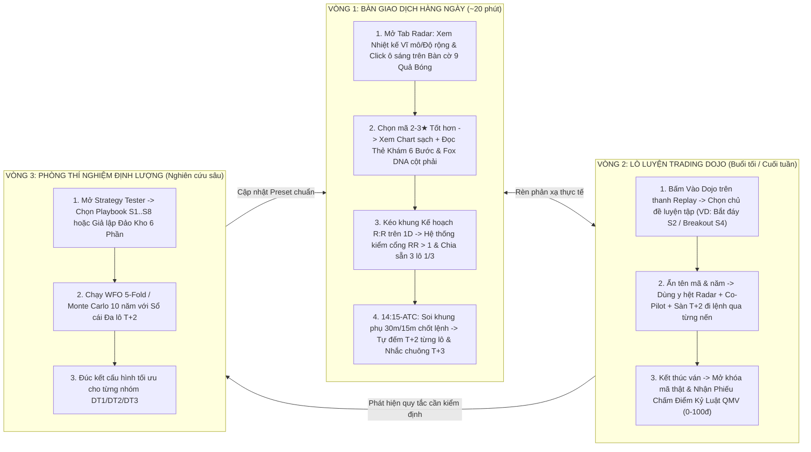

# 05. TÀI LIỆU YÊU CẦU NGHIỆP VỤ & KIẾN TRÚC SẢN PHẨM (BRD): NÂNG CẤP SUMI THÀNH WORKSTATION GIAO DỊCH, TẦM SOÁT & LUYỆN TẬP ĐỊNH LƯỢNG CHUẨN QMV

> **Mã tài liệu:** `SUMI-QMV-BRD-V2.0`  
> **Trạng thái:** Bản thiết kế tổng thể sẵn sàng cho giai đoạn Phân tích Kỹ thuật Chi tiết (Tech Spec), Lập Kế hoạch (Plan) & Triển khai (Implementation)  
> **Tài liệu nền tảng liên kết:**
> - Chỉ mục tổng thể: [00_QMV_KNOWLEDGE_MASTER_INDEX.md](file:///Users/mizuhara/workspace/sumi/docs/qmv_research/00_QMV_KNOWLEDGE_MASTER_INDEX.md)
> - Học thuyết gốc QMV: [01_QMV_TECHNICAL_ANALYSIS_COMPLETE_DOCTRINE.md](file:///Users/mizuhara/workspace/sumi/docs/qmv_research/01_QMV_TECHNICAL_ANALYSIS_COMPLETE_DOCTRINE.md)
> - 08 Chiến lược chuẩn QMV: [02_QMV_TRADING_STRATEGIES_PLAYBOOK.md](file:///Users/mizuhara/workspace/sumi/docs/qmv_research/02_QMV_TRADING_STRATEGIES_PLAYBOOK.md)
> - 07 Chỉ báo độc quyền QMV: [03_QMV_CUSTOM_INDICATORS_SPECIFICATION.md](file:///Users/mizuhara/workspace/sumi/docs/qmv_research/03_QMV_CUSTOM_INDICATORS_SPECIFICATION.md)
> - Đối chiếu mã nguồn Sumi `v1`: [04_SUMI_GAP_ANALYSIS_AND_IMPLEMENTATION_ROADMAP.md](file:///Users/mizuhara/workspace/sumi/docs/qmv_research/04_SUMI_GAP_ANALYSIS_AND_IMPLEMENTATION_ROADMAP.md)

---

## MỤC LỤC

1. [Tầm nhìn Sản phẩm & Định vị Sứ mệnh Kép (`Executive Vision & Dual-Mission`)](#1-tầm-nhìn-sản-phẩm--định-vị-sứ-mệnh-kép-executive-vision--dual-mission)
2. [Bản đồ Phạm vi Nâng cấp: Indicators, Screens/Panels & Backend Services](#2-bản-đồ-phạm-vi-nâng-cấp-indicators-screenspanels--backend-services)
3. [Thiết kế Chi tiết Luồng Trải nghiệm Người dùng (`3 Core User Flows`)](#3-thiết-kế-chi-tiết-luồng-trải-nghiệm-người-dùng-3-core-user-flows)
4. [Đặc tả Yêu cầu Nghiệp vụ & Chức năng theo 06 Trụ cột (`FR-01` $\rightarrow$ `FR-24`)](#4-đặc-tả-yêu-cầu-nghiệp-vụ--chức-năng-theo-06-trụ-cột-fr-01--fr-24)
5. [Kiểm toán Dữ liệu Hiện trạng & Chiến lược Kiến trúc Dữ liệu (`Data Audit & Yumeko Bridge`)](#5-kiểm-toán-dữ-liệu-hiện-trạng--chiến-lược-kiến-trúc-dữ-liệu-data-audit--yumeko-bridge)
6. [Yêu cầu Phi chức năng, Bất biến Định lượng & Lộ trình Triển khai Đề xuất (`M1` $\rightarrow$ `M5`)](#6-yêu-cầu-phi-chức-năng-bất-biến-định-lượng--lộ-trình-triển-khai-đề-xuất-m1--m5)

---

## 1. TẦM NHÌN SẢN PHẨM & ĐỊNH VỊ SỨ MỆNH KÉP (`EXECUTIVE VISION & DUAL-MISSION`)

### 1.1. Bài toán Cốt lõi
Nền tảng **Sumi** hiện tại đã hoàn thiện xuất sắc vai trò một ứng dụng biểu đồ phân tích kỹ thuật, tua lại lịch sử (`Bar Replay`), giao dịch giả lập chuẩn Việt Nam (`T+2`, `LO/MP/ATO/ATC`, Trần/Sàn) và kiểm thử chiến lược cơ bản (`WFO`, `Monte Carlo`). Tuy nhiên, để phục vụ hiệu quả nhất cho một nhà đầu tư thực hành **chính thống phương pháp QMV**, các công cụ phổ thông vẫn để lộ khoảng trống lớn giữa *lý thuyết bài giảng* và *thao tác thực chiến hàng ngày*:
- Người dùng vẫn phải tự nhẩm từ vĩ mô/độ rộng xuống ngành/nhóm tiền (`9 Quả Bóng`), dễ rơi vào lỗi mở chart lẻ ra vẽ ngay (*nhìn cây quên rừng*).
- Các chỉ báo và mẫu nến phổ thông chưa phản ánh đúng quy tắc đặc thù của QMV tại TTCK Việt Nam (nến Trần/Sàn cứng không râu, quy tắc nến `1/3` và ghép nến 2–3 phiên tại vùng đặc biệt, `SMA(Volume, 5)` đọc theo chuỗi `T+3`, chuyển mạch tự động `Trending vs Sideways`, `BB(15, 2)` tụt dải lần 2, khử 2 bẫy chuẩn hóa 50 phiên của dòng tiền).
- Chưa có công cụ hỗ trợ và kiểm chứng **nghệ thuật đi vốn sống còn của QMV dưới luật `T+2.5`**: chia 3 phần `1/3 – 1/3 – 1/3`, khóa cổng `Reward/Risk > 1.0` trước lệnh, cắt `1/2` lượng hàng đang có khi thủng hỗ trợ (tận dụng lô `1/3` đã về tài khoản), cắt lỗ thời gian `T+3 Time-Stop`, và kỹ thuật **Đảo hàng 6 phần trên kho có sẵn**.

### 1.2. Sứ mệnh Kép của Sumi QMV Workstation (`v2.0`)
Biến Sumi thành **Trạm Làm Việc Chuyên Biệt 100% Theo Phương Pháp QMV** phục vụ đồng thời hai mục tiêu gắn kết chặt chẽ:
1. **Sứ mệnh 1 — "Bàn Giao Dịch & Tầm Soát Thực Chiến Hàng Ngày" (`Daily Top-Down Trading Desk`):** Giúp nhà đầu tư hoàn thành quy trình từ *Nhìn rừng (Vĩ mô, Độ rộng, 9 Quả Bóng)* $\rightarrow$ *Soi cây (Khám 6 bước PTKT & Tính nết đội tạo lập)* $\rightarrow$ *Lập kế hoạch lệnh 3 mốc (`RR > 1`, chia lô `1/3`)* $\rightarrow$ *Đi lệnh khung giờ vàng `14:15–ATC` và giám sát hậu lệnh `T+`* một cách kỷ luật, mạch lạc, tốn ít thời gian nhất.
2. **Sứ mệnh 2 — "Lò Luyện Tay Nghề Mù & Phòng Thí Nghiệm Hệ Thống QMV" (`QMV Dojo & Quantitative Portfolio Lab`):** Biến 10 năm dữ liệu lịch sử TTCK Việt Nam thành môi trường **tập phản xạ mù có giám khảo chấm điểm kỷ luật (`Trading Dojo`)** và **kiểm chứng định lượng đa lô `T+2` / Đảo kho 6 phần** để mài sắc kỹ năng cũng như tối ưu hóa hệ thống bằng số liệu thực chứng.

### 1.3. Năm Nguyên tắc Thiết kế Bất biến
1. **Thuần khiết Phương pháp QMV:** Mọi thuật toán nhận diện nến, vùng, khối lượng, chỉ báo, phân loại cổ phiếu và quy tắc đi vốn phải bám sát 100% bài giảng gốc QMV đã lưu tại [01_QMV_TECHNICAL_ANALYSIS_COMPLETE_DOCTRINE.md](file:///Users/mizuhara/workspace/sumi/docs/qmv_research/01_QMV_TECHNICAL_ANALYSIS_COMPLETE_DOCTRINE.md).
2. **Đồ thị Tối giản, Không Rác Thị Giác (`Clean Chart First`):** Không nhồi nhét mọi thứ thành đường vẽ rối mắt trên chart. Thông tin bối cảnh, chẩn đoán 6 bước và hồ sơ mã được phân bổ khoa học sang các Panel/Card chuyên trách.
3. **Nhân quả Tuyệt đối (`100% Causal` / `DEF-001`):** Tại bất kỳ cây nến lịch sử $t$ nào (trong Backtest, Screener hay khi tua `Bar Replay`), toàn bộ 4 tầng công cụ **chỉ được phép biết dữ liệu $\le t$**, tuyệt đối không rò rỉ tương lai.
4. **Khớp Vi cấu trúc TTCK Việt Nam:** Tôn trọng biên độ `HOSE ±7% / HNX ±10% / UPCOM ±15%`, bước giá `10/50/100đ`, khóa thanh khoản Trần/Sàn cứng, lô chẵn `100`, lịch sử thanh toán `T+3` (trước `29/08/2022`) và `T+2` (từ `29/08/2022`), phí `0.15%` và thuế bán `0.10%`.
5. **Minh bạch Nguồn gốc Dữ liệu (`Provenance Honesty`):** Luôn phân biệt rõ trên UI và trong dữ liệu giữa **(a) Chỉ số đồng bộ nguyên gốc từ QMV/Yumeko (`Official Synced`)** và **(b) Chỉ số tính toán nhân quả từ OHLCV bởi Sumi (`Sumi QMV Proxy`)**; tuyệt đối Read-Only không ghi đè sang kho dữ liệu của Yumeko.

---

## 2. BẢN ĐỒ PHẠM VI NÂNG CẤP: INDICATORS, SCREENS/PANELS & BACKEND SERVICES

Dự án nâng cấp **không chỉ thêm các chỉ báo**, mà là sự nâng cấp đồng bộ trên **03 Khối Kiến Trúc** của Sumi (tận dụng tối đa khung giao diện đa cửa sổ sẵn có, không đập đi xây lại từ đầu):

### 2.1. Khối 1 — Bộ Chỉ báo, Lớp phủ Biểu đồ & Mẫu Màn hình (`Indicators & Smart Overlays`)
- **05 Chỉ báo cấp Cổ phiếu & 02 Chỉ báo cấp Thị trường/Ngành** (đặc tả toán học chi tiết tại [03_QMV_CUSTOM_INDICATORS_SPECIFICATION.md](file:///Users/mizuhara/workspace/sumi/docs/qmv_research/03_QMV_CUSTOM_INDICATORS_SPECIFICATION.md)):
  1. `QMV_MERGED_VPA` *(Overlay + Volume Pane)*: Phân loại nến quy tắc `1/3` (gồm cả nến Trần/Sàn cứng `±100`), lọc nhiễu vẽ nến `ATO 100 cổ`, bóng mờ **Nến ghép động 2–3 phiên (`Ghost Merged Candle`)** chỉ hiện tại vùng đặc biệt, đường `SMA(Volume, 5)` và nhãn chuỗi VPA `T+3` (`Tiết cung`, `Test cung cạn Vol`, `Kill Nến Đỏ`, `Đạp ga không chạy`, cảnh báo đỏ `Cây thông Noel`).
  2. `QMV_ZONE_3TOUCH` *(Price Overlay)*: Hộp Hỗ trợ/Kháng cự tự động **gọt bỏ râu nến hoảng loạn**, đếm trực tiếp **`Touch #1 / #2 / #3`**, đánh dấu hợp lưu (`MA50/EMA200/Fibo`) và tính sẵn tỷ lệ `Reward/Risk` tại nến hiện tại.
  3. `QMV_SMART_MONEY_CYCLE` *(Price Overlay Badges)*: Định vị bước sóng trên sơ đồ **`0 – 1 – 2 – 3 – 4 – 5 – 6 – 7 – 8`** và 3 pha tâm lý (*Nghi ngờ – Đồng thuận – Hưng phấn*), giúp phân biệt ngay `Hộp 2` (tái tích lũy mua được) với `Hộp 7` (tái phân phối sau khi gãy nền `6`).
  4. `QMV_REGIME_RIBBON_DIV` *(Overlay + Sub-pane)*: Bộ chuyển mạch tự động **`Trending vs Sideways`** (làm mờ cắt `MA` khi đi ngang; khóa cảnh báo bán non `RSI > 70` khi Uptrend mạnh), dải `MA10/20/50/EMA200 + Weekly EMA200`, `BB(15, 2)` báo điểm tụt vào dải lần 2 (`2nd Band Re-entry`), `CCI + SMA(CCI)`, Phân kỳ 3 đáy `MACD` và Phân kỳ kín (`Hidden Divergence`).
  5. `QMV_BLACKBOX_PROXY` *(Sub-pane)*: Đường la bàn trung hạn **`TMC + TMA20 + TMA50`** (4 trạng thái `Duy trì / Khỏe / Bão hòa / Yếu`), tốc độ dòng tiền bất đối xứng **`SP = TM - TS`**, dao động chu kỳ **`DSPI [-1, +1]`**, **`MPICP`**, bộ giảm chấn **chống 2 Bẫy chuẩn hóa 50 phiên** (kèm nút gạt đối chiếu `Raw vs Damped Z-50`), và huy hiệu **`0–5★ + Tốt hơn/Kém hơn`**.
  6. `QMV_MARKET_BREADTH_BB` *(Market Sub-pane / Header Widget)*: Chuỗi độ rộng `BBS20 / BBS50 / BBS200` toàn thị trường & cảnh báo hậu kiểm `BBS200 > 80%` phân kỳ âm.
  7. `QMV_9BALL_ROTATION` *(Radar Matrix Engine)*: Động cơ tính sức mạnh và gia tốc luân chuyển của `3 Nhóm ngành × 3 Nhóm dòng tiền (DT1/DT2/DT3)`.
- **03 Mẫu Biểu đồ 1-Chạm (`QMV Chart Templates` trên [TopHeader.tsx](file:///Users/mizuhara/workspace/sumi/ui/src/components/TopHeader.tsx)):**
  - *Template 1 — `QMV Tầm soát & Đánh Vùng (Core VPA + Zones)`:* Mặt chart cực thoáng gồm `QMV_ZONE_3TOUCH` + `QMV_MERGED_VPA` + `TMC/DSPI`.
  - *Template 2 — `QMV Sóng Trung Hạn (Trend & Ichimoku 6-18-36)`:* `Ichimoku (6,18,36,18)` + `MA20/50/200` + `BB(15,2)` + `TMC`.
  - *Template 3 — `QMV Bắt Đáy & Đảo Chiều (Safe Bottom & Divergence)`:* `Weekly EMA200` + `BB(15,2)` + `MACD 3-Đáy / RSI-CCI Trendline`.

### 2.2. Khối 2 — Các Màn hình, Panel & Tương tác Giao diện Mới/Nâng cấp (`Screens, Panels & UX Workflows`)

| Mã UI | Tên Screen / Panel / Công cụ | Vị trí tích hợp trên Sumi | Thay đổi cốt lõi so với hiện tại |
| :--- | :--- | :--- | :--- |
| **UI-01** | **Trạm Radar Top-Down & Bàn Cờ 9 Quả Bóng (`QMV Radar & Screener`)** | Nâng cấp tab [StockScreenerTab.tsx](file:///Users/mizuhara/workspace/sumi/ui/src/components/dock/StockScreenerTab.tsx) trong `BottomTradingDock` | Thêm **Thanh Nhiệt kế Tổng vốn (`3/3..0/3` + `BBS20/50/200` + Cờ Đổi gác)** và **Ma trận Tương tác 9 Quả Bóng (`3×3`)** ngay phía trên bảng lọc; click vào ô nào lọc ngay mã thuộc ô đó; thêm cột `0–5★ Tốt hơn/Kém hơn`, nhãn `Cờ An toàn Cơ bản/M-Score` và công tắc `Ẩn mã Bo cung quay tay`. |
| **UI-02** | **Trợ lý Chẩn đoán Nhanh (`QMV Co-Pilot & Fox DNA Sidebar`)** | Thêm tab thứ 4 `"QMV"` cạnh `Watchlist | Alerts | Objects` trong [RightWidgetBar.tsx](file:///Users/mizuhara/workspace/sumi/ui/src/components/RightWidgetBar.tsx) | Hiển thị gọn trên cột phải 3 thẻ cho mã đang mở: *(1) Cổng Vĩ mô & Chất lượng DN ("Không được chết" / M-Score)*; *(2) Phiếu khám tự động 6 Bước PTKT*; *(3) Thẻ Căn cước Hành vi Đội tạo lập (`Fox DNA`: tỷ lệ Bull-trap Breakout 5 năm, MA/Indicator nhạy nhất, độ nhiễu ATO)*. |
| **UI-03** | **Trình Lập Kế Hoạch Lệnh 3 Mốc (`1-Click QMV Trade Planner`)** | Nối công cụ vẽ `Long R:R` $\leftrightarrow$ [PaperBrokerTab.tsx](file:///Users/mizuhara/workspace/sumi/ui/src/components/dock/PaperBrokerTab.tsx) $\leftrightarrow$ `Alerts` | Khi kẻ khung `Long R:R`, tự động kiểm tra cổng **`RR > 1.0`** (dưới `1.0` đổi màu đỏ cảnh báo), tự tính khối lượng theo biến động `1/σ` chia thành **3 lô `1/3 – 1/3 – 1/3` chẵn 100 cổ**, đẩy sang phiếu lệnh và tự tạo chuông nhắc đánh giá **`T+3`**. |
| **UI-04** | **Phòng Tập Thực Chiến Mù & Giám Khảo Kỷ Luật (`QMV Trading Dojo`)** | Mở rộng [ReplayControlBar.tsx](file:///Users/mizuhara/workspace/sumi/ui/src/components/ReplayControlBar.tsx) + [PaperBrokerTab.tsx](file:///Users/mizuhara/workspace/sumi/ui/src/components/dock/PaperBrokerTab.tsx) + Modal Tổng kết | Thêm nút `Vào Phòng Tập Dojo`: chọn chủ đề tình huống (`S1..S8` hoặc ngẫu nhiên), ẩn tên mã & ngày tháng trên toàn bộ UI, đồng bộ lùi thời gian cho cả Bàn cờ 9 Quả Bóng + Co-Pilot + Sàn `T+2`; kết thúc ván hiện **Bảng Chấm Điểm Kỷ Luật QMV (thang 100)** và mở khóa tên mã thật. |
| **UI-05** | **Phòng Thí Nghiệm Danh Mục Đa Lô `T+2` & Đảo Kho 6 Phần (`QMV Strategy & Portfolio Lab`)** | Nâng cấp tab [StrategyTesterTab.tsx](file:///Users/mizuhara/workspace/sumi/ui/src/components/dock/StrategyTesterTab.tsx) | Bổ sung trọn bộ **8 Playbook chuẩn QMV (`S1..S8`)**, chế độ đi vốn **`3-Tranche (1/3–1/3–1/3)`**, chế độ mô phỏng **`Đảo Kho 6 Phần (Inventory Rebalancing)`**, bảng bật/tắt tách lớp quy tắc (`Ablation Toggles`) và hiển thị từng lô giải ngân/cắt `1/2`/`T+3 Time-Stop` trên nhật ký lệnh. |

### 2.3. Khối 3 — Các Dịch vụ Backend & Engine Định lượng (`Rust Services in sumi-core, sumi-data, sumi-desktop`)
1. **`sumi-core::indicators` & `sumi-core::scanner` (`QMV Quantitative Core`):** Thuần `f64/i64`, $O(N)$, chạy được cả Native Desktop lẫn WebAssembly (`wasm32`), cung cấp 7 chỉ báo, +28 tín hiệu `qmv.v2.*` trong catalog và bộ lọc cổ phiếu Bo cung/Quay tay.
2. **`sumi-core::fox_dna` (`FoxDnaProfilerService`):** Dịch vụ quét lịch sử 5–10 năm của từng mã cổ phiếu để trích xuất đặc trưng hành vi tạo lập (xác suất Breakout thành công tại `T+3`, tần suất rũ `Spring`, đường `MA` và chỉ báo dao động có độ chính xác lịch sử cao nhất trên riêng mã đó, hệ số biến thiên thanh khoản bo cung).
3. **`sumi-core::backtest` v2 (`PerTrancheT2Engine` & `SixPartInventorySimulator`):** Sổ cái theo dõi trạng thái thanh toán `T+2` (hoặc `T+3` trước `29/08/2022`) độc lập cho từng lô `TrancheLot`, hỗ trợ `ScaleIn`, `PartialExit`, `CutHalfOnSupportBreak`, `PreTradeRewardRiskGate` và `SetupExpiredTimeStop`.
4. **`sumi-core::dojo` (`DojoScenarioGenerator` & `QmvDisciplineAuditor`):** Quét kho dữ liệu lịch sử để tạo danh sách các lát cắt tình huống kinh điển (`Scenario Catalog`) và chấm điểm từng quyết định đặt lệnh của người dùng trong phiên Replay theo 7 quy tắc kỷ luật QMV.
5. **`sumi-data::yumeko_bridge` & `sumi-data::backfill` (`Read-Only Yumeko Connector & Market Data Enricher`):** Đọc an toàn (`SQLITE_OPEN_READ_ONLY` + `PRAGMA query_only = ON` hoặc đọc gói xuất `research-exports`) các bảng Vĩ mô `VM01`, Phân loại 9 Quả Bóng, Tài chính/M-Score và QMV Blackbox từ Yumeko sang cache nội bộ của Sumi, kết hợp công cụ nạp giá `Raw` và pre-warm dữ liệu nội ngày `15m/30m/1W`.

---

## 3. THIẾT KẾ CHI TIẾT LUỒNG TRẢI NGHIỆM NGƯỜI DÙNG (`3 CORE USER FLOWS`)



---

## 4. ĐẶC TẢ YÊU CẦU NGHIỆP VỤ & CHỨC NĂNG THEO 06 TRỤ CỘT (`FR-01` $\rightarrow$ `FR-24`)

### Trụ cột 1 — Trạm Radar Top-Down & Bàn Cờ 9 Quả Bóng (`Ý tưởng 1`)
- **`FR-01` (Thanh Nhiệt Kế Tổng Vốn & Độ Rộng `BB`):** Hiển thị trạng thái `VN-Index` (*Thuận lợi / Phân hóa đi ngang / Downtrend đứng ngoài*), cặp độ rộng `BBS20`, `BBS50`, `BBS200`, pha vĩ mô (nếu có đồng bộ Yumeko) và mức trần tỷ trọng cổ phiếu khuyến nghị (`3/3`, `2/3`, `1/3`, `0/3`). Tự động bật cảnh báo nổi bật khi `BBS20 >= 80–85%` (khóa mua đuổi) hoặc khi **`BBS200 > 80%` kèm `BBS20` gãy phân kỳ âm**.
- **`FR-02` (Ma trận Tương tác 9 Quả Bóng):** Hiển thị lưới `3 Nhóm ngành (NN1 Tài chính-BĐS-XD / NN2 Sản xuất-Bán lẻ-XK / NN3 Phòng thủ-Hạ tầng)` $\times$ `3 Tầng dòng tiền (DT1 / DT2 / DT3)` + ô phụ `Trà đá (< 10.000đ)`. Mỗi ô hiển thị điểm sức mạnh dòng tiền, mũi tên gia tốc 5 phiên và số mã đang cho điểm uốn mua. Click vào ô nào sẽ lọc ngay danh sách mã bên dưới.
- **`FR-03` (Cảnh báo Đỉnh Chu kỳ Liên ngành):** Tự động phát hiện và gắn cờ: *(a)* **Cảnh báo Đỉnh #1** khi ô `DT3 / Trà đá` tăng nóng diện rộng trong khi `DT1/DT2` suy yếu; *(b)* **Báo động Đỏ #2 ("Đổi gác")** khi dòng tiền gãy đồng loạt ở `DT3` và rút ngược về đỡ giá `3 quả bóng DT1` cuối chu kỳ (khuyến nghị cá nhân rút về 100% tiền mặt).
- **`FR-04` (Xếp hạng `0–5★ + Đạo hàm Tốt hơn` & Lọc Rác/Bo cung):** Xếp hạng cổ phiếu ưu tiên nhóm **`2★–3★ Tốt hơn`** lên trên `4★–5★ Kém hơn`; cung cấp nút gạt ẩn cổ phiếu *Bo cung quay tay* (`CV_30(Volume)` thấp bất thường + râu nến nhân tạo) và ẩn mã vi phạm cổng *"Không được chết"* / `M-Score > -1.78`, đồng thời giữ chế độ *"Gỡ bộ lọc mặc định"* riêng cho bài toán săn `Trà đá 0 -> 1` có kiểm soát.

### Trụ cột 2 — Đôi Mắt Đọc Chart 6 Bước (`QMV Chart Co-Pilot` — `Ý tưởng 2`)
- **`FR-05` (Nến Quy tắc `1/3`, Trần/Sàn Cứng & Bóng Nến Ghép Động):** Sửa dứt điểm nhận diện nến khóa trần/sàn (`O=H=L=C`) thành nến đặc cực đại (`±100`); áp dụng ngưỡng `1/3` chuẩn QMV; khử nhiễu vẽ nến `ATO 100 cổ`; vẽ bóng nến ghép 2–3 phiên (`Ghost Candle`) chỉ khi giá nằm trong Vùng đặc biệt.
- **`FR-06` (Chuỗi VPA `T+3` quanh `SMA(Vol, 5)` & Cảnh báo Cây Thông Noel):** Chuyển đường tham chiếu khối lượng sang `SMA(Volume, 5)`, tự động gắn nhãn chuỗi `>= 3` phiên (`Tiết cung`, `Cạn cung Test cung`, `Kill Nến Đỏ`, `Đạp ga xe không chạy`, và cảnh báo khẩn cấp `Tiết cung -> Nổ Vol = Cây thông Noel`), phân biệt rõ nhịp rũ sớm `5–10%` đầu sóng với phân phối `>= 40%` cuối sóng.
- **`FR-07` (Vùng 3 Chạm Cắt Râu Hoảng Loạn & Chu kỳ `0–8`):** Tự động gọt râu hoảng loạn dị biệt khi dựng hộp Hỗ trợ/Kháng cự, hiển thị số lần chạm (`Touch #1 / #2 / #3`) và huy hiệu vị trí trên sơ đồ `0 – 1 – 2 – 3 – 4 – 5 – 6 – 7 – 8`.
- **`FR-08` (Chuyển mạch Tự động `Trending vs Sideways` & `BB(15, 2)`):** Tự nhận diện chế độ đi ngang hay có xu hướng để cảnh báo việc dùng sai nhóm chỉ báo; đổi nhãn vùng `RSI > 70` trong Uptrend thành *"Xung lực mạnh — Cấm bán non"*; bổ sung `BB(15, 2)` báo điểm tụt vào dải lần 2 và `CCI` kèm đường trung bình `SMA(CCI)`.
- **`FR-09` (Hộp Đen QMV Minh Bạch Khử Bẫy 50 Phiên):** Cung cấp cửa sổ `TMC + TMA20 + TMA50`, `SP = TM - TS`, `DSPI`, `MPICP` với thuật toán `Dead-Amplitude Dampener` triệt tiêu bẫy kéo giãn giả trên cổ phiếu lịm thanh khoản, kèm công tắc xem song song `Raw vs Damped Z-50`.
- **`FR-10` (Phiếu Khám Nhanh 6 Bước PTKT trên Sidebar):** Tổng hợp tự động 6 bước phân tích theo đúng thứ tự quyền lực công cụ QMV ngay trên tab `"QMV"` của cột phải, cập nhật tức thời cả khi đổi mã lẫn khi bấm từng nến trong `Bar Replay`.

### Trụ cột 3 — Hồ Sơ Tính Nết Cổ Phiếu & Dấu Vân Tay Đội Tạo Lập (`Fox DNA` — `Ý tưởng 5`)
- **`FR-11` (Phân tích Hành vi Lịch sử 5–10 Năm của từng Mã):** Tính toán và lưu cache cho từng cổ phiếu trên sàn:
  - Phân lớp hành vi thực tế (`DT1 / DT2 / DT3 / Trà đá / Hàng lái MM - Bo cung`) và hệ số $\beta$ chiều tăng vs $\beta$ chiều giảm so với `VN-Index`.
  - **Tỷ lệ Đột phá Thật vs Bull-trap tại `T+3`:** Thống kê trong quá khứ của chính mã đó, bao nhiêu % các phiên nổ Breakout vượt hộp giữ được thành quả khi hàng `T+2.5` về (cảnh báo rõ những mã chuyên đánh úp phiên nổ để người dùng chỉ mua tại hỗ trợ).
  - **Công cụ Kỹ thuật "Hợp vía" nhất:** Thống kê đường `MA` (`MA10/20/50`) có tỷ lệ đỡ giá thành công cao nhất và chỉ báo dao động (`RSI` vs `CCI` vs `MACD`) có xác suất đúng cao nhất trên lịch sử riêng của mã đó.

### Trụ cột 4 — Lập Kế Hoạch Lệnh 3 Mốc & Liên Thông Yumeko (`Ý tưởng 6`)
- **`FR-12` (Cổng Kiểm tra `Reward/Risk > 1.0` Trực quan):** Khi người dùng vẽ hoặc chỉnh sửa khung `Kế hoạch Long R:R`, hệ thống tính tức thời `RR = (Target - Entry) / (Entry - StopZone)`; nếu `RR < 1.0`, hiển thị cảnh báo đỏ rõ ràng nhắc hủy kế hoạch theo kỷ luật `KT01T2`.
- **`FR-13` (Chia Khối lượng `1/3 – 1/3 – 1/3` theo Biến động `1/σ` & Đồng bộ Phiếu Lệnh):** Từ tổng vốn danh mục và biến động `ATR/σ` của mã, gợi ý hạn mức vốn tối đa cho mã đó và chia sẵn thành 3 lô chẵn `100` cổ phiếu đẩy sang [PaperBrokerTab.tsx](file:///Users/mizuhara/workspace/sumi/ui/src/components/dock/PaperBrokerTab.tsx).
- **`FR-14` (Đồng hồ `T+2` Từng Lô & Nhắc lịch Kiểm định `T+3`):** Theo dõi trạng thái hàng khả dụng riêng cho từng lô mua; tự động tạo nhắc nhở đánh giá vào ngày `T+3` hàng về và cảnh báo thực thi quy tắc *"Cắt 1/2 trên lô đã về"* nếu thủng hỗ trợ.

### Trụ cột 5 — Phòng Tập Thực Chiến Mù & Giám Khảo Kỷ Luật (`QMV Trading Dojo` — `Ý tưởng 3`)
- **`FR-15` (Bộ Đề Thi Tình Huống Thực Chiến Giấu Tên Mã):** Xây dựng trình tạo đề thi từ dữ liệu lịch sử 10 năm theo 6 chủ đề luyện tập (*Mua hỗ trợ Test cung `S1`*, *Bắt đáy an toàn `S2`*, *Sóng trung hạn & Bear-trap mây `S3`*, *Phân biệt Breakout thật vs Bull-trap `S4`*, *Chốt lời chống Cây thông Noel `S8`*, và *Ngẫu nhiên tổng hợp*), che tên mã, che năm lịch sử và chuẩn hóa giá hiển thị nếu muốn chống đoán mã.
- **`FR-16` (Đồng bộ Nhân quả Toàn Trạm trong lúc Tập Dojo):** Khi đang ở phiên Dojo tại thời điểm cắt $t_0$, toàn bộ *Bàn cờ 9 Quả Bóng*, *Phiếu khám 6 bước*, *Chỉ báo QMV* và *Sàn đặt lệnh `T+2` (có khóa Trần/Sàn cứng)* đều hoạt động đúng tại thời điểm $t_0$, hỗ trợ lật qua lại giữa khung `1D` và `30m/15m` mà không lộ nến tương lai.
- **`FR-17` (Giám khảo Chấm Điểm Kỷ Luật QMV — `Discipline Scorecard`):** Khi kết thúc bài tập, chấm điểm người chơi trên thang `0–100` dựa trên **sự tuân thủ phương pháp** (kiểm tra `RR > 1`, không bắt Chạm #1 rơi Vol lớn, giải ngân từng phần `1/3`, thực hiện `T+3 Time-Stop` khi Breakout xịt, thực hiện `Cắt 1/2` khi thủng nền, không bán non ở `RSI > 70` trong Uptrend), sau đó mở khóa tên mã thật và toàn bộ diễn biến sau đó để rút kinh nghiệm.

### Trụ cột 6 — Phòng Thí Nghiệm Đa Lô `T+2`, 8 Playbook & Đảo Kho 6 Phần (`Ý tưởng 4`)
- **`FR-18` (Sổ cái Backtest `T+2` Đa Lô — `Per-Tranche T+2 Lot Ledger`):** Nâng cấp engine backtest để quản lý danh sách `Vec<TrancheLot>` độc lập trong mỗi vị thế, tính chính xác khối lượng cổ phiếu đã về tài khoản tại mỗi phiên để khớp trung thực các lệnh mua bồi `1/3`, chốt lời từng phần và cắt `1/2` cứu hộ.
- **`FR-19` (Cài đặt Chuẩn 08 Chiến lược QMV `S1..S8` & Bộ Bật/Tắt Quy tắc `Ablation`):** Triển khai đầy đủ 8 Playbook từ [02_QMV_TRADING_STRATEGIES_PLAYBOOK.md](file:///Users/mizuhara/workspace/sumi/docs/qmv_research/02_QMV_TRADING_STRATEGIES_PLAYBOOK.md), cho phép bật/tắt từng điều kiện thành phần (như cổng `VN-Index`, cổng `BBS200`, cổng `RR > 1`, `SMA5` vs `SMA20`, `T+3 Time-Stop`) để kiểm chứng đóng góp thực sự của từng quy tắc qua `Walk-Forward 5-Fold` và `Monte Carlo`.
- **`FR-20` (Trình Mô phỏng "Đảo Kho 6 Phần" cho Danh mục Trung hạn):** Cho phép chọn một danh mục cổ phiếu cơ bản nắm giữ dài hạn, cấu hình tỷ lệ kho lõi (`4/6` hoặc `5/6`) và phần xoay vòng (`2/6` hoặc `1/6`) bán tại vùng kháng cự / quá mua `BB(15,2)` và **bắt buộc cover lại đủ số lượng cổ phiếu** khi chỉnh về hỗ trợ hoặc khi vượt đỉnh retest thành công; xuất báo cáo so sánh trực tiếp hiệu suất và mức giảm Drawdown so với nắm giữ thụ động (`Buy & Hold`).

---

## 5. KIỂM TOÁN DỮ LIỆU HIỆN TRẠNG & CHIẾN LƯỢC KIẾN TRÚC DỮ LIỆU (`DATA AUDIT & YUMEKO BRIDGE`)

Để trả lời chính xác câu hỏi **"Dữ liệu hiện tại của Sumi đã đủ chưa, đã tham khảo nguồn của Yumeko chưa và có cần thêm nguồn nào nữa không?"**, dưới đây là kết quả kiểm toán thực tế từng kho dữ liệu đang có ngay trên máy của bạn:

### 5.1. Kiểm kê Thực tế Những gì Đang Có trong Sumi & Yumeko

| Kho dữ liệu hiện có trên máy | Dung lượng & Quy mô thực tế | Những gì ĐÃ ĐỦ rất tốt | Những khoảng trống / chi tiết cần bổ sung |
| :--- | :--- | :--- | :--- |
| **1. Kho Nội tại của Sumi**<br>(`sumi_market.db` ~85 MB + `data/raw/cafef/*.csv` ~76 MB + `TradingViewFeed` WebSocket) | - **`470` mã cổ phiếu VN** (`263 HOSE + 90 HNX + 117 UPCOM`, ~940.000 nến ngày `1D` đã điều chỉnh chia tách từ `2016 -> 11/2026`).<br>- **`VNINDEX`** (`6.391` nến `1D` từ năm `2000 -> 2026`) & **`HNXINDEX`** (`4.669` nến).<br>- Tệp gốc `CafeF.SolieuGD.Raw.Upto06112026.csv` (`34.4 MB` giá chưa điều chỉnh) **đang nằm sẵn trên đĩa** nhưng chưa bật nạp (`include_raw: false`).<br>- Kết nối trực tiếp `TradingView` (`ProData`/`Data`) tải live & lịch sử `1m..1M`. | **Đủ 100% để tính toán 7 Chỉ báo QMV (bản Proxy OHLCV), Hồ sơ `Fox DNA`, Backtest 10 năm (`2016–2026`) và Phòng tập Dojo khung Ngày (`1D`) & Tuần (`1W`) cho 470 mã thanh khoản chính!** | 1. **Lỗi nhỏ trong `sumi-data/src/types.rs:178`:** Khung `30m` (`M30`) và `1M` (`MN1`) đang trả `None` khi ánh xạ sang `sumi-core::Timeframe`, trong khi QMV dùng `30m` làm khung kích hoạt chính.<br>2. **Chưa bật nạp giá `Raw` (`Unadjusted`):** Cần giá thật chưa chia tách tại ngày giao dịch để lọc chuẩn cổ phiếu `Trà đá (< 10.000đ)` trong quá khứ và tính chính xác bước giá `10/50/100đ`.<br>3. **Khung nội ngày (`15m, 30m, 1H`) & `VN30 / VN30F1!` mới tải lẻ tẻ khi mở chart:** Cần 1 lệnh `Pre-warm` tải sẵn lịch sử nội ngày cho rổ `QMV60 + VN30 + VN30F1!`. |
| **2. Kho Dữ liệu Phong phú Sẵn có bên Yumeko**<br>(`yumeko-app.sqlite` ~63.5 MB + `data/qmv-shared.sqlite` ~3.73 GB + `yumeko-sumi-contract` + `research_export.rs`) | Yumeko **ĐÃ XÂY SẴN** cả giao thức `yumeko-sumi-contract` lẫn bộ xuất `export_research_dataset` (10 bảng chuẩn `PIT` chống nhìn trước tương lai):<br>- **`macro_pit` (`1.708` dòng):** Đủ 9 chỉ số vĩ mô cốt lõi `VM01` (`OMO`, `LS Liên ngân hàng`, `LS Điều hành`, `USD/VND`, `Tín dụng`, `CPI`, `GDP`, `VN10Y/US10Y`, `Bán lẻ/IIP`).<br>- **`qmv_division_daily` (`1.031 – 1.799` mã):** Phân nhóm ngành & tầng dòng tiền toàn thị trường.<br>- **`fundamentals_pit` (`32.923` dòng BCTC + `52.923` dòng chỉ số tài chính `P/E, P/B, ROE, ROA, EPS, D/E...`):** Phục vụ cổng *Định giá & Không được chết*.<br>- **`qmv_market_blackbox`, `qmv_sector_blackbox`, `qmv_stock_blackbox` (`4.200+` dòng), `qmv_active_money_cao_soi_tho` (`4.065` dòng), `qmv_screener_history`:** Số liệu Hộp đen chính chủ từ QMV Webapp & Doraemi/DNSE! | **Giải quyết ngay lập tức bài toán Vĩ mô `VM01`, Phân loại `9 Quả Bóng` toàn sàn (>1.000 mã), Định giá cơ bản `P/E, P/B, ROE` và Hộp đen QMV chính chủ cho giao dịch hàng ngày mà Sumi không cần viết lại trình thu thập từ đầu!** | **Giới hạn quan trọng cần lưu ý:** Dữ liệu *QMV Stock Blackbox & Cáo–Sói–Thỏ chính chủ* trong Yumeko chỉ có độ sâu khoảng **9–12 tháng gần nhất (`12/2025 – 11/2026`) và tập trung ở ~55–60 mã trọng điểm**. Do đó, không thể dùng riêng bảng Blackbox thật này để Backtest 10 năm cho 470 mã — mà **phải kết hợp cả hai**: dùng dữ liệu thật từ Yumeko cho *Bàn giao dịch hàng ngày + Hiệu chỉnh tham số (Calibration)*, và dùng công thức `QMV_BLACKBOX_PROXY` trên OHLCV 10 năm của Sumi cho *Backtest dài hạn & Dojo lịch sử*! |

### 5.2. Có Cần Nghiên cứu Thêm Nguồn Dữ liệu Ngoại vi Nào Nữa Không?

Câu trả lời tư vấn rõ ràng theo mức độ cần thiết là: **90% toàn bộ 6 Ý tưởng có thể chạy hoàn hảo ngay bằng [Dữ liệu sẵn có của Sumi + Cầu nối Read-Only sang Yumeko] mà KHÔNG bị chặn bởi bất kỳ nguồn ngoài nào.** Tuy nhiên, để đạt tới mức hoàn mỹ **100%** ở một vài chi tiết nâng cao, có **03 hạng mục dữ liệu bổ sung đáng cân nhắc ở giai đoạn mở rộng (Optional Phase)**:

1. **Dữ liệu Mua/Bán Ròng Khối Ngoại (`Foreign Flow`) & Tự Doanh Lịch Sử Toàn Sàn (`470+` mã):**
   - *Hiện trạng:* CafeF OHLCV và TradingView không có cột Khối ngoại mua/bán ròng; Yumeko mới lưu `symbol_foreign_flow_current` cho ~15–55 mã gần đây. Trong khi đó *Tầng 4 (Thẩm định cổ phiếu 3 chân)* của QMV có coi Khối ngoại là một chân tham khảo quan trọng với nhóm `DT1 / VN30`.
   - *Phương án gọn nhẹ:* Tận dụng kết nối **DNSE / Entrade public/OAuth API** (kiến trúc đã có sẵn mẫu trong `yumeko-source-dnse`) hoặc nguồn EOD công khai của **CafeF / Vietcap (VCI)** để lấy thêm bảng `foreign_flow_daily(date, symbol, buy_vol, sell_vol, net_val)`.
2. **Dữ liệu BCTC Tóm tắt Toàn Sàn để Tính Tự Động `Beneish M-Score` & Cổng `"Không được chết"` cho đủ 470–1.000 mã:**
   - *Hiện trạng:* Trong `qmv-shared.sqlite` của Yumeko đã có sẵn bảng `qmv_symbol_financials` (`32.923` dòng) và `qmv_symbol_ratios` (`52.923` dòng)! Ngay ở Bước 1 của phiên triển khai tới, chỉ cần kiểm tra độ phủ mã của 2 bảng này: những mã đã có đủ khoản mục (`Doanh thu`, `Phải thu`, `Lợi nhuận gộp`, `Tổng tài sản`, `Khấu hao`, `CFO`, `Lợi nhuận sau thuế`, `Vốn chủ sở hữu`) thì **tính thẳng `M-Score` và 5 tiêu chí `"Không được chết"` từ kho Yumeko luôn**; chỉ những mã còn khuyết mới cần kéo bổ sung từ API tài chính của **DNSE (`financial_get_report_catalog`)** hoặc **VCI/Simplize**.
3. **Dữ liệu Khớp Lệnh Mua Chủ Động / Bán Chủ Động Thực Tế Cuối Ngày (`Intraday Active Buy/Sell Volume`):**
   - *Hiện trạng:* Công thức `QMV_BLACKBOX_PROXY` tách cung–cầu từ hình học nến `OHLCV` đã chạy được xuyên suốt 10 năm lịch sử. Nếu muốn trên **Bàn Giao Dịch Hàng Ngày (Live)** có độ sát thực tế từng lệnh đớp `Ask` vs táng `Bid` của Cáo trong ngày (cho cả những mã ngoài danh sách 55 mã đã đồng bộ QMV), Sumi có thể thu thập thêm thống kê `Mua chủ động / Bán chủ động` cuối ngày từ bảng khớp lệnh nội ngày của **DNSE / VCI** từ nay về sau.

### 5.3. Kiến trúc Dữ liệu Hợp nhất Đề xuất cho Sumi (`3-Tier Data Architecture`)

```
┌──────────────────────────────────────────────────────────────────────────────┐
│ TẦNG DỮ LIỆU 1 (NỘI TẠI SUMI — BẮT BUỘC, PHỤC VỤ 100% OFFLINE & BACKTEST)    │
│ • sumi_market.db:                                                            │
│   - 470+ mã x 10 năm 1D Splits-Adjusted + BẬT THÊM 1D Raw (Unadjusted)       │
│   - Sửa ánh xạ Timeframe::M30 & Timeframe::MN1 trong sumi-data/sumi-core     │
│   - Job Pre-warm lịch sử 15m, 30m, 1H, 1W cho VNINDEX, VN30, VN30F1!, QMV60  │
└──────────────────────────────────────┬───────────────────────────────────────┘
                                       │
┌──────────────────────────────────────▼───────────────────────────────────────┐
│ TẦNG DỮ LIỆU 2 (CẦU NỐI READ-ONLY SANG YUMEKO — TẬN DỤNG TÀI SẢN SẴN CÓ)     │
│ • Mở ?mode=ro (PRAGMA query_only=ON) hoặc đọc gói xuất từ research_export.rs:│
│   - macro_pit (9 chỉ số vĩ mô VM01) -> Cấp cho Thanh Nhiệt Kế Tổng Vốn       │
│   - qmv_division_daily (>1.000 mã)  -> Chuẩn hóa phân tầng 9 Quả Bóng & Trà đá│
│   - fundamentals_pit (85.000+ dòng) -> Tính Cổng "Không được chết" & M-Score │
│   - qmv_market/sector/stock_blackbox -> Hiển thị Official Badge & Hiệu chỉnh │
│     trọng số (Calibrate) cho thuật toán QMV_BLACKBOX_PROXY của Sumi!         │
└──────────────────────────────────────┬───────────────────────────────────────┘
                                       │
┌──────────────────────────────────────▼───────────────────────────────────────┐
│ TẦNG DỮ LIỆU 3 (MỞ RỘNG TÙY CHỌN VỀ SAU — KHÔNG CHẶN TIẾN ĐỘ DỰ ÁN)          │
│ • Enricher EOD nhẹ (DNSE / VCI): Khối ngoại mua/bán ròng toàn sàn +          │
│   Thống kê Mua/Bán chủ động khớp lệnh nội ngày + Bổ sung BCTC mã còn khuyết  │
└──────────────────────────────────────────────────────────────────────────────┘
```

---

## 6. YÊU CẦU PHI CHỨC NĂNG, BẤT BIẾN ĐỊNH LƯỢNG & LỘ TRÌNH TRIỂN KHAI ĐỀ XUẤT (`M1` $\rightarrow$ `M5`)

### 6.1. Yêu cầu Hiệu năng & Chất lượng Kỹ thuật (`NFRs`)
1. **Hiệu năng mượt tức thì:**
   - Mở hoặc đổi mã trên biểu đồ kèm tính toán trọn bộ 5 chỉ báo cấp cổ phiếu + Phiếu khám 6 bước + Thẻ `Fox DNA`: **`< 16 ms`** (giữ vững 60 FPS).
   - Quét toàn bộ `470+` mã trên *Trạm Radar 9 Quả Bóng & Screener* (hoặc khi nhảy nến trong `Bar Replay`): **`< 25 ms`** nhờ tiền tính toán tuyến tính $O(N)$ và bộ nhớ đệm RAM.
2. **An toàn Kiến trúc:**
   - Lõi `crates/sumi-core` giữ nguyên tính chất **100% thuần tính toán (`wasm32-unknown-unknown`-compatible)**, không nhúng SQLite hay mạng vào `sumi-core`.
   - Mọi truy cập sang tệp SQLite của Yumeko bắt buộc dùng cờ chỉ đọc `SQLITE_OPEN_READ_ONLY` + `PRAGMA query_only = ON`, có cơ chế tự vận hành độc lập (`Graceful Standalone Fallback`) nếu máy không có thư mục Yumeko.
3. **Bộ 06 Kiểm thử Bất biến Bắt buộc:** Toàn bộ các bài kiểm thử `TEST-QMV-CAUSAL-PREFIX`, `TEST-QMV-VN-LIMIT-CANDLE`, `TEST-QMV-Z50-DEAD-SPAN`, `TEST-QMV-TRANCHE-T2-CUT-HALF`, `TEST-QMV-RR-AND-TIMESTOP`, `TEST-QMV-GUARD-CHANGE-CASH` (đặc tả tại Chương 4 của [04_SUMI_GAP_ANALYSIS_AND_IMPLEMENTATION_ROADMAP.md](file:///Users/mizuhara/workspace/sumi/docs/qmv_research/04_SUMI_GAP_ANALYSIS_AND_IMPLEMENTATION_ROADMAP.md)) phải đạt xanh 100%.

### 6.2. Lộ trình Chia 05 Milestone Độc lập, Dễ Kiểm chứng (`M1` $\rightarrow$ `M5`)
1. **Milestone 1 (`Data Foundation & Yumeko Read-Only Bridge`):** Bổ sung `Timeframe::M30/MN1`, bật nạp `CafeF Raw (Unadjusted)`, công cụ Pre-warm `15m/30m/1W` cho `VN30/VN30F1!/QMV60`, và xây dựng `YumekoReadOnlyBridge` nạp Vĩ mô `VM01`, Phân nhóm `Division`, Tài chính/`M-Score` và dữ liệu hiệu chỉnh Blackbox.
2. **Milestone 2 (`QMV Core Indicators & Chart Co-Pilot`):** Sửa lõi nến Trần/Sàn & quy tắc `1/3`, triển khai trọn bộ 05 chỉ báo cấp cổ phiếu (`QMV_MERGED_VPA`, `QMV_ZONE_3TOUCH`, `QMV_SMART_MONEY_CYCLE`, `QMV_REGIME_RIBBON_DIV`, `QMV_BLACKBOX_PROXY` chống bẫy `Z-50`), 03 `Chart Templates`, dịch vụ `Fox DNA` và tab `"QMV Co-Pilot"` trên cột phải.
3. **Milestone 3 (`Top-Down Radar & 9-Ball Screener`):** Triển khai `QMV_MARKET_BREADTH_BB` (`BBS20/50/200`), `QMV_9BALL_ROTATION`, lọc cổ phiếu Bo cung/Rác, xếp hạng `0–5★ Tốt hơn/Kém hơn` và giao diện *Bàn cờ 9 Quả Bóng + Thanh Nhiệt kế Tổng vốn* trong `StockScreenerTab`.
4. **Milestone 4 (`Per-Tranche T+2 Portfolio Engine, 8 Playbooks & 6-Part Rebalance`):** Nâng cấp engine backtest đa lô `1/3–1/3–1/3` khớp `T+2` từng lô, luật cứu hộ `Cắt 1/2`, cổng `RR > 1.0`, `T+3 Time-Stop`, cài đặt đủ 8 chiến lược `S1..S8`, trình giả lập *Đảo kho 6 phần* và nâng cấp `StrategyTesterTab` + kiểm định `WFO 10 năm`.
5. **Milestone 5 (`1-Click Trade Planner & QMV Trading Dojo`):** Liên kết công cụ vẽ `Long R:R` chia sẵn 3 lô `1/3` + nhắc chuông `T+3`, xây dựng bộ sinh đề thi lịch sử giấu tên mã (`Scenario Packs`) và **Giám khảo Chấm điểm Kỷ luật QMV (`0–100đ`)** trên chế độ `Bar Replay`.
