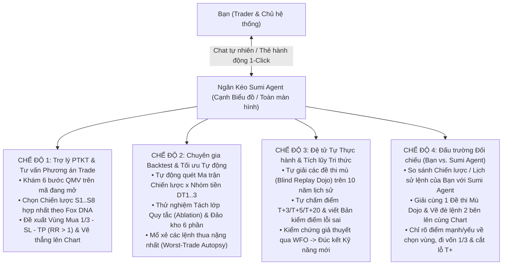

# 07. PHÂN TÍCH Ý TƯỞNG & THIẾT KẾ KIẾN TRÚC TOÀN DIỆN CHO `SUMI AGENT` (`QMV TECHNICAL CO-PILOT, AUTONOMOUS QUANT RESEARCHER & SELF-PRACTICING AGENT`)

> **Mã tài liệu:** `SUMI-AGENT-SPEC-V1.1`  
> **Vai trò biên soạn:** Principal AI Agent Systems Architect, Quantitative Researcher & Chief Market Technician  
> **Tham chiếu nền tảng & Mã nguồn đối chứng:**
> - Hệ sinh thái nội bộ: [yumeko-agent-acp](file:///Users/mizuhara/workspace/yumeko/crates/yumeko-agent-acp/src/lib.rs), [yumeko-memory](file:///Users/mizuhara/workspace/yumeko/crates/yumeko-memory/src/lib.rs), [yumeko-mcp](file:///Users/mizuhara/workspace/yumeko/crates/yumeko-mcp/src/lib.rs), [yumeko-sumi-contract](file:///Users/mizuhara/workspace/yumeko/crates/yumeko-sumi-contract/src/lib.rs) và bộ tài liệu [00..10](file:///Users/mizuhara/workspace/sumi/docs/qmv_research/00_QMV_KNOWLEDGE_MASTER_INDEX.md) của Sumi (tích hợp trọn vẹn **Dòng tiền/VPA QMV + Cấu trúc Keylevel Medio + Mẫu hình `123BO` & Thống kê Thực chiến Nukida**).
> - Kiến trúc Agent mã nguồn mở tiên tiến đã khảo sát mã nguồn thực tế: **`milind-soni/OpenMausBot`** (ACP runtime, per-bot tool scoping, budgeted `MEMORY.md` + auto-recall), **`NousResearch/hermes-agent`** (byte-stable prompt caching, progressive `SKILL.md` disclosure, `skill_ledger.jsonl` SHA-256 rollback & self-learning curator), **`Kiro`** (context-matched steering & deterministic lifecycle hooks), **`TauricResearch/TradingAgents`** (bi-temporal `Decision -> Settled Outcome -> Lesson` memory & Bull/Bear debate), và **`Microsoft RD-Agent(Q)`** (vòng lặp khoa học `Hypothesis -> Backtest -> Statistical Gate`).

---

## MỤC LỤC

1. [Chương 1 — Định vị Chiến lược: Mảnh ghép Hoàn thiện Hệ sinh thái `Yumeko ↔ Sumi ↔ Sumi Agent`](#chương-1--định-vị-chiến-lược-mảnh-ghép-hoàn-thiện-hệ-sinh-thái-yumeko--sumi--sumi-agent)
2. [Chương 2 — Tinh hoa Học hỏi từ các Kiến trúc Agent Hàng đầu (`OpenMausBot`, `Hermes`, `Kiro`, `TradingAgents`, `RD-Agent`)](#chương-2--tinh-hoa-học-hỏi-từ-các-kiến-trúc-agent-hàng-đầu-openmausbot-hermes-kiro-tradingagents-rd-agent)
3. [Chương 3 — Thiết kế Chức năng: 04 Chế độ Hoạt động Cốt lõi của `Sumi Agent`](#chương-3--thiết-kế-chức-năng-04-chế-độ-hoạt-động-cốt-lõi-của-sumi-agent)
4. [Chương 4 — Thiết kế Kỹ thuật Chi tiết: AI Runtime (`ACP`), Knowledge, Skills, Memory & 14 MCP Tools](#chương-4--thiết-kế-kỹ-thuật-chi-tiết-ai-runtime-acp-knowledge-skills-memory--14-mcp-tools)
5. [Chương 5 — Rào chắn Chống Học Vẹt (`Anti-Superstition`), Giao diện Tương tác & Lộ trình Triển khai (`M6 – M7`)](#chương-5--rào-chắn-chống-học-vẹt-anti-superstition-giao-diện-tương-tác--lộ-trình-triển-khai-m6--m7)

---

## CHƯƠNG 1 — ĐỊNH VỊ CHIẾN LƯỢC: MẢNH GHÉP HOÀN THIỆN HỆ SINH THÁI `YUMEKO ↔ SUMI ↔ SUMI AGENT`

Qua đọc sâu kiến trúc thực tế của **Yumeko `v2.9.2`**, có thể thấy ranh giới thiết kế giữa hai ứng dụng của bạn cực kỳ sáng rõ và bổ khuyết hoàn hảo cho nhau như hai phòng ban cốt lõi của một quỹ đầu tư chuyên nghiệp:

| Tiêu chí | **Yumeko (`CIO & Portfolio Strategist`)** | **Sumi + `Sumi Agent` (`Chief Market Technician, Tactical Trader & Quant Lab`)** |
| :--- | :--- | :--- |
| **Trọng tâm trong Quy trình QMV** | **Tầng 1 $\rightarrow$ Tầng 4 (Top-Down 9 Bước Chiến lược):** Chu kỳ tiền tệ `VM01`, Hộp đen thị trường/ngành từ QMV, Chất lượng DN & Định giá 3 phương pháp `DN01`, Quản trị danh mục thực nắm giữ, Cashflow cá nhân (`Doraemi`) và Báo cáo tham mưu 20 phần. | **Tầng 5 $\rightarrow$ Tầng 7 (Thực thi PTKT, Kịch bản Lệnh, Backtest & Luyện tập):** Đọc cấu trúc Giá – Khối lượng – Nến ghép – Vùng 3 chạm đa khung (`1W/1D/30m/15m`), chọn chiến lược tối ưu cho từng mã (`S1..S8`), lên kế hoạch điểm Mua/Cắt lỗ/Chốt lời `RR > 1` chia 3 lô `1/3`, kiểm thử định lượng 10 năm và tự rèn luyện trên sa bàn lịch sử. |
| **Ranh giới Pháp lý / Hành động của AI** | **Cố vấn An toàn (`Strictly Advisory`):** Validator của Yumeko chủ động từ chối sinh lệnh mua/bán cụ thể, từ chối chia khối lượng giải ngân hay suy diễn mã trạng thái chưa chứng minh. | **Thực chiến Kỹ thuật & Định lượng Nhân quả (`Tactical & Empirical`):** Được phép đề xuất **Kịch bản Giao dịch Cụ thể có Điều kiện (`Conditional Trade Plan`)**, vẽ trực tiếp vùng Mua/SL/TP lên biểu đồ, chạy máy Backtest `WFO` chứng minh xác suất và thực thi lệnh giả lập trong môi trường `Paper Broker / Dojo` để tự học và đối chiếu với bạn! |
| **Câu hỏi điển hình bạn giao cho Agent** | *"Vĩ mô tháng này tiền nhiều hay ít? Danh mục thật của tôi đang lệch ngành nào? Mã HPG định giá dài hạn bao nhiêu sao?"* | *"Đánh giá chart VCI hôm nay theo 6 bước QMV? Với tính nết đội lái của VCI thì nên đánh Hỗ trợ `S1` hay Breakout `S4`? Vẽ giúp phương án đi vốn 1/3 có `RR > 1` lên chart! Hãy tự backtest tối ưu chiến lược này và so kết quả với các lệnh của tôi!"* |

> **Giá trị Đột phá của Ý tưởng `Sumi Agent`:**
> Nếu chỉ có các chỉ báo và màn hình trên Sumi, **bạn vẫn phải một mình làm 100% công việc tổng hợp, suy luận và tự kiểm điểm**. Khi có `Sumi Agent` nối trực tiếp vào bộ công cụ tính toán Rust siêu tốc của Sumi, bạn có thêm một **Người Cộng Sự PTKT Chuyên Sâu QMV** vừa biết trò chuyện phân tích trực tiếp trên biểu đồ đang mở, vừa biết lầm lũi chạy hàng nghìn phép kiểm thử định lượng, vừa biết **tự luyện tập qua các tình huống lịch sử mù và so găng kết quả sòng phẳng với bạn**!

---

## CHƯƠNG 2 — TINH HOA HỌC HỎI TỪ CÁC KIẾN TRÚC AGENT HÀNG ĐẦU (`OPENMAUSBOT`, `HERMES`, `KIRO`, `TRADINGAGENTS`, `RD-AGENT`)

Thay vì lắp ghép một chatbot gọi LLM đơn giản (vốn rất dễ "chém gió" PTKT, quên bài hoặc học vẹt từ vài lệnh ăn may), kiến trúc `Sumi Agent` chắt lọc **5 cơ chế kỹ thuật đắt giá nhất** từ mã nguồn thực tế của các dự án dẫn đầu hiện nay, được tinh chỉnh riêng cho bài toán Tài chính Định lượng & PTKT QMV:

### 2.1. Từ `OpenMausBot` & `Yumeko v2.9.2` — Kết nối `Antigravity ACP` Bền vững & Phân quyền Công cụ Chặt chẽ
- **Giữ 1 tiến trình `agy acp` sống xuyên suốt (`PooledAgyAcpWorker`):** Khởi chạy `agy acp` qua `stdio` JSON-RPC 2.0 trong thư mục làm việc sạch (`~/.local/share/sumi/acp-workspace`), tự động xóa sạch 13 biến môi trường API Key ngoại lai (`GEMINI_API_KEY`, `OPENAI_API_KEY`...) để **chỉ dùng tài khoản cá nhân `oauth-personal` (chi phí token = 0đ)**, hỗ trợ đầy đủ mọi model được cấp quyền (`Gemini 4 Neon`, `Orchestrator`, `Gemini 3.8 Flash`, `Claude Sonnet 4.6`, `Claude Opus 4.6`...) kèm mức độ suy nghĩ `thought_level` (`low..xhigh`).
- **Tái sử dụng phiên (`session/resume`) & Cô lập Stream đa luồng:** Giữ mạch hội thoại không tốn phí gửi lại lịch sử, hỗ trợ vừa chạy 1 luồng Agent nghiên cứu Backtest ở nền vừa mở 1 phiên Chat hỏi nhanh mã cổ phiếu trên biểu đồ mà không bị trộn lẫn dữ liệu (`0` stream bleed).
- **Kỷ luật Payload `< 6 KB` & `PermissionPolicy` Fail-Closed:** Học bài học xương máu từ Yumeko (`--chat-mode`) và OpenMausBot (`acp/core.ts:826`): Mọi tool trả về cho Agent đều được tầng Rust cô đọng dưới `6 KB` (để không bao giờ tràn 46 KB ra file tạm) và khi từ chối quyền ngoài danh sách luôn trả `reject_once` (không bao giờ trả `cancelled` làm gãy lượt trả lời).

### 2.2. Từ `NousResearch/hermes-agent` (266k★) — Prompt Bất biến, Tiết lộ Kỹ năng Từng phần (`Progressive Skills`) & Sổ cái Hoàn tác Skill
Qua đọc trực tiếp `agent/AGENTS.md`, `tools/skill_manager_tool.py`, `tools/memory_tool.py` và `tools/skill_ledger.py` của **Hermes**:
1. **System Prompt Bất biến theo Byte (`Byte-Stable System Prompt`):** Không bao giờ nhét trạng thái biểu đồ đang nhảy hay sửa System Prompt giữa chừng cuộc hội thoại (vì làm vỡ bộ nhớ đệm `Prefix Cache` của model và gây loãng sự chú ý). Đầu phiên chỉ nạp **Hiến pháp QMV Cốt lõi + Chỉ mục Mục lục Skills siêu gọn (`<= 60 ký tự/skill`) + Hồ sơ Phong cách của Bạn (`TRADER_PROFILE.md` đóng băng)**. Toàn bộ dữ liệu nến/chỉ báo hiện tại và nội dung chi tiết của Skill được nạp động qua **Kết quả Tool (`Tool Result`)**.
2. **Kiến trúc `SKILL.md` Tách 2 Tầng (`Canonical` vs. `Learned`):**
   - **Tầng Kỹ năng Giáo trình Gốc (`skills/canonical/` — Khóa Bất biến):** Chuyển hóa các quy trình chuẩn QMV thành các gói `SKILL.md` chuẩn mực (kèm `references/` dẫn sang kho `docs/qmv_research/`). Agent chỉ đọc file `SKILL.md` nào đúng với câu hỏi hiện tại (tiết kiệm 90% ngữ cảnh nhưng độ chính xác đạt tuyệt đối!).
   - **Tầng Kỹ năng Thực nghiệm Tự Đúc Kết (`skills/learned/` — Có Sổ cái Kiểm toán `skill_ledger.jsonl`):** Mọi kỹ năng mới do Agent học được từ thực hành/backtest đều lưu kèm mã băm `SHA-256` trước/sau trong `skill_ledger.jsonl`, cho phép bạn xem chi tiết và bấm **`[Hoàn tác / Undo]`** trong 1 cú nhấp chuột nếu không ưng ý!

### 2.3. Từ `Kiro` — Điều hướng Theo Ngữ cảnh (`Context-Matched Steering`) & Móc Tự động Tất định (`Deterministic Hooks`)
1. **Steering Tự động Khớp Ngữ cảnh Mã & Màn hình (`contextMatch`):**
   - Khi bạn đang mở mã thuộc **Ngân hàng (`DT1`)**, tầng Rust tự động đính kèm bản chỉ dẫn ngắn về đặc thù Ngân hàng (neo `P/B`, biên hẹp, cấm lướt `T+` liên tục).
   - Khi bạn đang mở mã **Bất động sản / Đầu cơ (`DT2/DT3`)**, tự đính kèm cảnh báo kiểm tra bẫy tồn kho, biên độ biến động cao và cảnh báo *Tiết cung -> Nổ Vol*.
   - Khi bạn đang bật **Phòng tập Mù (`Blind Dojo`)**, tự động kích hoạt **`Socratic Anti-Spoiler Steering`**: cấm tuyệt đối Agent tiết lộ tên mã hay gợi ý dựa trên trí nhớ lịch sử tương lai, chỉ được phân tích thuần túy trên dữ liệu `<= cutoff`!
2. **Lifecycle Hooks Không Tốn Token:** Các tác vụ kiểm toán định kỳ (như chấm điểm lệnh `T+3 / T+5 / T+20` khi có nến ngày mới, kiểm tra chạm `Stop-Loss` hay tính lại `Fox DNA`) được chạy **100% bằng code Rust tất định** thông qua Hooks sự kiện; chỉ khi phát hiện một sự kiện đáng học (như 1 kịch bản bị phá vỡ bất ngờ) thì Hook mới đánh thức AI vào phân tích rút kinh nghiệm!

### 2.4. Từ `TauricResearch/TradingAgents` (123k★) — Ký ức Kép Chống Du Hành Thời Gian (`Bi-Temporal Memory`) & Phản biện `Cáo vs. Thỏ`
- Đọc trực tiếp `src/engine/memory.ts` của `TradingAgents` cho ta mẫu thiết kế cực chuẩn cho tài chính: Mọi nhận định/khuyến nghị của Agent được ghi thành chuỗi sự kiện bất biến **`Decision (tại ngày T) -> Outcome (chấm điểm thực tế tại T+3, T+5, T+20) -> Lesson (bài học rút ra tại ngày T+k)`**.
- **Quy tắc Chống Gian lận Thời gian (`strict cutoff`):** Khi truy xuất ký ức tại ngày $t_{\text{cut}}$ (ví dụ khi chạy Backtest hoặc thực hành Replay năm 2022), bộ lọc Rust ép cứng `lesson.resolved_date <= t_cut` — nghĩa là Sumi Agent năm 2022 chỉ biết những kinh nghiệm nó đã tích lũy trước ngày đó, tuyệt đối không biết trước kết quả tương lai!
- **Cơ chế Tự Phản Biện (`Fox Devil's Advocate`):** Trước khi kết luận đề xuất Mua theo bất kỳ chiến lược nào, quy trình ép Agent phải tự đóng vai **"Cáo (Đội tạo lập)"** đặt 1 câu hỏi ngược: *"Nếu đây là cái bẫy lừa Thỏ (như vẽ nến ATO, kéo trụ đổi gác, hay rướn đỉnh Hộp 4) thì dấu vết bất thường nào đang hiện diện?"*.

### 2.5. Từ `Microsoft RD-Agent(Q)` — Vòng lặp Khoa học `Giả thuyết -> Backtest WFO -> Cổng Thống kê` (Chống "Mê tín AI")
- **Vấn đề sống còn trong giao dịch:** Nếu một AI tự thực hành 1–2 lệnh, thấy mua bừa lúc `RSI = 82` ăn may trần 2 phiên rồi tự ghi vào trí nhớ *"Cứ RSI > 80 là mua mạnh"*, AI sẽ biến chất thành kẻ **học vẹt / mê tín (Overfitting to Noise)**!
- **Giải pháp kết hợp `RD-Agent` + Động cơ `WFO` của Sumi:** Sumi Agent tách bạch hoàn toàn **Nhật ký Quan sát Tình huống (`Episodic Notes`)** với **Quy tắc/Kỹ năng Được Thăng Cấp (`Promoted Skills`)**. Mọi giả thuyết rút ra từ quá trình tự thực hành **bắt buộc phải được chính Agent gọi tool chạy kiểm định `Walk-Forward 5-Fold` 10 năm trên `sumi-core`**. Chỉ khi giả thuyết đó vượt qua **Cổng Thống kê Cứng** (*Số mẫu $N \ge 30$ lệnh, Hiệu suất ngoài mẫu `WFE >= 50%`, cải thiện `Profit Factor` hoặc giảm `Max Drawdown`, và không vi phạm Hiến pháp QMV*) thì mới được đúc kết thành `Skill` đề xuất cho bạn duyệt!

---

## CHƯƠNG 3 — THIẾT KẾ CHỨC NĂNG: 04 CHẾ ĐỘ HOẠT ĐỘNG CỐT LÕI CỦA `SUMI AGENT`



### 3.1. Chế độ 1 — Trợ lý PTKT & Tư vấn Chiến lược Giao dịch Cá thể hóa (`Unified QMV × Medio × Nukida Co-Pilot`)
Khi bạn đang xem bất kỳ mã cổ phiếu `A` hoặc hợp đồng tương lai `VN30F1M` (`HNX:VN30F1!`) / Crypto nào trên biểu đồ (hoặc gõ thẳng trong khung chat: *"Đánh giá giúp tôi `VCI` (hoặc `VN30F1M` khung 15m), hiện tại theo hệ thống hợp nhất QMV + Medio + 123BO của tôi thì nên hành động thế nào?"*), Sumi Agent thực hiện chuẩn 4 bước đúng phong cách giao dịch gốc của bạn:
1. **Đọc Bối cảnh Thượng nguồn, Vi cấu trúc Sàn & Tính nết Mã (`Context + Venue + Fox DNA`):** Kiểm tra ngay nhiệt kế thị trường (`VN-Index`, `BBS20/50/200`, `9 Quả Bóng`), cổng an toàn cơ bản từ Yumeko (*Không được chết*, `M-Score`) và đọc **Thẻ Căn Cước Hành Vi (`Fox DNA`)** của mã đó (nếu là `VN30F1M` hay `Crypto`, tự động chuyển sang chế độ 2 chiều `Long/Short T+0` không bị trói bởi `T+2.5`).
2. **Chẩn đoán Hợp nhất `QMV 6 Bước` × `Medio Keylevel` × `Nukida 123BO`:** Đọc kết quả định lượng từ `sumi-core` về vị trí chu kỳ `0–8`, dòng tiền `TMC/DSPI/SP`, chuỗi `VPA 3 phiên` quanh `SMA(Vol, 5)`, đồng thời xác định rõ **`Keylevel quan trọng` đã lọc 8 nhiễu/GAP của Medio** (đang ở sóng đẩy, sóng hồi trơn, xu hướng hồi hay vùng cấm `No-Man's Land`; có dính `Nghịch lý Trường hợp 4` chạy già không?) và quét xem tại `Vùng Mua/Bán` đã xuất hiện **mẫu hình cạn kiệt `123BO` của Nukida** (kèm điểm số 13 yếu tố Nội/Ngoại & khoảng trống `Room-to-Left R` tới cản đối diện) hay chưa!
3. **Đề xuất Chiến lược Phù hợp Nhất bằng Bằng chứng Thực nghiệm (`Data-Backed Strategy Selection S1..S11`):**
   - Không khuyên chung chung theo cảm tính! Agent gọi công cụ chạy nhanh ma trận kiểm chứng lịch sử của cả **11 chiến lược `S1..S11`** (kể cả bảng phân phối `Max R (MFE)` kiểu Nukida) trên chính mã đó để tư vấn rõ:
     > *"Cổ phiếu `A` hiện đang ở `Hộp 2` trong xu hướng Tăng trung hạn (`TMC > TMA20 > TMA50`), vừa lùi về hợp lưu kim cương `Đỉnh cũ == Fibo 0.5–0.618` trên `1D` và giữ vững trên `Keylevel quan trọng Medio`. Trên khung `1H/30m`, giá vừa tạo mô hình **`123BO` nén 3 chạm (`Điểm 3 = 64% Điểm 1'` cạn Vol dưới `SMA5`, `Nukida Score = 81%`, `Room-to-Left = 3.2R`)**. Lịch sử 8 năm trên `A` cho thấy đánh **`S10` (QMV VPA + Nukida 123BO)** đạt Win-rate `69%` tại mốc chốt lời tối ưu `2.0R`, vượt trội hoàn toàn so với mua đuổi Breakout đơn thuần `S4` (`38%`)."*
4. **Xuất Phương án Giao dịch Thích ứng Sàn + Phản biện Cáo + Nút Vẽ Lên Biểu Đồ:**
   - Trình bày rõ: **Vùng mua / Điểm vào (`Early / Breakout / Limit Đường chạm` kèm điều kiện hủy Limit nếu chạy `>= 1.5R`)**, **Mốc `SL` 2 tầng** (dưới `Điểm 3` để cắt `1/2` và sau `Keylevel quan trọng Medio` để thoát 100% cho Cơ sở `T+2.5`; hoặc `Hard SL = 1R` kèm mốc dời `Breakeven` cho `VN30F1M`), **Mốc `TP1 (Optimal Fixed R) / TP2`**, kịch bản chia 3 lô `1/3` (hoặc số hợp đồng theo `1% NAV`), và mục **⚠️ Phản biện Rủi ro (Cáo / Phá vỡ giả Medio / Cản gần Nukida)**.
   - Ngay dưới câu trả lời có nút **`[📐 Áp Kịch Bản Này Lên Biểu Đồ & Phiếu Lệnh]`**: bấm 1 cái là Sumi tự động vẽ `Keylevel Medio`, `Đường chạm 123BO` và khung `R:R` lên `KLineViewport`!

### 3.2. Chế độ 2 — Chuyên gia Backtest & Nghiên cứu Định lượng Tự động (`Autonomous Quant Backtester`)
Bạn giao bài toán nghiên cứu bằng ngôn ngữ tự nhiên (ví dụ: *"Hãy tìm giúp tôi cấu hình chiến lược tốt nhất cho rổ Ngân hàng `DT1` vs Chứng khoán `DT2`, kiểm tra xem quy tắc Đảo kho 6 phần có thắng giữ nguyên không?"*):
- Agent tự động sử dụng các công cụ `sumi_backtest_run`, `sumi_wfo_validate` và `sumi_ablation_compare` chạy hàng chục tổ hợp trên động cơ Rust đa luồng trong vài giây.
- Tự động truy vấn **5 giao dịch thua nặng nhất (`Worst Drawdown Trades`)** trong bản backtest, mở lại biểu đồ lịch sử của đúng 5 ngày đó để giải thích cho bạn *tại sao* chiến lược bị thua ở những pha đó (ví dụ do sập vĩ mô toàn cục hay do bắt Chạm #1) và đề xuất bộ lọc khắc phục (có kiểm chứng lại ngoài mẫu `Out-of-Sample` để tránh tối ưu hóa quá mức!).

### 3.3. Chế độ 3 — Đệ tử Tự Thực Hành Sa Bàn & Tích Lũy Kiến Thức (`Self-Practice & Compounding Loop`)
Đây là cơ chế giúp Sumi Agent **thực sự trưởng thành theo thời gian** qua thực hành giống hệt một học viên QMV chăm chỉ:
1. **Phiên Tự Luyện Tập Mù (`Autonomous Dojo Sparring`):** Bạn có thể bấm nút **`[🧠 Cho Sumi Tự Luyện 10 Tình Huống]`** (hoặc đặt chạy khi nghỉ trưa/buổi tối). Hệ thống Rust bốc các tình huống lịch sử ở mốc cắt $t_0$ bất kỳ trong giai đoạn `2016–2026`, khóa cứng mọi dữ liệu $> t_0$.
2. **Ra Quyết định & Đi Lệnh Thật trên Sổ cái Giả lập của Agent:** Tại mỗi bước nến, Sumi Agent đọc dữ liệu $\le t$, viết luận điểm ngắn, chọn đứng ngoài hoặc đi lệnh `1/3 – 1/3 – 1/3`, đặt cắt lỗ, cắt `1/2` cứu hộ, `T+3 Time-Stop`...
3. **Chấm Điểm Khắc Nghiệt & Tự Mổ Xẻ Lỗi Sai (`Self-Reflection`):** Sau khi ván tập kết thúc, động cơ `QmvDisciplineAuditor` của Rust chấm điểm Agent trên cả 2 trục: **Hiệu suất Lãi/Lỗ (`R-Multiple`, `MAE/MFE`)** và **Điểm Tuân thủ Kỷ luật QMV (`0–100đ`)**. Với mọi ván bị điểm kỷ luật `< 80` hoặc lỗ `> 1R`, Agent bắt buộc đọc lại bài giảng gốc liên quan, tự viết **Bản Kiểm Điểm Ngắn (`Lesson Candidate`)**.
4. **Kiểm chứng Thống kê Trước Khi Ghi Nhớ Dài Hạn:** Khi gom đủ $\ge 3$ lỗi sai cùng một dạng (ví dụ: hay dính Bull-trap khi mua Breakout lúc `BBS20 > 78%`), Agent tự lập giả thuyết và gọi `sumi_wfo_validate` kiểm tra trên 10 năm toàn thị trường. Nếu số liệu xác nhận cải thiện thật ngoài mẫu (`WFE >= 50%`), Agent đóng gói thành **1 Kỹ năng Tinh chỉnh Thực chiến (`Learned Tactical Skill`)** đưa vào hộp thư chờ bạn bấm Duyệt!

### 3.4. Chế độ 4 — Đấu trường Đối chiếu & So găng `Bạn vs. Sumi Agent` (`Co-Benchmark & Twin-Track Arena`)
Biến việc luyện tập và kiểm thử thành một quá trình đối thoại hai chiều đầy hứng thú:
1. **Đối chiếu Chiến lược Backtest (`Strategy Benchmark Duel`):** Khi bạn tự chạy một chiến lược trên `StrategyTesterTab` (hoặc nhập một ý tưởng giao dịch của bạn vào chat: *"Tôi định mua khi RSI cắt lên 30 và bán khi chạm BB trên, hãy backtest và so với phương pháp QMV chuẩn của bạn trên mã SSI"*), Sumi Agent chạy chính xác quy tắc của bạn đặt cạnh Playbook QMV tối ưu của nó dưới **cùng một điều kiện vốn, phí, thuế, trượt giá và luật `T+2`**, xuất bảng so sánh trực diện (`CAGR`, `MaxDD`, `Sharpe`, `Win-rate`, `Số lần kẹp hàng sàn cứng`) và phân tích rõ ưu/nhược điểm của từng bên.
2. **So găng Cùng Một Đề Thi Mù (`Twin-Track Blind Replay Comparison`):** Sau khi bạn vừa tự tay đánh xong một ván tập mù trên `QMV Trading Dojo` (hoặc trên lịch sử các lệnh `PaperBroker` của bạn), bạn bấm **`[⚔️ So Sánh Với Quyết Định Của Sumi Agent]`**:
   - Sumi Agent giải đúng bài tập đó (với con mắt chỉ nhìn thấy dữ liệu quá khứ y hệt lúc bạn đánh).
   - Giao diện vẽ **Lệnh của Bạn** và **Lệnh của Sumi Agent** lên cùng một biểu đồ lịch sử kèm bảng đối chiếu từng bước: *Ai kiên nhẫn đợi Điểm chạm 2 tốt hơn? Ai kiểm soát `RR > 1` chặt hơn? Ai xử lý ngày hàng `T+3` về dứt khoát hơn?* — vừa giúp bạn tiến bộ thần tốc, vừa giúp bạn phát hiện những chỗ trực giác thực chiến của bạn sắc bén hơn máy để dạy ngược lại cho Agent qua lệnh `/learn`!

---

## CHƯƠNG 4 — THIẾT KẾ KỸ THUẬT CHI TIẾT: AI RUNTIME (`ACP`), KNOWLEDGE, SKILLS, MEMORY & 14 MCP TOOLS

### 4.1. Sơ đồ Kiến trúc Kỹ thuật Nội bộ của `Sumi Agent` trong Workspace Sumi

Để giữ nguyên tính gọn nhẹ, an toàn và hiệu năng cao của Sumi, chúng ta bổ sung **03 crate Rust nhỏ gọn, tách biệt trách nhiệm rõ ràng** bên cạnh `sumi-core` và `sumi-data`:

```
/Users/mizuhara/workspace/sumi/crates/
├── sumi-core/          (Đã có — Thuần f64/i64, wasm32-clean: Indicators, Scanner, Backtest T+2, Dojo Scorer)
├── sumi-data/          (Đã có — SQLite OHLCV Cache, CafeF, TradingView WS + YumekoReadOnlyBridge)
├── sumi-agent-memory/  (MỚI — SQLite FTS5 Knowledge Graph, Progressive Skills, Bi-Temporal Memory & Skill Ledger)
├── sumi-mcp/           (MỚI — Local Stdio JSON-RPC 2.0 MCP Server cung cấp 14 QMV/Quant Tools < 6 KB)
├── sumi-agent-acp/     (MỚI — Kế thừa chuẩn Yumeko/OpenMausBot: Pooled `agy acp` Client, OAuth, Stream, Policy)
└── sumi-desktop/       (Đã có — Tauri 2 Commands nối UI React với Chart, Backtest, Dojo & Sumi Agent Drawer)
```

### 4.2. Tổ chức Kho Tri Thức (`Knowledge`), Bộ Chỉ dẫn (`Steering`) & Kỹ năng (`Skills`)

```
~/.local/share/sumi/agent_brain/       (hoặc đồng bộ từ /Users/mizuhara/workspace/sumi/agent_pack/)
├── CONSTITUTION.md                    # Hiến pháp bất biến QMV × Medio × Nukida (~2.8 KB, nạp cố định đầu phiên — giữ nguyên Prefix Cache!)
├── TRADER_PROFILE.md                  # Hồ sơ khẩu vị rủi ro, rổ mã sở trường & quy tắc riêng của bạn (<= 150 dòng)
├── steering/                          # Tự động đính kèm theo ngữ cảnh (Kiro-style Context Steering, 0 tốn token thừa)
│   ├── sector_bank_dt1.md             # Luật riêng khi mở mã Ngân hàng / DT1
│   ├── sector_bds_cyclical.md         # Luật riêng khi mở mã BĐS / Chu kỳ cao
│   ├── tier_trada_penny.md            # Thiết quân luật khi phân tích cổ phiếu Trà đá (0 -> 1)
│   ├── venue_vn30f_derivatives.md     # Luật 2 chiều T+0 Long/Short (S11, 1%-2% NAV theo 1R, Breakeven +1R, cầu dao -2R/ngày) cho VN30F1M & Crypto
│   └── mode_blind_dojo.md             # Luật chống lộ đề (Anti-Spoiler) khi đồng hành trong Phòng tập Mù
├── skills/
│   ├── canonical/                     # 12 Kỹ năng Giáo trình Gốc QMV + Medio + Nukida (Read-Only, băm SHA-256 kiểm chứng)
│   │   ├── qmv-topdown-9ball/SKILL.md
│   │   ├── qmv-6step-diagnosis/SKILL.md
│   │   ├── qmv-strategy-router/SKILL.md
│   │   ├── qmv-vpa-merged-candles/SKILL.md
│   │   ├── qmv-safe-bottom-s2/SKILL.md
│   │   ├── qmv-ichimoku-trend-s3/SKILL.md
│   │   ├── qmv-validated-breakout-s4/SKILL.md
│   │   ├── qmv-active-exit-rebalance-s8/SKILL.md
│   │   ├── qmv-backtest-ablation-protocol/SKILL.md
│   │   ├── pa-medio-keylevel-structure/SKILL.md     # Cấu trúc đa tầng, Keylevel quan trọng, 8 lọc nhiễu/GAP, 55% BE rescue & Nghịch lý TH4
│   │   ├── pa-nukida-123bo-execution/SKILL.md       # Vùng Mua/Bán vs Bò/Gấu, 123BO [50-100%], 13 yếu tố Nội/Ngoại, Ngón tay & Early/Limit/Cancel
│   │   └── unified-qmv-pa-synthesis/SKILL.md        # Phối hợp Tam Hợp QMV×Medio×Nukida (S9..S11 Cơ sở T+2.5 vs Phái sinh T+0 & Thống kê Max R/Quarantine)
│   ├── learned/                       # Kỹ năng Thực nghiệm Agent tự đúc kết (Đã qua cổng WFO + Bạn phê duyệt)
│   └── .skill_ledger.jsonl            # Sổ cái lưu vết SHA-256 mọi chỉnh sửa Skill kèm Rollback 1-chạm (Hermes-style)
└── sumi_agent_memory.sqlite           # FTS5 tìm kiếm bài giảng QMV + Medio + Nukida (`01..10`, `lecture_digests/`, `pa_digests/`) + Sổ cái PIT-gated
```

#### Cơ chế Vận hành Tinh gọn Khác biệt với RAG Thông thường:
1. **Không nhồi nhét toàn bộ 1.3 MB tài liệu vào Prompt:** Ở đầu mỗi phiên, Agent chỉ nhận `CONSTITUTION.md` (~2.5 KB) + bảng danh mục 9 dòng tên các `SKILL.md` (~600 bytes).
2. **Đọc Kỹ năng Đúng Lúc (`Just-in-Time Skill Loading`):** Khi bạn hỏi *"Có nên bắt đáy HPG lúc này không?"*, Agent thấy khớp mô tả của `qmv-safe-bottom-s2`, liền gọi `sumi_skill_view("qmv-safe-bottom-s2")` để nạp đúng quy trình kiểm tra `Weekly EMA200 + 3 Đáy MACD + Kill Nến Đỏ` (~3 KB), và nếu cần tra cứu ví dụ thực tế của Thầy Hào trong buổi giảng `10/02/2026`, nó gọi tiếp `sumi_knowledge_search("bắt đáy MACD 3 đáy DBC MBB")` trên chỉ mục SQLite FTS5 (`unicode61` hỗ trợ tiếng Việt có dấu & không dấu dưới `1 ms`)!

### 4.3. Thiết kế Bộ 14 Công cụ Chuyên biệt của `Sumi Agent` (`sumi-mcp` — Kỷ luật `< 6 KB / kết quả`)

Mọi phép toán nặng (tính chỉ báo, quét 470 mã, mô phỏng `T+2` đa lô, thống kê WFO) đều do **Rust thực thi chính xác 100% đến từng con số**; LLM tuyệt đối không tự nhẩm cộng trừ giá nến bằng mắt mà nhận các gói JSON định lượng cô đọng từ 14 MCP tools sau:

| Nhóm năng lực | Tên MCP Tool | Đầu vào chính | Đầu ra cô đọng (`< 6 KB`) & Tác dụng thực tế |
| :--- | :--- | :--- | :--- |
| **A. Nhìn Rừng & Chẩn đoán Mã** | `sumi_market_topdown_radar` | `as_of?` | Trạng thái `VN-Index`, độ rộng `BBS20/50/200`, trần tỷ trọng `3/3..0/3`, ma trận `9 Quả Bóng`, cờ cảnh báo Đỉnh `Trà đá` / `"Đổi gác"` & tóm tắt vĩ mô `VM01` (từ Yumeko Bridge). |
| | `sumi_symbol_6step_diagnosis` | `symbol`, `interval`, `as_of?` | Trọn gói Phiếu khám hợp nhất `QMV + Medio + Nukida` tại đúng thời điểm `<= as_of`: nút `0..8`, vùng 3 chạm + **`Keylevel quan trọng Medio` (8 lọc nhiễu/GAP, `CHoCH` sóng hồi, Nghịch lý TH4)** + **Mẫu hình `123BO Nukida` (điểm 13 yếu tố Nội/Ngoại, `Room-to-Left R`)**, nến ghép `1/3`, `VPA SMA5`, `Ichimoku 6-18-36`, `BB(15,2)`, `TMC/DSPI/SP` & cờ an toàn cơ bản/M-Score. |
| | `sumi_symbol_fox_dna` | `symbol`, `as_of?` | Hồ sơ tính nết lịch sử của mã: phân tầng `DT1/2/3/MM`, tỷ lệ Breakout thật vs Bull-trap tại `T+3`, phân phối `Max R (MFE)` để gợi ý `Optimal Fixed R` chuẩn Nukida, đường `MA`/chỉ báo nhạy nhất & độ nhiễu `ATO`. |
| | `sumi_screener_scan` | `ball_filter`, `preset_or_rules`, `as_of?` | Quét nhanh Top 15 ứng viên khớp tiêu chí (ví dụ `2–3★ Tốt hơn` trong ô `NN1-DT2`, cổ phiếu vừa kết thúc sóng hồi Medio, hoặc có `123BO` nén cạn Vol `Score >= 70%`). |
| **B. Tư vấn & Tương tác Biểu đồ** | `sumi_strategy_fit_ranker` | `symbol`, `as_of?` | Chạy nhanh kiểm định lịch sử cả **11 Playbook `S1..S11`** trên riêng mã `symbol` (hoặc `VN30F1M`) để xếp hạng khách quan chiến lược nào hợp "tính nết" mã này nhất trong bối cảnh hiện tại. |
| | `sumi_propose_trade_plan_overlay` | `symbol`, `strategy_id`, `side`, `entry_zone`, `sl`, `tp1`, `tp2` | Tự thích nghi vi cấu trúc (`Cổ phiếu T+2.5` chia 3 lô `1/3` kiểm cổng `RR > 1.0`, hoặc `VN30F1M/Crypto T+0` Long/Short tính khối lượng theo `1%–2% NAV` trên `1R`) và tạo thẻ **`[📐 Vẽ Lên Biểu Đồ]`** trên khung chat. |
| **C. Tự động Backtest & Đối chiếu** | `sumi_backtest_run` | `symbols`, `playbook_or_rules`, `tranche_mode`, `window` | Chạy backtest chuẩn vi cấu trúc (sổ cái `T+2` đa lô `1/3`, `Đảo kho 6 phần`, hoặc `T+0` 2 chiều cho `S11`), xuất Tearsheet + **Bảng phân phối `Max R (MFE)` kiểu Nukida** + Top 5 lệnh thắng/thua tiêu biểu. |
| | `sumi_wfo_and_ablation` | `base_config`, `ablation_toggles`, `folds=5` | Chạy kiểm định `Walk-Forward 5-Fold` + `Monte Carlo` và so sánh A/B khi bật/tắt từng quy tắc (kể cả từng yếu tố Bên trong/Bên ngoài của `123BO`) để tối ưu độ Chặt (`Sniper`) vs Vừa ngoài mẫu (`WFE`). |
| | `sumi_compare_with_user` | `comparison_mode`, `user_run_or_session_id`, `agent_config` | **Công cụ So găng trực tiếp:** Đặt kết quả Backtest hoặc lịch sử lệnh Dojo/Paper của Bạn (có tách riêng các lệnh gắn cờ `"Vào sai quy tắc"` theo chuẩn Nukida) cạnh phương án của Sumi Agent trên cùng mốc thời gian, xuất bảng chênh lệch từng chỉ số và từng quyết định. |
| **D. Tự Thực hành Dojo & Ghi nhớ** | `sumi_dojo_step_session` | `session_id`, `action` (`buy_tranche` / `short` / `move_be`...) | Cho phép Sumi Agent tự bước qua từng nến trong đề thi mù lịch sử (cả Cổ phiếu lẫn `VN30F1M`) và nộp quyết định kèm checklist yếu tố Nội/Ngoại để máy chấm điểm công bằng như người thật. |
| | `sumi_knowledge_search` | `query`, `module?` | Tìm kiếm siêu tốc trên toàn bộ Toàn thư `QMV + Medio + Nukida` (`01..10`) + `15` tập `lecture_digests/` + `07` tập `pa_digests/` qua SQLite FTS5. |
| | `sumi_skill_view` | `skill_name` | Đọc nội dung quy trình chi tiết của một `SKILL.md` (`canonical` hoặc `learned`) khi nhiệm vụ khớp. |
| | `sumi_memory_recall_and_record` | `action`, `symbol?`, `as_of` | Tra cứu lại các luận điểm/bài học quá khứ của chính Agent và của bạn (lọc nghiêm `resolved_date <= as_of`), hoặc ghi nhận luận điểm mới để hệ thống tự theo dõi hậu kiểm `T+3 / T+5 / T+20`. |
| | `sumi_skill_propose_evolution` | `skill_name`, `wfo_run_id`, `patch_markdown` | Đề xuất tạo mới hoặc tinh chỉnh 1 kỹ năng trong `skills/learned/` — **bắt buộc đính kèm `wfo_run_id` đã vượt cổng thống kê** để lưu vào hàng đợi chờ bạn duyệt! |

---

## CHƯƠNG 5 — RÀO CHẮN CHỐNG HỌC VẸT (`ANTI-SUPERSTITION`), GIAO DIỆN TƯƠNG TÁC & LỘ TRÌNH TRIỂN KHAI (`M6 – M7`)

### 5.1. Bốn Rào chắn Sắt Đá Đảm Bảo `Sumi Agent` Thông Minh Thật, Không Ảo Giác & Không Học Vẹt
1. **Cấm LLM Tự Tính Nhẩm Số Học Đồ Thị (`Zero Mental Math Hallucination`):** Agent không bao giờ đọc mảng 500 dòng giá thô rồi tự phán "RSI đang phân kỳ" hay "đã chạm EMA200 tuần". Mọi phép đo lường đều do `sumi-core` tính chính xác bằng `f64` rồi giao cho Agent diễn giải sự hội tụ/mâu thuẫn giữa các yếu tố theo đúng thứ tự quyền lực công cụ QMV.
2. **Cổng Phong Thần Kép cho Trí nhớ Tự học (`Dual-Gate Skill Promotion`):**
   - *Cổng 1 (Máy kiểm toán định lượng):* Mọi bài học muốn nâng cấp thành quy tắc giao dịch trong `skills/learned/` bắt buộc phải chứng minh trên `WFO 5-Fold` ($\ge 30$ mẫu, `WFE >= 50%`, không vi phạm nguyên lý gốc `CONSTITUTION.md` như không bao giờ được phép bỏ `Stop-Loss` hay mua full 100% ở Chạm #1 rơi Vol lớn).
   - *Cổng 2 (Con người phê duyệt + Rollback 1 chạm):* Mọi quy tắc mới đều hiện thành thẻ thông báo rõ ràng kèm số liệu chứng minh để bạn bấm **`[Duyệt áp dụng]`** hoặc **`[Bác bỏ]`**, và luôn khôi phục lại bản cũ tức thì nhờ `skill_ledger.jsonl`.
3. **Cách ly Thời gian Tuyệt đối khi Tự Thực hành & So găng (`Strict Causal Time-Wall`):** Khi chạy ở mốc lịch sử `as_of`, tầng `sumi-mcp` khóa cứng tham số trần thời gian ở cấp Rust — dù LLM có muốn hỏi giá ngày mai hay đọc bài học rút ra ở năm sau thì cơ sở dữ liệu cũng từ chối trả về.
4. **Chế độ Dự phòng Nội bộ Khi Mạng/ACP Gián đoạn (`Deterministic Offline Fallback`):** Giống hệt thiết kế bền bỉ của Yumeko, ngay cả khi bạn đang trên máy bay không có Internet để gọi `agy acp`, bảng `Phiếu khám 6 bước`, `Xếp hạng Chiến lược S1..S8` và `Chấm điểm Dojo` bằng Rust vẫn hoạt động 100% offline tức thời!

### 5.2. Thiết kế Giao diện Tương tác của `Sumi Agent` trên App Sumi
Không làm biến dạng giao diện biểu đồ chuyên nghiệp hiện tại của Sumi, chúng ta tích hợp `Sumi Agent` cực kỳ tinh tế ở **2 chế độ hiển thị**:
1. **Ngăn Trượt Thông Minh Cạnh Biểu Đồ (`Sumi Agent Co-Pilot Drawer` — Phím tắt `⌘J` hoặc nút `🤖 Sumi AI` trên [TopHeader.tsx](file:///Users/mizuhara/workspace/sumi/ui/src/components/TopHeader.tsx)):**
   - Mở gọn bên phải màn hình (`380px – 460px`, kéo giãn mượt như `RightWidgetBar`): Bạn vừa nhìn biểu đồ nến bên trái, vừa chat với Sumi Agent bên phải!
   - Tự động nhận biết mã cổ phiếu và khung thời gian bạn đang mở (`Context Pill: @VCI · 1D · Live` hoặc `@MÃ ẨN #07 · 1D · Dojo Replay`), có bộ chọn Model & Mức suy luận (`Gemini 4 Neon · High`, `Claude Sonnet 4.6`...) giống hệt trải nghiệm quen thuộc trên Yumeko.
   - Các câu trả lời đi kèm **Action Chips tương tác trực tiếp với biểu đồ và Dock**:
     - `[📐 Vẽ Vùng Mua & R:R Lên Chart]`
     - `[🧪 Mở Kết Quả Backtest S1 vs S4 Tại Dock Dưới]`
     - `[⚔️ Bật Chế Độ So Sánh Lệnh Của Tôi vs Sumi]`
2. **Tab Quản trị Trí não & Nhật ký Tự Luyện (`Agent Lab & Brain` trong `BottomTradingDock` hoặc Modal chuyên biệt):**
   - Nơi bạn xem: *(a)* **Nhật ký Tự thực hành của Sumi Agent** (nó đã tự giải bao nhiêu đề Dojo, tỷ lệ thắng và điểm kỷ luật tăng trưởng qua từng tuần ra sao), *(b)* **Bảng Phong Thần Đấu Trường `Bạn vs. Sumi Agent`**, và *(c)* **Thư viện Kỹ năng (`Canonical Skills` + Duyệt/Undo `Learned Skills` + Chỉnh sửa `TRADER_PROFILE.md`)**.

### 5.3. Lộ trình Triển khai Nối tiếp Hoàn hảo (`Milestone M6 & M7`)
Ghép nối liền mạch vào lộ trình 5 Milestones (`M1 -> M5`) đã thiết kế trong [05_SUMI_QMV_WORKSTATION_BRD.md](file:///Users/mizuhara/workspace/sumi/docs/qmv_research/05_SUMI_QMV_WORKSTATION_BRD.md):
- **Tại sao thứ tự `M1..M5` $\rightarrow$ `M6..M7` là tối ưu nhất?** Vì các chỉ báo QMV, `Fox DNA`, Bàn cờ 9 Quả Bóng, Sổ cái Backtest đa lô `T+2` và Phòng tập `Dojo` ở `M1..M5` chính là **"Đôi mắt, Đôi tay và Phòng thí nghiệm"** mà `Sumi Agent` sẽ gọi qua MCP! Khi công cụ nền đã sắc bén, lắp bộ não Agent vào ở `M6–M7` sẽ phát huy 100% uy lực ngay lập tức:
  - **`Milestone M6` (`Sumi Agent Core, ACP Runtime, Skills & Interactive Chart Co-Pilot`):** Xây dựng `sumi-agent-acp` (kế thừa chuẩn `OpenMausBot`/Yumeko), `sumi-agent-memory` (FTS5 + 9 `Canonical QMV Skills` + Context Steering), `sumi-mcp` (nhóm công cụ Chẩn đoán 6 bước, Xếp hạng chiến lược `S1..S8`, Đề xuất & Vẽ kịch bản `RR > 1` lên biểu đồ, Tự động Backtest/WFO) và giao diện `Sumi Agent Co-Pilot Drawer` (`⌘J`).
  - **`Milestone M7` (`Autonomous Dojo Self-Practice, Human-vs-Agent Arena & WFO-Gated Skill Evolution`):** Hoàn thiện vòng lặp tự thực hành đề thi mù cho Agent, bảng **Đấu trường Đối chiếu `Bạn vs. Sumi Agent`** (so sánh cả Backtest lẫn giải đề Dojo song song trên cùng biểu đồ), và cơ chế tự đúc kết `Learned Skills` qua cổng kiểm chứng `WFO` kèm `skill_ledger.jsonl` hoàn tác 1 chạm.
