# HỆ THỐNG GIAO DỊCH CÁ NHÂN HÓA HỢP NHẤT (`QMV × MEDIO × NUKIDA 123BO`) & ĐẶC TẢ TOÁN HỌC NHÂN QUẢ TRÊN SUMI
**(`10_UNIFIED_QMV_PA_TRADING_SYSTEM_AND_SPECS.md`)**

> **Mã tài liệu:** `SUMI-UNIFIED-QMV-PA-SPEC-V1.0`  
> **Vai trò biên soạn:** Principal Price Action Strategist, Chief Market Technician & Quantitative Trading System Architect  
> **Tài liệu nền tảng tham chiếu:**
> - Tri thức gốc QMV (`01..03`): [01_QMV_TECHNICAL_ANALYSIS_COMPLETE_DOCTRINE.md](file:///Users/mizuhara/workspace/sumi/docs/qmv_research/01_QMV_TECHNICAL_ANALYSIS_COMPLETE_DOCTRINE.md), [02_QMV_TRADING_STRATEGIES_PLAYBOOK.md](file:///Users/mizuhara/workspace/sumi/docs/qmv_research/02_QMV_TRADING_STRATEGIES_PLAYBOOK.md), [03_QMV_CUSTOM_INDICATORS_SPECIFICATION.md](file:///Users/mizuhara/workspace/sumi/docs/qmv_research/03_QMV_CUSTOM_INDICATORS_SPECIFICATION.md)
> - Tri thức gốc Medio & Nukida (`09` & `pa_digests/`): [09_MEDIO_NUKIDA_COMPLETE_PRICE_ACTION_DOCTRINE.md](file:///Users/mizuhara/workspace/sumi/docs/qmv_research/09_MEDIO_NUKIDA_COMPLETE_PRICE_ACTION_DOCTRINE.md), [00_PA_DIGESTS_INDEX.md](file:///Users/mizuhara/workspace/sumi/docs/qmv_research/pa_digests/00_PA_DIGESTS_INDEX.md)
> - Bất biến Kỹ thuật trên Sumi: **100% Nhân quả tại nến đóng `t` (`Causal <= t` / `DEF-001`)**, tương thích `wasm32-unknown-unknown`, độ phức tạp tuyến tính $O(N)$, tôn trọng tuyệt đối vi cấu trúc từng sàn trong `sumi-core::journal::ExchangeVenue` (`Hose`, `Hnx`, `Upcom`, `Vn30Futures`, `CryptoSpotPerp`, `UsEquities`).

---

## MỤC LỤC

- **PHẦN 1 — MA TRẬN DUNG HỢP TƯ DUY & VI CẤU TRÚC THỊ TRƯỜNG (`QMV × MEDIO × NUKIDA`)**
  - `1.1.` Kiến trúc Phễu Giao dịch Thống nhất 5 Tầng ("Tam Hợp Đại Pháp")
  - `1.2.` Giải phẫu Vi cấu trúc Thị trường: `Cổ phiếu Cơ sở VN (T+2.5, Long-Only)` vs `VN30F1M Phái sinh & Crypto/FX (T+0, Long/Short)`
  - `1.3.` Bảng Hoà giải & Dung hợp 07 Điểm Xung đột Học thuật giữa `QMV`, `Medio` và `Nukida`
- **PHẦN 2 — ĐẶC TẢ TOÁN HỌC NHÂN QUẢ 100% (`CAUSAL <= t`) CHO CHỈ BÁO, BẢNG THỐNG KÊ & CHIẾN LƯỢC MỚI**
  - `2.1.` Custom Indicator #8: `PA_MEDIO_KEYLEVEL_STRUCTURE` (`Keylevel Quan Trọng`, 8 Lọc Nhiễu, `CHoCH` Kết thúc Sóng hồi & `Breakeven Rescue`)
  - `2.2.` Custom Indicator #9: `PA_NUKIDA_123BO_ENGINE` (`Vùng Mua/Bán`, Mẫu hình `123BO`, Chấm điểm Nội/Ngoại, `Early/Limit/Cancel` & `Room-to-Left`)
  - `2.3.` Động cơ Tự Thống Kê `Max R (MFE)` & Tách Lỗi `"Vào Sai Quy Tắc"` kiểu Nukida cho `Dojo`, `Journal` & `Sumi Agent`
  - `2.4.` Chiến lược Hợp nhất `S9`: `QMV Flow + Medio Keylevel Pullback End` *(Cổ phiếu cơ sở VN)*
  - `2.5.` Chiến lược Hợp nhất `S10`: `QMV VPA + Nukida 123BO High-Probability Confluence` *(Cổ phiếu cơ sở VN)*
  - `2.6.` Chiến lược Hợp nhất `S11`: `Pure Medio Keylevel × Nukida 123BO Two-Way Tactical Engine` *(`VN30F1M` Phái sinh & Crypto `T+0` 2 Chiều)*
  - `2.7.` Bổ sung Kiểm thử Bất biến (`TEST-PA-01` $\rightarrow$ `TEST-PA-04`)

---

# PHẦN 1 — MA TRẬN DUNG HỢP TƯ DUY & VI CẤU TRÚC THỊ TRƯỜNG (`QMV × MEDIO × NUKIDA`)

## 1.1. Kiến trúc Phễu Giao dịch Cá nhân Hóa Thống nhất 5 Tầng ("Tam Hợp Đại Pháp")

Khi đặt ba hệ thống cạnh nhau sau khi đã đọc trọn vẹn 100% bài giảng gốc, ta phát hiện ra một sự thật kiến trúc tuyệt đẹp: **Ba phương pháp hoàn toàn KHÔNG giẫm chân lên nhau mà khớp khít vào đúng khoảng trống của nhau theo trục từ Vĩ mô xuống Vi mô đến từng cây nến!**

- **QMV** cực mạnh ở **Thượng nguồn Vĩ mô, Chu kỳ Dòng tiền 9 Quả Bóng, Thẩm định Doanh nghiệp "Không được chết", Đọc Dấu chân Tổ chức qua Khối lượng (`VPA SMA5` / `TMC`) và Nghệ thuật Đi vốn `1/3` vượt rào `T+2.5`** — nhưng khi cần xác định chính xác *khi nào con sóng hồi kết thúc trên đa khung* hoặc *định nghĩa hình học một mô hình nén chuẩn xác từng bước giá để bóp cò*, QMV thiên về định tính vùng rộng.
- **Medio** cực mạnh ở **Bản đồ Cấu trúc Thị trường Đa tầng, Định nghĩa Toán học về Thành trì `Keylevel Quan Trọng` đã lọc sạch nhiễu, Xác nhận thời điểm Sóng hồi kết thúc (`CHoCH`) và Nghệ thuật Đặt / Dời `Stoploss` bảo toàn Hòa vốn (`55% BE`)** — nhưng lại thiếu bộ lọc Dòng tiền/Khối lượng trên thị trường cổ phiếu và chưa lượng hóa thành bảng thống kê các biến số xác suất của mô hình vi mô.
- **Nukida (`123BO`)** cực mạnh ở **Vi cấu trúc Điểm Bóp Cò Cạn Kiệt Cung–Cầu (`1-2-3 Breakout`), Chấm điểm Định lượng Các Yếu tố Bên trong + Bên ngoài (kể cả đo khoảng trống `Room-to-Left` tới cản đối diện), Linh hoạt `Early / Breakout / Limit Entry` và Phương pháp Thống kê `Max R (MFE)` tách biệt lỗi `"Vào sai quy tắc"`**!

```mermaid
flowchart TD
    T1["TẦNG 1 — BỘ LỌC THƯỢNG NGUỒN & VĨ MÔ (QMV)\n• Chính sách tiền tệ VM01 -> Trần tỷ trọng 3/3, 2/3, 1/3, 0/3\n• Độ rộng BBS20/50/200 (Chặn bẫy BBS200 > 80%) & Bàn cờ 9 Quả Bóng (Chặn Đổi gác DT3->DT1)"]
    --> T2["TẦNG 2 — CHỌN TÀI SẢN, CHẤT LƯỢNG & DÒNG TIỀN LỚN (QMV)\n• Cổ phiếu cơ sở: Cổng 'Không được chết' + Beneish M-Score + Loại Bo cung quay tay\n• Dòng tiền TMC > TMA20 > TMA50 (Duy trì/Khỏe), 2-3★ Tốt hơn & Hồ sơ Fox DNA\n• Phái sinh VN30F1M / Crypto: Chuyển sang chế độ T+0 2 Chiều Long/Short thanh khoản cao"]
    --> T3["TẦNG 3 — BẢN ĐỒ CẤU TRÚC & VÙNG MUA/BÁN ĐÃ LỌC NHIỄU (MEDIO × NUKIDA × QMV)\n• Định vị Bối cảnh 0..8 (Ưu tiên Hộp 0->1, Hộp 2; tránh Nghịch lý Trường hợp 4 Medio / Bước 5 QMV)\n• Xác định Thành trì Keylevel Quan Trọng (Medio 8 Lọc nhiễu + Lọc GAP) & Vùng Mua/Bán (Nukida phủ nến ngược màu)\n• Kiểm tra Hợp lưu Kim cương: Đỉnh/Đáy cũ == Fibo [0.5..0.618] & Khoảng trống tới Cản đối diện >= 1.5R..2.0R"]
    --> T4["TẦNG 4 — CÒ SÚNG KÍCH HOẠT ĐA KHUNG 1D -> 1H/30m/15m (NUKIDA 123BO × MEDIO CHoCH × QMV VPA)\n• Điều kiện 1 (Medio): Phá vỡ thật Keylevel quan trọng của Xu hướng hồi (2-Bar True Break)\n• Điều kiện 2 (Nukida): Xuất hiện 123BO nén đẹp (Điểm 3 thuộc [50%, 100%], >=2-3 chạm, Sóng dẫn hướng / Ngón tay)\n• Điều kiện 3 (QMV VPA): Điểm 3 cạn cung (Vol < SMA5) + Nến BO đóng >=2/3 thân kèm Vol nổ >= 1.3x SMA5!"]
    --> T5["TẦNG 5 — ĐI VỐN, QUẢN TRỊ RỦI RO VI CẤU TRÚC & TỰ THỐNG KÊ MFE\n• Nhánh Cơ sở VN (T+2.5): Đi 3 lô 1/3 (Early -> BO 14:15/ATC -> Limit Retest), Cắt 1/2 cứu hộ, Trailing max(Keylevel, 2/3 Sóng), T+3 Time-Stop\n• Nhánh VN30F1M / Crypto (T+0): Định cỡ chuẩn 1%-2% NAV theo 1R = |Entry - Điểm 3|, Kéo BE M1/M5, Chốt Optimal Fixed R (2R) + Partial 50%\n• Hậu kiểm Nukida: Lưu Checklist Yếu tố Nội/Ngoại, Max R (MFE) & Cô lập riêng lệnh 'Vào sai quy tắc'"]
```



---

## 1.2. Giải phẫu Sự Khác biệt Vi cấu trúc Thị trường: `Forex/Crypto/VN30F1M (T+0)` vs `Cổ phiếu Cơ sở VN (T+2.5)`

Để không bao giờ áp dụng máy móc một quy tắc Forex sang Cổ phiếu cơ sở Việt Nam dẫn tới bị quét `SL` oan hoặc bị giam hàng sàn cứng, hệ thống phân tách rạch ròi 2 môi trường vi cấu trúc ngay trong `ExchangeVenue` của Sumi:

| Đặc tính Vi cấu trúc | **Forex / Crypto (`CryptoSpotPerp`)** | **Phái sinh `VN30F1M` (`Vn30Futures` — `HNX:VN30F1!`)** | **Cổ phiếu Cơ sở VN (`Hose ±7% / Hnx ±10% / Upcom ±15%`)** | **Quy tắc Thích nghi Bắt buộc trên Sumi** |
| :--- | :--- | :--- | :--- | :--- |
| **1. Chiều giao dịch** | **2 chiều (`Long & Short`)** bình đẳng 100%. | **2 chiều (`Long & Short`)** bình đẳng 100%. | **Chỉ 1 chiều (`Long-Only`)** — không bán khống. | Cơ sở VN: Các tín hiệu Short của Medio/Nukida chỉ dùng để **Chốt lời / Hạ tỷ trọng / Đứng ngoài**. `VN30F1M` & Crypto: Mở khóa **100% Long & Short** (`S11`). |
| **2. Chu kỳ Thanh toán** | **`T+0`** (đóng/cắt lỗ/dời `BE` tức thì trong 1 giây). | **`T+0`** (đóng/đảo chiều Long $\leftrightarrow$ Short tức thì trong phiên). | **`T+2` (chiều về `T+2.5`)**: Mua ngày $t_0$ bị khóa cứng suốt $t_0, t_0+1$, chỉ bán được từ $t \ge t_0+2$. | Cơ sở VN: **Cấm All-in 1 lệnh với SL siêu hẹp 1%**! Bắt buộc dùng **3 lô `1/3 – 1/3 – 1/3`** (để luôn có lô trước đã về tài khoản sẵn sàng `Cắt 1/2`) và bóp cò lúc **`14:15–ATC`**. |
| **3. Dữ liệu Khối lượng (`Volume`)** | Forex OTC phi tập trung (Tick Vol); Crypto có Vol sàn thật. | **Khối lượng hợp đồng khớp thật 100% tập trung trên HNX** + `Open Interest (OI)`. | **Khối lượng cổ phiếu khớp thật 100% tập trung trên HSX/HNX** — lộ rõ dấu chân Cáo! | Trên Cơ sở VN & `VN30F1M`, nâng cấp `123BO` và `Keylevel` bằng **`VPA SMA(Vol, 5)`**: Điểm 3 phải cạn Vol, Điểm BO phải nổ Vol thật! |
| **4. Nhiễu Phiên Định kỳ & `GAP`** | Forex 24/5 chỉ có `GAP` sáng Thứ Hai (`Medio Bài 08.10`); Crypto 24/7 không Gap. | Có **Gap qua đêm (`ATO 08:45–09:00`)**, nghỉ trưa (`11:30–13:00`) và **`ATC 14:30–14:45`**. | Có **nhiễu vẽ nến `ATO 100 cổ`**, Gap mở cửa hàng ngày, khóa **Trần/Sàn cứng mất thanh khoản**, tham chiếu bình quân gia quyền trên `UPCoM`. | Mở rộng bộ lọc `Monday Gap` của Medio (`Bài 08.10`) thành **Bộ lọc `Daily Session Gap & ATO Paint Trap`**: Gap đầu phiên lấp lại ngay về tham chiếu được gom thành Sideway, không tạo Keylevel giả! |
| **5. Chi phí Ma sát & Tối thiểu `1R`** | Spread siêu mỏng (`0.5–1.5 pips` trên `EURUSD/AUDJPY`). | Phí cực thấp (`~0.4–0.8 điểm/vòng`), cho phép đánh `M5/M15` với `SL = 2.5–5.0 điểm`. | Phí mua `0.15%` + Phí bán `0.15%` + Thuế `0.10%` + trượt giá = **`~0.50%–0.60%/vòng`**. | Trên Cơ sở VN, khoảng cách `1R` tối thiểu phải **$\ge 3.5\% – 6.0\%$** (để ma sát $< 0.12R$); trên `VN30F1M`, cho phép `1R = 3.0 – 6.0 điểm` đánh mượt trên `M15/M5`! |

---

## 1.3. Bảng Hoà Giải & Dung Hợp 07 Điểm Xung Đột Triết Lý (`QMV × Medio × Nukida`)

1. **Xung đột #1 — Tin tức & Nền tảng Cơ bản (`Medio "bỏ qua tin tức"` vs `QMV "Nguồn tiền + Định giá + Không được chết"`):**
   - *Hoà giải kiến trúc:* Medio giao dịch các cặp tiền tệ quốc gia `EUR/USD, GBP/USD` (không bao giờ phá sản hủy niêm yết về `0` — chính Medio trong `Bài 08.04` cũng cảnh báo rõ *"mấy loại tài sản vớ vẩn sẽ giảm mãi về 0, cấm áp dụng!"*). Trên TTCK Việt Nam với hơn 1.000 mã rác/xào nấu BCTC, **Tầng 1 & 2 bắt buộc dùng Cổng `"Không được chết" + M-Score` của QMV**; khi cổ phiếu đã lọt vào rổ chuẩn, ở **Tầng 3 & 4 (Thực thi trên biểu đồ)** ta áp dụng 100% kỷ luật của Medio: **tắt mọi tin đồn room/báo chí, chỉ hành động khi giá đóng nến xác nhận tại Keylevel / Đường chạm**!
2. **Xung đột #2 — Chỉ báo Kỹ thuật (`Medio/Nukida Naked Chart` vs `QMV Ichimoku / BB(15,2) / RSI-CCI-MACD`):**
   - *Hoà giải kiến trúc:* Tôn trọng triết lý *"Biểu đồ sạch (`Clean Chart First`)"* của cả ba thầy! Không chồng chéo rừng chỉ báo, mà tách thành **Template Chuyên Biệt**: khi bật chế độ Price Action hợp nhất, mặt biểu đồ chỉ hiển thị tinh gọn **`Keylevel Medio` + `Hộp 123BO Nukida` + `Thanh Volume SMA(5) QMV`**; các chỉ báo `TMC/DSPI`, `Weekly EMA200` hay `Phân kỳ MACD/RSI` hoạt động ngầm ở tầng **Bộ lọc Đồng thuận (`Confluence Gate` cộng thêm `+5%..+10%` xác suất theo công thức Nukida `Bài 04`)**!
3. **Xung đột #3 — `Trendline` & `Fibonacci` (`Medio bỏ Trendline, chỉ giữ Fibo 0.5–0.618` vs `QMV dùng Tia 3 chạm & mốc 1/3 – 1/2 – 2/3`):**
   - *Hoà giải kiến trúc:*
     - **Tuyệt đối KHÔNG bao giờ dùng việc gãy `Trendline` chéo đơn lẻ để kết luận đảo chiều xu hướng** (cả `Medio Bài 07` lẫn `QMV Chương 4.1` đều thống nhất: chỉ khi phá vỡ thật **`Keylevel quan trọng` ngang** mới đảo chiều!). Đường tia chéo chỉ dùng cục bộ để đo **độ nén (`Compression`)** của mẫu hình `123BO` / Phễu giảm.
     - Hợp nhất thước đo sóng hồi thành 2 tầng rõ ràng: Hồi nông cực khỏe thuộc **`[0.333 (1/3), 0.50]`** (thường dừng tại **`Đỉnh cũ` của Medio**); hồi tiêu chuẩn xác suất đảo chiều cao nhất thuộc vùng vàng **`[0.50, 0.618]`** (đặc biệt khi trùng khít `Đỉnh cũ` — `Medio Bài 08.16`); hồi lún sâu **`> 0.667 (2/3)`** hoặc xuyên thủng `Keylevel quan trọng` $\rightarrow$ hủy kịch bản tăng! *(Riêng cổ phiếu cơ sở VN: tự động gọt râu sàn cứng mất thanh khoản khi đo Fibo theo quy tắc QMV).*
4. **Xung đột #4 — Định cỡ Vị thế `1 Lệnh Fixed 1–2% Risk` (Medio/Nukida) vs `Chia 3 Lô 1/3 – 1/3 – 1/3` (QMV):**
   - *Hoà giải toán học tuyệt đẹp:* Thay vì coi `1%–2% NAV` và `Chia 3 lô 1/3` là mâu thuẫn, ta **hợp nhất cả hai trong cùng một công thức Ngân sách Rủi ro (`Risk-Budgeted 3-Tranche Sizing`)** cho Cổ phiếu cơ sở VN:
     - Giả sử ngân sách rủi ro tối đa cho cả kèo cổ phiếu `A` là $R_{\text{budget}} = 1.5\% \text{ NAV}$, và khoảng cách từ vùng mua trung bình tới `Hard SL` (dưới `Keylevel quan trọng`) là $d_{\text{SL}}\%$ (ví dụ $7.5\%$) $\Rightarrow$ Tổng quy mô vị thế tối đa cho mã `A` là $W_{\max} = \min\big(15\% \text{ NAV},\; \frac{1.5\%}{7.5\%} \text{ NAV} = 20\% \text{ NAV}\big) \rightarrow 15\% \text{ NAV}$.
     - Chia tổng $W_{\max}$ đó thành **3 lô bằng nhau `1/3 – 1/3 – 1/3` (`5% – 5% – 5% NAV`)** gắn với đúng 3 mốc cấu trúc của **Nukida & Medio**:
       1. **Lô 1 (`1/3` — Thăm dò lấy lợi thế `T+`):** Giải ngân khi giá chạm `Vùng Mua` (`Keylevel quan trọng / Đỉnh cũ`) có `Early Entry` (cạn cung `SMA5 Vol` + `Sandwich/Engulfing`).
       2. **Lô 2 (`1/3` — Chủ lực xác nhận):** Giải ngân vào `14:15–ATC` khi giá đóng nến **phá vỡ thật `Keylevel xu hướng hồi` (Medio)** hoặc **đóng vượt `Đường chạm 123BO` (Nukida)** kèm nổ `Vol`!
       3. **Lô 3 (`1/3` — Bồi an toàn không nhân đôi rủi ro theo `Medio Bài 10.1`):** Giải ngân tại nhịp **`Limit / Retest Đường chạm`** (hoặc phá mô hình `123BO` tiếp diễn kế tiếp) **chỉ khi Lô 1 đã có lãi đệm đưa điểm hòa vốn chung về vùng an toàn**!
5. **Xung đột #5 — Đặt `Stop Loss` sát dưới `Điểm 3` của `123BO` vs Kẹt `T+2.5` & Quét Râu Cơ sở VN:**
   - *Hoà giải kiến trúc 2 Tầng Bảo Vệ (Áp dụng mẹo mượn `SL` khung lớn của `Medio Bài 08.14` + Luật `Cắt 1/2` của `QMV`):*
     - **Tầng SL Vi mô (`Micro Alert Stop` = Dưới `Điểm 3` của `123BO` khung `30m/1H`):** Nếu hàng Lô 1 đã về tài khoản mà giá đóng cửa xuyên thủng dưới `Điểm 3` kèm Vol bán tăng $\rightarrow$ kích hoạt **`Cắt 1/2` vị thế đang giữ (bán Lô 1)** để lùi ngay về thế thủ an toàn!
     - **Tầng SL Cấu trúc (`Macro Hard Stop` = Phía sau `Keylevel quan trọng` khung `1D` / `Lowest Low` vùng hỗ trợ QMV):** Nếu nến ngày đóng cửa phá vỡ thật (`2-Bar True Break` hoặc nến đỏ Marubozu dài) xuyên thủng `Keylevel quan trọng` $\rightarrow$ **Đóng sạch 100% phần vị thế còn lại**!
     - *(Còn trên **`VN30F1M` & Crypto `T+0`**: Đặt trực tiếp `Hard SL` ngay sau `Điểm 3` + 1–2 ticks đệm để ăn trọn tỷ lệ `R:R` sắc lẹm của Nukida!).*
6. **Xung đột #6 — Dời `Trailing Stop`: `Dời theo Keylevel Swing mới` (Medio) vs `Chặn lãi 2/3 Sóng` (QMV) vs `Fixed R` (Nukida):**
   - *Hoà giải hoàn hảo dựa trên chính `Medio Bài 08.05` (Cảnh báo sóng tăng dựng đứng bong bóng!):*
     - Khi cổ phiếu/hợp đồng **tăng thoai thoải bền vững có tạo nhịp nghỉ (`Swing Low -> BOS`)**: Dời `SL` bám ngay phía sau từng **`Keylevel quan trọng` mới hình thành** (theo đúng Medio `Bài 01 & 10.2`), tuyệt đối không bị văng non ở các nhịp rũ lành mạnh `< 50%`!
     - Khi cổ phiếu **kéo dựng đứng thẳng tắp (`Parabolic` / Bước 5 QMV — không tạo bất kỳ đáy Swing mới nào nên `Keylevel quan trọng` bị bỏ lại quá xa tít bên dưới!)**: Tự động kích hoạt **`Chặn lãi 2/3 Sóng` của QMV** (hoặc chốt `1/2` tại `Fixed 2R–3R` của Nukida) để khóa chặt thành quả trước khi bong bóng sập chữ V!
7. **Xung đột #7 — Thời gian Giữ lệnh: `"Quên lệnh đi chờ chạm SL/TP"` (Medio/Nukida) vs `"T+3 Time-Stop"` (QMV):**
   - *Hoà giải:* Trong cả `Nukida Bài 12` lẫn `Bài 24` đều khẳng định rõ: bản chất của `123BO` là phe đối diện đã cạn kiệt nên **phá Đường chạm là phải chạy ngay; nếu khớp xong mà giá cứ đi ngang nhập nhằng mãi không chạy thì phải thoát quanh `Entry`**! Điều này đồng nhất 100% với **`T+3 / T+4 Time-Stop` của QMV**: trên khung `1D` dùng `4 nến ngày`, trên khung `M15` của `VN30F1M` dùng `12–16 nến` (`3–4 giờ`) nếu giá đi ngang lình xình không đạt nổi `+0.5R` và tạo cấu trúc ngược chiều thì đóng lệnh bảo toàn vốn!

---

# PHẦN 2 — ĐẶC TẢ TOÁN HỌC NHÂN QUẢ 100% (`CAUSAL <= t`) CHO CHỈ BÁO, BẢNG THỐNG KÊ & CHIẾN LƯỢC MỚI TRÊN SUMI

> ** Cam kết Nhân quả Tuyệt đối (`DEF-001`):** Mọi thuật toán dưới đây tại chỉ số nến `t` chỉ truy cập `O[0..=t], H[0..=t], L[0..=t], C[0..=t], V[0..=t]`. Tuyệt đối không dùng hàm tìm đỉnh/đáy nhìn trước tương lai (`future_bars > 0`). Mọi sự kiện `BOS`, cập nhật `Keylevel quan trọng`, nhận diện `Điểm 1 - 1' - 2 - 3 - BO` đều được xác nhận bằng máy trạng thái hữu hạn tiến về phía trước (`Forward Finite-State Machine`) với độ phức tạp $O(N)$!

---

## 2.1. CUSTOM INDICATOR #8: `PA_MEDIO_KEYLEVEL_STRUCTURE`
**(`Cấu Trúc Thị Trường Đa Tầng, Keylevel Quan Trọng Đã Lọc 8 Nhiễu, CHoCH Sóng Hồi & Mốc Hòa Vốn Medio`)**

### 2.1.1. Cơ sở Bài giảng Gốc
- **Nguồn trích dẫn:** Medio `Bài 02.01..02.03`, `Bài 05`, `Bài 06`, `Bài 08.01..08.16`, `Bài 09.1..09.2`, `Bài 10.1`, `Bài 13.3..13.4`.
- **Vấn đề giải quyết:** Các chỉ báo `ZigZag` hay `Smart Money Concepts (SMC)` phổ thông trên mạng mắc 3 lỗi chí mạng: *(1)* Dùng `pivot(left, right)` nhìn trộm `right` nến tương lai gây repaint giả tạo khi chạy Bar Replay/Backtest; *(2)* Nhận nhầm mọi đáy phụ nhỏ, mọi nến đơn ngược màu hoặc mọi cú nhảy `GAP` lấp lại ngay thành `BOS / Keylevel` khiến trader bị dừng lỗ liên hoàn; *(3)* Không phân biệt được `Sóng hồi` (1 mạch) với `Xu hướng hồi` (có đỉnh đáy) theo đúng quy tắc `Medio Bài 08.07 – 08.08`.

### 2.1.2. Công thức Toán học & Mã giả Nhân quả $O(N)$ (`crates/sumi-core/src/indicators/pa_medio.rs`)

```python
# INPUT tại phiên t: chuỗi OHLCV[0..=t], khung thời gian tf, cấu hình params
# TRẠNG THÁI DUY TRÌ TUẦN TỰ (State Machine O(1) mỗi nến):
# - trend_dir in {+1 (UP), -1 (DOWN), 0 (SIDEWAY_INIT)}
# - imp_kl_price, imp_kl_bar: Keylevel quan trọng hiện hành của xu hướng chính
# - extreme_price, extreme_bar: Đỉnh cao nhất (khi UP) hoặc Đáy thấp nhất (khi DOWN) hiện hành
# - prev_peak_zone: Đỉnh/Đáy cũ vừa bị phá thật (Keylevel phụ hoán đổi vai trò - Bài 09.1)
# - pb_state: Máy trạng thái theo dõi nhịp hồi từ extreme_bar -> phân loại SÓNG HỒI vs XU HƯỚNG HỒI!

def step_pa_medio_structure_causal(t, O, H, L, C, V, state, params):
    eps = 1e-9
    atr14 = ATR(14, t)

    # -------------------------------------------------------------------------
    # BƯỚC 1: Lọc Nhiễu #5 (GAP Lấp Ngược Ngay - Bài 08.10) & Lọc Nhiễu #1 (Inside/Sideway Box - Bài 08.05, 08.14)
    # -------------------------------------------------------------------------
    prev_c = C[t-1] if t >= 1 else O[t]
    gap_down = (O[t] < prev_c - params.min_gap_atr * atr14)
    gap_up   = (O[t] > prev_c + params.min_gap_atr * atr14)

    # Nếu nhảy GAP giảm nhưng không đâm giảm sâu tiếp mà hồi lấp ngay về sát prev_c -> Cờ GapSidewayNoise!
    is_filled_gap_noise = (
        (gap_down and C[t] >= prev_c - 0.15 * atr14 and L[t] >= O[t] - 0.25 * atr14)
        or (gap_up and C[t] <= prev_c + 0.15 * atr14 and H[t] <= O[t] + 0.25 * atr14)
    )

    # Kiểm tra nến hiện tại có nằm lọt trong hộp đứng yên [box_lo, box_hi] của cây nến dừng đầu tiên không (Bài 08.14)
    in_inside_pause_box = (
        state.pause_box_active
        and H[t] <= state.pause_box_hi + eps
        and L[t] >= state.pause_box_lo - eps
    )

    # Một nhịp lùi chỉ được công nhận là "Hồi rõ ràng" (Valid Retracement - Bài 08.05, 08.16, 13.4) khi:
    # Có >= 2 nến ngược hướng thoát khỏi hộp đứng yên đầu tiên HOẶC biên độ hồi >= params.min_pullback_atr * atr14 (mặc định 1.2 ATR)
    # mà KHÔNG phải là cú nhảy GAP lấp lại ngay!
    valid_pullback_from_high = (
        not is_filled_gap_noise
        and not in_inside_pause_box
        and (state.bear_pullback_bars >= 2 or (state.extreme_price - L[t]) >= params.min_pullback_atr * atr14)
    )

    # -------------------------------------------------------------------------
    # BƯỚC 2: Kiểm định "Phá Vỡ Thật" (2-Bar True Break) vs "Phá Vỡ Giả" (Lọc #2 - Bài 08.06, 08.14, 13.4)
    # -------------------------------------------------------------------------
    def is_true_break_up(level_high):
        # ĐK chuẩn Medio Bài 08.06: Nến t-1 đã vượt qua râu level_high VÀ Nến t tiếp tục đóng cửa nằm hẳn trên level_high
        # (cách càng xa càng tốt, và không nằm co cụm lưỡng lự rồi chui ngược vào trong)
        two_bar_confirm = (
            t >= 2
            and H[t-1] > level_high
            and C[t] > level_high + params.bos_buffer_atr * atr14
            and C[t] >= O[t]                                  # Nến 2 giữ lực mua đóng trên cản
        )
        # Ngoại lệ 1 nến Marubozu khổng lồ phá dứt khoát cực xa (> 0.8 ATR vượt trên râu đỉnh cũ)
        decisive_marubozu = (
            C[t] > level_high + 0.80 * atr14
            and (C[t] - O[t]) / max(H[t] - L[t], eps) >= 0.70
        )
        return two_bar_confirm or decisive_marubozu

    def is_true_break_down(level_low):
        two_bar_confirm = (
            t >= 2
            and L[t-1] < level_low
            and C[t] < level_low - params.bos_buffer_atr * atr14
            and C[t] <= O[t]
        )
        decisive_marubozu = (
            C[t] < level_low - 0.80 * atr14
            and (O[t] - C[t]) / max(H[t] - L[t], eps) >= 0.70
        )
        return two_bar_confirm or decisive_marubozu

    # Phát hiện Phá Vỡ Giả (False Break Trap) để cảnh báo trực quan trên biểu đồ:
    false_break_up = (t >= 1 and H[t-1] > state.extreme_price and C[t] < state.extreme_price and C[t] < O[t])
    false_break_dn = (t >= 1 and L[t-1] < state.imp_kl_price and C[t] > state.imp_kl_price and C[t] > O[t])

    # -------------------------------------------------------------------------
    # BƯỚC 3: Cập nhật Cấu trúc Xu hướng Chính + Phân tách SÓNG HỒI vs XU HƯỚNG HỒI (Lọc #3 & #4 - Bài 08.07, 08.08)
    # -------------------------------------------------------------------------
    bos_bull, bos_bear, choch_reversal, pullback_ended_trigger = False, False, False, False

    if state.trend_dir == +1:                                 # ĐANG TRONG XU HƯỚNG TĂNG (UPTREND)
        # 3A. Theo dõi cấu trúc bên trong nhịp hồi từ đỉnh cao nhất (extreme_bar..t)
        # Nếu bên trong nhịp hồi đã có >= 1 lần phá đáy phụ thật (True Break Down nội bộ) -> nhịp hồi nâng cấp thành "XU HƯỚNG HỒI"!
        # Khi đó, lưu lại `pb_imp_kl` = Đỉnh tạo ra đáy thấp nhất của chính Xu hướng hồi đó (Bài 08.02 & 08.08).
        update_internal_pullback_substructure_for_uptrend(state, t, O, H, L, C, atr14)

        # Kiểm tra Thời điểm Vào lệnh Hoàn hảo (Bài 08.02 & 09.1):
        # Giá chưa thủng Keylevel quan trọng chính VÀ vừa phá vỡ thật `pb_imp_kl` (Keylevel quan trọng của Xu hướng hồi)!
        if state.pb_is_structural_trend and is_true_break_up(state.pb_imp_kl_price):
            pullback_ended_trigger = True
            # Ngay khi phá pb_imp_kl (Bài 08.08): Đáy thấp nhất của xu hướng hồi trở thành căn cứ tăng mới
            state.pb_is_structural_trend = False

        # 3B. Kiểm tra Phá vỡ Đỉnh cao nhất -> Dịch chuyển Keylevel Quan Trọng lên Đáy tạo đỉnh mới!
        if is_true_break_up(state.extreme_price):
            if state.had_valid_pullback_since_extreme:
                bos_bull = True
                state.prev_peak_level = state.extreme_price   # Đỉnh cũ vừa vượt -> Vùng hồi số 1 (Bài 09.1)
                # Áp dụng chuẩn xác Lọc #3 (Bài 08.07): Lấy Lowest Low của toàn bộ sóng hồi vừa qua làm Keylevel quan trọng mới!
                state.imp_kl_price = state.lowest_low_since_extreme
                state.imp_kl_bar = state.lowest_low_bar_since_extreme
                state.impulse_leg_count += 1
            # Cập nhật Đỉnh cao nhất mới và reset bộ đếm nhịp hồi
            state.extreme_price, state.extreme_bar = H[t], t
            reset_pullback_tracker(state, H[t], L[t], t)

        elif H[t] > state.extreme_price and not state.had_valid_pullback_since_extreme:
            # Sóng đẩy vẫn đang nối dài liên tục (chưa có nhịp hồi hợp lệ ở giữa) -> chỉ nâng đỉnh, giữ nguyên Keylevel quan trọng cũ!
            state.extreme_price, state.extreme_bar = H[t], t

        # 3C. Kiểm tra Đảo chiều Xu hướng Thực sự: Phá vỡ thật Keylevel Quan Trọng (Bài 08.01 & 10.1)
        if is_true_break_down(state.imp_kl_price):
            choch_reversal = True
            state.trend_dir = -1
            # Đỉnh cao nhất dẫn tới cú sập phá Keylevel quan trọng lập tức trở thành Keylevel Quan Trọng mới của Xu hướng Giảm!
            state.imp_kl_price, state.imp_kl_bar = state.extreme_price, state.extreme_bar
            state.extreme_price, state.extreme_bar = L[t], t
            state.impulse_leg_count = 1
            reset_pullback_tracker(state, H[t], L[t], t)

    # (Nhánh state.trend_dir == -1 thực thi hoàn toàn đối xứng gương cho Xu hướng Giảm!)

    # -------------------------------------------------------------------------
    # BƯỚC 4: Tính Vùng Fibo [0.5, 0.618], Hợp lưu Kim cương (Lọc #8), Vùng Cấm No-Man's Land & Cảnh báo Nghịch lý TH4
    # -------------------------------------------------------------------------
    leg_range = abs(state.extreme_price - state.imp_kl_price)
    if state.trend_dir == +1:
        fibo_50  = state.extreme_price - 0.500 * leg_range
        fibo_618 = state.extreme_price - 0.618 * leg_range
    else:
        fibo_50  = state.extreme_price + 0.500 * leg_range
        fibo_618 = state.extreme_price + 0.618 * leg_range

    fibo_lo, fibo_hi = min(fibo_50, fibo_618), max(fibo_50, fibo_618)

    # Lọc #8 (Bài 08.16): Đỉnh/Đáy cũ trùng khít vùng Fibo 0.5 - 0.618 -> Vùng đỡ/cản Kim Cương!
    diamond_prev_peak_fibo = (
        state.prev_peak_level is not None
        and (fibo_lo - 0.20 * atr14) <= state.prev_peak_level <= (fibo_hi + 0.20 * atr14)
    )

    # Vùng cấm No-Man's Land (Bài 10.1 & Bài 11 GBPUSD): Đang kẹp lơ lửng giữa Keylevel chính và Keylevel xu hướng hồi
    in_no_mans_land = state.pb_is_structural_trend and not pullback_ended_trigger

    # Cảnh báo Nghịch lý Trường hợp 4 (Bài 13.3): Xu hướng đã chạy già >= 3 nhịp đẩy liên tiếp -> xác suất mua đỉnh dễ dính chỉnh khung lớn!
    late_trend_paradox_warning = (state.impulse_leg_count >= 3)

    # Nến Thân Dài Xác Nhận tại Keylevel (Bài 04.2 & 04.3 - chỉ bật khi đang chạm Keylevel/Đỉnh cũ và là Sóng hồi trơn!)
    at_key_zone = is_touching_medio_zone(H[t], L[t], state.imp_kl_price, state.prev_peak_level, atr14)
    strong_confirm_candle = (
        at_key_zone
        and not state.pb_is_structural_trend                  # Định luật 2 & 3 Bài 04.3: Cấm dùng nến đảo chiều chống lại cả 1 xu hướng hồi!
        and abs(C[t] - O[t]) >= max(abs(C[t-1] - O[t-1]), 0.55 * (H[t] - L[t]))
        and ((state.trend_dir == +1 and C[t] > O[t]) or (state.trend_dir == -1 and C[t] < O[t]))
    )

    return {
        "trend_dir": state.trend_dir,
        "imp_keylevel": (state.imp_kl_price, state.imp_kl_bar),
        "prev_peak_keylevel": state.prev_peak_level,
        "pullback_imp_keylevel": state.pb_imp_kl_price if state.pb_is_structural_trend else None,
        "fibo_golden_zone": (fibo_lo, fibo_hi),
        "diamond_prev_peak_fibo": diamond_prev_peak_fibo,
        "bos": bos_bull or bos_bear,
        "choch_reversal": choch_reversal,
        "pullback_ended_trigger": pullback_ended_trigger,
        "strong_candle_at_wave_pullback": strong_confirm_candle,
        "false_break_trap": false_break_up or false_break_dn,
        "filled_gap_noise": is_filled_gap_noise,
        "in_no_mans_land": in_no_mans_land,
        "impulse_leg_count": state.impulse_leg_count,
        "late_trend_paradox_warning": late_trend_paradox_warning,
    }
```

### 2.1.3. Hiển thị Trực quan trên `KLineChart` (`Clean Medio Overlay`)
- **`Keylevel Quan Trọng` hiện hành:** Thanh ngang nét liền dày `2px` kéo từ `imp_kl_bar` sang phải (`#00E676` xanh ngọc cho thành trì Bò, `#FF5252` đỏ san hô cho thành trì Gấu) kèm nhãn **`KL QUAN TRỌNG (SL AN TOÀN)`**. Các Keylevel cũ đã hoàn thành nhiệm vụ tự động thu ngắn gọn gàng đúng triết lý *"xóa hết quá khứ xa để không rối mắt"* của `Medio Bài 02.01`!
- **`Keylevel Xu Hướng Hồi` (`pb_imp_kl`):** Thanh đứt nét màu vàng cam `#FFB300` ghi **`KL SÓNG HỒI (CHỜ PHÁ)`**; ngay tại cây nến phá vỡ thật sẽ bật mũi tên sáng **`⚡ KẾT THÚC HỒI (MEDIO ENTRY)`**.
- **Dải `Fibo 0.5 – 0.618` tối giản:** Chỉ hiện 2 đường mảnh trắng mờ `0.5` và `0.618` (nếu trùng `Đỉnh/Đáy cũ` thì tô viền vàng **`💎 HỢP LƯU ĐỈNH CŨ + FIBO`**).
- **Nhãn lọc nhiễu thông minh:** Gắn pill nhỏ tinh tế `BẪY PHÁ GIẢ!` khi `false_break_trap == True` và `GAP SIDEWAY (BỎ QUA)` khi `filled_gap_noise == True`.

---

## 2.2. CUSTOM INDICATOR #9: `PA_NUKIDA_123BO_ENGINE`
**(`Tự Động Nhận Diện Vùng Mua/Bán, Mẫu Hình 1-2-3 Breakout, Chấm Điểm Nội/Ngoại & Quản Trị Early / Limit / Cancel`)**

### 2.2.1. Cơ sở Bài giảng Gốc
- **Nguồn trích dẫn:** Nukida `Bài 01..20`, `Bài 22`, `Bài 24`, `Bài 25`.
- **Vấn đề giải quyết:** Hiện thực hóa chính xác 100% quy tắc hình học khắt khe của Nukida (Đường chạm ngang tuyệt đối, sai số đỉnh `<= 20%`, Điểm 3 thuộc `[50%, 100%]` Điểm 1', không đóng cửa vượt Điểm 1 tại Điểm 2, phát hiện `Mô hình trong Mô hình` và `Mô hình Ngón tay`), đồng thời tự động tính **Bảng điểm Cộng/Trừ Xác suất Yếu tố Bên trong & Bên ngoài**, đo khoảng trống **`Room-to-Left` (theo đơn vị `R`)** tới cản đối diện và quản lý trạng thái lệnh chờ `Limit` (tự hủy khi giá chạy quá `1.5R` hoặc đi ngang quá lâu!).

### 2.2.2. Công thức Toán học & Mã giả Nhân quả $O(N)$ (`crates/sumi-core/src/indicators/pa_nukida.rs`)

```python
def step_pa_nukida_123bo_causal(t, O, H, L, C, V, medio_state, qmv_vpa_opt, params):
    eps = 1e-9
    atr14 = ATR(14, t)

    # -------------------------------------------------------------------------
    # BƯỚC 1: Cập nhật Danh sách Vùng Bò / Vùng Gấu Chuẩn Nukida (Bài 01, 02, 04)
    # -------------------------------------------------------------------------
    # Khi xác nhận nhân quả 1 đáy rõ ràng tại idx_low (khởi phát sóng tăng dốc >= 1.5 ATR):
    # - Cạnh dưới Vùng Bò = L[idx_low] (bắt buộc chính xác điểm thấp nhất!)
    # - Cạnh trên Vùng Bò = High của cây nến đỏ khác màu liền trước gần idx_low (Bài 02), hoặc vùng râu chung!
    bull_zones, bear_zones = update_causal_nukida_bull_bear_zones(O, H, L, C, t, atr14)

    # Phân loại "Vùng Mua / Vùng Bán" (Actionable POI - Bài 04) khác "Vùng Bò / Vùng Gấu" thô:
    # Vùng Bò chỉ được thăng cấp thành "VÙNG MUA" khi cấu trúc chung đang Tăng (medio_state.trend_dir == +1)
    # hoặc đó là Vùng Bò Mẹ khung lớn có sóng dẫn hướng mạnh!

    # -------------------------------------------------------------------------
    # BƯỚC 2: Dò Nhân quả Bộ Điểm (1 -> 1' -> 2 -> 3) & Đường Chạm Ngang (Bài 06..11)
    # (Minh họa chiều LONG 123BO; chiều SHORT 123BO đối xứng hoàn toàn!)
    # -------------------------------------------------------------------------
    active_setup = None
    candidate = find_latest_causal_123_long_candidate(O, H, L, C, t, max_span=params.max_pattern_bars)
    if candidate is not None:
        p1, p1_prime, p2, p3 = candidate.p1, candidate.p1_prime, candidate.p2, candidate.p3
        touch_line = max(p1.high, p2.high)                    # Đường chạm NGANG tuyệt đối (Bài 06)
        depth_1p = touch_line - p1_prime.low

        # Kiểm tra 3 Điều kiện Hình học Cứng của Nukida:
        cond_no_premature_close = all(C[k] <= p1.high for k in range(p1.idx + 1, candidate.search_end))
        equal_diff_ratio = abs(p1.high - p2.high) / max(depth_1p, eps)
        cond_equal_peaks = (equal_diff_ratio <= params.max_peak_diff_ratio)       # <= 1/5 = 0.20 (Bài 06)

        depth_3 = touch_line - p3.low
        ratio_p3 = depth_3 / max(depth_1p, eps)
        cond_valid_p3 = (0.50 <= ratio_p3 <= 1.00)                                # [50%, 100%] (Bài 08)

        if cond_no_premature_close and cond_equal_peaks and cond_valid_p3:
            # Kiểm tra thêm Mô hình con lồng bên trong sát Đường chạm (Nested 123BO - Bài 10, 16, 17)
            sub_123 = find_nested_micro_123_near_touch(O, H, L, C, p2.idx, t, touch_line)
            eff_sl = (sub_123.p3.low if sub_123 else p3.low) - params.sl_pad_atr * atr14
            one_r = max(touch_line - eff_sl, eps)

            # -----------------------------------------------------------------
            # BƯỚC 3: Chấm Điểm Định Lượng Yếu Tố Bên Trong & Bên Ngoài (+5% / -5% - Bài 04, 08..16, 22)
            # -----------------------------------------------------------------
            touch_cnt = count_horizontal_touches_near(H, C, p1.idx, t, touch_line, tol=0.12 * depth_1p)
            is_compressed = (one_r <= 2.2 * atr14) and (ratio_p3 <= 0.80 or sub_123 is not None)
            clean_single_waves = check_legs_have_no_internal_subtrends(H, L, p1.idx, p3.idx)
            has_long_wick_sweep = any(H[k] > touch_line + 0.25 * depth_1p and C[k] <= touch_line for k in range(p1.idx, t))

            # Sóng dẫn hướng / Sóng chủ & Mô hình Ngón tay (Bài 13, 16, 22, 24)
            guiding_wave = measure_guiding_impulse_before(O, H, L, C, p1.idx)
            has_bull_guiding = (guiding_wave.dir == +1 and guiding_wave.slope_atr >= 0.65)
            is_overextended_wave = (guiding_wave.dir == +1 and guiding_wave.height > 8.0 * depth_1p)   # Bài 16: Sóng chủ quá dài!
            is_finger_spire = detect_finger_spire_reversal(O, H, L, C, p1.idx, dir=+1)                 # Bài 22 & 24: Ngón tay!

            # Khoảng trống tới Vùng Gấu đối diện gần nhất (Room-to-Left theo R - Bài 15, 16)
            nearest_opp_bear = find_nearest_unbroken_bear_zone_above(bear_zones, touch_line)
            room_to_opp_r = ((nearest_opp_bear.low - touch_line) / one_r) if nearest_opp_bear else 10.0
            supportive_zone = (
                is_sitting_on_bull_zone(p1_prime.low, p3.low, bull_zones)
                or is_touch_line_at_or_above_bear_zone_peak(touch_line, bear_zones)                    # Bài 15: Trùng/trên đỉnh cản!
            )

            # Xác nhận VPA QMV (tự động cộng hưởng khi giao dịch Cổ phiếu VN hoặc VN30F1M có Volume thật!)
            vpa_confirm = True
            if qmv_vpa_opt is not None and params.use_vpa_confluence:
                p3_dry_vol = (V[p3.idx] < 0.90 * qmv_vpa_opt.vol_ma5[p3.idx])
                bo_vol_expand = (C[t] > touch_line and V[t] >= 1.25 * qmv_vpa_opt.vol_ma5[t])
                vpa_confirm = p3_dry_vol or bo_vol_expand

            # Tính Xác suất Ước lượng theo mô hình cộng/trừ Nukida (Base = 50%):
            win_prob_est = (
                50.0
                + (5.0 if equal_diff_ratio <= 0.08 else 0.0)
                + (6.0 if is_compressed else -5.0)
                + (5.0 if touch_cnt >= 3 else 0.0)
                + (6.0 if sub_123 is not None else 0.0)
                + (5.0 if clean_single_waves else -4.0)
                - (8.0 if has_long_wick_sweep else 0.0)
                + (7.0 if medio_state.trend_dir == +1 else (-8.0 if not is_finger_spire else 0.0))
                + (6.0 if (has_bull_guiding or is_finger_spire) else -3.0)
                - (7.0 if is_overextended_wave else 0.0)
                + (6.0 if supportive_zone else 0.0)
                + (7.0 if room_to_opp_r >= 2.0 else (-12.0 if room_to_opp_r < 1.2 else 0.0))
                + (5.0 if vpa_confirm else -4.0)
            )

            # -----------------------------------------------------------------
            # BƯỚC 4: Ba Cò Súng Thực Thi (Early / Breakout / Limit) & Luật Hủy Limit (Bài 09, 17, 18, 24, 25)
            # -----------------------------------------------------------------
            # 1) Early Entry: Nén >= 3 chạm + Engulfing hoặc Sandwich (Xanh-Đỏ-Xanh) + Xu hướng/Sóng chủ ủng hộ
            is_engulf_bull = (C[t] > O[t] and C[t-1] < O[t-1] and C[t] > O[t-1] and O[t] <= C[t-1])
            is_sandwich_bull = (
                t >= 2 and C[t-2] > O[t-2] and C[t-1] < O[t-1] and C[t] > O[t] and C[t] > max(H[t-1], C[t-2])
            )
            early_trigger = (
                C[t] <= touch_line and C[t] >= touch_line - 0.35 * one_r
                and touch_cnt >= 3 and is_compressed
                and (is_engulf_bull or is_sandwich_bull)
                and (medio_state.trend_dir == +1 or has_bull_guiding or is_finger_spire)
            )

            # 2) Breakout Bar chuẩn (Bài 09): Đóng cửa trên Đường chạm (và trên râu quét ngắn nếu có), không bị rút râu trên dài!
            max_prior_wick = max(H[p1.idx:t])
            upper_wick_ratio = (H[t] - C[t]) / max(H[t] - L[t], eps)
            valid_bo_candle = (
                C[t] > max(touch_line, max_prior_wick if max_prior_wick <= touch_line + 0.25 * depth_1p else touch_line)
                and C[t] > O[t]
                and upper_wick_ratio <= 0.35
            )
            bo_overextended_dist_r = (C[t] - touch_line) / one_r
            # Nếu nến Break đóng quá xa (> 0.65R trên Đường chạm) -> Không đuổi Market, chuyển sang đặt Buy Limit tại Đường chạm!
            market_bo_trigger = valid_bo_candle and (bo_overextended_dist_r <= 0.65)
            place_limit_order = valid_bo_candle and (bo_overextended_dist_r > 0.65)

            active_setup = {
                "side": "LONG", "points": (p1, p1_prime, p2, p3), "touch_line": touch_line,
                "nested_sub_123": sub_123 is not None, "finger_pattern": is_finger_spire,
                "touch_count": touch_cnt, "is_compressed": is_compressed,
                "stop_loss": eff_sl, "one_r": one_r, "room_to_opp_r": room_to_opp_r,
                "win_prob_est": clip(win_prob_est, 5.0, 95.0),
                "internal_flags": (cond_equal_peaks, cond_valid_p3, valid_bo_candle, is_compressed, sub_123 is not None, not has_long_wick_sweep),
                "external_flags": (has_bull_guiding, medio_state.trend_dir == +1, supportive_zone, room_to_opp_r >= 2.0, not is_overextended_wave, is_finger_spire, vpa_confirm),
                "early_trigger": early_trigger, "market_bo_trigger": market_bo_trigger, "place_limit_at_touch": place_limit_order,
                "tp_2r": touch_line + 2.0 * one_r,
            }

    # Theo dõi trạng thái hủy Limit cho các mô hình vừa Break trước đó (Bài 18 & Bài 24):
    # Hủy ngay nếu giá chưa khớp Limit mà đã chạy xa >= 1.5R ("Runaway Cancel") HOẶC treo quá max_limit_wait_bars (mặc định 8 nến)!
    update_pending_limit_cancellations_and_mfe_tracker(state, H[t], L[t], C[t], t)

    return active_setup
```

### 2.2.3. Hiển thị Trực quan trên `KLineChart`
- Vẽ các hộp **`Vùng Mua` (`#00C853` mờ)** và **`Vùng Bán` (`#FF1744` mờ)** tách biệt với các `Vùng Bò/Gấu` thô (viền xám mảnh) đúng tinh thần `Nukida Bài 04`.
- Khi xuất hiện mẫu hình `123BO`, tự động kẻ **`Đường Chạm Ngang`** sắc nét kèm các điểm nhãn gọn `1`, `1'`, `2`, `3`, **`BO`** (nếu có `Mô hình Ngón tay` gắn thêm huy hiệu `👆 NGÓN TAY`, nếu có `Mô hình con` gắn `🪆 LỒNG NÉN`), vạch đỏ `SL (1R)` dưới `Điểm 3`, vạch xanh `TP (2R)` và thẻ điểm nổi góc phải mô hình: **`NUKIDA SCORE: 78% • Room: 3.4R • [LIMIT / MARKET]`**.

---

## 2.3. ĐỘNG CƠ TỰ THỐNG KÊ `MAX R (MFE)` & TÁCH LỖI `"VÀO SAI QUY TẮC"` KIỂU NUKIDA (`DOJO + JOURNAL + AGENT`)

Chuyển hóa trực tiếp phương pháp Excel trong `Nukida Bài 21 – 23` thành cấu trúc dữ liệu Rust chuẩn xác trong `crates/sumi-core/src/journal/ledger.rs` và `crates/sumi-core/src/dojo/`:

1. **Mở rộng Bản ghi Nhật ký / Lệnh Thực hành (`NukidaFactorAuditRecord`):**
   - Lưu kèm cho mỗi lệnh (cả lệnh Backtest, lệnh Dojo lẫn lệnh Paper/Thực tế):
     - `internal_factor_bits: u8` & `external_factor_bits: u8` (13 biến số Nội/Ngoại nhị phân ở Mục `2.2.2`).
     - `entry_execution_mode: PaExecutionMode::{EarlySignal, CloseBreakout, LimitRetest}`.
     - `max_favorable_r_before_sl: f64` (`Max R` chạy được trước khi chạm `SL`, cắt trần ở `10.0R` đúng chuẩn `Nukida Bài 21`).
     - **`is_rule_violation_quarantined: bool`** (*Cờ `"Vào sai quy tắc"` — `Nukida Bài 23`*): Khi cờ này `= true`, hệ thống **tự động tách riêng lệnh này sang ngăn Kiểm điểm Tâm lý (`Discipline Quarantine`)**, tuyệt đối không cộng trộn vào bảng tính `Winrate / Expectancy` của bộ quy tắc chiến lược!
2. **Hàm Tối ưu hóa Điểm Chốt Lời Mặc Định (`compute_nukida_optimal_fixed_r_table`):**
   - Trên tập $N$ lệnh hợp lệ (`!is_rule_violation_quarantined`), với mọi mốc $k \in \{1.0, 1.5, 2.0, 2.5, 3.0, 4.0, 5.0\}R$:
     $$W(k) = \frac{1}{N}\sum_{i=1}^{N} \mathbb{I}\big(\text{MaxR}_i \ge k\big), \qquad E(k) = W(k) \cdot k - \big(1 - W(k)\big) \cdot 1.0$$
   - Trả về bảng phân phối trực quan trên UI & cho `Sumi Agent` biết chính xác trên mã/khung đó nên đặt `Fixed TP` ở mấy `R` và bật/tắt yếu tố Nội/Ngoại nào để đạt điểm cân bằng tối ưu giữa `Sniper (Chặt)` và `Standard (Vừa)`!

---

## 2.4. CHIẾN LƯỢC HỢP NHẤT `S9`: `QMV FLOW + MEDIO KEYLEVEL PULLBACK END`
**(`Dành cho Cổ phiếu Cơ sở VN: 1D QMV/Medio Zone × 1H/30m Structural Pullback Break — T+2.5, Chia 3 Lô 1/3`)**

### Lớp 1 — Playbook Thực Chiến Cho Trader
1. **Bối cảnh & Cổ phiếu áp dụng:**
   - Thị trường chung `VN-Index` không Downtrend (`BBS200` không dính bẫy phân phối `> 80%`, không có cờ `"Đổi gác"`).
   - Cổ phiếu thuộc **`DT1 / DT2`** vượt qua cổng `"Không được chết" + M-Score < -1.78`, không bo cung quay tay, dòng tiền trung hạn **`BB Status = Tiền khỏe / Tiền duy trì`** (`TMC >= TMA20`), đang nằm ở **`Hộp 2` (nhịp chỉnh đầu tiên sau chân sóng `0 -> 1`)** và **chưa dính Nghịch lý Trường hợp 4 của Medio** (`impulse_leg_count <= 2`).
2. **Xác định Vùng Đón trên Khung `1D` + Bóp Cò trên `1H / 30m` (hoặc cuối phiên `1D`):**
   - Trên `1D`, giá lùi về chạm **1 trong 3 vùng chuẩn Medio**: *(a)* `Đỉnh cũ` vừa phá thật (đặc biệt kim cương khi trùng `Fibo 0.5 – 0.618`), *(b)* `Keylevel quan trọng 1D`, hoặc *(c)* Vùng `1/3 – 1/2` nhịp đẩy trước, kèm khối lượng sụt giảm cạn cung dưới `SMA(Vol, 5)`.
   - Hạ xuống khung **`1H` hoặc `30m`** (hoặc theo dõi cấu trúc nến ngày): **Không mua mù khi xu hướng hồi giảm còn nguyên!** Chờ giá giữ vững trên `Keylevel quan trọng 1D` và **đóng nến phá vỡ thật qua `Keylevel quan trọng của Xu hướng hồi`** (`pullback_ended_trigger == True`) kèm `VPA` cầu quay lại (`Vol >= SMA5`) và tỷ lệ `RR > 1.5` lên đỉnh cũ/mục tiêu tịnh tiến!
3. **Đi Vốn `1/3 – 1/3 – 1/3` & Quản trị Hậu lệnh Lai `Medio × QMV`:**
   - **Lô 1 (`1/3`):** Mua khi sóng hồi chạm vùng hợp lưu (`Đỉnh cũ + Fibo 0.5–0.618` hoặc `Chạm 2` cạn cung) xuất hiện nến rút chân `Spring / 1/3 Top`.
   - **Lô 2 (`1/3` — Trọng tâm):** Mua lúc `14:15–ATC` ngay phiên xác nhận **phá `Keylevel xu hướng hồi`** (`CHoCH` kết thúc sóng hồi).
   - **Lô 3 (`1/3`):** Mua khi giá retest nhẹ lại vùng cản hồi vừa phá không thủng (khi Lô 1 đã có đệm lãi bảo vệ Hòa vốn!).
   - **Phòng thủ & Chặn lãi:** Nếu cầm `>= 2/3` mà đóng nến thủng đáy nhịp test nhỏ $\rightarrow$ **Cắt ngay `1/2` (bán Lô 1 đã về)**; nếu đóng nến phá thật dưới `Keylevel quan trọng 1D` $\rightarrow$ thoát 100%. Chiều thắng: dời `Trailing Stop` theo **`max(Keylevel quan trọng mới của Medio, Chặn lãi 2/3 Sóng QMV khi kéo dốc Parabolic)`**!

### Lớp 2 — Công thức Định lượng Nhân quả (`sumi-core::backtest` — `QmvS9MedioPullbackEnd`)
Tại thời điểm đóng nến $t$ ($\neg \text{CeilLock}_t$):
$$\text{Context\_S9}_t \iff G^{\text{mkt}}_t \;\land\; \text{QualityGate} \;\land\; (\text{TMC}_t \ge \text{TMA20}_t) \;\land\; (\text{medio}.\text{trend\_dir}_t = +1) \;\land\; (\text{medio}.\text{impulse\_leg\_count}_t \le 2)$$
$$\text{InMedioZone}_t \iff \min_{j \in [t-5, t]} L_j \le \max\big(\text{medio}.\text{prev\_peak}_t \times 1.015,\; \text{medio}.\text{fibo\_hi}_t,\; \text{medio}.\text{imp\_kl}_t \times 1.025\big) \;\land\; C_t > \text{medio}.\text{imp\_kl}_t$$
$$\text{Trig\_S9\_Main}_t \iff \text{Context\_S9}_t \;\land\; \text{InMedioZone}_t \;\land\; \big(\text{medio}.\text{pullback\_ended\_trigger}_t \lor \text{medio}.\text{strong\_candle\_at\_wave\_pullback}_t\big) \;\land\; (V_t \ge \overline{V}_{5,t}) \;\land\; (\text{RR}_t \ge 1.4)$$
- **Stop-Loss & Hybrid Trailing (với các lô $t \ge t_{\text{buy}} + 2, \neg \text{FloorLock}_t$):**
  - `HardStop`: $C_t < \text{medio}.\text{imp\_kl}_t \times 0.992 \rightarrow$ Thoát 100%.
  - `HybridTrail`: Nếu tốc độ tăng 10 phiên $\frac{H_{\text{peak}} - C_{t-10}}{C_{t-10}} \ge 0.22$ (tăng dựng đứng bong bóng — `Medio Bài 08.05`), kích hoạt $\text{Trail}_t = \max\big(\text{medio}.\text{imp\_kl}_t,\; L_{\text{base}} + \frac{2}{3}(H_{\text{peak}} - L_{\text{base}})\big)$; ngược lại giữ $\text{Trail}_t = \text{medio}.\text{imp\_kl}_t$ để gồng trọn con sóng lớn (`1:5 .. 1:10R`)!

---

## 2.5. CHIẾN LƯỢC HỢP NHẤT `S10`: `QMV VPA + NUKIDA 123BO HIGH-PROBABILITY CONFLUENCE`
**(`Giải Bài Toán Bull-Trap Breakout Trên Cổ Phiếu Cơ Sở VN Bằng Cấu Trúc Nén 123BO + VPA Cạn Cung`)**

### Lớp 1 — Playbook Thực Chiến Cho Trader
1. **Tại sao `S10` giải quyết triệt để điểm yếu của Breakout truyền thống (`S4`)?**
   - Trong `QMV`, giảng viên nhấn mạnh xác suất hỏng của Breakout lần 1 rất cao vì nhỏ lẻ đua mua vào vùng cung kẹp chưa hấp thụ hết. Mẫu hình **`123BO` của Nukida** khắc phục chính xác gốc rễ này: yêu cầu tối thiểu `2 – 3` lần chạm ngang trên cùng `Đường chạm`, nhịp lùi `Điểm 3` nằm gọn trong `[50%, 100%]` của `Điểm 1'` kèm **khối lượng cạn kiệt dưới `SMA(Vol, 5)`** (chứng minh phe Bán giữ cản đã cạn sạch cổ phiếu!), sau đó mới bùng nổ phá `Đường chạm`!
2. **Checklist Điều kiện Kích hoạt & Đi vốn `3 Lô`:**
   - [x] `VN-Index` thuận lợi, cổ phiếu `DT1/DT2` (hoặc `DT3` chân sóng `0 -> 1` trong mùa tiền nhiều), `TMA50` không dốc xuống.
   - [x] Xuất hiện mẫu hình **`123BO` chiều Mua** tại `Hộp 0` (vượt đỉnh nền gom), `Hộp 2` (kết thúc nhịp chỉnh về Vùng Mua) hoặc có `Đường chạm` trùng đỉnh Vùng Cản lớn (`Nukida Bài 15`), đạt **`Nukida WinProb >= 65%`** và **`Room-to-Left >= 2.0R`** tới Vùng Gấu kế tiếp!
   - [x] **Hợp lưu `VPA QMV`:** Tại `Điểm 3`, `Vol < 0.85 * SMA(Vol, 5)`; tại phiên `BO`, cây nến xanh không rút râu trên dài (`upper_wick <= 30%`), đóng vượt `Đường chạm` và **`Vol >= 1.30 * SMA(Vol, 5)`**.
   - **Giải ngân khôn ngoan không đuổi giá xa:**
     - **Lô 1 (`1/3`):** Vào tại **`Early Entry`** (nén $\ge 3$ chạm + `Sandwich / Engulfing` sát Đường chạm).
     - **Lô 2 (`1/3`):** Vào ngay cuối phiên `BO` nếu nến không phóng quá xa (`<= 0.65R` từ Đường chạm). Nếu phiên `BO` kéo trần/quá xa (`> 0.65R`), **không đua trần** mà treo **`Buy Limit` ngay tại `Đường chạm`** trong tối đa `5 phiên` (tự động **hủy Limit** nếu giá phóng thẳng đạt `>= 1.5R` trước khi lùi về — đúng kỷ luật `Nukida Bài 18`!).
     - **Lô 3 (`1/3`):** Khớp tại nhịp retest `Đường chạm` bật xanh tiếp diễn.
   - **Quản trị Rủi ro & `T+3 Time-Stop`:**
     - Nếu thủng dưới `Điểm 3` (`Micro SL`) khi đang giữ $\ge 2$ lô $\rightarrow$ **Cắt `1/2` vị thế**; thủng dưới `Điểm 1'` / `Keylevel quan trọng` $\rightarrow$ thoát 100%.
     - **`T+3/T+4 Time-Stop` (`QMV × Nukida Bài 12`):** Sau phiên `BO` `4 phiên` mà giá không tăng vượt giá đóng cửa phiên `BO` (đi ngang nhập nhằng trên Đường chạm) $\rightarrow$ **Đóng vị thế ngay lập tức** vì `123BO` chuẩn bắt buộc phải chạy ngay!
     - **Chốt lời:** Chốt `1/2` tại mốc **`Fixed 2.0R`** (hoặc `Optimal R` lịch sử của mã đó theo `Fox DNA`), `1/2` còn lại nuôi theo `Trailing Keylevel / 2/3 Sóng`.

### Lớp 2 — Công thức Định lượng Nhân quả (`sumi-core::backtest` — `QmvS10NukidaVpa123Bo`)
$$\text{Trig\_S10\_BO}_t \iff G^{\text{mkt}}_t \;\land\; \text{QualityGate} \;\land\; (\text{TMA50}_t \ge \text{TMA50}_{t-5}) \;\land\; (\text{nukida}.\text{win\_prob\_est}_t \ge 65.0) \;\land\; (\text{nukida}.\text{room\_to\_opp\_r}_t \ge 2.0)$$
$$\land\; \big(V_{p_3} \le 0.90 \, \overline{V}_{5, p_3}\big) \;\land\; \text{nukida}.\text{valid\_bo\_candle}_t \;\land\; \big(V_t \ge 1.30 \, \overline{V}_{5, t-1}\big)$$
- Nếu $\frac{C_t - \text{TouchLine}}{\text{1R}} \le 0.65$: Khớp Market tại $C_t$; nếu $> 0.65$: Khởi tạo `PendingLimitAtTouch { price: TouchLine, expire_bar: t + 5, cancel_if_high_ge: TouchLine + 1.5 * 1R }`.
- Tại $t = t_{\text{bo}} + 3$ (hoặc $+4$): Nếu $C_t \le C_{t_{\text{bo}}}$ $\rightarrow$ `Exit(SetupExpiredTimeStop)`.

---

## 2.6. CHIẾN LƯỢC HỢP NHẤT `S11`: `PURE MEDIO KEYLEVEL × NUKIDA 123BO TWO-WAY TACTICAL ENGINE`
**(`Vũ Khí Chuyên Biệt 2 Chiều Long & Short T+0 Cho Phái Sinh VN30F1M & Crypto/FX Trên Sumi`)**

### Lớp 1 — Playbook Thực Chiến Cho Trader
1. **Môi trường phát huy 100% công lực nguyên bản:**
   - Khai thác trực tiếp hạ tầng `ExchangeVenue::Vn30Futures` (`HNX:VN30F1!`, `T+0`, hệ số nhân `100.000đ`, ký quỹ) và `ExchangeVenue::CryptoSpotPerp` (`BTCUSDT`, `ETHUSDT` `T+0` 24/7) có sẵn trong Sumi!
   - Tổ hợp đa khung chuẩn:
     - **`VN30F1M` Day Trading:** Khung lớn **`1H`** (xác định `Medio Important Keylevel` & `Vùng Bò/Gấu Mẹ`) $\times$ Khung thực thi **`15m` / `5m`** (tìm `Nukida 123BO` & `Medio Pullback End`), kiểm tra thêm độ đồng thuận của chỉ số cơ sở `VN30` (`VPA SMA5`).
     - **`Crypto / FX` Swing & Intraday:** Bộ 3 khung chuẩn Medio **`4H – 1H – 15m`**.
2. **Đánh Đủ Cả 2 Chiều `LONG` và `SHORT` Theo 2 Nhánh Chuẩn `Medio × Nukida`:**
   - **Nhánh 11A — Thuận Cấu Trúc (`Trend-Aligned Long / Short` — Chủ lực 85% số lệnh):**
     - **Kịch bản `LONG`:** `1H` đang Uptrend (giá trên `Keylevel quan trọng 1H`, chưa dính Nghịch lý TH4 chạy già), giá hồi về `Vùng Mua` (`Keylevel quan trọng / Đỉnh cũ / Fibo 0.5–0.618`) $\rightarrow$ trên `15m/5m` xuất hiện **`123BO` Mua nén đẹp** (`SL` ngắn dưới `Điểm 3`, `Room >= 2.0R` trước Vùng Gấu `1H`) HOẶC **phá thật `Keylevel xu hướng hồi 15m`**.
     - **Kịch bản `SHORT` (Đặc quyền phái sinh khi thị trường sập!):** `1H` đang Downtrend (giá dưới `Keylevel quan trọng 1H`), giá nảy hồi lên `Vùng Bán` (`Keylevel quan trọng / Đáy cũ / Fibo 0.5–0.618`) $\rightarrow$ trên `15m/5m` xuất hiện **`123BO` Bán nén đẹp** phá xuống dưới `Đường chạm` (`SL` đặt ngay trên râu cao nhất `Điểm 3`, `Room >= 2.0R` trước Vùng Bò `1H`)!
   - **Nhánh 11B — Đảo Chiều Sắc Lẹm Bằng `"Mô Hình Ngón Tay"` (`Finger Spire Counter-Trend` — `Nukida Bài 22 & 24` × `Medio Bài 12`):**
     - Chỉ kích hoạt khi giá chạm `Vùng Bò/Gấu Mẹ` khung lớn (hoặc rướn quá đà cuối sóng dài) rồi tạo **chóp tháp nhọn `Mô hình Ngón Tay`** tạo sóng chủ ngược chiều cực gắt + kết mô hình `123BO` nén chặt và còn khoảng trống **$\ge 2.5R$** về `Keylevel` khung lớn!
3. **Quản trị Vốn, Dời `Breakeven` & Luật Ngắt Cầu Dao Trong Ngày (`Circuit Breaker` — `Medio Bài 00, 08.15` & `Nukida Bài 22`):**
   - **Định cỡ vị thế chuẩn xác theo `1R`:** Mỗi lệnh rủi ro cố định **`1.0%` NAV** (tối đa `2.0%` NAV):
     $$Q_{\text{contracts}} = \left\lfloor \frac{\text{NAV} \times r\%}{|P_{\text{entry}} - P_{\text{SL}}| \times \text{Multiplier} + \text{RoundTripFee}} \right\rfloor$$
   - **Dời `SL` về Hòa vốn (`Breakeven`):** Ngay khi giá chạy đạt **`+1.0R`** (hoặc chạm đáy/đỉnh cấu trúc nhỏ đầu tiên theo `Medio Bài 08.15`) $\rightarrow$ tự động kéo `SL` về `Entry + phí`! Cấm mở/nhồi lệnh thứ 2 khi lệnh 1 chưa về `Breakeven`.
   - **Chốt lời:** Cho phép chọn **`Fixed TP = 2.0R`** (chuẩn `Nukida Bài 24` — đặt xong tự động khớp) hoặc **`50% @ 2.0R + 50% Trailing theo Medio Keylevel 15m`** (ăn trọn các phiên trend mạnh `5R – 10R` của `VN30F1M`!). *(Riêng `VN30F1M`: tùy chọn đóng vị thế Intraday vào `14:25` trước ATC để tránh rủi ro Gap qua đêm nếu đánh khung `5m`).*
   - **Cầu dao bảo vệ tâm lý hàng ngày (`Nukida Bài 22`):** Tối đa `3 lệnh / ngày`; nếu trong ngày thua **`-2R`** (hoặc thua 2 lệnh liên tiếp) $\rightarrow$ **khóa giao dịch nghỉ hết ngày hôm đó**!

### Lớp 2 — Công thức Định lượng Nhân quả (`sumi-core::backtest` — `PaS11TwoWayDerivatives`)
1. **Tín hiệu `LONG` và `SHORT` đối xứng nhân quả tại nến `t` (`PositionSide::{Long, Short}`):**
   - **Long Signal:**
     $$\text{Long\_S11}_t \iff \Big[\big(\text{htf\_medio}.\text{trend\_dir}_t = +1 \land \neg \text{htf\_medio}.\text{in\_no\_mans\_land}_t\big) \;\lor\; \big(\text{nukida}.\text{finger\_pattern}_t \land \text{nukida}.\text{room\_to\_opp\_r}_t \ge 2.5\big)\Big]$$
     $$\land\; (\text{nukida}.\text{side} = \text{LONG}) \;\land\; (\text{nukida}.\text{is\_compressed}) \;\land\; (\text{nukida}.\text{room\_to\_opp\_r}_t \ge 2.0) \;\land\; (\text{nukida}.\text{market\_bo\_trigger}_t \lor \text{nukida}.\text{limit\_filled}_t)$$
   - **Short Signal:**
     $$\text{Short\_S11}_t \iff \Big[\big(\text{htf\_medio}.\text{trend\_dir}_t = -1 \land \neg \text{htf\_medio}.\text{in\_no\_mans\_land}_t\big) \;\lor\; \big(\text{nukida}.\text{finger\_pattern}_t \land \text{nukida}.\text{room\_to\_opp\_r}_t \ge 2.5\big)\Big]$$
     $$\land\; (\text{nukida}.\text{side} = \text{SHORT}) \;\land\; (\text{nukida}.\text{is\_compressed}) \;\land\; (\text{nukida}.\text{room\_to\_opp\_r}_t \ge 2.0) \;\land\; (\text{nukida}.\text{market\_bo\_trigger}_t \lor \text{nukida}.\text{limit\_filled}_t)$$
2. **Quản trị Lệnh `T+0` Nội phiên Nhân quả:**
   - `StopLoss`: $P_{\text{SL}} = \text{nukida}.\text{stop\_loss}_t$ (dưới `Điểm 3` cho Long, trên `Điểm 3` cho Short).
   - `Breakeven Trigger`: Khi $\text{MFE}_t \ge 1.0 \cdot \text{1R}$ (hoặc hình thành `Keylevel` cùng chiều mới) $\rightarrow$ nâng $P_{\text{SL}} \leftarrow P_{\text{entry}} \pm \text{fee\_ticks}$.
   - `Daily Circuit Breaker`: Bộ đếm `daily_realized_r` reset đầu mỗi ngày lịch; nếu `daily_realized_r <= -2.0` hoặc `daily_trades >= params.max_daily_trades` $\rightarrow$ từ chối mọi tín hiệu mới cho tới phiên ngày hôm sau!

---

## 2.7. BỘ 04 BÀI KIỂM THỬ BẤT BIẾN BỔ SUNG CHO PHÂN HỆ PRICE ACTION (`TEST-PA-01..04`)

Bổ sung nối tiếp vào 06 bài kiểm thử bất biến của QMV (nâng tổng số bài kiểm thử bất biến bắt buộc của Sumi v2 lên **10 bài**):
1. **`TEST-PA-01-CAUSAL-PREFIX-NO-REPAINT`:** Tính `PA_MEDIO_KEYLEVEL_STRUCTURE` và `PA_NUKIDA_123BO_ENGINE` trên lát cắt `candles[..=t]` phải khớp từng bit (`bit-exact`) với phần tử `t` khi tính trên toàn chuỗi `candles[..N]` với mọi $t < N$ — tuyệt đối không được dùng pivot tương lai làm thay đổi ngược quá khứ!
2. **`TEST-PA-02-MEDIO-GAP-AND-FALSE-BREAK-FILTER`:** Chuỗi dữ liệu giả lập có cú nhảy `GAP` giảm đầu tuần rồi hồi lấp ngay về `Close` trước Gap rồi mới rơi tiếp **không được phép** sinh `Keylevel quan trọng` tại đỉnh lấp Gap (`Medio Bài 08.10`); cây nến đâm qua đỉnh nhưng nến kế tiếp nhấn chìm đóng ngược vào trong phải bắn cờ `false_break_trap = true` và giữ nguyên `Keylevel quan trọng` cũ (`Medio Bài 08.06 & 13.4`).
3. **`TEST-PA-03-NUKIDA-123BO-GEOMETRY-AND-STALE-LIMIT`:** Mẫu hình có `Điểm 3` lùi `< 50%` hoặc `> 100%` `Điểm 1'`, hoặc `Điểm 2` đã đóng cửa vượt `Điểm 1`, phải bị từ chối 100% (`Nukida Bài 06 & 08`); lệnh `Limit` treo tại `Đường chạm` phải tự động chuyển sang trạng thái `CancelledRunaway` ngay khi giá chưa khớp Limit mà đã chạy đạt `>= 1.5R` (`Nukida Bài 18`).
4. **`TEST-PA-04-NUKIDA-QUARANTINE-STATS-SEPARATION`:** Trong `Journal` và `Dojo`, các lệnh gắn cờ `is_rule_violation_quarantined = true` (`"Vào sai quy tắc"`) phải được tách riêng sang thống kê Kỷ luật cá nhân, hoàn toàn không làm sai lệch bảng phân phối `Max R (MFE)` và `Expectancy` của phương pháp (`Nukida Bài 23`).
